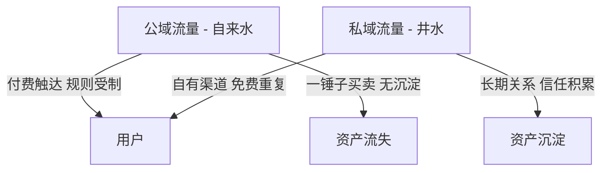
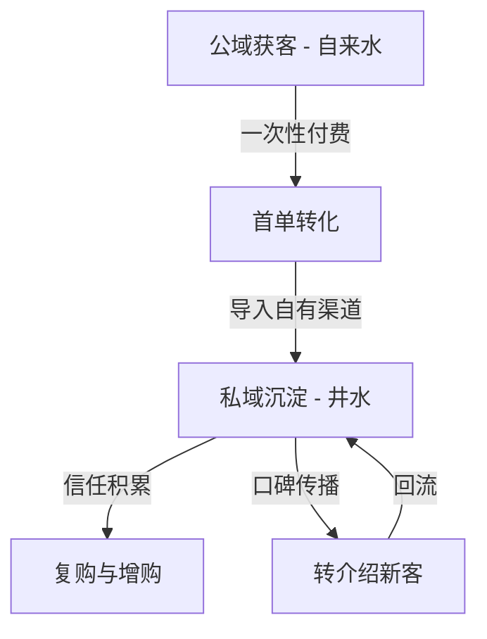

# 第 9 章 私域流量运营——信任驱动的客户关系

## 学习目标
- 理解私域流量定义本质及其与公域流量核心差异
- 掌握信任在私域运营中的核心地位
- 掌握先予后取原则内涵操作要点与边界条件
- 理解私域作为商业模式归宿的原因
- 能通过实证案例理解信任驱动的私域变现闭环

## 9.1 生活类比
私域运营就像自己打井取水。公域流量是自来水，付费即用，不付费即停，还得时刻受制于平台的定价规则和水管阀门；私域流量则是井水，打井虽然费时费力费钱，但一旦打好，用水免费，旱涝保收。这口井的水质就是信任关系，看似免费，却需要长期养护才清澈甘甜。先予后取，就是先修渠引水浇灌邻里，邻里自然帮你传扬井名；如果你只顾着抽水卖钱、过度营销，透支了信任，这口井便会干涸。

## 9.2 概念地图
```
私域流量运营方法论
├── 基础概念
│   └── 私域流量：自有、可重复、免费触达的用户池
├── 核心逻辑
│   ├── 信任是运营核心
│   └── 先予后取原则
├── 战略定位
│   └── 私域是商业模式归宿
└── 实证验证
    └── 赏金活动变现案例
```

## 9.3 私域流量——自己打的井才能天天免费喝水
> "私域就是那些你自己拥有、重复、免费触达的用户"（来源：《私域流量运营方法论》）

$$P_{\text{私域}} = \{u \in U \mid u \text{ 可被企业} \text{ 免费} \wedge \text{ 重复} \text{触达}\}$$

三个核心判据：**自有**（用户资产归属企业而非平台）、**免费**（后续触达无需额外付费）、**重复**（可持续多次触达）。

| 维度 | 公域流量（自来水） | 私域流量（井水） |
|------|-------------------|------------------|
| 成本结构 | 付费即用，按次计费，价格平台定 | 打井贵，用水免费，成本沉没在前 |
| 可控制性 | 规则多变，平台说了算 | 自有渠道，规则自主 |
| 用户关系 | 一锤子买卖，无沉淀 | 长期关系，可重复触达 |

**私域的边界**：私域不等于用户列表本身——如果只把用户拉进群却不经营关系，名单只是一本冷冰冰的通讯录。过度营销会导致井水干涸——持续刷屏、狂发广告，用户退群、取关、拉黑，私域资产瞬间归零。



## 9.4 信任为核心的私域逻辑——先有关系后有买卖
> "私域运营核心不是为了触达和营销"（来源：《私域流量运营方法论》）

很多企业把私域简单等同为"免费群发广告的渠道"。结果打开率越来越低、退群率越来越高。因为单纯依靠触达频次无法维持用户留存，你每次触达都在消耗用户的注意力。

$$R_{\text{用户留存}} \propto f(\text{信任深度}) - g(\text{触达频次} \cdot \text{营销浓度})$$

**信任先行**：用户购买行为由信任驱动，不是因为你广告来得勤而是因为信你。**抗扰动性提升**：信任关系下用户对企业失误容忍度显著提升。**去营销化**：用户因在关系中获得持续价值而留下。

**信任的边界**：信任是慢变量，需长期一致行为积累。且产品本身有问题时，信任会加速负面口碑扩散——信任是一把双刃剑。

## 9.5 先予后取原则——先给用户甜头再谈自己的收获
> "不要总想从用户身上获得什么，先想自己能带来什么""欲先取之必先予之"（来源：《私域流量运营方法论》）

用户加入私域的本质诉求是"给我一个留下来的理由"，而不是"给我一个被推销的理由"。

> **先予后取原则**定义（来源：《私域流量运营方法论》）

$$\text{用户终身价值} (LTV) = \sum_{t=1}^{T} \left[ V_{\text{给予}}(t) - C_{\text{获取}}(t) \right] \cdot \mathbb{1}[\text{信任}_t > \theta]$$

**行动前置于思考**：先问自己能解决用户的什么问题。**价值前置**：先输出干货福利服务解决方案，再引导付费。**可持续性**：给予与回报在正向循环中不断深化。

**边界**：先予不等于无底线免费（需平衡成本与服务能力）；后取不等于不取（建立信任后应适时自然引导转化）。

## 9.6 私域作为商业模式归宿——流量终局关系常青
> "商业模式的尽头一定是私域"（来源：《私域流量运营方法论》）

流量的增量时代已经结束，公域获客成本持续攀升，平台流量分发不可控。竞争的焦点从"获取新客"转向"经营老客"。

| 逻辑 | 核心命题 | 推论 |
|------|----------|------|
| 普适性 | 绝大多数行业结合私域运营能事半功倍 | 私域是通用杠杆而非特定行业特权 |
| 杠杆效应 | 私域与成熟商业模式结合 | 放大转化、复购、口碑传播 |
| 必然趋势 | 公域成本上升推动行业转向 | 私域成为战略必选项而非可选 |

**私域归宿的边界**：私域不能凭空创造需求——产品本身没有价值，私域只会更快放大失败速度。品牌初期仍应借公域获取初始流量，再沉淀入私域形成闭环。



## 9.7 赏金活动变现案例——信任变现三天五万
> "3天左右额外变现5万+"（来源：《私域流量运营方法论》）

这个案例的背景是支付宝的"赚钱红包"放水活动。运营者借助已沉淀好的私域信任关系和社群基础，把平台福利推荐给用户，3天左右额外变现超过5万元。

> **赏金活动变现**方法（来源：《私域流量运营方法论》）
```
1. 依托既有私域社群（已沉淀信任基础）
2. 筛选平台低门槛福利活动（支付宝赚钱红包）
3. 以"分享福利"姿态推送，而非"推销产品"
4. 用户零成本领取红包，获得直观收益
5. 运营者获得平台佣金奖励，完成变现闭环
```

**零成本高杠杆**（无需额外广告预算）、**低决策门槛**（赏金红包参与门槛低、获益直观）、**快速验证性**（验证先予后取积累的长期信任在适当时机可快速兑现）。

**案例的边界**：**冷启动社群不具备**（变现高度依赖已沉淀的信任基础和用户活跃度）；**收益波动性**（赏金收益随平台活动周期波动，不可作为长期稳定收入）。

## 9.8 多源对照
本节内容源自单篇素材，多源交叉验证不足，需诚实标注。

### 共识
现有素材范围内相关概念均出自同一来源，属于同一理论体系内部的一致性表述。

### 分歧
由于仅有单一来源，以下论断需要更多文献交叉验证：私域是商业模式归宿是否适用于所有行业；三天变现5万的案例是否可复制；先予后取原则的给予边界缺乏量化标准。

## 9.9 设计中的取舍
**为什么不用"高频触达"取代"信任构建"？**
高频触达见效快、操作简单、即时可测，但这是"涸泽而渔"——每一次触达都消耗用户注意力储备，储备耗尽用户退群，渠道归零。信任构建虽然慢，但它是复利资产：每增加一份信任，就降低一次转化成本。高频触达是"取"，信任构建是"予"，前者消耗存量，后者创造增量。

**这个设计的 trade-off 是什么？**
信任构建的代价是时间与耐心。在KPI压力下运营者很难坚持先予后取，因为给予的回报是滞后的。另一个 trade-off 是成本结构：先予后取需前置投入内容生产、社群运营、服务资源，而高频触达的成本是后置且不断上升的。

## 9.10 动手练习
1. 辨析自来水与井水的运营启示——三维对比公域私域，设计打井方案。
2. 判断对错：信任vs触达——判断五种做法是否体现信任为核心逻辑，提改进建议。
3. 情景模拟：如何践行先予后取原则——设计4周先予运营计划和后取转化方案。
4. 论证与批判：私域真的是商业模式归宿吗——多角度论证并批判，举反例。
5. 案例复盘：从赏金活动看信任变现——分析成功要素与冷启动不具备条件。

## 9.11 本章小结
这一章我们学习了私域流量运营的完整方法论。定义了私域流量是企业自有的可重复免费触达的用户池，本质是长远忠诚的客户关系；剖析了信任是私域运营的核心；介绍了先予后取原则；论证了私域是商业模式的归宿；最后通过赏金活动三天变现五万的实证案例验证了信任驱动变现的闭环。

| 概念 | 解释 |
|------|------|
| 私域流量 | 企业自有的可重复免费触达的用户池，本质是长远而忠诚的客户关系 |
| 公域vs私域 | 公域是自来水付费即用，私域是井水打井贵但用水免费 |
| 信任为核心的私域逻辑 | 私域运营核心不是触达和营销而是信任构建，先有关系后有买卖 |
| 先予后取原则 | 欲先取之必先予之，先思考能给用户带来什么再考虑自己的收获 |
| 私域是商业模式归宿 | 商业模式的尽头一定是私域，绝大多数行业结合私域运营能事半功倍 |
| 赏金活动变现案例 | 借助既有私域信任，通过低门槛活动实现零成本高杠杆快速变现 |

下一章中，我们将从"为什么做私域"转向"如何搭建私域的运营体系"，学习私域流量的具体承接载体、组织架构、用户分层运营和数据驱动方法。