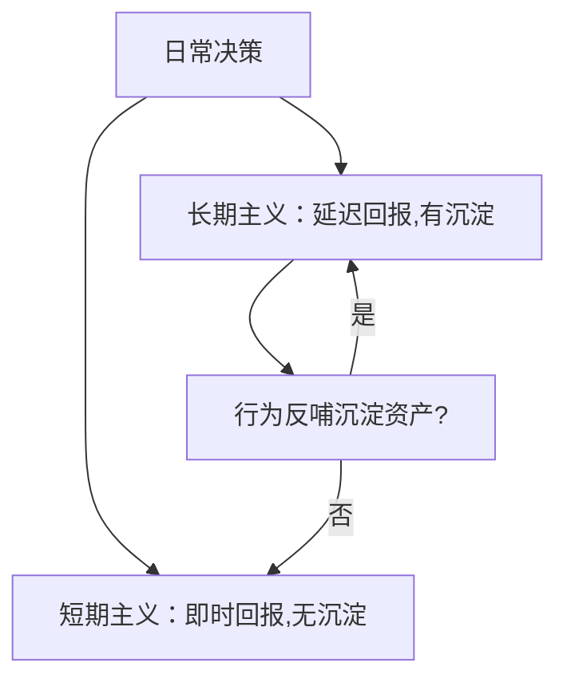
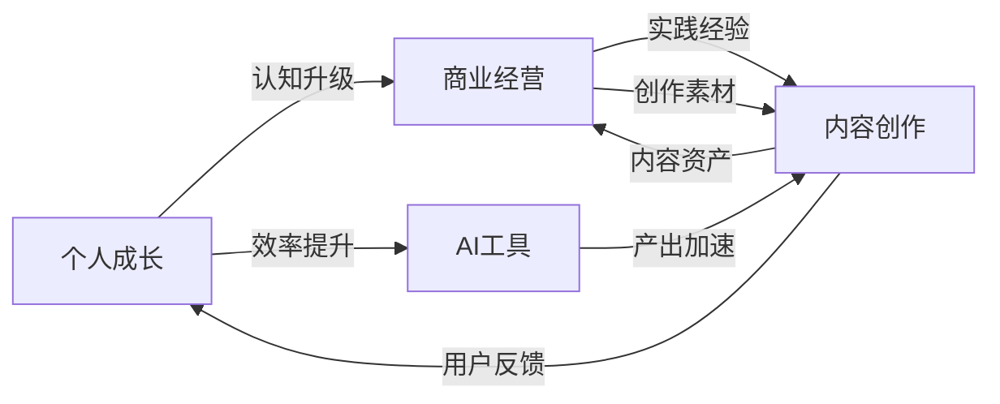

# 第 10 章 短期主义与长期主义——人生与生意的终极分野

## 学习目标
- 理解短期主义与长期主义的本质区别
- 掌握延迟满足与复利思维的心理机制
- 学会用资产而非余额视角评估决策
- 识别长期主义陷阱并建立防御性思维
- 掌握第一桶金性质决定后续命运的逻辑
- 能构建四维长期主义复利系统

## 10.1 生活类比
长期主义是一场种树与摘果的比赛：短期主义是摘下路边的野果，立刻填饱肚子，但明年还得重新寻找；长期主义是种一棵果树，前几年虽然不结果，但第五年起每年都有收成。延迟满足是忍住不吃种子，把它埋进土里；复利思维是果树每年结出的果子，一部分吃掉，一部分留作种子再种下去。沉淀是果树本身——它不依赖你每天的行动而独立存在；余额则是摘下来的果子，吃完就没了。第一桶金决定论则提醒我们：种子是优质还是劣质，直接决定了这棵树未来的收成规模。

## 10.2 概念地图
```
短期主义与长期主义
├── 本质分野：赚快钱 vs 做沉淀
├── 心理基础：延迟满足与复利思维
├── 判断标准：资产视角而非余额视角
├── 风险陷阱：过度坚守、机会成本、路径依赖
└── 系统构建：四维长期主义复利循环
```

## 10.3 短期主义与长期主义的生活分野——赚快钱与做沉淀的两条路
我们每天都会在"眼前收益"与"长远价值"之间做出无数次权衡。要不要接这个急单？要不要做这个一次性项目？要不要追这个风口？这些问题背后，站着两种截然不同的底层逻辑。

> "根本是短期主义和长期主义的较量""一定要做有沉淀的东西"（来源：《拼多多无货源系统方法论》）

**短期主义与长期主义定义**（来源：《拼多多无货源系统方法论》）
**短期主义**：追求即时回报的一次性收益行为，不产生可累积的资产。
**长期主义**：追求有沉淀、可复利累积的成果，即使回报周期漫长。

| 特征 | 短期主义 | 长期主义 |
|------|----------|----------|
| 收益速度 | 快 | 慢 |
| 根基深度 | 浅 | 深 |
| 复利性 | 无 | 强 |
| 资产沉淀 | 无 | 有 |

重要的边界条件：**服务于长期沉淀目标的短期行为应当被纳入长期主义**。比如为了积累启动资金而接短期项目，是长期主义的组成部分。长期主义不排斥短期盈利，关键是盈利是否反哺沉淀资产。



## 10.4 延迟满足与复利思维——让每一次选择都成为下一次的垫脚石
理解长期主义只是第一步，我们需要回答一个更根本的问题：凭什么相信长期主义值得等待？答案由两个互补的机制构成：延迟满足提供心理支撑，复利思维提供机制解释。

> "我们这一生得到的一切都源于我们满足了别人的需求""作者做内容创业五六年越做越好"（来源：《需求满足回报论》）

**延迟满足**：为了获取更大的长期价值，主动放弃即时奖励的心理能力。
**复利思维**：将每个阶段的成果作为下一阶段的基础，使增长呈指数而非线性。

序列 1, 2, 3, …, n 是线性增长；数列 1, 2, 4, 8, …, 2ⁿ 是指数增长。复利思维要求你用后者的眼光看待自己的积累。复利效应最显著的特征是：**前期增长缓慢，但越到后期越陡峭**。很多人放弃长期主义，是因为在前期看不到明显回报，但他们没有意识到复利曲线的拐点往往在坚持之后才出现。

复利思维还有一个容易被忽视的要求：**连续性**。复利的前提是本金不被清零，中断则复利断裂，前期的积累归零。

边界：**延迟满足的前提是长期方向正确**。**复利思维需要足够的时间窗口**，短于一个完整的回报周期，复利无法显现。

> 需求满足回报论（来源：《需求满足回报论》）

$$\text{一生的所得} = \sum_{\text{每次交互}} \text{满足他人需求的程度}$$

这个公式暗示：你得到的每一分回报，本质上都是因为你在某个时刻满足了别人的需求。长期主义的方向必须锚定在"持续满足他人需求"上，而不是"持续满足自己"上。

## 10.5 有沉淀的选择——用资产而不是余额来评估一件事
长期主义是一个抽象原则，但"我要做长期主义"并不能指导你明天该做什么。我们需要一个可操作的选择标准。

> "无货源沉淀的一定是店铺"（来源：《拼多多无货源系统方法论》）

**沉淀定义**（来源：《拼多多无货源系统方法论》）
**沉淀**：能脱离单次行为独立存在的、具有复用性和累积性的积累物。

| 类别 | 特征 | 例子 |
|------|------|------|
| 沉淀（资产） | 可复用、可累积、独立存在 | 店铺、用户、口碑、课程、系统 |
| 余额（消耗品） | 一次性收益、用完即止 | 单次佣金、一次性项目费、差价 |

> 判断沉淀的方法（来源：《拼多多无货源系统方法论》）
```
1. 问自己：三个月后，这件事还值钱吗？
2. 如果还值钱 —— 它就是沉淀，优先做。
3. 如果消失了 —— 它是一次性收益，谨慎做。
4. 如果答案是"能变成更多东西" —— 它是复利资产，持续做。
```

**边界条件**：判断"沉淀"时，必须区分"自己以为的沉淀"和"市场认可的沉淀"。一个无法满足他人需求的沉淀物，只是自我安慰的收藏品。"三个月后还值钱吗"的下一层追问是："你自己觉得值钱，还是别人也觉得值钱？"

## 10.6 长期主义的风险与陷阱——当坚守变成僵化，当复利变成侥幸
长期主义被过度美化之后，反而容易成为陷阱：人们把它当作逃避调整、拒绝改变的借口。

> "如果第一笔金带投机行为往后面临大坑"（来源：《拼多多无货源系统方法论》）
> "我们这一生得到的一切都源于我们满足了别人的需求"（来源：《需求满足回报论》）

**长期主义陷阱定义**（来源：《需求满足回报论》《拼多多无货源系统方法论》）
**长期主义陷阱**：因过度坚守而产生的机会成本、路径依赖与自我合理化。

| 陷阱 | 表现 | 本质问题 |
|------|------|----------|
| 机会成本 | 长期坚守单一方向，忽略更优路径 | 收益最大化 vs 方向正确性混淆 |
| 路径依赖 | 早期选择已证伪，仍因沉没成本难以放弃 | 成本沉没 vs 止损能力混淆 |
| 伪长期主义 | 把坚持本身当美德，回避对方向的质疑 | 手段 vs 目标倒置 |

> 第一桶金决定论（来源：《拼多多无货源系统方法论》）
$$\text{第一桶金的性质} \rightarrow \text{后续发展模式}$$
```
若第一桶金来自投机 → 路径依赖投机 → "坑越挖越大"
若第一桶金来自沉淀 → 路径依赖沉淀 → 越做越深
```

判断"健康的长期主义"还是"陷阱中的长期主义"，标准不在坚持本身，而在方向是否仍满足他人需求：

> 方向有效性检验（来源：《需求满足回报论》）
$$\text{方向有效} \iff \text{该方向上仍有被满足的需求} \land \text{你仍是最优供给者}$$

长期主义不是"永远不转弯"，而是"在方向有效时坚持，在方向失效时转弯"。

## 10.7 构建可持续的长期主义系统——让慢成为一种基础设施
单个长期主义决策无法形成合力。真正的持久竞争力来自**系统**——把多个维度的长期行为编织成互相强化的整体。

> "根本是短期主义和长期主义的较量""无货源店群底层逻辑：稳定是最好的发展"（来源：《拼多多无货源系统方法论》）

**长期主义系统定义**（来源：《拼多多无货源系统方法论》《需求满足回报论》）
**长期主义系统**：将个人成长、商业经营、内容创作、AI工具四个维度纳入同一套沉淀逻辑，形成复利循环。

系统的核心性质在于**正反馈**：一个维度的沉淀会成为另一个维度的输入。



> 单元循环（来源：《需求满足回报论》）
```
投入 → 沉淀 → 复用 → 再投入
```

以内容创作为例：你投入时间写文章（投入），文章成为可检索资产（沉淀），读者反复阅读带来关注（复用），关注成为下一篇文章的读者基础（再投入）。

两个边界条件：
- **AI工具是放大器，不是引擎**。系统能否运转取决于前三维度是否形成有效沉淀循环，AI只是让循环更快；如果循环本身不存在，AI什么都放大不了。
- **系统的持续性依赖外部需求的持续存在**。一旦需求消失，整个系统就必须重新锚定。

## 10.8 多源对照
### 共识
两篇核心素材都认为"沉淀"是长期主义的核心。无论个人的能力、店铺的评分、内容的影响力，都必须形成可脱离单次行为独立存在的积累。
### 分歧
- **【P117】侧重商业模式确定性**：第一桶金决定论表达对投机的警惕，更关注商业模式基因是否健康。
- **【P009】侧重外部需求导向**：需求满足回报论把"满足他人需求"作为一切所得的唯一来源，更关注方向的正确性。

两者的分歧在于：P117认为问题出在"起点性质"，P009认为问题出在"需求方向"。一个好的长期主义框架应同时包含这两个维度的检验——既要看起点是否健康，也要不断审视需求是否还在。

## 10.9 设计中的取舍
**为什么不用"只追求资产"的严格标准？**
如果"只做有沉淀的事"是唯一标准，那么生活中大量必要但确实没有沉淀价值的任务就无人处理。所以系统允许短期行为存在，约束条件是"短期行为的盈利必须反哺到沉淀资产中"。

**这种设计的 trade-off 是什么？**
用"可检验的沉淀标准"换取"对短期行为的宽容"。好处是决策标准清晰可操作；代价是判断"盈利是否反哺资产"仍需个体自己完成。

**为什么不用"长期主义=永不放弃"？**
如果长期主义等于永不放弃，那就等于没有退出机制。方向失效时，坚持的成本远大于放弃的成本。本框架引入"需求满足"作为动态检验：长期主义是"在正确方向上坚持"，而不是"坚持本身正确"。

## 10.10 动手练习
1. **识别你的十个日常决策**——回顾一周10个决策，分类为短期或长期主义，追问沉淀了什么、三个月后是否还值钱、可调整版本。
2. **第一桶金审计**——审视第一次赚较大一笔钱的方式，判断投机或沉淀，分析二桶三桶是否继承基因，设计"基因改造计划"。
3. **设计你的四维复利系统**——盘点个人成长、商业经营、内容创作、AI工具四维度沉淀，绘制数据流图，标注锚点，分析AI是放大器还是引擎。
4. **长期主义风险压力测试**——找出当前坚持的长期方向，用需求满足回报论做压力测试，检查需求是否消失、退出机制、是否陷入路径依赖。

## 10.11 本章小结
这一章我们系统完成了对短期主义与长期主义这一终极分野的完整剖析。明确定义了两者的本质区别；深入探讨了长期主义的心理基础——延迟满足与复利思维；建立了可操作判断标准——用"资产还是余额"评估决策；直面长期主义风险陷阱——机会成本、路径依赖、伪长期主义，并引入第一桶金决定论；最后构建了以个人成长、商业经营、内容创作、AI工具为四维的复利循环系统，明确了AI是放大器而非引擎的边界。

| 概念 | 解释 |
|------|------|
| 短期主义 | 追求即时回报的一次性收益行为，不产生可累积资产 |
| 长期主义 | 追求有沉淀、可复利累积的成果，即使回报周期漫长 |
| 延迟满足 | 为更大长期价值主动放弃即时奖励的心理能力 |
| 复利思维 | 每阶段成果作为下阶段基础，增长呈指数而非线性 |
| 沉淀（资产） | 可脱离单次行为独立存在的复用性积累物 |
| 第一桶金决定论 | 第一桶金性质决定后续命运，投机基因会把坑越挖越大 |
| 需求满足回报论 | 一切所得源于满足他人需求，长期主义需以他人需求为支点 |
| 长期主义系统 | 个人成长、商业经营、内容创作、AI工具四维复利循环 |

至此，全书十个章节全部完成，我们从"需求满足与竞争优势"出发，走过了个人成长、内容创作、副业与私域的完整闭环，最终落在长期主义的价值观上，形成了一个知行合一的成长与创富系统。