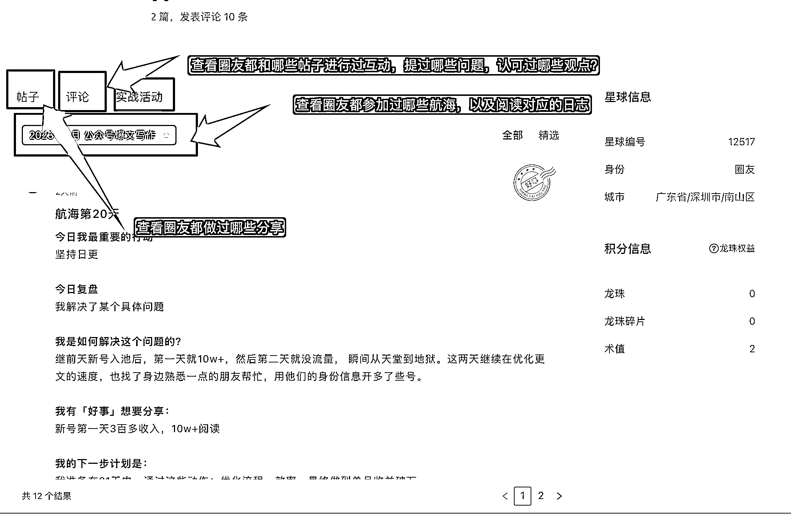
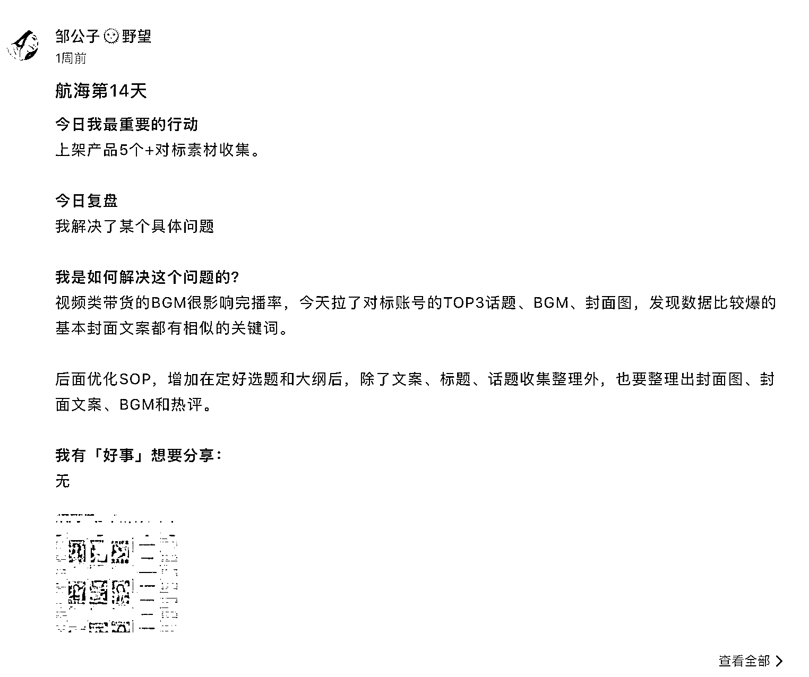
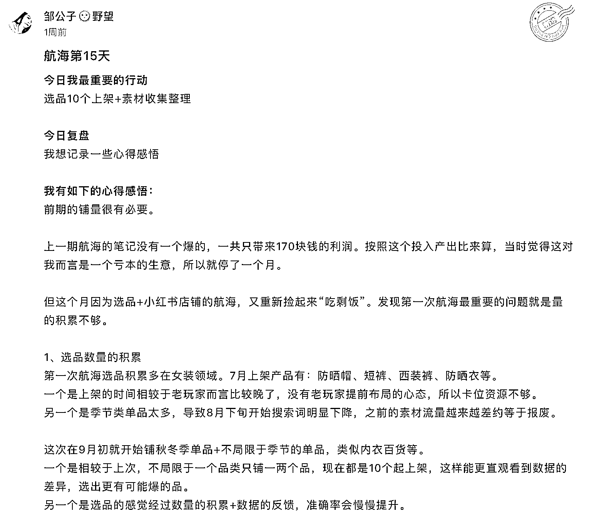

# ('如何靠近当下有结果的人？——航海好事使用指南', (2, 24))

新手入行最容易踩的坑是什么？不是不够努力，而是闭着眼睛瞎忙——看别人晒一张收益截图就热血上头冲进去，结果两眼一抹黑，做着做着开始怀疑自己，最后草草放弃。

之前和不少实战派连麦聊天，他们几乎都提到同一个理念：**做项目，要主动靠近那些此刻正在出成绩的人。**

别急着划走，这句话远没有听起来那么简单。

为什么要靠近？因为跟着有成果的人，你能收获三样东西：

第一，看清项目从0到1的真实全貌，而不是被一张好看的截图牵着鼻子走，凭冲动做决定。第二，确认自己正在练的玩法还没过时，操作没有跑偏，心里有底就不会内耗。第三，学到能落地的操作细节——理论家告诉你去哪，实战派教你具体怎么走。

这些问题解决了，焦虑自然就少了。

可问题是——谁是“此刻正在出成绩的人”？怎么才算“靠近”？

很多人第一反应是那些天天发精华帖的大佬，或者是官方认证的教练。对，但不全对。

有结果，得看是在什么事情上有结果。每位新手面临的困境，不只是技术上的：你可能在不同项目里反复横跳，可能因为期望太高而频频受挫，可能遇到问题不知道如何拆解，也可能只会机械执行、不会复盘总结。

那么，谁能在这些问题上真正帮到你？

在航海这个场景里，答案其实是那些和你同期参与、已经拿到成果的明星船员。他们的经验离你最近，最有参考价值。

怎么找？别费劲了，赚钱团队早就帮你筛好了。「航海好事」栏目和「精选日志」这两个地方，藏着大量这样的优质对象。

这就引出了那个关键问题：什么叫靠近？

说实话，看了一下最近的总结帖数据，很能反映人性：总结帖下面点赞一大片，被选为好事的报喜日志也有不少人点赞，但船员们记录日常动作的日志，几乎无人问津。

观众爱看烟花绽放，却没人关心火药的颗粒是怎么装进去的。

但正如我在直播间反复说过的——一直当观众，只会让你越来越焦虑。只有当参与者，你才有可能一步步走到舞台中央。

所以，回到那个标准：

给有结果的人点个赞，算靠近吗？
加个好友躺在列表里，算靠近吗？

都不算。

真正的靠近，是去看他的行动轨迹，去研究他做事的过程，去理解他如何一步步走到今天。具体怎么做？拿「航海好事」举个例子，三步走：

**第一步，初步筛选。** 进入「航海好事」，找到和你做同一项目的那批人。

**第二步，深度观察。** 点击头像下的「查看更多」，翻他的历史足迹——发过的帖子、留过的言、参加过的历次航海日志，尤其是实战日志。然后问自己几个问题：他的成绩可信吗？他起点如何？他踩过哪些坑、怎么爬出来的？其中哪些坑你也在踩，能不能照着他的方法填？

举个例子，这次航海中冒出来的圈友@邹公子🌞野望，翻她的往期日志，既能看到各种具体技术问题的破解思路，也能看到她经历过的没反馈、想放弃的时刻，她是靠坚持走到今天的。

这些记录，比任何总结帖都有价值。

**第三步，行动验证。** 当你通过上面两步确认这个人确实能帮到你，再考虑加微信、做付费咨询，进一步深入学习。

说句题外话，你也可以许愿，让这位伙伴上实战家访谈，和我一起把他聊透。

说到底，靠近的本质，是让你能看到有结果的人真实的行动痕迹。而大量圈友的珍贵行动痕迹，恰恰都沉淀在航海日志里——这是一座长期被忽略的宝藏。

以上这套方法，就是“靠近当下有结果的人”这句口号的落地指南。

我写这篇文章，更想让大家意识到一件事：知道和做到之间，隔着巨大的鸿沟。很多人听了道理就以为自己懂了，转头还是老样子，成了“高认知穷人”。

道理要变成你的，得经历四步：知道做什么，理解为什么做，学会怎么做，然后一遍遍实践，修正自己的认知和动作，最终知行合一。

如果你认同这个观点，不如现在就打开「航海好事」，按这个方法试着迈出第一步。

我是郭晓文，最懂新手的男人。