# 视频号创作者分成怎么拿到手？靠追热点做爆款就能吃到红利

> 原文：[`www.yuque.com/for_lazy/thfiu8/otd70vphmqgg6bhl`](https://www.yuque.com/for_lazy/thfiu8/otd70vphmqgg6bhl)

## (精华帖)(190 赞)视频号创作者分成收益怎么赚？追好热点，打造爆款视频

作者： 流浪虎

日期：2023-09-27

在视频号里，追热点、猎奇类、催泪故事、婆媳撕扯这类题材特别容易火，播放轻轻松松破十万。

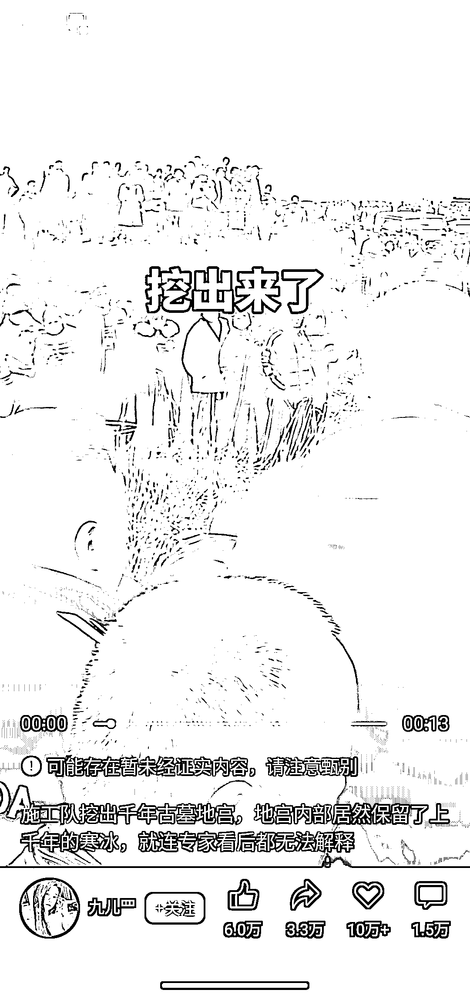

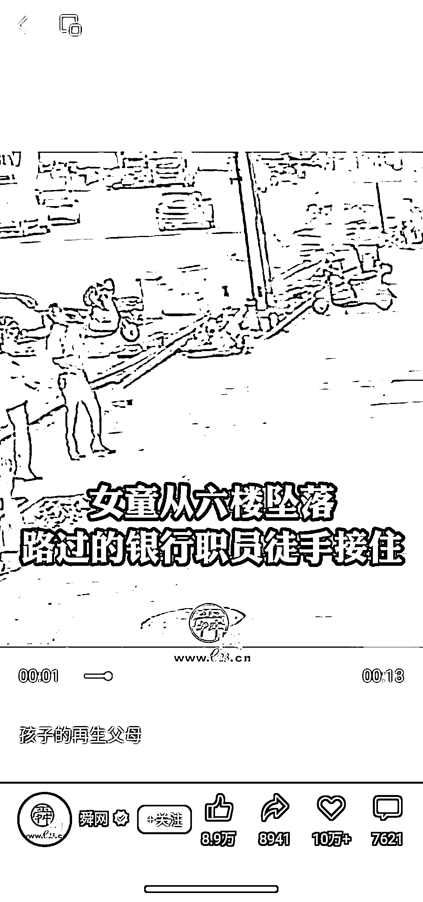

很多人好奇，这类十万加的号到底怎么把流量变现。

我现在就在做这个方向，下面就把这类账号的赚钱逻辑掏开讲讲，希望能帮到你。

玩视频号一个月，单日创作者分成最高冲到1500元+，粉丝累计9万+，单条最高播放608万，半个月到手3300元。

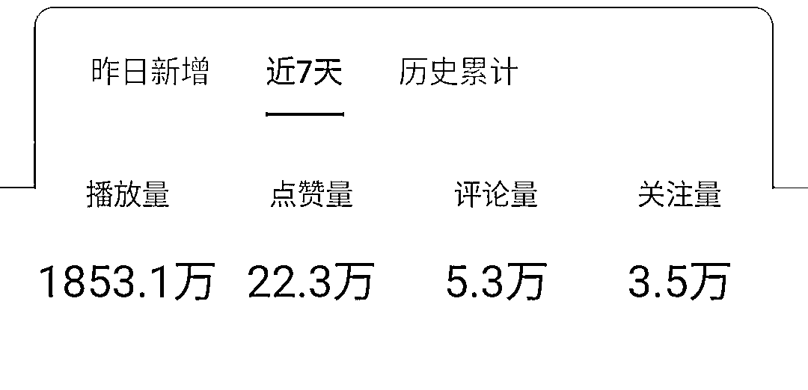

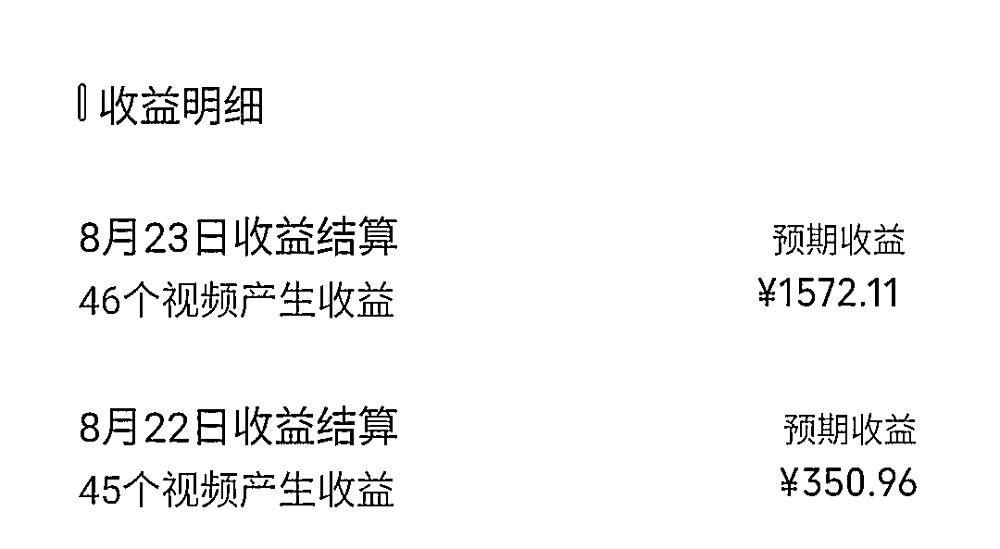

核心打法就是做热点视频发到视频号，靠创作者分成计划拿广告分成。

门槛不高，目前市面上卖课的不少，价格在499到1500不等。今天把整套流程一次性讲清楚，全文2700多字，想看更顺畅版可以走飞书链接。

### 一、项目介绍

视频号创作者分成计划是平台邀请制，开通后发布作品并勾选原创声明，评论区会自动挂广告，按点击效果结算。

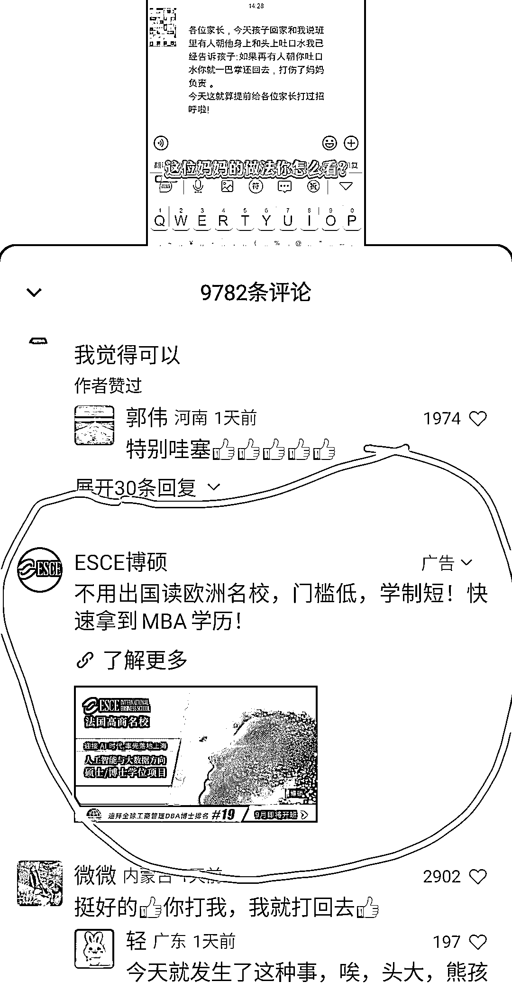

说白了就是视频版的流量主。公众号是图文吃广告，视频号是视频吃广告。

怎么看自己有没有被邀请：

**微信号主页--发现--视频号--右上角头像--创作者中心--创作者服务更多--收入变现**

能看到创作者分成计划就点进去开通。

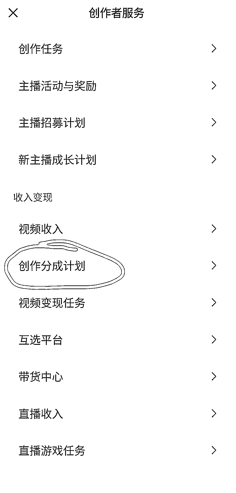

看不到就说明还没到邀请名单。有时候平台会发通知点开就能开，有时候收入变现里悄悄出现了，得自己点进去激活。

这个得自己盯。

怎么被邀请？

目前只有腾讯内部邀请，官方只给了模糊描述：持续创作优质作品。

实操经验是，账号干净没违规，爆2-3条50万到100万播放的作品后基本会收到邀请。

我手上4个号都开了，还有一个号累计播放破百万，到现在也没动静，多少有点玄学。

### 二、收益空间

腾讯没公布具体算法：

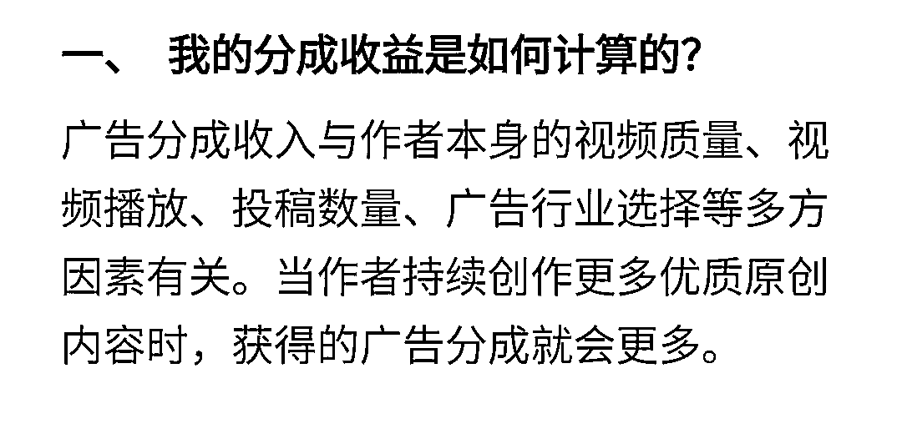

经验值是1万播放大概1块钱左右，最终还是看广告点击率。

有个视频才300多万播放，分成1500多；有个100多万播放只拿到30块。昨天一条79.6万播放的，收益122.93元。

波动很大，说不准。

### 三、实操玩法

做分成只要视频能爆就行，题材不重要。

现在视频号最容易爆的是什么？

热点、猎奇、爱国、见义勇为、暖心故事、婆媳矛盾等。

**猎奇**，找点稀奇古怪、抓眼球的事，抖音上一抓一大把，直接改编别人已爆的内容。

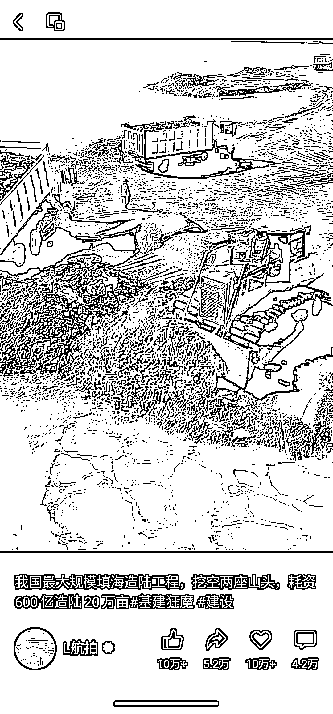

**爱国**，这类很敏感就不展开，平台上常火的有新疆西藏修铁路、港珠澳大桥、邮政骑马骑骆驼送信等。参考新闻联播风格，后半段内容平台给流量很猛。

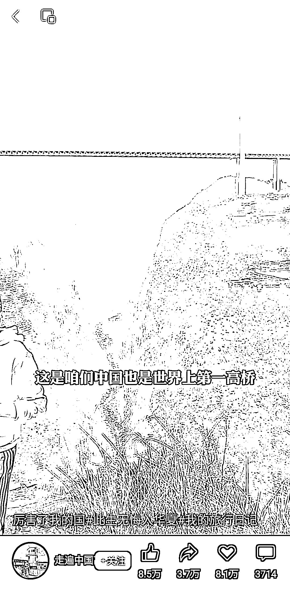

英勇救人，视频号用户偏中老年，特别吃这种正能量内容。

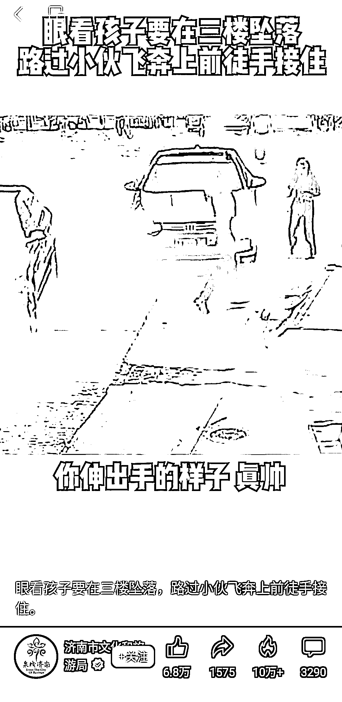

感人故事

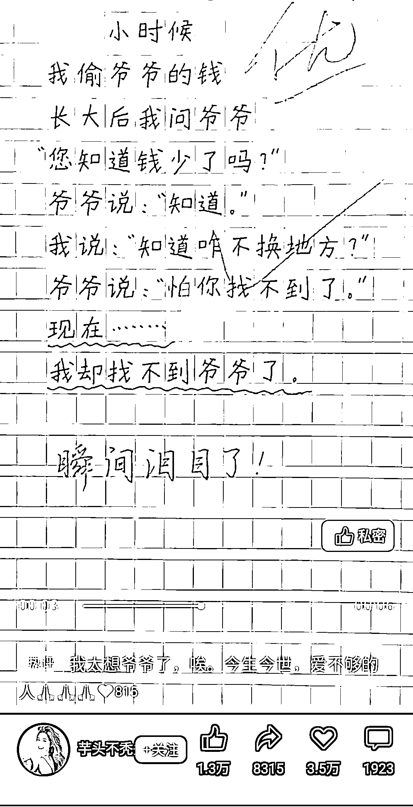

婆媳矛盾

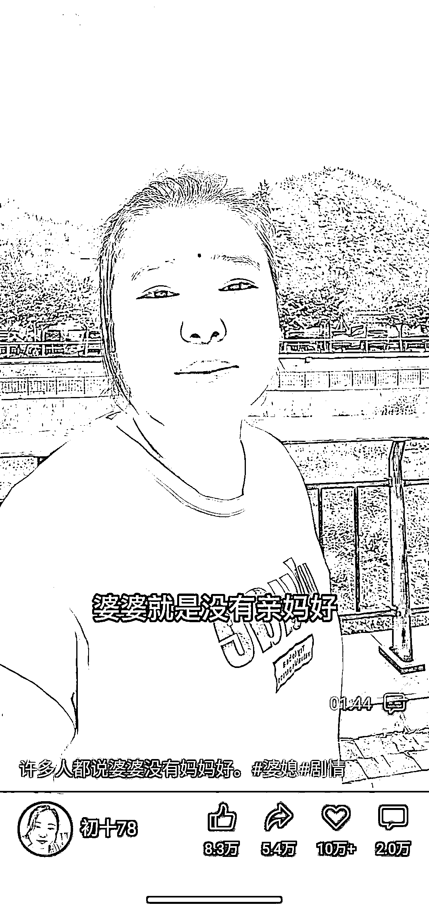

可参考的号：

**美摄安然；L 航拍；小啾啾 1987；九儿；感恩有爱小木屋；禅缘智慧；党史博采；**

**小茹观世界；琨少说说；心心的念叨；宝珠书道；玩玩娱乐；古董那些事；**

**王耳朵先生；红尘 7666；今古奇谈；12 月 ya。;杰哥看历史；罗兰妹妹；浅笑情感驿站等。**

呈现形式可以是视频，也可以是图文震惊体，图文制作更快，在视频号上反而更容易起量。

上面这些方向都能做，爆了就是好猫。

今天重点讲热点爆款视频的制作，其他形式大同小异。流程如下：

#### （1）锁定当天热点

找热点的常用渠道，抖音热榜、微博热榜。看多了就有感觉了，比如前几天的李佳琦相关：79元眉笔、西门子报警、蜂花商战；华为mate60发布、国产芯片；日本核污水排海；国足门将喝水事件等。

政治军事类热点坚决不碰，比如三胖访俄，擦边的也别碰，比如深圳北极鲶鱼事件。红线碰不得，封号事小，喝茶事大。

#### （2）找文案

热点锁定后就要找文案，自写也可以二改。

三招：

1、抖音上扒热点口播爆款，用轻抖这类工具抽文案，稍微润色换成自己的话。

2、打开360浏览器，首页全是热点新闻，长文转短文案，可用ChatGPT改，或者度咔剪辑的AI成片-AI改写功能。

3、直接去微博抄热点文案，改到像自己的就发。

控制在200-300字最佳，别超500字。

#### （2）制作视频

我们走的是批量打法，用数量冲概率，一条10分钟内搞定就行。

最快三种做法：

**1、口播：**

最省事，户外边走边录，对表达有要求。

**2、图文：**

一张图配音乐也常见，对文案要求更高。还有多图合成视频，3-4张图配多个标题，就是典型的图文震惊体，吊胃口。

前段时间好声音李玟相关，十万加的很多都是这种。剪映里做一个模板，后续只要换图换标题，3分钟出一条。

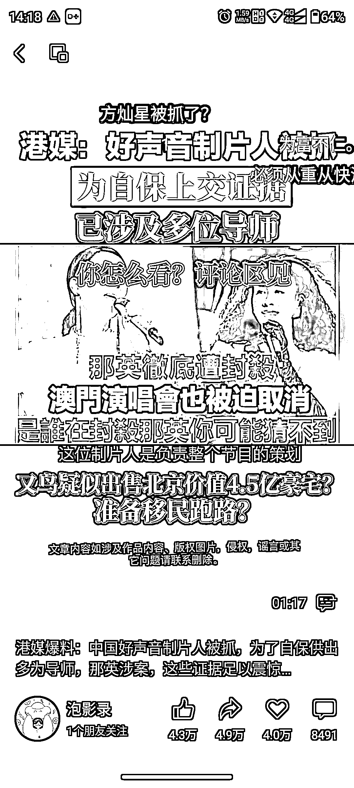

**3、软件一键文字成片：**

剪映一键成片、度咔剪辑都可以。度咔匹配画面更准，声音也更舒服，但对敏感内容会罢工，字数上限800字。剪映更宽松。

**4、发布视频**

手机发电脑发都行。有人说手机流量好，我最高的一条就是电脑发的。

发布要注意三点：

1、标题要抓人
2、标签必须打
3、标原创声明

发布时间隔半小时以上。

多号同IP同WiFi发有影响吗？没影响。

爆款可以授权给其他号重复发：

**创作者中心--创作者服务--更多--账号管理--原创保护记录--授权账号**

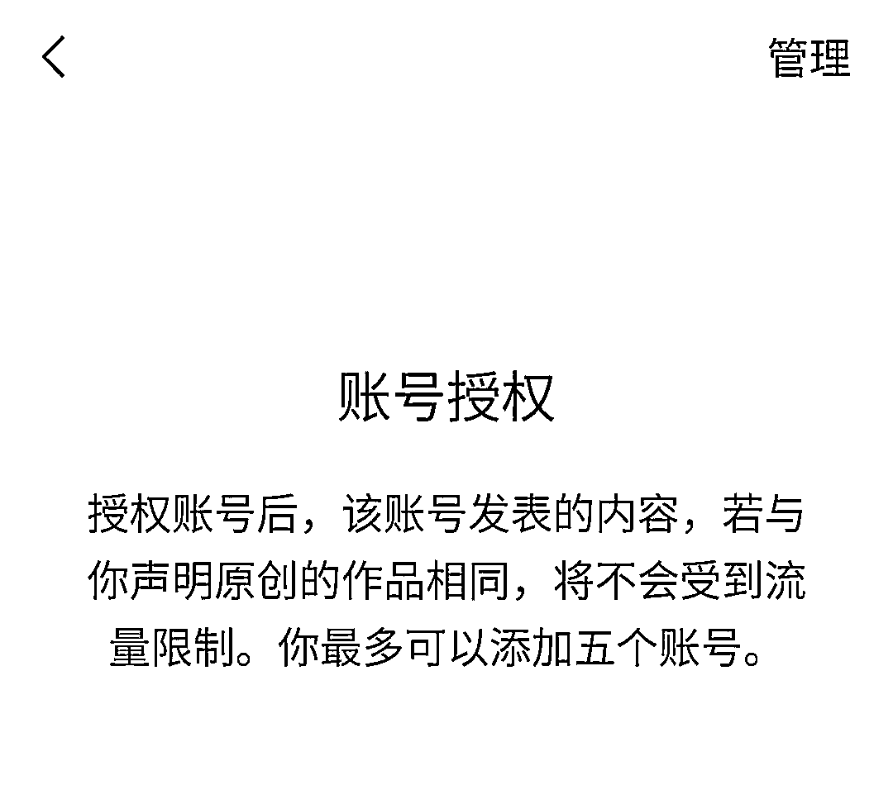

### 四、踩过的坑

市面上视频号撸分成的教程几乎没有，规则也是摸索出来的，坑一个没少踩。

4万粉的号和2万粉的号，都被关小黑屋一个多星期，每天只有几十播放。

总结的坑：

**1、忘了勾原创声明**

一条600多万播放的忘了开原创，估计亏了2000元。

**2、评论区失控被限流**

一条转发35.8万，评论太多风向歪了，评论被吞，号直接进小黑屋。爆款出现负面评论苗头，建议关评论区。

**3、一天发太多**

一天发30条，后来被关一周。一个号一天别超9条，5-6条最稳。

**4、翻炒太久远的爆款**

发了半个月前的老爆款，又被限流。老爆款能复发，最好1-2天内发，间隔太久会被判定搬运。

**5、大爆后必限流**

大爆后限流几乎是常态，一般7天内恢复，超过7天还不回流量，可能内容真有问题，可以换号。

### 五、总结

视频号创作者分成是刚起步的品类，参与的人不多，属于蓝海。

对比公众号流量主：

优点：比公众号更简单，图片图文也好爆，反馈快，操作简单不用梯子，一部手机搞定。
缺点：大爆后容易限流；开通门槛比公众号高；没开通前发作品没收益。

对比抖音中视频计划：

抖音中视频是按播放量补贴，属于平台抢中长视频的短期策略，现在红海严重，僧多粥少，收益只会降。

视频号分成不看播放量，看广告点击，钱是投放广告的人出的，平台和创作者双赢。

未来创作者越多、作品质量越高、用户越多，广告主也会越多。创作者有钱赚才愿意持续更新，不像B站那种为爱发电最后断更。

现在收益不高，但我看好长期。腾讯做事重积累，公众号养了十多年，视频号大概率也会走同样路线。

先涨粉再说，视频号在腾讯生态的位置，不会比公众号差。

最后说一句，无论是公众号流量主、抖音中视频，还是视频号分成，本质都是用内容换流量，是变现效率最低的一种方式。副业玩玩可以，主业不靠谱，收益不稳定。

* * *

评论区：

西沙 : 我混剪的超级容易违规[流泪]泪目

流浪虎 : 混剪流量一大收益都可能没收

世界倒着看 : 现在邀请应该不大好邀请吧

流浪虎 : 涨到 1000 粉，爆 2-3 个视频，就可能会收到邀请。

FF_23531 : 玄学，我小号爆了一个视频，涨粉 90，然后限流。后来花 50 加热了一个，粉丝涨到 300，发现开通了这个分成收益，是说航海没学到哈哈[强][强][强]

Waldeinsam* : 做了三天，前两天也没几个粉，第三天就突然被限流了，感觉被关小黑屋了

龙哥 : 感谢分享，已加精华。

流浪虎 : 感谢老大

* * *