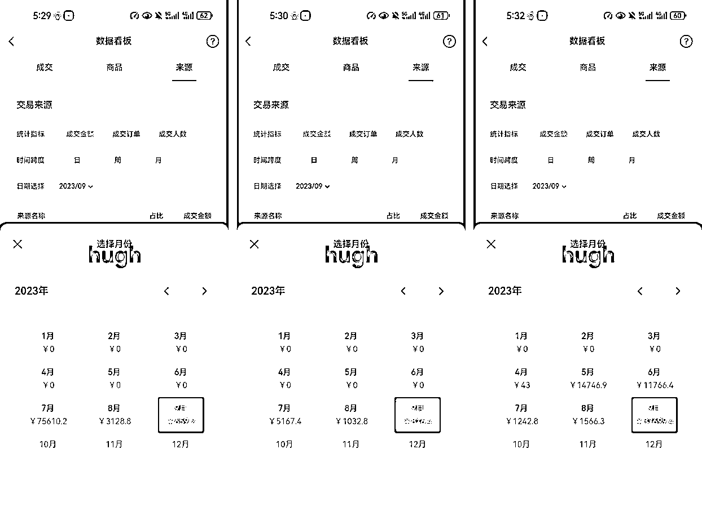
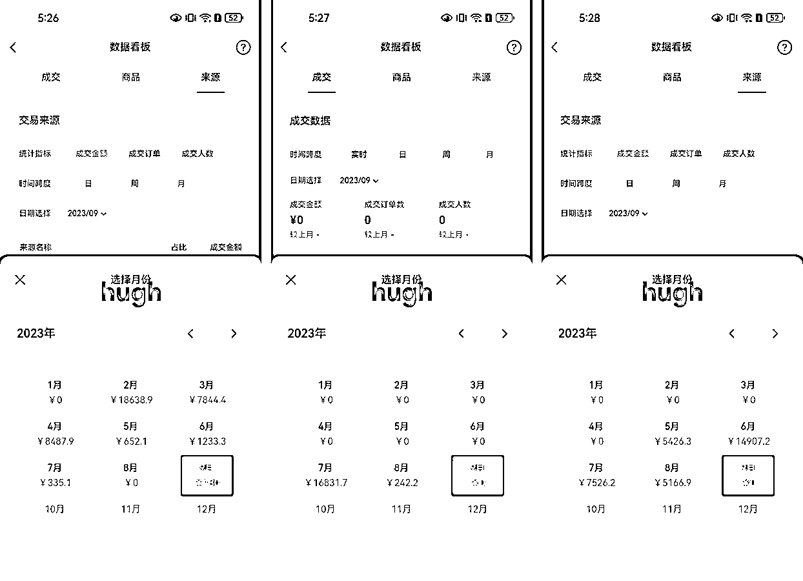

# 半年入账15万：我在视频号死磕一个小类目的实战复盘

> 原文链接：https://www.yuque.com/for_lazy/thfiu8/sprg68cyg1vdqaix

## 精华分享（165赞）：视频号小类目深耕，半年赚15w

作者：Hugh  
日期：2023-10-13

各位圈友大家好，我是Hugh，加入龙哥盟已经一年多了。从今年2月起，我把全部时间投入到视频号带货上。半年多的时间里，单品类累计销售额超过25万，毛利也达到了15万以上。下面这六张图，是我主力账号的真实成交数据。

和那些追求“快速打爆品”的大佬不同，我的节奏算是相当佛系——大半年只专注一个极度细分的领域。接下来，我从五个维度来聊聊这种玩法：

1. 为什么一个细分类目能让我坚持玩半年
2. 从零起步，我是怎么把月利润做到5万+的
3. 从几个号扩展到几十个号，需要掌握哪些基础能力
4. 做矩阵和后端时，我踩过的那些坑
5. 给还没跑通模式的朋友一些建议

为了更好的阅读体验，完整内容请移步飞书文档：[`i2mok5xev6.feishu.cn/docx/Y0hGduYtnot9WIxB1excr6S0nde?from=from_copylink`](https://i2mok5xev6.feishu.cn/docx/Y0hGduYtnot9WIxB1excr6S0nde?from=from_copylink)

* * *

评论区：
龙哥：感谢分享，已加精华。
龙哥：深耕不错，慢慢往上游走，成为细分领域的小品牌。
曼巴：非常实在，内容很干很有料。
Hugh：感谢龙哥，第一篇精华达成！
起轩：很实在的分享。
牧羊人：优秀！感谢分享。
云珞 YunL：很优秀，感谢分享。
芷蓝：有启发。

* * *