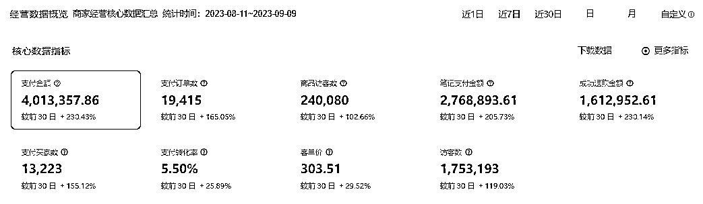

# 单店月销四百万GMV，我踩过的女装坑全盘托出

> 原文：[`www.yuque.com/for_lazy/thfiu8/vm2s9g80fwx68rq8`](https://www.yuque.com/for_lazy/thfiu8/vm2s9g80fwx68rq8)

## 小红书女装单店做到月销400万GMV的实战踩坑笔记

作者：嘉成
日期：2023-10-13

大家好，我是阿成，目前在小红书带队做店铺的航海教练，今天就把我们做女装这一路的实操经验摊开聊。

做女装这个赛道在我们内部是主流方向，我也一直建议团队往这条路走。原因很简单：女装上手快，见效快，多账号运作起来结果就更可观。固然这个赛道繁琐，选品、内容、售后全都要管，但很多人就是因为觉得琐碎就直接放弃了。只要你找到一条跑得通的效率路径，就能把结果跑出来，而这条路径的本质就是多号并行、反复练手。

不少同行想做女装也想做好女装，却对女装始终摸不着头脑，不知道核心抓手在哪，做久了只会怀疑人生。

先说一个关键认知。如果你是新手，千万别一上来就想靠一个单品打爆。在女装类目里，单品爆发通常是阶段性的，一个款能火一周就不错了。所以别看到别人一个款一直在推就觉得能复制过来，也去死磕一个款，最后大概率什么都得不到。

女装极度吃款、吃选品。热门款的生命周期很短，火得快凉得也快，有时两天流量就开始掉。因此当一个款起来了，我们的做法是立刻去找它的同款或相似款。女装的胜负手就是持续选品、持续测款，必须保持高频。我经常强调多选多测，但现实中很多人还是偷懒，就那两三件衣服反复做笔记，把素材稍微剪一剪就发，等着爆发。

我看过很多账号，拿着同一个品反复测，测到地老天荒也还是没单。封面、内容都还行，就是下单数起不来，或者只有零碎一两单，根本做不大。

其实没必要那么精细。我们手下不少账号剪辑都很糙，不可能每个号都做精细化运营，因为账号基数大。但封面一定要过关。起号期我们会一直上新、一直测，测出一个有苗头的款后，才会集中精力去精细化运营这个款，深度找素材、深挖内容。流程走顺了，事情就变得很简单。

在我看来，女装的本质就两个字：上新、选款。

小红书的上新不是单纯把商品挂上去，还得配内容。内容数据加上商品数据一起看，才能判断这个款值不值得继续推。所以总结下来，女装核心就是款，拼的就是选款能力。

想把选款做成，靠两件事。第一是单款的命中率，挑一个款就更容易中；第二是上新的体量。因为就算高手选款也不是百发百中，所以必须靠数量来摊薄风险。

所以策略只有两种：要么把命中率提上去，要么把上新量堆上去，最好能同时做到。归根结底，所有问题都要回到选款上来怎么解决。

不同人解决选款的方式不一样。有人会找懂穿搭的女同事来一起选，比如我们团队一个人在测窄脚牛仔裤，女同事说现在大家更偏爱宽松慵懒风，我一看数据，爆款裤子确实都是这种风格，糯米裤、山本裤、奶西裤一堆，肌理感、清冷感的都有。他顺着这个方向选了几条，其中一条红白条纹的裤子我觉得丑到离谱，结果却爆单了[狗头]

我们也有两种打法。一种是靠海量上新练手。我刚开始选款也不准，但靠大量上新慢慢练出来了选款的感觉，也沉淀了自己的运营思路。测到一个款后，就围绕它找相似款，这样很顺。起初测款很累，一直在找新款测，后来调整策略：测爆就跟爆款找相似款，效率高很多。

另一种伙伴没资源、没女员工、也不愿意每天找大量款。那他的解法就是抄。大把时间泡在小红书、灰豚、蝉小红上，盯近期销量高、起量快的笔记，尤其是低粉爆文、刚起来的新款，直接抄、直接跟。

需要强调的是，起号期不是只挑一两个品反复做。起号头一周，甚至更久，都是在疯狂挖掘爆款并跟进，每天都要有新款上架，每天都要发新款笔记。

**如果你的审美敏感度不够，不知道款好不好看，有两个笨办法：第一抄爆款，爆什么跟什么；第二抄爆款的相似款。**这两个动作执行到位，成功率会大幅提升。在此基础上再结合预售款，也就是新款一起测，思路手册里也提到过，可以再回头看。

总结选款的打法就是四个字：抄、测、怼。

前期大量抄、大量测、大量怼，靠概率也能博出几款爆品。一旦爆了，再用我们的爆单后运营方法，这个号就稳了，后续可以用同样的方法起新号。

没有数据不是因为方法不对，而是测得不够。不是几篇笔记就能判定一个品。哪怕一个款先发一篇笔记测一下，有数据了再做延伸也完全来得及。举个例子，一天上10个品，每个品发1篇，第二天把数据差的淘汰，把数据好的延伸，同时继续测新款。对款的理解也是靠大量测出来的，这一步绕不开。所以做女装一定要勤快，多选、多看、多测。

执行力必须拉满，怼也要怼出一个苗子来。一个款不行，延伸再多笔记也没用。要灵活，一个款先发一篇测手感，把选款能力先练出来。

我们爆过的女装，回头看大多就是款好看。款好看，素材自然不会差。有时候2、3百赞的笔记也能出单，就是因为款自带购买力。也有一些款感觉很怪但莫名其妙就爆了，后来才总结出它好看的点在哪。但前提都是大量跟爆款、抄爆款、怼笔记怼出来的。发现了爆点的特质，下次选款就有经验可循了。

每个赛道都有一个绕不过去的卡点，你找到那个卡点并用你自己的办法解决掉，基本就解决了大半问题。

看完后你可能会豁然开朗，也可能觉得太麻烦。不用过度纠结，想一百遍不如做一遍。适合自己的才是最好的。你也可以选择更轻松的赛道，比如百货、零食，挑几个品长期打，减少选款负担，把精力放在内容上。

**关于女装售后：**

小红书女装售后问题多，这确实劝退了很多人。但归根结底，售后多是因为源头没选好。做低客单、做低品质，售后必然多。解决办法要从源头抓起，找到靠谱的优质供应商。高客单高品质的女装能显著降低退货率。

选品时还有一个误区，就是总想找高品质高利润低成本的宝藏款。不要拿市场价做简单对比，这个逻辑不成立，也会干扰你对消费者真实需求的判断。

**结尾：**

小红书这个项目理论上一定能做成，关键在于速度快慢、结果高低的问题。想在这个平台拿到结果，需要记住两点：1.不要死磕一个店铺；2.不要死磕一个品。

别纠结，该放弃的店铺就放弃，不行的品就换掉。项目的本质是靠大批量选品、测款，测出一个好款再把它打爆。

另一个逻辑是我们在做新媒体，店铺只是承接的工具。核心是在小红书做笔记，做内容，新媒体本身就有概率属性，不可能百分百起号。

市面上很多所谓的7天起店、各种花式起店法，本质还是内容+选品。这两项能力不是一天能练成的，需要不断打磨、找手感、练网感。能在7天内起店的人，综合能力已经非常扎实，要么在其他领域有深厚基本功，要么账号做得多，运气也占一部分。他们不会告诉你中间经历了多少困难，因为说了你可能就不做了哈哈。

所有的方法论都是为了提高成功概率。学完方法论要去执行、测试、试错、总结。遇到问题就解决问题，关键是总结问题出在哪，方向别错。所以别追求完美，大胆试错。试错的成本远低于错过的成本，该加店就加店，该换品就换品。

祝各位在赚钱做小红书女装的朋友，坚持测品。当你勇往直前，路自然会被你推开！

* * *

评论区：

书豪 : 阿成牛逼，女装大佬[强]

安俊 : 成哥真的有实力也很真诚！

Rex : 你好 同做小红书女装 方便加个 v 吗

* * *