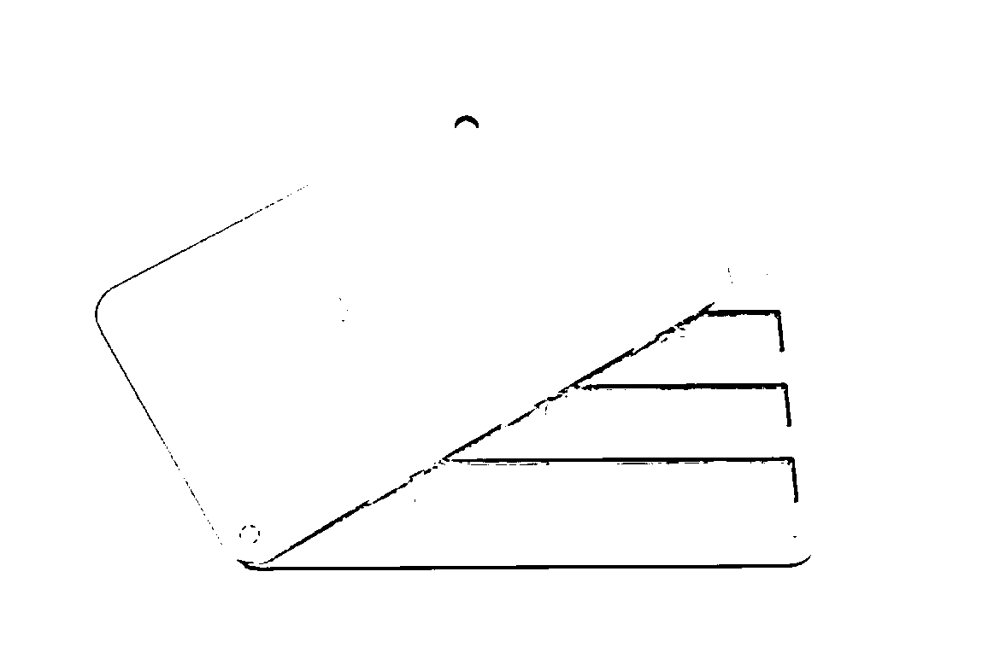

# 在 Web3 里怎么把时间变现

> 原文：[`www.yuque.com/for_lazy/thfiu8/mx3ddnighnzzf5mn`](https://www.yuque.com/for_lazy/thfiu8/mx3ddnighnzzf5mn)

## 精华帖 如何在 Web3 领域赚钱

作者：Keegan 小钢
日期：2023-10-07

**我的入场轨迹**

第一次碰比特币是 2013 年。那会儿只是随便查了查就看好它，本想入手，却被当时鱼龙混杂的交易平台和不会自己建冷钱包的现实劝退了。

真正二次入场是 2017 年，比特币一周内从 5000 人民币冲到 10000 人民币，这次我开始系统啃区块链的底层逻辑。读过的几本书分别是：

1. 《区块链：新经济蓝图及导读》，同事推荐，从 1.0、2.0、3.0 的宏观视角建立框架。
2. 《区块链：技术驱动金融》，用技术语言讲清比特币运行机制。
3. 《区块链技术指南》，更底层，涉及智能合约和超级账本，是上一本的进阶。
4. 《区块链革命：比特币底层技术如何改变货币、商业和世界》，通盘梳理理论与应用。

读完后我确信，区块链的本质是重塑社会生产关系。于是 All in，进了现在的 Web3。

到今天在这个赛道已经深耕七年多，在技术圈算是小有名气，写过的技术文章比如《万字长文聊聊 Web3 的组成架构》也被不少人转阅。现在的状态是半自由职业，和几个项目方保持长期合作，主要做技术研发和研发团队管理；另外也在做付费课，带新人入门 Web3 技术，正筹备新的课程体系，也在考虑是否做一个 Web3 赚钱社群。

这几年尝过甜头，也摔过跟头。最高光时一个月用 10 万本金做到 100 万，最疼时也经历过多次资产归零。历练下来，投资和技术两条线都成长了，也让我有了多条在 Web3 里赚钱的能力。下面是我的实战总结。

## 先把安全盘清楚

Web3 最怕的不是赚不到，而是赚到了却因为安全意识不足一夜回零。

钱会消失的场景很多：中心化交易所跑路、助记词私钥泄露、参与的 DeFi/GameFi 项目被黑、遇到诈骗。

很多人图方便把资产长期放在 Binance、OKX、Coinbase、Bybit、Bitget 这类中心化交易所。可连全球第二大的 FTX 都能说倒就倒，中心化平台的安全性始终存疑。即便是头部交易所，也避不开黑天鹅。我自己绝不会把大额资产长期留在交易所里。

我更习惯把资产放到自有钱包，日常交易直接用 Uniswap 这类去中心化交易所，兼顾效率和主权。钱包也不是一个，习惯分散到多个地址，其中大部分放进硬件钱包里。硬件钱包只认 Ledger、Trezor、OneKey 这些老牌，并且必须官方渠道购买，渠道不对安全无从谈起。

助记词和私钥必须离线保管。有人嫌麻烦把助记词存云盘，这就是定时炸弹。龙哥就曾把助记词写进云笔记，导致私钥泄露损失八位数比特币。现在市面上有助记词钢板，防水防火防腐蚀，比如下面这个：

开发时还有一个易踩坑点：测试网和主网混用同一个钱包。身边就有同事用同一个钱包主网收款，结果几十个 ETH 被转走。我自己也踩过，好在那次金额很小。

另外我很少追新项目。薅羊毛、追空投看似性感，实则费时费力还费钱，还常被反薅。知名新项目又更容易被黑客盯上。真要参与，也控制在小范围小资金体验即可。

## 用劳动换稳定现金流：全职入行

加入 Web3 公司全职打工，是最常见也最稳的路径。

上一轮牛市里，Web3 的薪资普遍高于 Web2，人才缺口大，机会多。现在熊市，整体行情不佳，但入场门槛变高了，Web3 知识体系和 Web2 已经差异很大。

拿技术岗举例，最抢手的智能合约工程师，光会 Solidity 不够，还得会 Hardhat 测试部署、会搭 Subgraph、懂预言机和 Keeper、熟悉 ERC20/ERC721/ERC1155 等标准协议，并对 Uniswap、Compound 等经典项目有实战拆解能力。这些对新人来说都是学习清单。

熊市看起来冷，其实是学习的窗口期。提前把能力补齐，等下一轮招聘潮来时，你的竞争力会远高于临时抱佛脚的人。

## 用经验变现：开技术课

技术人可把沉淀的知识产品化。我本身做技术多年，又有自媒体积累，所以能靠课程变现。没有流量基础也可以和有流量的大佬合作推广。

目前我只开了一门录播课，面向从 Web2 转 Web3 或初入 Web3 的研发人员，聚焦兼容 EVM 链的 DApp 应用层开发，而非链底层。十节内容分别是：

1. Web3 基础概况：Web3 是什么、组成架构、现状趋势、DApp 技术架构。
2. 智能合约技术和语言基础：钱包基础、EVM 原理、Solidity 基础。
3. 智能合约开发测试部署：Infura、Alchemy、Etherscan 等工具，Remix & Hardhat 实操。
4. 标准 Token 协议：ERC20、ERC721、ERC1155、SBT、ERC3525。
5. 价格预言机和 Keeper：Chainlink、Uniswap TWAP，如何用 Golang 实现 Keeper 服务。
6. 数据索引服务 Graph：Subgraph 的开发与部署。
7. 前端 Web3 框架：MetaMask API、ethers、wagmi 示例。
8. 剖析 Uniswap 协议：V1、V2、V3 代码与机制。
9. 剖析 Compound 协议：借贷模型、利率模型、利息计算、清算机制与清算机器人思路。
10. 详解实战项目：用 UniswapV2 + Compound 实现杠杆借贷，串联完整 DApp 技术栈。

这本质是一门 DApp 全栈课。受出版社邀请，我在基于此写书，熊市拖慢了出版节奏。下一期课程和更高阶课程也在规划中，会联合其他技术大佬。

开课最关键的是行动力。很多人总觉得不完美才不敢开始，其实时机到了就先上，缺口会在推进中被倒逼补齐。

## 接外包：把复用来做成利润

有技术背景的人可以接 Web3 外包。前端、智能合约、测试是最缺的人才，牛市时新项目急需人手，但全职招聘成本高，更倾向兼职或外包团队。

有项目方本身没有研发团队，会把整套系统外包出去，能组团队就更容易接大单。

但不是所有外包都值得接。我只接复利型项目。比如我早年拆解过大量 Compound 的文章，对其非常熟悉。后来项目方找我 fork 一套 Compound，包含智能合约、Subgraph 和清算服务，只做少量调整。我已有成熟模板，花很少时间就能交付，于是接了好几单同类项目。

另外可以从自己的课程学员里挑优秀者组队，做系统性外包。我负责统筹，学员得实战、拿报酬，双赢。

长期稳定合作的外包也很有价值，除了收入还能持续提升能力，我前东家的项目组就长期合作两位外部兼职技术。

## 做顾问：拿股份一起创业

资深技术人可以和项目方建立长期顾问关系，每月拿顾问费，同时拿股份和币权，本质是合伙创业，我现在的固定收入主要靠这一块。

当顾问必须谈股份或币权，否则和打工无异。评估前景、尽早写进合同很重要，不然项目起来后容易扯皮。

不一定非要技术背景，运营、金融产品设计、资源对接等优势也能担任顾问。我前东家就有位金融顾问，主导了早期金融产品设计。

Web3 团队普遍分布式、远程、商业模式不同于 Web2，优秀的个体很容易同时参与多个项目，这就是个体崛起的时代。

## 低风险生息：把闲钱放进 DeFi

熊市或闲置资金，适合做低风险的 DeFi 生息，主要是流动性挖矿。

我最近在 Aave 里 Supply 稳定币赚利息，USDC 使用率最高时 APR 在 2%-5%，高峰甚至超过 10%。

Compound 同样支持 Supply 稳定币赚利息，USDC 存款 APR 常在 3% 左右，再叠加挖矿 COMP，APR 约 1.5%，合计约 4% 以上。

今年 5 月上线的 Spark Protocol 存 DAI 利率一度到 5%，收益不错，但项目新，建议仓位控制。

头部 DEX 的流动性挖矿也可以做，如 Uniswap、SushiSwap、Curve，通过提供 LP 赚取交易手续费分成。选池子要看交易量，Uniswap 上 USDC/ETH 的交易量远高于 WBTC/ETH，量大收益通常更稳。

LP 会有无常损失，本质是机会成本：做流动性和不做流动的价值差异。如果长期持有代币，在剧烈波动期提供流动性可能不如直接持有；在震荡市提供流动性则更合适，手续费能抵消损失风险。持有时间越长，手续费累计越多，覆盖无常损失的概率越大。

新手想参与这些，需要先补基础：建钱包、连接钱包、Gas 概念、用法币买币、查资产等。最省事是找老手带一把。

## 价值投资：长期定投等牛市

数字货币没有价值是偏见。比特币从 2009 年走来 14 年多，若无价值早已归零。长期投资的核心资产目前最稳妥是 BTC 和 ETH，其他币很难保证十年不被淘汰。

蓝筹代币则可以精选赛道龙头，如 DEX 的 UNI，借贷的 COMP、AAVE，Layer2 的 ARB、OP 等，牛市里适当配置。

我的策略很笨：熊市定投囤币，牛市分批卖出。

常用指标是 Bitcoin Ahr999 Index。低于 0.45 时相对底部，可放心抄底，分批建仓更好，每次探底再加码，降低成本。0.45-1.20 区间也可定投，按天按周执行，有朋友写程序按小时定投。

判断顶部远比底部难。操作上可以设定预期目标价，分批止盈，比如每创新高就减持一半，落袋为安的同时也能吃到顶部利润。

长期持仓期间，还可以把资产放到 Compound、Aave 等平台赚利息，持币等涨的同时多一层收益。

这个策略简单却考验耐心。我自己也曾贪心想高抛低吸，结果操作失误把价值投资做成投机。

资产配置上，我的规划是下一轮牛市 BTC+ETH 重仓占 50% 以上，Layer2 占约 30%，分布式存储占约 20%。

## 高风险博弈：加杠杆做合约

高风险就是杠杆期货。一旦爆仓，保证金清零。我被爆仓过很多次，也尝过 10 万本金一个月变 100 多万的快感，但这样的机会不是常态。

这块极度考验交易经验和人性，尤其是贪婪。我的爆仓大多源于控制不住贪心。

做合约必须严控风控，否则很难持续盈利。我坚持的基本准则是...

先把定位想清楚。做高弹性、高杠杆这块的盘，最根本的用途是为价值配置和稳健配置攒子弹，而不是把它当成一夜暴富的捷径。方向一旦反了，就别碰合约。顺带一提，我自己玩合约还有个额外的训练目的，就是磨盘感。磨了几年才有点感觉，也才做过十万本金一个月翻到百万的行情，但这条路的学费同样不便宜。

仓位上一定要守住主次。把 90% 甚至更高比例的资金放在价值投资和低风险的布局上，留个最多 10% 的小池子去玩带杠杆的高风险博弈。哪怕这部分亏完，也不会伤筋动骨。

顺势是底线。趋势向上时只做多不做空，趋势向下时只做空不做多，逆势博弈的胜率和心态成本都不划算。

进场点位比方向更重要。准备做多就等回撤到支撑区再动手，目标价没到就空仓等，不要追涨。进场也不要一次梭哈，至少拆成三笔，可以按第一二三支撑分层挂单，也可以用价格阶梯挂，比如每跌 500U 接一笔。爆仓线的设置要留足安全垫，至少放在现价 20% 以下，最好能放到 50% 以下。牛市里回调后继续跌超 20% 的概率很低，但放在大周期里，按波浪来看必有几次深度回调，跌幅有可能超过 20%。在这种大回调窗口，最好的做法是别抢，等到位了再分批上。

上去了怎么走也很关键。价格涨到预期压力位出现滞涨，就开始分批落袋，同样拆成三段，每过一个压力位就收一笔，然后再耐心等下一次回撤的建仓机会。

阶段性目标达成后，最重要的动作是把本金和利润抽出来，转移到低风险或价值端去复利。这才是高风险盘真正发挥作用的闭环。

把上面这套流程循环下来，本质就是用受控的杠杆去做低风险高收益的增强。成败就看三点：爆仓价是否足够安全、是否能等到合适的建仓时机、是否不贪及时止盈止损。道理很简单，做起来很难。

#### **以上是我目前所知道、亲身经历或正在验证的 Web3 领域的一些赚钱路径和操作逻辑。市场上当然还有别的打法，比如我可以做 Web3 变现社群，也能把自己的交易策略做成程序化工具供给付费会员使用。还有不少我不熟悉的模式就不展开了。总的来说，Web3 的机会依然很多。**

* * *

评论区：

无忌 : 我对技术领域不是很熟悉，也是 17 年入坑，中间经历过暴富，也体验过归零。

币圈除了技术其他资源都有[捂脸]，有机会多交流

Keegan 小钢 : 我也同样经历过暴富和归零

木心 : 同样经历

Hope : ahr 指数只能是个参考

Keegan 小钢 : 没错，是个参考指数

龙哥 : 感谢分享，已加精华。

　　　　　　　　 : 如何看你的课程呢？

Keegan 小钢 : 是说我的 Web3 技术课程吗？目前主要通过微信，你可以加我微信：keegan704

* * *