# 用 QQ 频道把私域做到 1500 人，关键全在选词上

> 原文：[`www.yuque.com/for_lazy/thfiu8/aq0v4g0i2ixrt8xz`](https://www.yuque.com/for_lazy/thfiu8/aq0v4g0i2ixrt8xz)

## QQ 频道怎么在不烧钱的情况下把 1500 人拉进私域？答案是选对关键词

作者： 易小北

日期：2023-10-09

QQ 频道这个引流阵地，很多人压根没注意到，却是实打实能做流量的入口。

我这次就是靠一个做演唱会的频道，把微信私域拉到了 1500 人。下面把我在 8 月 21 号实操的风向标拆开讲讲，给想做的朋友一个参考。

大家好，我是易小北，长期做 QQ 号 SEO 引流，之前做过 400 多个茅台酒相关的长尾词 QQ 群。今天分享的是演唱会这个案例的完整复盘。

靠 QQ 频道的搜索机制，单单吃“演唱会”这一个核心词，就把微信引流到 1500 人，还把三个票务交流群给填满了。刚上手的时候，整个搜索结果里就我一个人在做。

等流量起来后，模仿的人蜂拥而入，其中两个频道因为违规被干掉，搜索里直接没数据了。我靠着搜索演唱会实现了首页霸屏，三个自己做的频道都上去了，最高一个频道进 1000 人，设置成加入自动推送微信号。后来同行越来越多，我才把这个词公开出来。

图 3 是当时零竞争的状态，关键词就不公开了，不然又要被抢[呲牙]

图 4、图 5 讲的是频道在搜索里的存活规则。一般新频道上线第二天，如果人数是 ❌ 的状态，只要拉 10 个熟人进去就能触发搜索结果。一旦弹出阳光准则 ❌，基本就废了，想恢复很难。

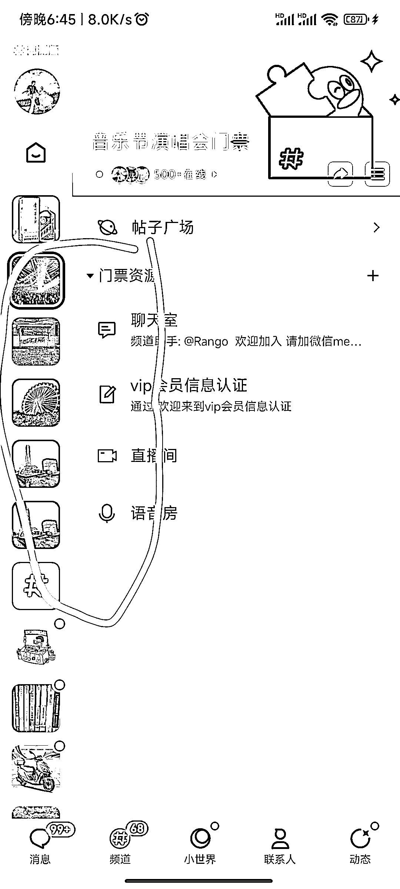

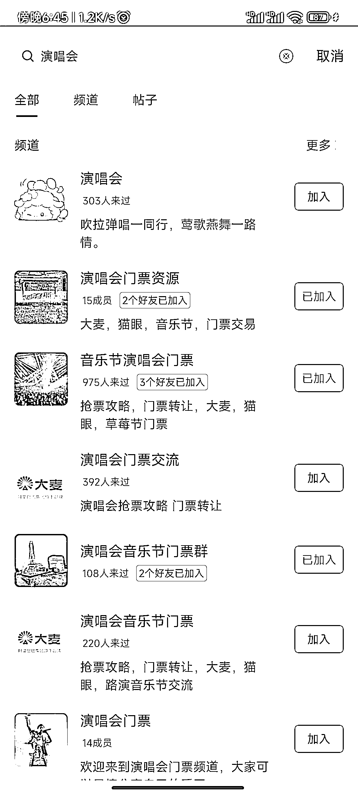

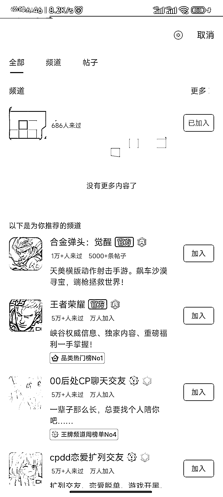

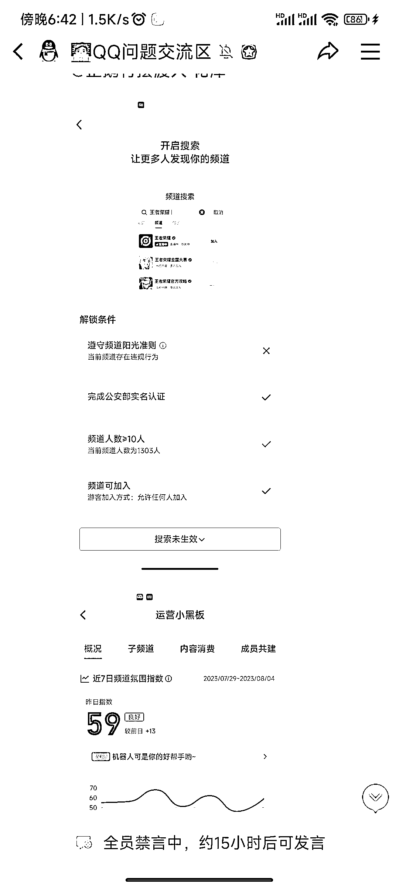

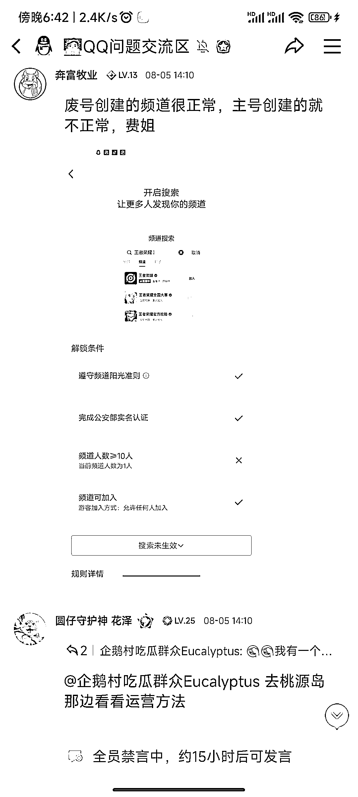

我的演唱会频道最早是 6 月份建的，一开始只是放着，没想着引流。后来发现有人进来，才顺手加上微信引流的。中间有一次两个频道被同时判定违规，只能重建，新起号的时候身边还是蓝海。

到了 8 月，各地演唱会扎堆，模仿者才大量出现。他们的玩法和我一模一样，频道路人自动提醒加微信好友，再拉群沉淀。现在开学了，整体流量比高峰期下滑不少。

这个玩法上手门槛几乎为零。别人照着我建频道就能拿到流量，前提是你先找到一个有真实搜索量的词作为参照，而且这个词不能太火，要能保证新频道上线后立刻出现在首页。

比如二手手机这个词，是我对标别人做出来的流量词；二手书这个词是我自己首创的。我以前操作过 400 多个茅台群，涵盖各地同城交易、超市活动、同城招聘等品类，对词的判断还是有经验的。

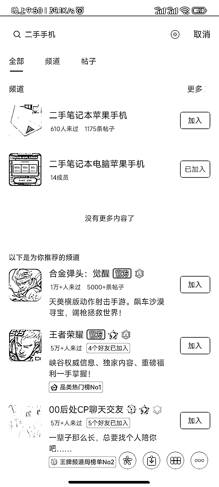

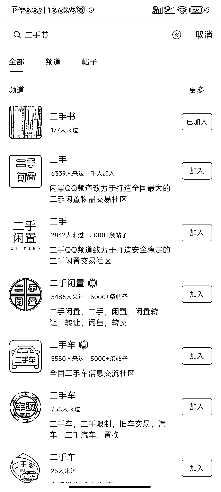

再说同城这块，目前二三线城市的同城频道还很少，尤其是带大学的城市。

租房、找工作这些同城刚需，可以去看别人怎么布词。同城需求类型很多，提前布局就能长期吃搜索。这种同城频道就是今年建的，到现在还在持续吸量。

这个同城频道里有个词“招聘”，属于高危词。搜这个词基本搜不到任何正常内容，因为很多招人干坏事的被封，导致这个词已经被污染。我之前也做过“小红书”，流量不差，但里面全是招人发帖点赞赚钱的，最后群被封，小红书也被标记为违规词。选词这一步一定要避坑。

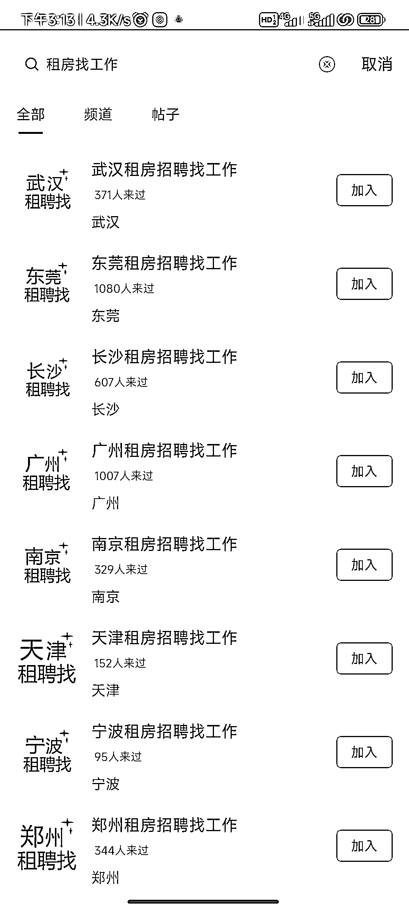

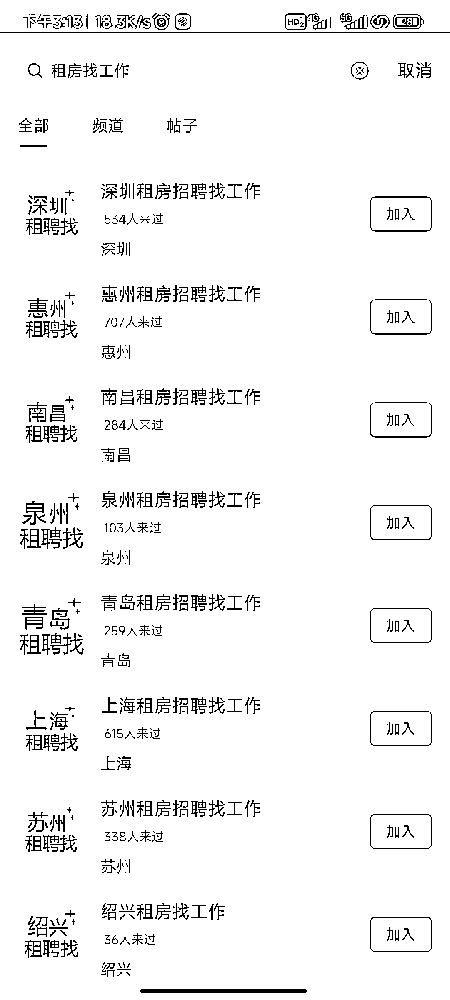

关于建频道的资源需求：

1. 一个 QQ 号最多创建 3 个频道
2. 一个手机号码可以注册 5 个 QQ
3. 一个实名认证可以绑定 2 个 QQ

算下来自己申请 10 个小号，就足够做词测试了。把自己的 10 个小号全部加进自己建的频道里打底。

新号基本都能直接开通 QQ 频道，新注册的账号默认就有频道权限。

变现层面目前我主要靠朋友圈带货，群更多是引流钩子。有些群本身也可以直接卖群位变现：

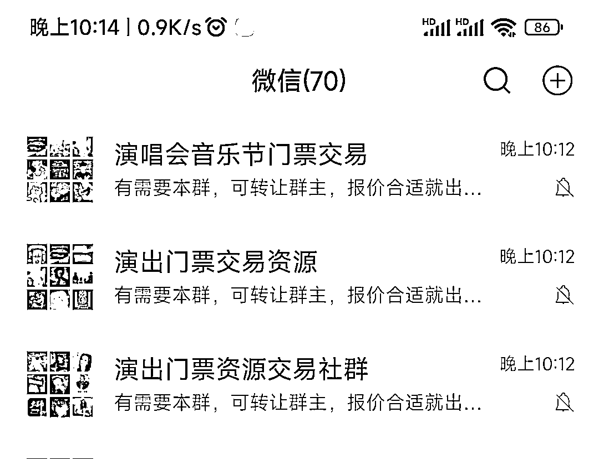

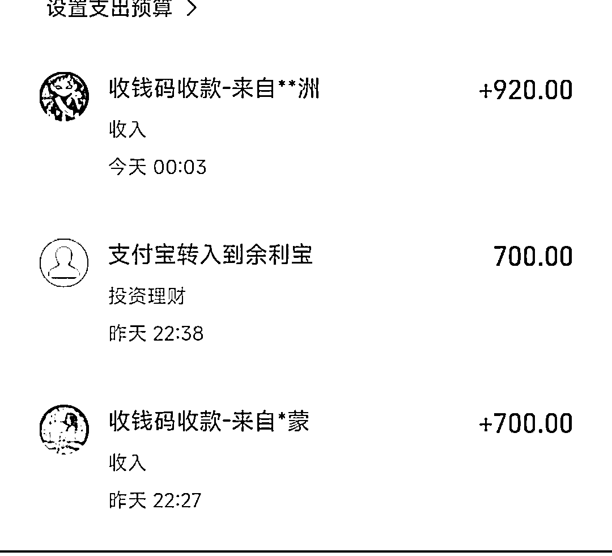

想做业务的话可以看这个方向

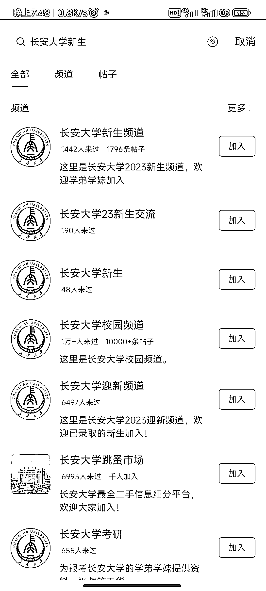

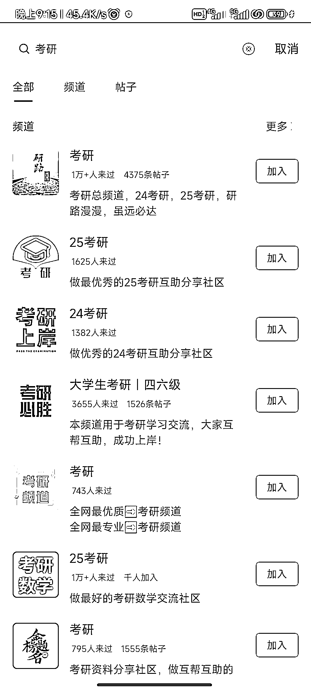

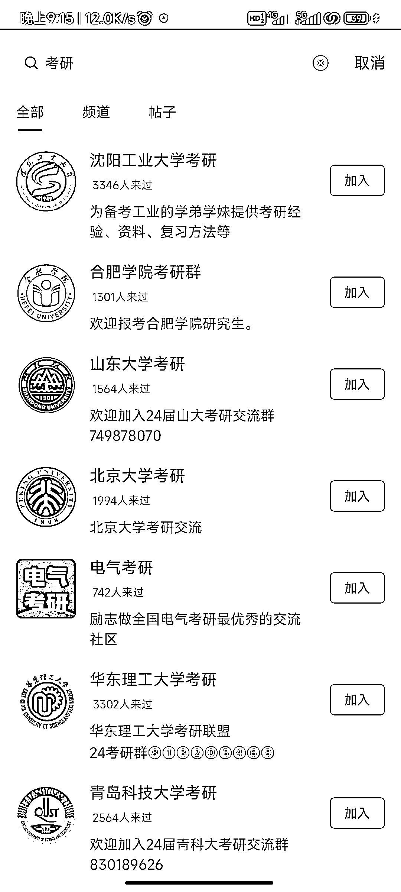

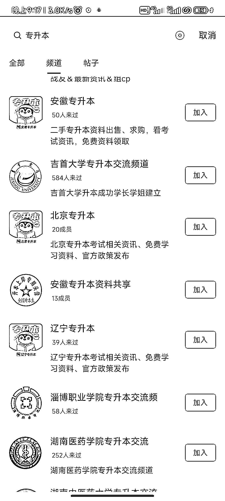

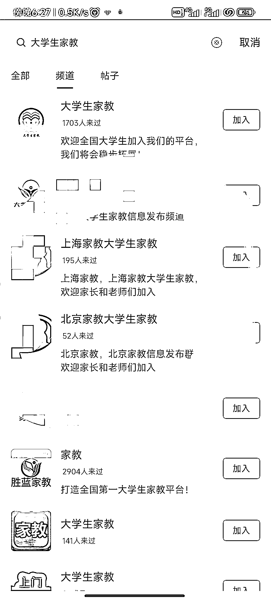

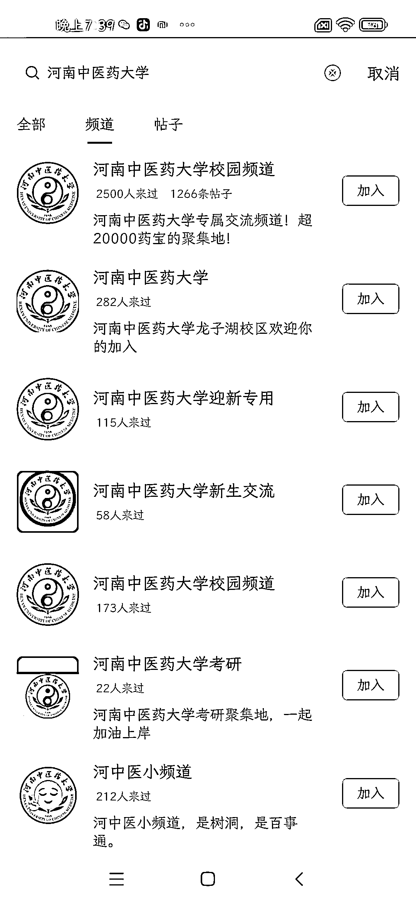

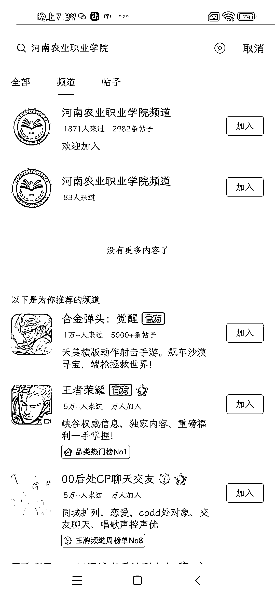

全国 3000 多所大学，专科和部分本科院校的频道数量非常少，很容易靠学校名称吃学生搜索流量。引流进私域后做学生相关的需求转化。

新生、考研、家教、专升本，这些方向的变现路径都很成熟。

具体怎么玩，可以去加一些正在运营的大学频道，观察频道主的变现套路，再结合赚钱里大学生变现的案例去模仿。经过市场验证的模式直接抄就行。只要某个学校的频道数量少于 7 个，新建频道基本稳上首页。

整体操作流程很轻，不用写文章也不用拍视频，唯一的难点在于你能不能坚持做词测试。刚开始选的词可能长久没人进，你愿不愿意每天建新频道去试。

举个失败的例子，我建过一个“赚钱有术”的频道圈内都知道，但建了半个月，搜索加入的人数为零。

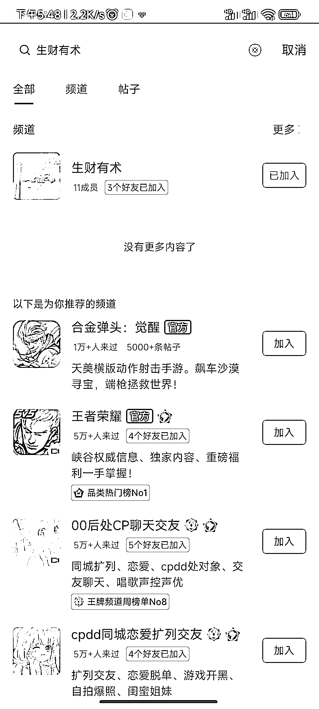

* * *

评论区：

才 : 如果词不对一直没人进，是保留还是换词重建？

易小北 : 直接换词重建就行

黎涛 : 能加个微信交流吗？

易小北 : wu256123

* * *