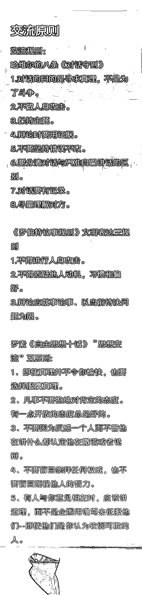

# ('交流原则', (2, 6))

在人与人之间的每一次对话里，都藏着一种看不见的章法——我们称之为“交流原则”。它就像一座桥梁的锚点，看似简单，却稳稳托住表达与倾听的平衡。真正懂得沟通的人，未必是口才最好的，而是最清楚何时该进、何时该退、何时该把话语权交给对方。

最近读到龙哥收藏夹里的一条记录，发布于2023年9月27日，标题正是这简短的四个字：交流原则。虽然篇幅极简，但能让人停下脚步，去审视自己的日常互动。我们常常把沟通当作本能，却忘了它其实是一门需要打磨的手艺。所谓原则，不是刻板的教条，而是让彼此都舒服的边界感——比如尊重对方的观点，先听完再回应；比如避免情绪化反驳，用事实代替主观臆断；再比如真诚地表达自己，同时也给沉默留出呼吸的空间。

或许比起技巧，真正的交流原则更关乎一种心态：愿意理解他人，也愿意被他人理解。当你把这一点放在心间，很多话自然就知道该怎么说了。愿我们都能在对话中，找到那份既清晰又温柔的力量。

这篇笔记虽然只有寥寥数行，评论区也空无一人，却像一枚小小的石子，在我们心中激起涟漪。交流的原则，不在于背诵多少金句，而在于每一次开口时，是否带着善意与尊重。希望读到这里的你，也能从今天开始，把“交流原则”当作一面镜子，照亮自己的表达之路。