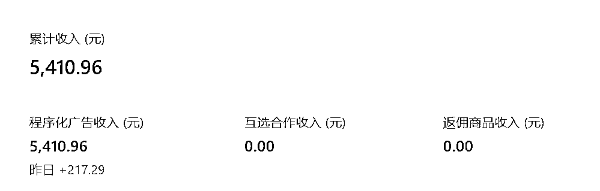
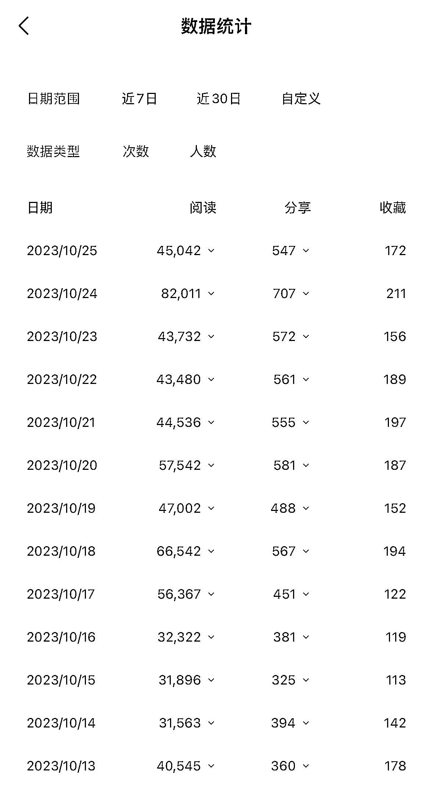
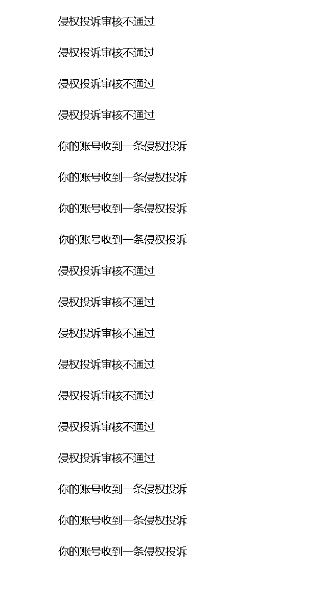
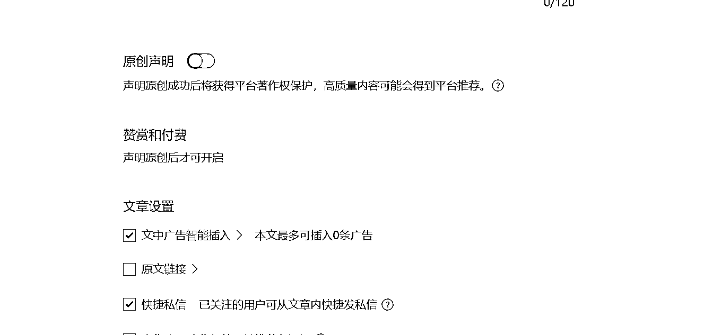
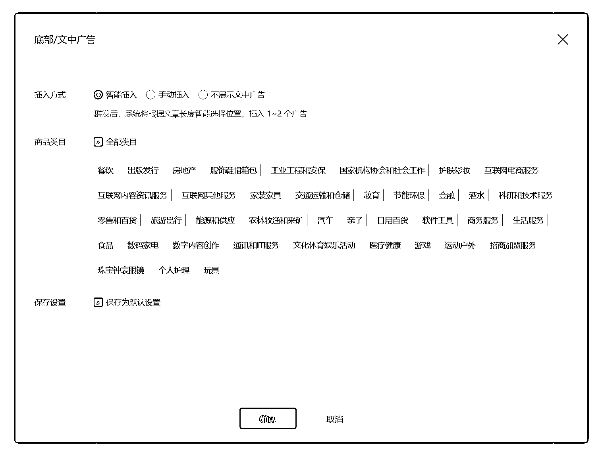

作为一个刚入赚钱圈没多久的小白，我误打误撞看到了公众号爆文这个项目，然后从七月底一路做到现在。账号从零粉涨到了两千多粉，八月份顺手参加了爆文航海，月底开了流量主，目前累计到手五千四百多。单日阅读基本稳定在四万左右，也出过十万加的小爆款，每月能踏实赚个六千上下。

我知道这点成绩在赚钱里根本排不上号，但正因为我是最普通的那种素人，才更想把这段经历讲给和我一样没什么资源、只想先找个稳定收入来源的人听。

大家看我的后台数据就能发现，流量很平很稳，基本每天四万上下，十万加偶尔也会来一下。

其实做公众号爆文的人，各有各的打法。我自己观察下来，大致有纯AI、纯手写、手写加AI辅助三个派别。我始终觉得内容和个人的成长才是根本，所以前期一直是纯手写起号。这篇分享不聊什么ChatGPT指令、提示词那套，只讲最朴素的实操过程和真实感受。

下面我从四个部分来说：流量主是什么、具体怎么做、一些常见问题，以及最后的心得。

### 一、流量主是个啥？

简单说，就是公众号粉丝满500后，可以开通的一个变现功能。你发一篇文章，微信会在里面插广告，读者看了就有收益打进你账户。注册、发文这些基础操作赚钱里已经有很多人讲过了，我不重复。

### 二、具体怎么操作？

在我看来，公众号爆文写作核心就三件事：找对标、照着爆款结构写、坚持日更。

**怎么找对标账号？**

工具和方法很多，什么第三方数据平台都可以。但我的建议是，选一种最笨的就行——直接在微信“看一看”里刷。可以刷自己的，也可以刷爸妈的。

《误杀》里有句台词：“当你看过一千部电影，就会发现这个世界上根本没有离奇的事情。”新手只要用这种笨办法多看爆款，看多了心里自然就有数了。最笨的方法往往就是最有效的，这就是基本功。

**什么样的账号适合做对标？**

最好找今年新起的号，平时阅读只有几十，最近突然出了几万阅读的那种。这种低粉爆款最值得模仿。千万别找那些老账号，哪怕数据再漂亮也没用，因为它的阅读量很多是靠粉丝堆出来的，不是靠推荐，你根本学不来。

还有几个注意点：

第一，别选发挥空间太窄的领域，比如“养老金”。之前有人靠养老金爆了，天天十万加，但你看现在阅读掉下去了。因为那点事翻来覆去就“涨了3.8%”，就算编故事也写不出花来。我自己也试过，写吐了。

第二，别选自己打心底排斥的领域。哪怕对方数据很好，你要是看着就难受，千万别写。写作本来应该是快乐的事，你写得痛苦，肯定出不了好文，换一个吧。

**爆文怎么写？**

核心就一句话：写你的目标读者爱看的东西。

千万警惕自我感动。老是有人说自己文章写得极好，不推就是公众号的问题。好不好不由你说了算，得看数据。有时候你觉得写得特别爽，发出去就几个阅读；有时候你毫无感觉，反而爆了。

那怎么找读者爱看的东西？很简单，去找对标的爆款，尤其是上万阅读那种，看它的观点和结构，开头、中间、结尾怎么安排的，照着写就行，一点都不复杂。

技巧当然也有，但新手前期不建议琢磨太多。你先动手写一篇类似的，发出去，再拿自己的和对标的比一比。你读自己那篇，如果能被调动起情绪，那爆的概率就很大，剩下就是持续日更。

这也是我不建议前期用AI的原因。AI写出来的东西，感情浓度真的不够。而且手写能练你的写作能力和网感。我现在有时候文章还没发，就预感它会爆，这种能力就是靠不断分析和写练出来的。

再强调一遍：新手刚开始，先把技巧放一边。为什么？我之前在社群里看过各种“开幕雷击”“对比写法”的拆解，看完感觉会了，一动笔还是脑袋空白。因为你没写过，那些技巧根本接不住。就像刚入行的程序员，你天天研究设计模式，写出来的系统照样一堆bug，本质就是欠练。

所以老老实实找对标、拆爆款、开写。在日更中慢慢学和改进。

### 三、一些你们常问的问题

**1. 这个项目适合普通人吗？**

适合。现在公众号加了推荐机制，越来越像头条号，低粉也能出爆款。开了流量主，写爆文变现，模式简单直接。

**2. AI写还是手写？**

强烈建议前期手写，后期再用AI辅助。我当初也迷过“一个指令日入上千”的分享，天天研究指令，最后发现自己成了AI的奴隶。本来该写文章的，整天比GPT3.5还是4.0，比来比去，越搞越焦虑。后来干脆不看了，打开“看一看”找对标，分析模仿日更，账号反而起来了。

**3. 别人用AI矩阵批量搞，收益不错，我能学吗？**

那些人是把账号当消耗品，封了就换。普通人没那么多账号，别学。

**4. 文章被投诉怎么办？**

我号起来后也被人盯上过，天天投诉。刚开始慌，后来就稳了。先自己检查有没有违规，有就删；没有就别管，让平台审核，自己千万别点承认侵权。

**5. 手写有什么好处？**

新手手写能倒逼成长。沉下心思考，写作能力就慢慢上来，时间久了你自然知道目标群体爱看啥。还能缓解焦虑——我花一上午写四五千字发出去，有些人研究一整天指令，一个字都没写。

我现在手写日更四十多天了，能力和对用户的了解都上来了，后面才考虑用AI辅助提效。这时候我已经很清楚读者喜欢什么结构、什么内容，AI是工具，为我服务，而不是反过来。

**6. 怎么提高收益？**

只说我自己实操的：

一是把“打赏”和“合集连续阅读”关掉。它们会占文章底部一大块，用户可能看到那儿就跳走了，底部广告曝光就少了，收益自然少。

二是发完文章，底部有个“是否在文中插入广告”的按钮，点进去可以选广告类目。别把所有类目全勾上，你按自己目标群体特征去选，吸引对的人点击，收益会更好。其他提升ecpm的方法我也看过，价值不大，先做好这两步。

**7. 为什么我的号一直没流量？**

无非这几个原因：一是内容不够好，方向错了还死磕；二是日更时间短，有些老号第二天就入池，但无论是老号新号，至少坚持30天，没起色再换方向；三是发的东西太杂，微信还没识别出你的内容定位。

反正你只要找到对标、照着爆款写、方向对，剩下就交给微信，别想太多。

**8. 个体户订阅号能入池吗？**

能。总有人说不行，但我亲眼见过个体户号起来。

**9. 想注册多个号怎么办？**

一个人只能注册一个，个体户能注册两个，企业更多。要更多的话，找老婆、父母、岳母、亲戚注册。用别人身份证注册后，开通流量主可以设置委托代收，收益照样进你钱包。精力够的话，也能找人合作，谈好分成就行。

**10. 账号违规了怎么处理？**

如果是误判，去公众号通知中心找申诉按钮，准备好材料。如果是真违规，申诉完直接继续日更。微信的脾气就是罚完你，只要你坚持更新和原创，还会给你机会，流量慢慢能回来。至于多久？不确定，有人一年，有人一个月，全看微信内部规则。

**11. 看别人老出爆款，要不要转方向？**

千万别轻易转，尤其是已经入池的号。没有哪个领域天生就比别的强，只要入池了，持续优化内容，大爆是迟早的事。你要是日更一个多月还没起色，那可以换方向试试。前期就得熬。

**12. 有什么写作技巧吗？**

有，什么三段式标题、开幕雷击都好。但前二三十篇，你先照着爆款模仿写，后面再学技巧优化。为什么？因为你在理论里泡得越久，越容易胡思乱想，最后直接放弃。先动起来形成习惯，之后再用AI和技巧去升级。

**13. 有没有推荐的创作领域？**

从我的数据看，公众号读者大多是中老年人。社群里常见三农、军事、社会热点、国学、法律、名人名言这些。但我要说的是，只要微信给你推，哪个领域都能爆。没有哪个领域绝对更好，只是热点、情感这类受众广，概率大一点。其他领域微信需要更久去匹配人群，但匹配上后流量会很稳。

大家自己去“看一看”刷，按我说的对标方法定方向。有人拍高速公路摄像头篇篇十万加，有人发猪价也不错。行动起来，自己挖掘。

### 四、最后的几条心里话

写作这块，前期还是手写，慢就是快。我到现在也没见过什么万能爆款指令，能随便一输入就源源不断出十万加。就算偶尔有人用AI出了爆款，那也是他账号先入了池，又刚好踩中热点。新手千万别以为同一个指令你也能复制同样的结果，你的基础根本不一样。

有些朋友可能还是爱看“一键爆款”这类分享，我理解。但这是我现阶段真实的看法，毕竟AI还在初期，说不定未来真有一天会有。

再强调两点：

第一，你得想清楚，如果完全用AI创作，你得到了什么，又失去了什么？你可能得到几个月的收益，却失去了时间。等流量掉了，你完全不知道原因，也不知道怎么救，因为你不了解用户，写作能力也没提升。还有封号风险，得不偿失。

但如果你前期手写起来，习惯和能力都养成了，后面就可以让AI帮你做很多事——比如对同一事件给不同角度的思考，给你搭一个故事框架，帮你查素材资料。你用这些加速你的创作，这才是正确的用法。

第二，别羡慕别人的高收益。日入过千过万跟你没半点关系，而且很多都不持久。我亲眼看过一些纯AI的、追热点的号，流量全掉了。

我也特别想跟和我一样的普通人说一句：赚钱里确实有人月入几十万上百万，大家晚上看这些分享，真的跟看爽文一样热血沸腾。但你要结合自己的实际想一想：他那个赚钱路径能不能跑通？跑通了以你一个人的精力能不能执行？能就干。

只要路径没问题，执行力到位，就能赚到钱。就拿我来说，肯定比不了那些公众号教练，但一个月稳稳赚六千，我这普通人已经觉得很爽了，来赚钱来对了。

现在公众号对普通人来说机会是平等的，你就做这几件事：找对标、拆爆文、照着写、坚持日更，过程中学技巧、用AI辅助提速。就完了。

不用怕被割韭菜，我能讲的基本都在这了。

加油，一起努力，日入过万。

