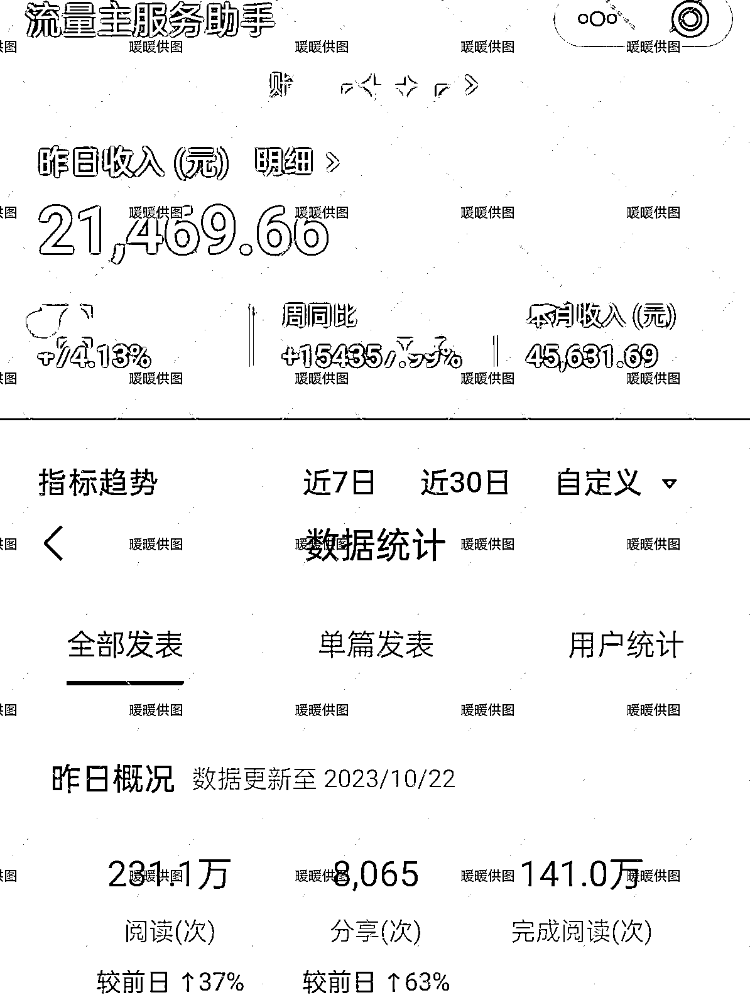
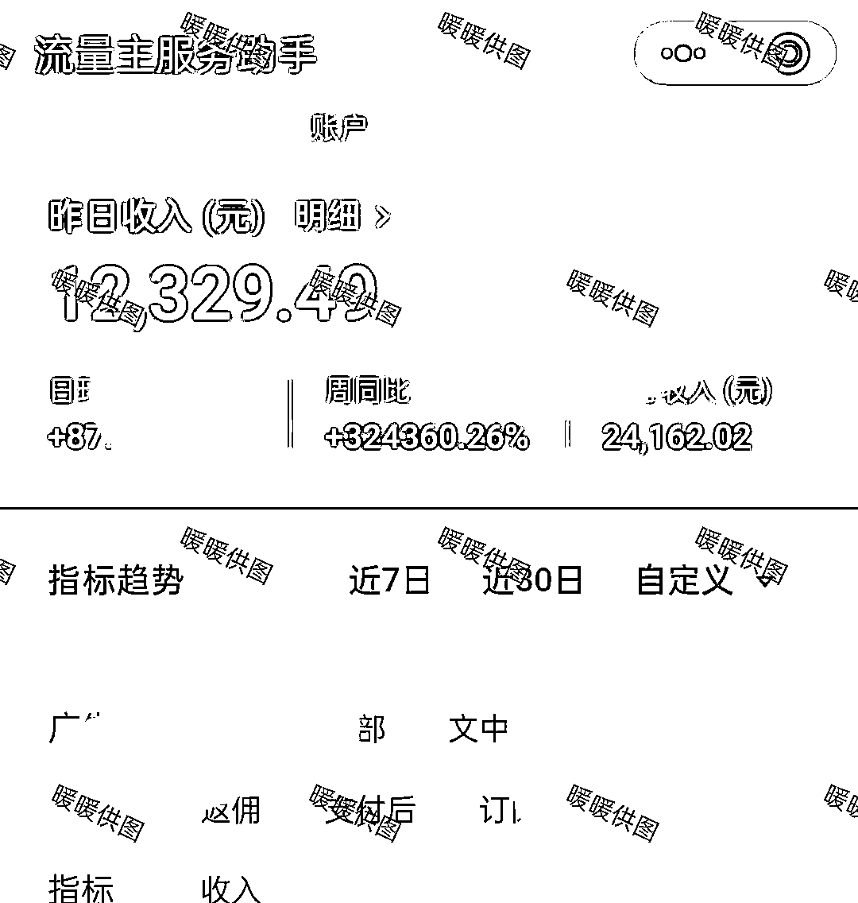
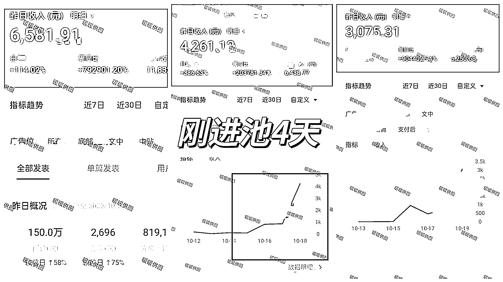
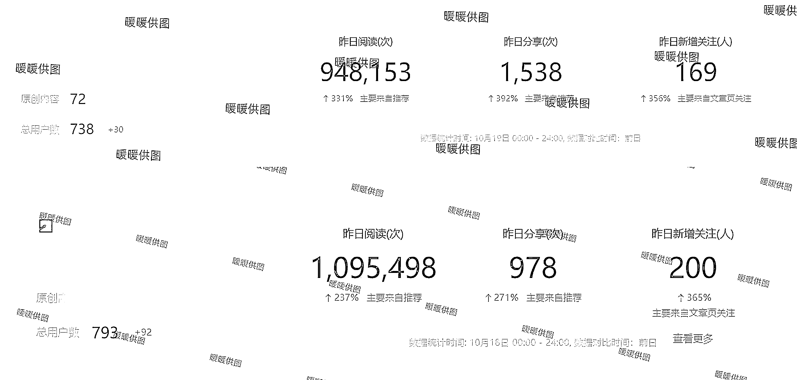
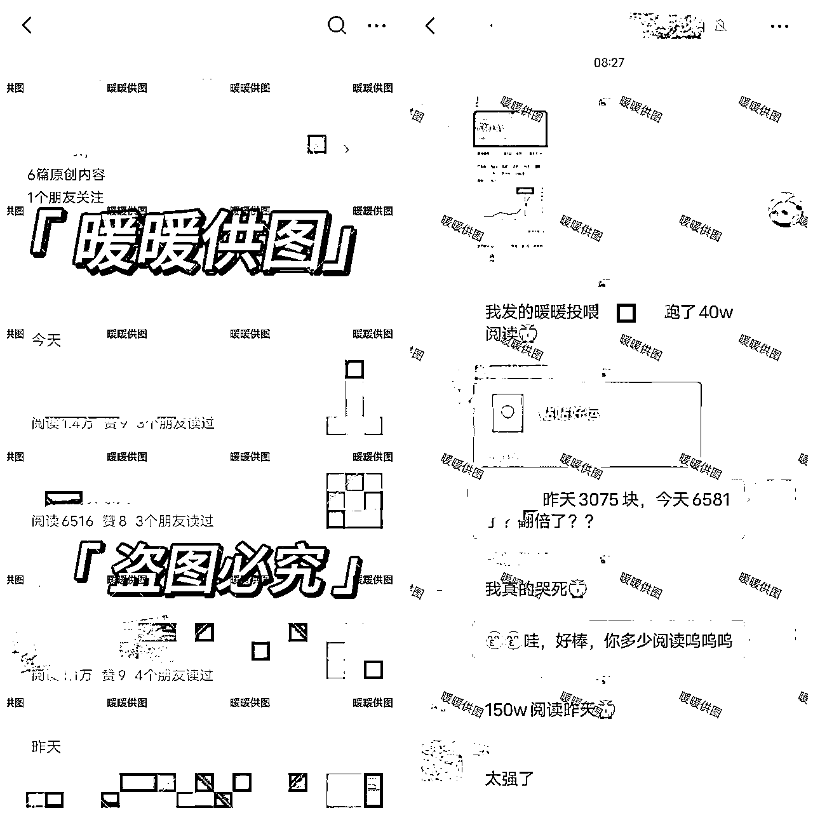

# 用 AI 撬动公众号故事爆文：矩阵入池率 90% 的实操路径，日营收 2.1W+ 的起号复盘

> 原文：[`www.yuque.com/for_lazy/thfiu8/vngasoful53tduki`](https://www.yuque.com/for_lazy/thfiu8/vngasoful53tduki)

## AI 赋能公众号故事类爆文，红海中找到蓝海突破口，矩阵入池率 90%，单篇阅读 230W，日流水 2.1W+，从零到起号的完整拆解

大家好，我是暖暖。深耕故事写作五年，旗下公众号矩阵累计粉丝 80 万，特别感谢赚钱提供的舞台与资源，让我得以见证众多新人在这条赛道上取得亮眼成果。

依托四年多运营十余个公众号的实战经验，我带着团队以 GPT 为核心，结合故事爆文及多个热门垂类，短短半个月内便成功打入流量池，营收梯度分别是日入 21000+、12000+、6500+、4000+、3000+、800+、900+……

整个过程用时不足 15 天。

本次复盘我会把团队从入门 GPT、注册账号、拆解爆款模型、设计调教指令，到日产多篇 10W+、数十万+爆文并完成变现的完整闭环，全部梳理清楚。

具体图文阅读可移步飞书：

流量主并非公众号唯一的收入来源。除了广告分成，暖暖在故事号上还打通了广告植入、付费阅读、带货转化等多条变现线，相关打法后续会逐一在赚钱分享。

做爆文号一定要保持冷静与数据驱动。持续找对标、沉淀网感、迭代指令词、做好周期复盘，才能在波动的数据里抓住爆款本质，一篇就赚几百上千，月入轻松过万，加油！

如果你已经跑通 1-2 个号，建议直接做矩阵。很多赛道需要靠选题测试来验证，矩阵化才能快速找到你的高潜力赛道。

复盘到此结束，感谢芷蓝姐和理白老师的指导，也感谢赚钱航海时期的各位教练。赚钱输出的多元项目与优质资源，对我帮助极大。

最后祝愿所有同行都能借助公众号故事爆文实现变现。[`n28vbku1px.feishu.cn/docx/R611dzwEtoq73pxSyUycMgV4nIg?from=from_copylink`](https://n28vbku1px.feishu.cn/docx/R611dzwEtoq73pxSyUycMgV4nIg?from=from_copylink)

* * *

评论区：

理白 : 炸裂的成绩，牛逼的团队，优秀的老师！

坏脾气的小可爱 : 太厉害了，暖暖老师。

饭饭 : 太炸裂了吧！

比比先森° : 暖暖老师太厉害了！！

小鹿 : 太牛了！！！

Rico : 暖暖老师太厉害了！

小张有茶自家人喝的茶 : 暖暖老师太厉害了！！

暖暖 : 蟹蟹理白老师[爱心][爱心]一直鼓励支持！！

* * *