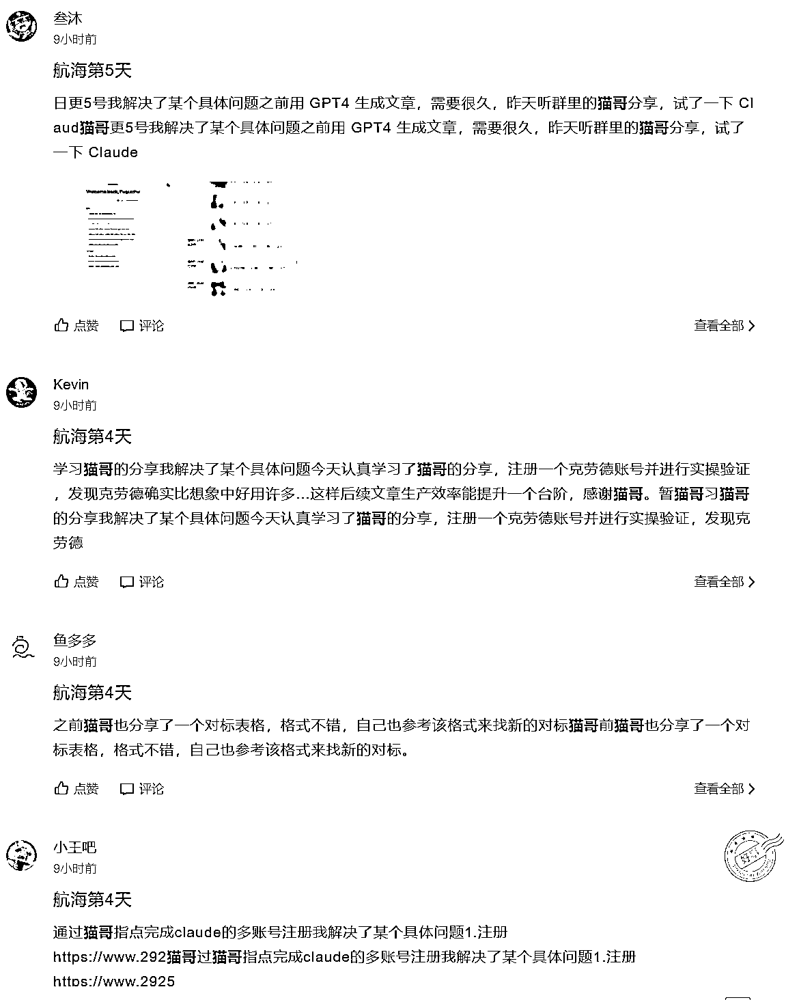

# 搞懂公号爆款的底层思路，一组可直接套用的实操笔记

> 原文：[`www.yuque.com/for_lazy/thfiu8/qn454ftmcglrof9z`](https://www.yuque.com/for_lazy/thfiu8/qn454ftmcglrof9z)

## 精华回看 | 公号爆款拆解与实操复盘

作者：猫哥  
日期：2023-10-16

前不久我在续航群里把这份梳理抛出来，隔了一天有志愿者把群友的留言截图发我，说不少人看完后思路清晰了很多，自己也能上手尝试，我看着也挺受鼓舞的。

说白了，公号本质上就是一个以内容为主的流量池。要想在这上面做成可复制的生意，需要同时把三件事做扎实：内容生产效率要上去，分发覆盖面要打开，爆款命中率要提升。

这个打法我持续在验证，到现在累计的回报已经到 20 个单元，体量还在不断做大。

下面把全盘思路拆成三块：

第一，文章的高速产出方式
第二，规模化触达的路径
第三，整个体系的枢纽所在

飞书文档：[`ex5bha8e8ip.feishu.cn/docx/BBnmd2RgFoItqXxazMrcQdIxn6g`](https://ex5bha8e8ip.feishu.cn/docx/BBnmd2RgFoItqXxazMrcQdIxn6g)

* * *

留言区：

Zzz : Claude2 需要付费订阅吗

大帅哥 : 真心感谢你分享法人绑定的那招，省了一笔成本

一朵云 : 爆出去的稿件第二天再发，是原封不动发吗？

火神可爱多 : Claude 的免费额度太少了

龙哥 : 感谢提供，已置顶推荐

文.二 : 猫哥你好，能否加个微信详聊

热心网友大表哥 : [强][强][强][强]

猫哥 : [握手]多谢老板支持

* * *