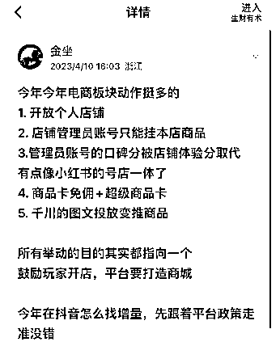

# 抖音卷到头了？在存量里找确定性增长的打法

> 原文：[`www.yuque.com/for_lazy/thfiu8/rta9l47945uzdvz6`](https://www.yuque.com/for_lazy/thfiu8/rta9l47945uzdvz6)

## 抖音极度内卷，如何在存量市场寻找确定性增长

作者： 金坐

日期：2023-10-18

“现在抖音太卷了”

这句话基本成了所有做或没做抖音人的共同认知。

前几年抖音上到处都是暴富故事，开个店开个播就能爆款爆单，赚钱像捡钱一样容易。

现在入口是多了，商品卡、搜索、商城全出来了，但做起来却越来越费劲，像是被一层无形的阻力挡住了，以前屡试不爽的套路正在失效。

说白了，时势变了。

抖音已经从增量狂奔期进入存量博弈期。

**先说天时变了。**

平台的用户和付费用户都快见顶了。中国能刷抖音的人基本都刷了，没刷的也很难再进来。电商的增量也在放缓，大部分成交来自已经养成在抖音买东西的熟客，还没在抖音花过钱的群体，转化成本很高。

流量见顶，兴趣电商的天花板也跟着显现。两年前大家谈兴趣电商时，谁也没想到上限来得这么快。

拿到过百万级销售额的人都发现：**靠兴趣冲动消费，撑不起长期稳定的利润。**要么往品牌和私域走，用复购来扛利润；要么就只能无休止地测品换品，靠爆款续命。

抖音自己也意识到问题。所有成交都以信息流形式出现，商家和用户都像无根浮萍，没有沉淀和连接，根本长不出像淘宝那样的品牌生态。

品牌是资产，代表认可、复购和持续赚钱能力。

**抖音商城一日不成，抖品牌就一日成不了。**

所以兴趣电商被改成了全域兴趣电商，商城、商品卡被强推，抖店、种草人群从年初就开始猛推。

四月份时候的分享

这些动作本质上是在补货架电商的短板。货架要起盘就需要习惯，需要流量，而这些流量只能从现有的直播间和内容里分流。

商城给了商家做复购和提高营收的机会，也让直播间和视频的流量成本水涨船高。

**再看地利变了。**

进场的人太多，蛋糕被切得越来越碎。

现在涌进来的，大多是原有生意增长乏力，又被前几年抖音案例刺激到的玩家。源头工厂想自己拿利润，外贸转内销首选抖音，还有早年淘宝京东前两千名的品牌，90%以上都已入驻。

商家多了，可愿意付钱的高价值人群就那么多，大家都在抢同一批人，流量价格自然上去。

为了让新商家也能活下来，平台把大量低消费人群推给直播间，让主播把他们孵化成付费用户，再把这些用户卖给付费买流量的直播间。

**平台永远是靠卖流量赚钱的。**

这也是今年直播间里泛粉多、来源不明未注册账号多的原因。

**最后人和也变了。**

消费者被教育到位了，韭菜割多了，对镰刀的容忍度也高了。

前两年靠自然流起量的直播，靠互动数据撬流量的套路满天飞：话术、AB链、高低价、憋单、福袋……付费场也玩微憋单、导互动。

现在用户比主播更懂玩法。你憋单我晚点来，你发福袋我当抽奖，你玩超低价我只捡漏，转正价就走。套路基本不好使了。

加上大环境不景气，剁手冲动减少，退货率上升。

三重因素叠加，抖音流量越来越贵，质量却越来越泛，投入产出比持续走低。

那抖音还值得做吗？

值得。

个人想赚点佣金，做抖音、视频号、小红书差别不大，体量小很容易做到月入几千上万。

但如果你是团队或公司，想做电商、做品牌，月营收要稳定到百万元以上，抖音依然是国内最快能达到这个结果的赛道。

**抖音难做，但必须做的理由只有两个：**

1. **抖音仍是国内最大的公域流量池。**其他平台要么流量大但转化弱，要么转化好但流量不够大。
2. **平台迭代速度快得吓人。**我从19年就在做抖音，平台的进化速度超过了绝大多数商家的学习速度。短期架构调整带来的混乱，最终都是为了更长期的繁荣。

我既是投放服务商，也是自营带货商家。

做服务商，亲历了抖音从用户爆发到商业化成熟的全过程。做商家，每天都在感受流量变化带来的焦虑。曾经一个视频就能爆，现在必须视频、直播、商品卡、达人全上阵。

两重身份，同一个困境，却也更清楚中小商家的痛点，以及怎么在内卷里打开局面。

下面这几条，是结合多年实操总结出来的确定性打法。

**适合人群：**

1. 抖音中小商家
2. 抖音电商运营
3. 想入局或已入局但没结果的老板
4. 曾有成绩但不稳不持续的操盘手

*不适合：*
1. 想找一个万能秘诀一用就稳赚的人
2. 达人/主播，这部分另说

* * *

## 第0个建议

# 带头冲锋

传统老板想做抖音，一定要把它当成创业项目来抓，从前端到后端都得亲自盯。

我见过太多传统转型失败的案例，套路几乎一样：

手里有个觉得不错的品 -> 找个很厉害的运营/主播 -> 招人买设备租场地 -> 折腾两三个月数据不行或算下来亏损 -> 找代运营或培训机构花钱 -> 再撑几个月更亏 -> 放弃回归老本行 -> 设备二手卖掉 -> 半年后又觉得老本行难做，重新招人做抖音

问题太多：产品没验证就上、盲目信任人才、不会抓流量、自己没跑通还想花钱外包、算不清账、前期规划失控……

**最核心的一点：老板不懂，也不想学。**

抖音不是“平台大，备个货就能卖”。也不是多花钱多招人就能跑起来。它是一个社交媒体生意，链路涵盖产品、内容、转化、数字化运营，传统生意要注意的这里都要注意，传统生意没遇到的这里更要注意。

这些事靠员工解决不了。运营再强，也跑不出老板认知的边界。

**老板不带头冲锋，没人能帮你做好。**能把项目真正做起来的人，根本不会去应聘打工。

代运营公司天生就是一队人服务多家客户，先扶好做的，难起量的自然被放养。后期增量可以外协，起盘阶段全包出去，跟A股找人代炒股没区别。

想做抖音，老板必须亲自上，拿回创业的劲头。

当然，如果你本身就是沉淀很久的品牌，有供应链、开品、人才管理、现金流都在线，再抽调团队启动抖音，那是另一回事。

## 第一个建议

# 知己知彼

现在做抖音已经没有秘密了。

传统行业调研对手要去踩点、蹲店、埋人。现在在抖音，只需要一个第三方数据平台的账号，对手就近乎裸奔：每天发几条视频、播放多少、直播时长、间布景、场观、成交、引流品、流量结构全都能查。

**现在做抖音就是开卷考试。**别人的试卷你都能翻。

新手入场，先看别人的答卷再做，总比闭门造车强。就算方式不适合自己，也能帮你排掉错误选项，省下试错成本。

比如你发现对标账号数据漂亮，战报好看，但流量全靠买，ROI很差，真正的利润靠私域和天猫旗舰店复购。而你既没有天猫店也不会做私域，硬抄就是死路，最终只能陷入抢流量的死局。

再比如你和同行都在做付费直播，对方自然推流和视频引流占比高，付费占比低，投产却比你好，表面GMV差不多，实际赚和亏是两回事。

知己知彼才能百战不殆。第一步，先买个数据网站的会员。

## 第二个建议

# 全域为王

没直播能力就别死磕直播间，在抖音赚钱不一定要开播。

前两年直播造神，但直播不一定适合你。

现在流量口多，除了短视频大盘，图文带货和商城流量今年涨很快。年初商城成交占比已到30%，目标是冲50%，内容场和货架场要对半开，还只盯直播就落后一个版本了。

直播成本也高，设备、场地、人力都要钱。初期预算不到50万，别急着上高配直播间。二十来平的场地、罩灯、手机支架、绿幕，老板自己上播就能先跑起来。

现阶段要做全域运营，不能单一依赖一个渠道。

**短视频**：抖音本质是内容平台，短视频是基本盘。带货也好做品牌也好，都绕不开。好视频能提升投产、涨店铺权重、种草用户。

**账号**：别把账号当工具。用户在评论区骂你比写差评更容易。主页头像签名背景都是信息位，企业号要用好商家工具和客资工具，个人号要用好粉丝群。多开号就是多开店。

**直播**：是实现销售和直接沟通的核心场。达人种草，直播拔草。

**搜索**：流量虽小但精准，布局关键词能吃到长期稳定流量。

**小店与商品卡**：高分店铺+高转化链接+活动券，即使不发内容也能自销。精选联盟会带来持续的主动合作。

**达人**：发视频不仅卖货，更是数字资产沉淀。KOC铺量是主力，自播也要留好精选联盟链接。

短视频、直播、小店、达人多渠道并行、互相导流，这才是存量时代的答案。

平台红利还在，只是分配方式变了。要持续拿增量，必须做好全域。

## 第三个建议

# 轻投放重优化

谈完全域就要谈全域ROI。

年中电商大会后抖音正式提出全域ROI，目的就是给运营减负。生态越大链路越复杂，短视频带货、直播带货、短视频搜索、图文搜索、商品卡、主页成交……数据一多很容易被带偏。

轻投放重优化的核心是：不靠砸钱硬扛，而是把已有流量玩透、把转化链路打通，让每个端口都能贡献业绩，而不是相互打架。

很多做抖音的老板，心里都有一个根深蒂固的念头：只要把投放搞明白了，生意就有救了。

直播没人看，怪投手；转化差，怪计划；一夜掉量，立刻切到后台拼命调参数。总觉得那串复杂的广告代码里，藏着翻盘的关键。

但说实话，投放这件事，早就不配当你的核心竞争力了。

前两年，千川投手确实是个很风光的岗位。那时候直播间的命脉，一半攥在主播嘴里，一半捏在投手手里。一个厉害的投手，能让一个人气惨淡的直播间硬生生跑出漂亮的数据。于是市场上到处抢人，字节出来的人更是香饽饽。

可现在你再看看，投手的“神坛”已经坐不稳了。

为什么？因为工具变聪明了，算法把过去需要人肉完成的操作全包了。全域ROI一拉，整个投放链路被压缩成一句话：你只管充钱，然后好好做内容。至于投多少、快还是慢、重点投视频还是直播间，根本不用你操心，算法自己会判断。

以前靠“建计划、改价、删计划”这三板斧吃饭的人，优势一夜之间没了。现在你去问那些找我聊投放的商家，十个里有五个，表面上是不知道广告怎么投，实际上真正的问题是：直播间留不住人、视频没有吸引力、产品竞争力撑不起转化。换个再牛的投手来，后端这摊子烂事不解决，照样白搭。

所以别再把精力耗在投放按钮上了。省下来的时间，去研究产品、琢磨内容、调团队架构，这些才真正决定一个项目能不能起量、能不能赚钱。

投放是放大器，但放大多少倍，得看后端这套人货场行不行。

再聊供应链这个话题。

有一种老板特别容易栽跟头——手里捏着工厂，觉得有货万事大吉。价格自己控、产品自己定、玩法自己说了算，看起来稳得一批。

但我们制造业最不缺的就是工厂。国内产能早就过剩了，能生产的人千千万，能生产出市场愿意买单的产品，才算真本事。

什么叫好产品？老板说了不算，员工说了也不算，市场说了才算。你的产品到底是潜力股还是垃圾股，拿出去卖一圈就知道了。

别一上来就囤几万件，然后指望抖音给你兜底。先做小批量测试，有反馈了再加码，没反馈赶紧换品。如果已经囤了一堆货，卖不动，也别硬撑，不如走低价渠道快速回笼资金，亏点就亏点，总比把现金流转断强。

低价能不能做？能。但低价是条窄路，前期要和同行拼谁命更长，熬到最后要么把大家都卷死，要么自己先撑不住。这条路适合少数人，不适合大多数人。

再看另一层：供应链的周转速度，能不能匹配上抖音的节奏？

传统生意是今天产一批货，放仓库里慢慢卖，卖个三五年都行。但直播电商是今天卖空，明天补货，后天被退一半。你的供应链如果还是按老节奏走——先生产、再铺货、再慢慢清库存，迟早被这个行业的快节奏拖垮。

正确姿势是“内容先行，测品放大”。先让一部分人看到你的产品、愿意下单，用反馈决定要不要量产。货卖不掉，成品还可以迭代，别一条道走到黑。

说到种草，很多老板第一时间是抗拒的：广告费砸进去，直接能算出ROI的才是好广告，种草那么虚，凭什么让我花钱？

但你想想追人的道理——你不可能让一个陌生姑娘第一次看到你，就决定嫁给你。你得先让她看见你、熟悉你、信任你，最后才有资格谈到约会。现在很多直播间干的事，就是让用户第一眼爱上自己、立刻掏钱。这种“一夜情”式的成交，低客单价能玩，但退货率也高得吓人。而价格稍微高一点的东西，用户要货比三家，要反复确认，你不在前面铺点种草内容，凭啥让人家冲动买单？

种草的意义，就是让用户从“见过你”变成“记住你”。等他们被种草了，再刷到你的直播间，下单就是顺理成章的事。而且现在平台也有了像云图这样的工具，种草到拔草、从认知到复购，每一步都能变成看得见的数字资产。不用再去外站搞一堆跨平台投放，在站内就能完成整条链路。

这不是玄学，是给自己建池子。有了池子，直播不过是把水舀上来。

最后再聊一句品牌。

平台、商家、消费者，三方各打各的算盘，日子过得都拧巴。消费者想要稳定的信任，商家想要回头客和利润，平台想要流水和增长。谁都不想让步，最后只能靠口碑破局。有口碑就有复购，有复购才有品牌。

有人觉得，品牌嘛，砸钱就能砸出来。可真不是。品牌这东西，靠时间熬、靠口碑喂，钱只是加速器，不是发动机。你看看那些有名的淘品牌，哪个不是被买家一次一次的复购给养起来的？抖音现在拼命推商城，其实也是想复刻这个逻辑，催生出一批“抖品牌”。但远没那么简单。

当然，我鼓励大家做品牌，不是让你一上来就砸广告。可以先从个人IP起步——品牌是个抽象的组织，人对抽象的东西天生不信任；但一个人是具体的，人是社会动物，觉得你靠谱，就愿意相信你。让这层信任先长在你身上，再转移到你的产品上。

哪怕玩不了大IP，做微人设带货也行。你不需要多耀眼，只要让人觉得你真实、有温度，转化率就会悄悄往上涨。算法其实很聪明，它会把流量给那些更能把普通游客变成付费用户的人。微人设成本不高，却刚好能帮你在“信任”这件事上省一大笔钱。

投放技巧、赔付规则、起量手段，这些网上教程多得是，真不用当成什么秘密武器。在抖音持续做生意，真正要拼的是产品有没有人认、内容有没有人看、团队能不能扛事、用户信不信任你。这几件事理顺了，钱自然追着你的生意跑。

> 主播的价值早就不在念词和计时扣屏上了。真正能打动人的，是一个有温度、有立场、有审美偏好的活人。

> 

> 你的角色不是替商家搬运商品清单，而是真心想把靠谱的好物递到消费者手里。

> 

> 千川投放，素材需求量极大。全实拍原创成本太高，实际执行里混剪类内容占了绝大多数。

> 

> 混剪的优点是便宜、快、能批量出片，缺点也明显——内容单薄、辨识度低，基本只能起到拓量填充的作用。

> 

> 用这种方式打投，转化率普遍偏低，能冒出一个高ROI高消耗的爆款算是运气。

> 

> 给内容里植入一个简单的人物设定后，观众在几秒内就能产生亲近感。信任感建立起来，认知产品和下单的阻力就会明显变小。

> 

> 当账号里这类带有记忆点的作品越来越多，人设会自然收敛，口碑和信任会慢慢沉淀下来，复购率和利润空间也会随之抬升。

> 

> 总体来说，**企业要走品牌化路线，个人要做IP化。** 品牌的力量是可以穿越平台和时间的。

> 

> 无论是公司还是个人，当用户对你的名字和你所代表的价值产生依赖后，哪怕你换了平台，他们依然会记住，并通过搜索等方式主动找到你。

> 

> 所以品牌化、IP化，是获取长期稳定增量的关键路径之一。

> 

> ## **最后**

> 

> # **放弃幻想**

> 

> 这段话是写给还没开始做抖音，或是已经试水一段时间却还没见到成效的负责人看的。

> 

> 说直白点，现在的抖音已经不适合小团队瞎搞，也不适合小打小闹试试水。两年前砸钱就能出爆款的窗口早已关闭。

> 

> 如今想进场，先把预期拉回现实。你犹豫的这段时间，薅流量的红利期已经过去了。抖音依然能造富，但不再像以前那样容易。

> 

> 在抖音做生意，本质和线下开店、成立一家公司做生意没有区别。

> 

> 你需要备好足够的启动资金，花时间打磨好产品，同时想办法拿到更长久、更便宜的流量。

> 

> 该花钱的花钱，该招人招人。瞻前顾后只会把公司拖垮，把机会成本一点点耗光。

> 

> 即便你请了很强的人，你自己也必须下场，亲手参与。

> 

> 现在的抖音是全员内卷，网上流传的各种技巧，解决不了根本问题。

> 

> 当下最关键的，是找到足够优质的资源，有格局，有耐心沉得住气。

> 

> 我说这些不是为了泼冷水，说抖音难做、赚钱难。实际上，我们手上的客户里，天天在投放的依然很多，他们的利润和投产比是稳定盈利的。

> 

> 抖音的机会依然存在，但在把握机会之前，

> 

> 请先放弃幻想，认清现实，踏踏实实去做。

> 

> ## **< END >**

> 

> * * *

> 

> 评论区：

> boarding : 真棒

> 一颗幸运小星星 : 写得特别好！拜读了

> 六六 : 写的好，受启发了

> 龙哥 : 感谢分享，已加精华。

> 金坐 : [耶][耶][耶]感谢老大

> 天青色 : 写的非常好

> 球哥笔记 : 吐血分享[强]

> 大俊 : 顶级

> 

> 

> 

> * * *