# 家居博主单号月入十万背后，她把账号玩成了精密的转化机器

> 原文：[`www.yuque.com/for_lazy/thfiu8/zlcx28hcg4zv3kfx`](https://www.yuque.com/for_lazy/thfiu8/zlcx28hcg4zv3kfx)

## 家居博主月入10W+，围绕底层逻辑做帐号到底有多香？

作者： Sherry💎谢无敌

日期：2023-10-17

Hi~赚钱的朋友们大家好~ 我是你们的老朋友-谢无敌，小红书 MCN 闪亮猫传媒创始人。

今天要给大家拆解的是实战营里一位家居操盘手的真实战绩——猫猫猫。

她现在走的是单号打法，月度广告花费仅**1K**，月度销售额却稳定在**10w**左右！

**目录：**

一、自我介绍

二、围绕底层逻辑做账号

三、雷区避坑指南

四、结语

**一、自我介绍**

嗨，我是猫猫，当前在小红书深耕高客单价、高净值人群的家居家装赛道。

公司主体以天猫起家，2023年3月加入实战营，开始启动小红书内容，8月完成店铺开通与直播平播，跑通私域+天猫的承接闭环，由客服完成后续转化。

启动初期，内部对小红书的价值判断并不一致。因为天猫当时动销稳定，而小红书作为内容种草阵地，短期很难看到回款。

前期试错成本不小。比如直接搬运海外案例，流量虽有但易被投诉，账号风险不低；再比如用抽奖做涨粉，粉虽涨了却多为薅羊毛心态，对最终成交贡献微弱，外表好看里子空。

跟着无敌老师在实战营里迭代升级，总算摸清了账号运营的底层原理，并把店铺定位拉回正轨。如今以单号驱动，粉丝基数不大，月投放维持在千元级别，月销售额却能稳定在十万上下。

本篇主要分享两大块。

1、依托底层逻辑搭建账号，涵盖定位梳理、选题挖掘、封面制作与引流设计。

2、运营小红书需要守住的心态与坑，摆正节奏、做好复盘，持续深耕才能迎来拐点。

**二、围绕底层逻辑做账号**

在小红书，我们的核心抓手是人设塑造、封面质感、关键词埋点、爆款笔记、合集沉淀以及聚光投放，综合提升笔记曝光与成交效率。

建议每周都参与星球的关键词共推，把星球资源用足，给笔记做冷启动，营造活跃氛围，也能在无形中增加粉丝信任。

做号的先决条件是搞清楚受众画像，进而思考内容能交付什么价值。除开常规的市场调研，更需要自问：受众想看到什么内容？我能交付哪些东西？我能解决哪些痛点？

归纳为两条主线：利他姿态、信任沉淀。当多数人还在想着收割时，你选择真诚服务，自然具备差异化吸引力。

想要在赛道里跑出来，核心还是底层逻辑。它像盖房子，地基稳了，上层才经得起考验。

我的底层拆法主要聚焦四块：

**1⃣账号定位与诊断**

**2⃣选题打法**

**3⃣封面制作**

**4⃣导流设计**

### **1、账号定位与诊断**

先说定位校准的过程。

无敌老师诊断前，我的设想是“打工妹”视角发内容，发出两条后反馈平平，且与自身气质错位。

按建议把人设调整为“软装搭配师”，数据立刻出现拐点。

做定位时要注意：

**第一，人设统一，画面集中产品。**

需要出镜的口播，人选必须与设定匹配，才有说服力，且要根据单品选择呈现方式。

以我们为例，人设从打工妹转向软装搭配师；拍摄设备与构图也升级，从手机拍摄改为单反视角，产品占比提升，场景感明显增强。

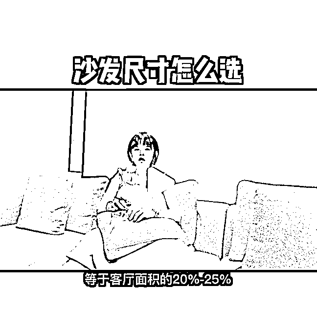

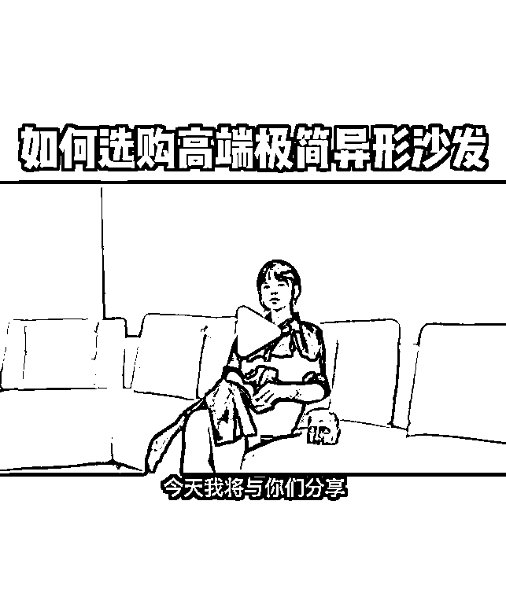

**第二，会看数据做分析，按年龄层、付费能力、偏好来定内容方向。**

我们的涨粉与互动都不错，且粉丝相对精准。

地域集中在佛山及海外，核心人群为25-44岁的女性，消费力可观，对家居家装有明确兴趣。

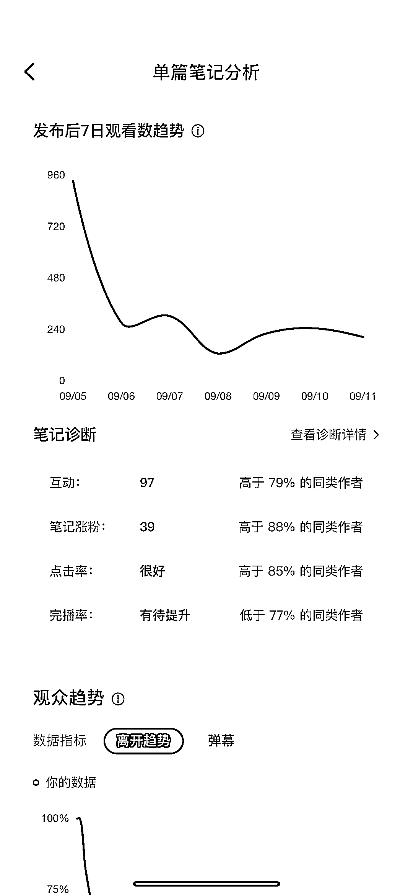

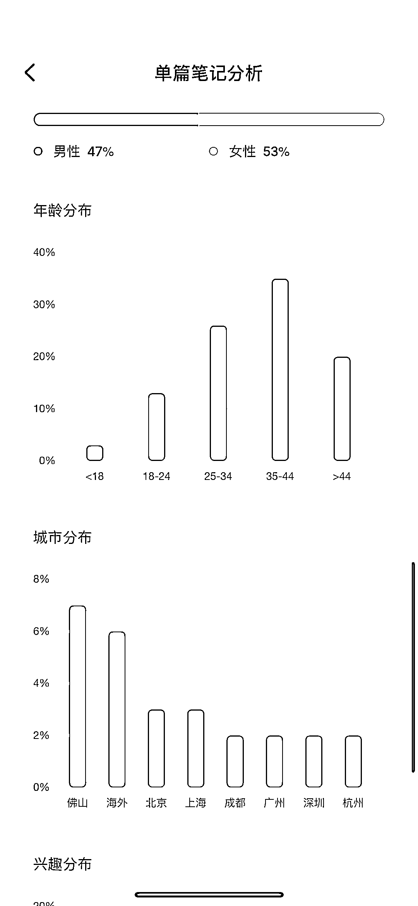

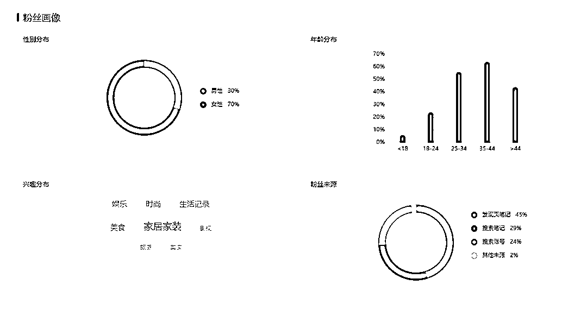

**第三，按客户画像挑选呈现形式。**

我们主打品牌复刻，客户多为一二线城市、对品质敏感的高端人群，因此视频剪辑风格偏精致、高端：

同行作品整体偏灰暗，我们的画面调亮，视觉更舒适。

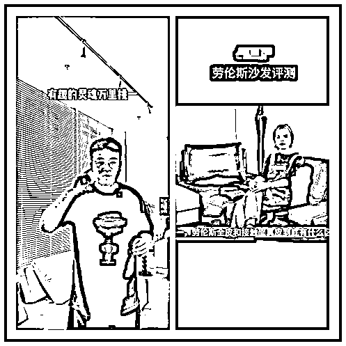

### **2.如何选题材**

很多伙伴做到中途会卡选题，素材枯竭。这就需要日常养成刷号积累的习惯。

选题上我更倾向主动检索。比如行业热词：极简轻奢、意式极简、劳伦斯沙发、大平层沙发等。

每天检索当下热度高、点赞破20的笔记做二创参考；同时把点赞收藏破500的优质内容归类，建立**笔记素材资源库**。

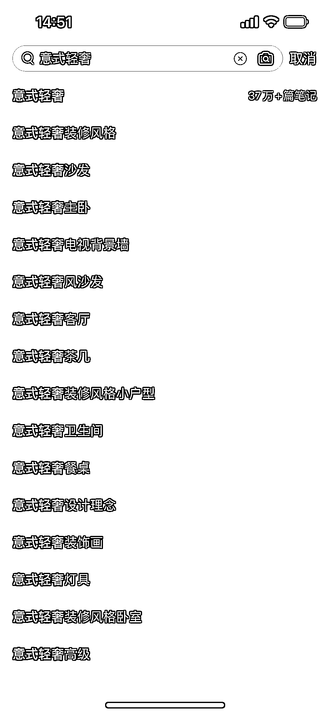

除了用表格搭建个人选题库，也可以在小红书App的【收藏】里按关键词建库。

若同一篇笔记被不同关键词检索到，说明其具备多维价值，值得拆解其脚本、标题、关键词布局，学习迁移。

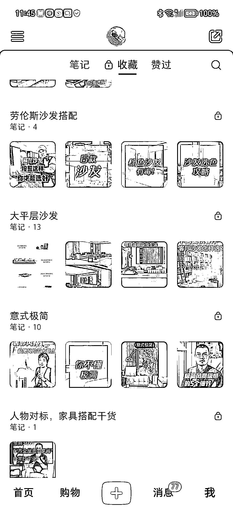

另外，我会把部分对标账号纳入长期观察清单，一旦出现爆款，就直接复用其创作思路。

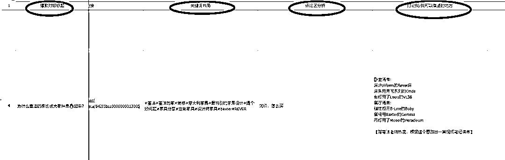

这里补充一个案例，我们曾把同行图文《董洁清单》改编为视频笔记。

遗憾的是，虽然拉来了大量询盘，但当时库存未上架，接不住流量。

同行发布的：

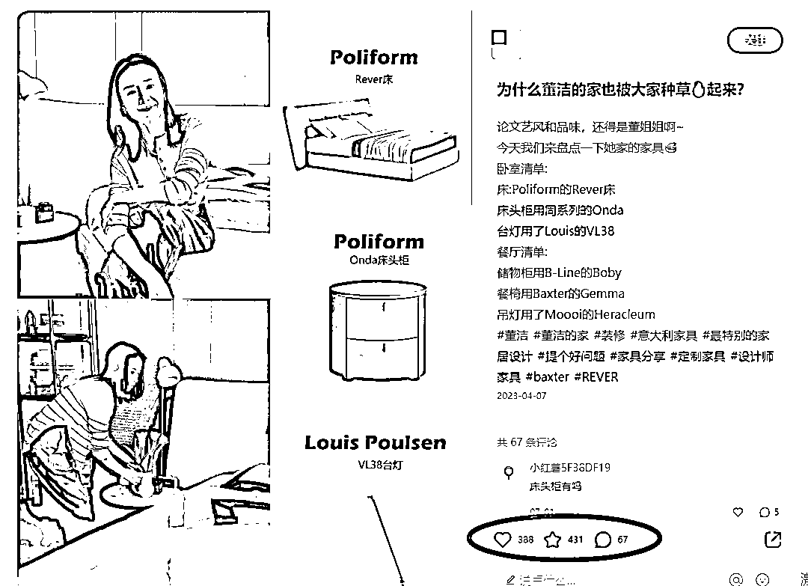

我们发布的：

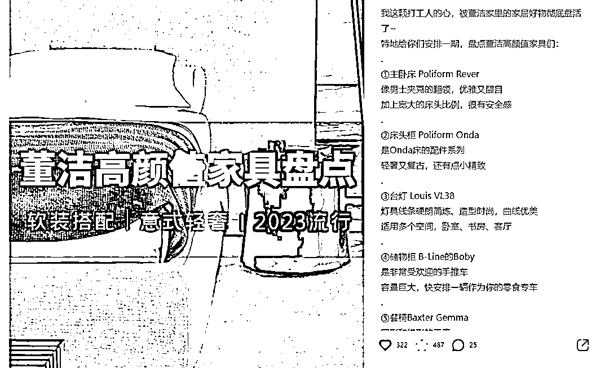

这件事说明：并非所有爆款都值得复制，要挑真正能带来成交的内容，且后端供应链必须同步跟上。

### **3.首图制作**

封面制作我也踩过坑，照搬抖音风格、模仿同行，最终都没有起量。

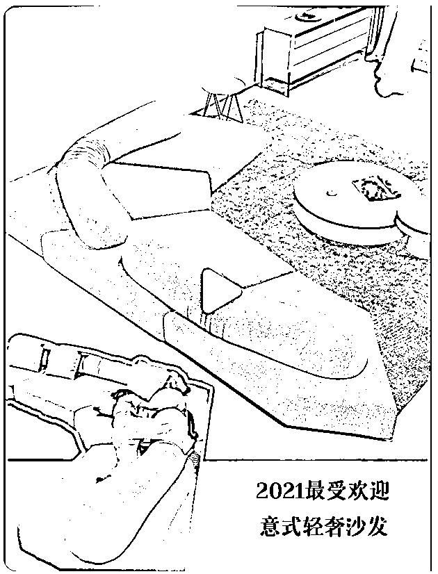

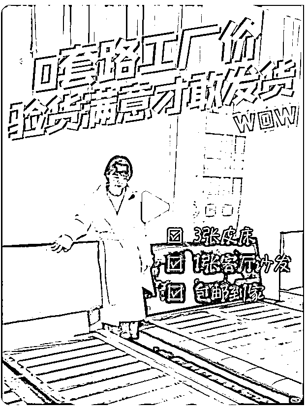

家居赛道，尤其是高端人群，封面要“端住”，保持画面干净、大气。

本质仍回溯定位，思考你的受众偏好什么，再投其所好。

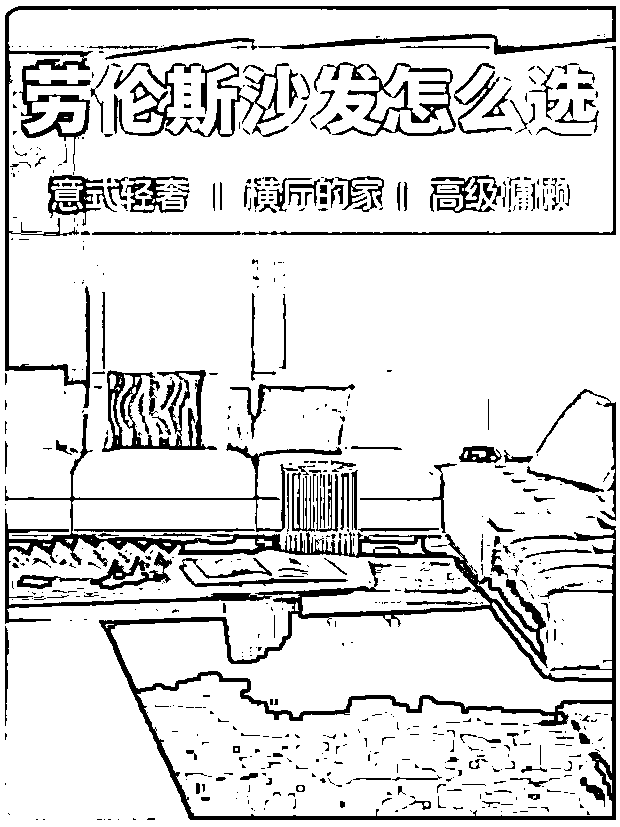

### **4.引流方式**

当前主要导流到微信与天猫店铺。

企业号投放后可明示联系电话，但需要让粉丝主动索取，因而话术设计很关键。

**【私信的自动回复】**

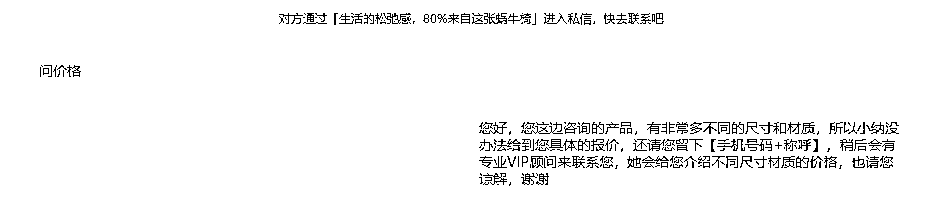

**【群聊的置顶】**

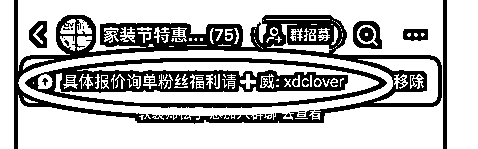

**【一些 cue 粉丝的话术】**

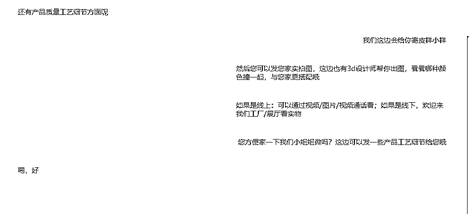

**二、雷区避坑指南**

确定产品后就是内容输出，紧扣产品与卖点。要点集中在封面与标题：

**1、心态**

刚发完就盯着数据刷是浪费精力，即便被收录，也需要等待。先让内容发酵，隔段时间再检索关键词看能否搜到。

可同步利用星球的关键词共推提升权重。

若笔记出现限流，可小幅调整标题、内容、封面，不行就联系后台客服。救不回来就果断放弃，继续下一条。

并非每条内容都具备爆款基因，要接受这种不完美，同时持续复盘提炼账号的流量密码。

### **2、培养敏感性**

这里的敏感是数据敏感。

运营小红书需要内容敏感度、美学敏感度、流量敏感度。

这些敏感度决定账号能走多远。

要建立账号分析、笔记分析、投放分析、ROI分析的表格体系，每周复盘、制定计划并执行。

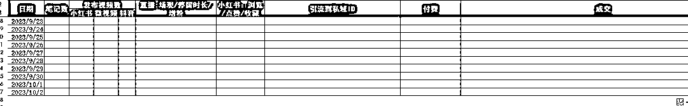

**三、结语**

最后想对还在做小红书的朋友说：

小红书是深度种草场，必须用笔记输出有价值的知识、产品或服务。

坚持利他思维创作，才能完成真实的种草转化。

再者，要接纳不完美。

笔记创作是不断复盘迭代的过程。若一条内容反复调整仍无起色，就及时止损，写下一条。

以上是猫猫猫的实战分享，希望能帮你找到属于自己的打法，一起玩转小红书~

欢迎交流，微信：sherryxie668

* * *

评论区：

40 : 请问下星球的关联词互助活动在哪里

Sherry💎谢无敌 : 会员群里每一周三五下午有

Sherry💎谢无敌 : 每周一三五

书豪 : 无敌真棒[玫瑰][玫瑰][玫瑰]

希声 : [强][强][强]

* * *