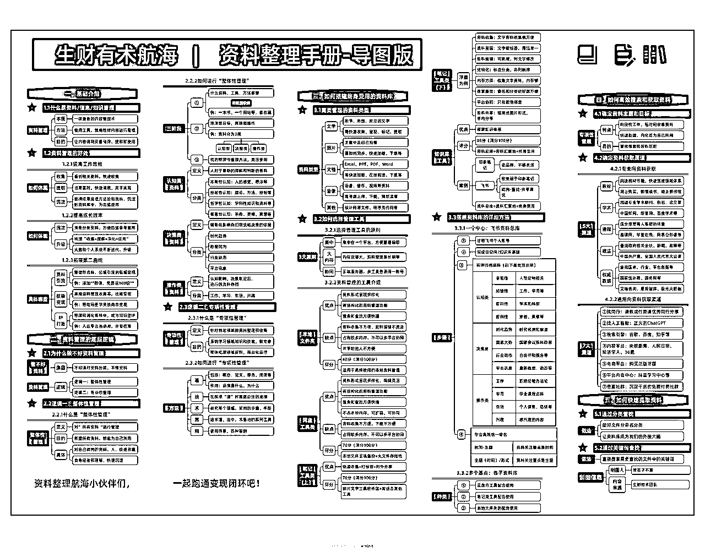
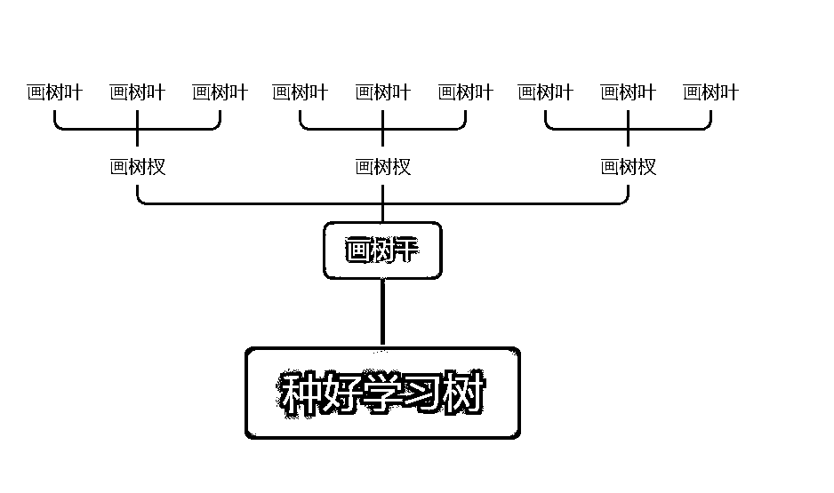
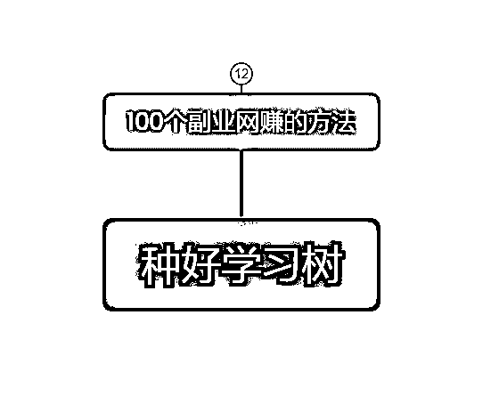
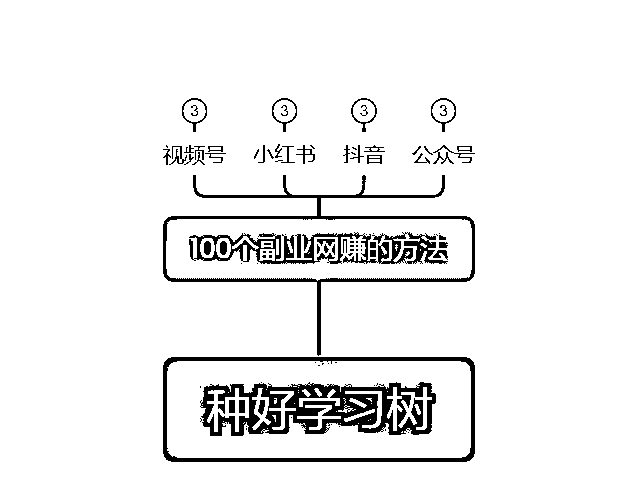
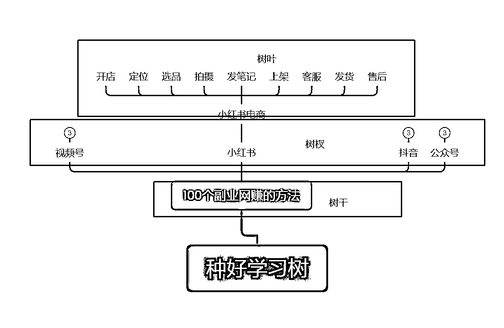
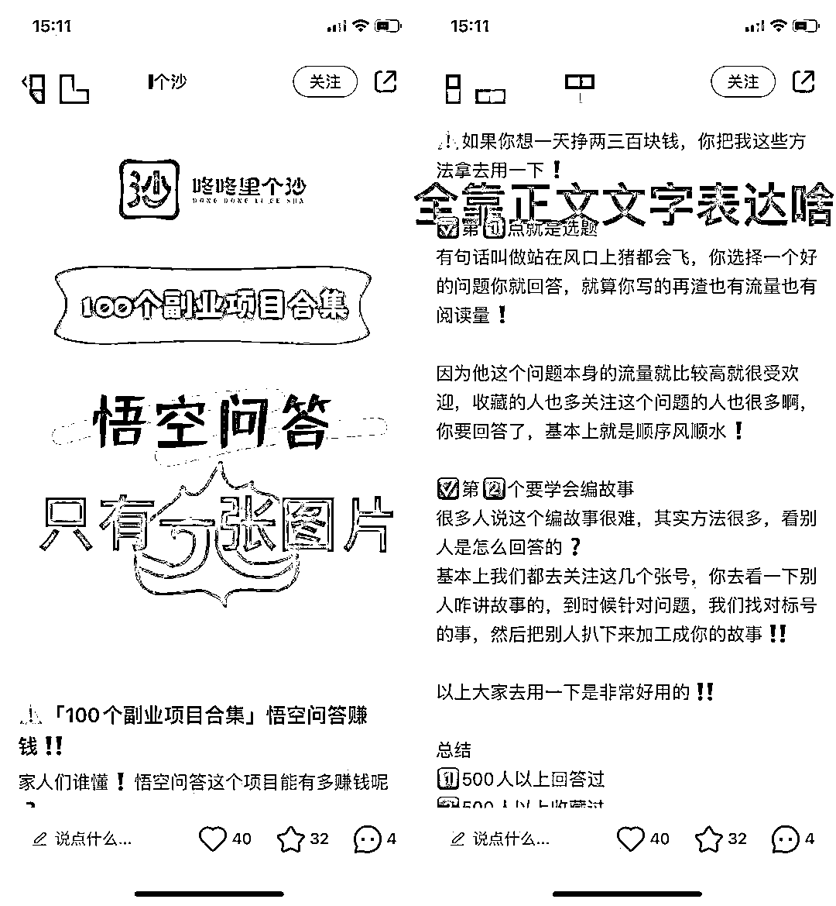
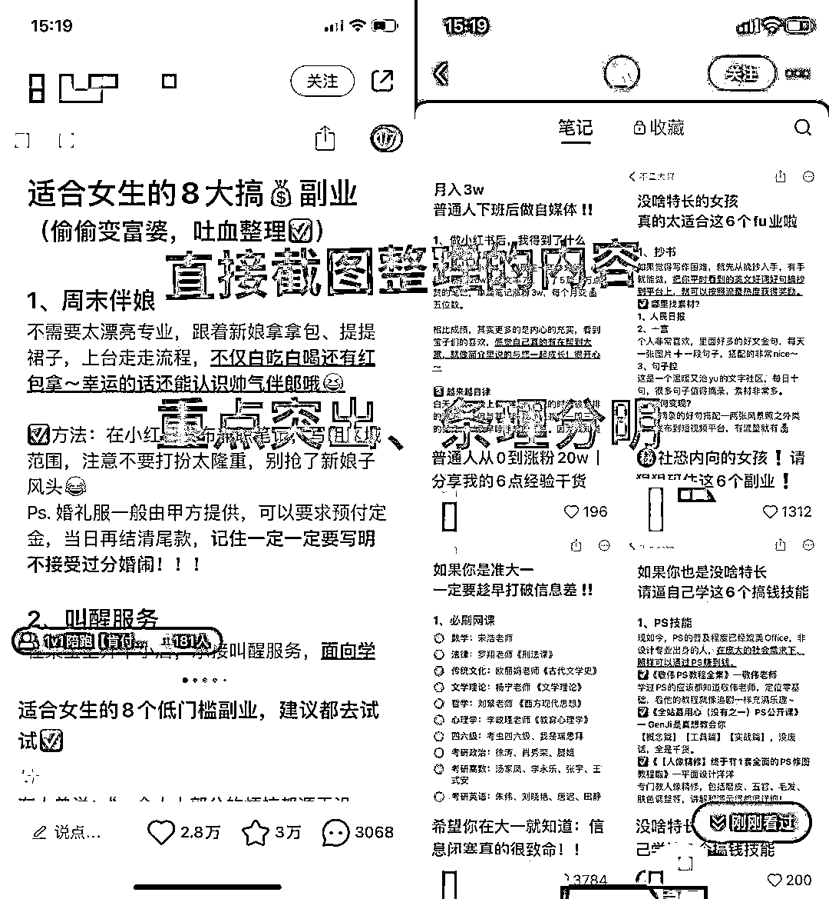
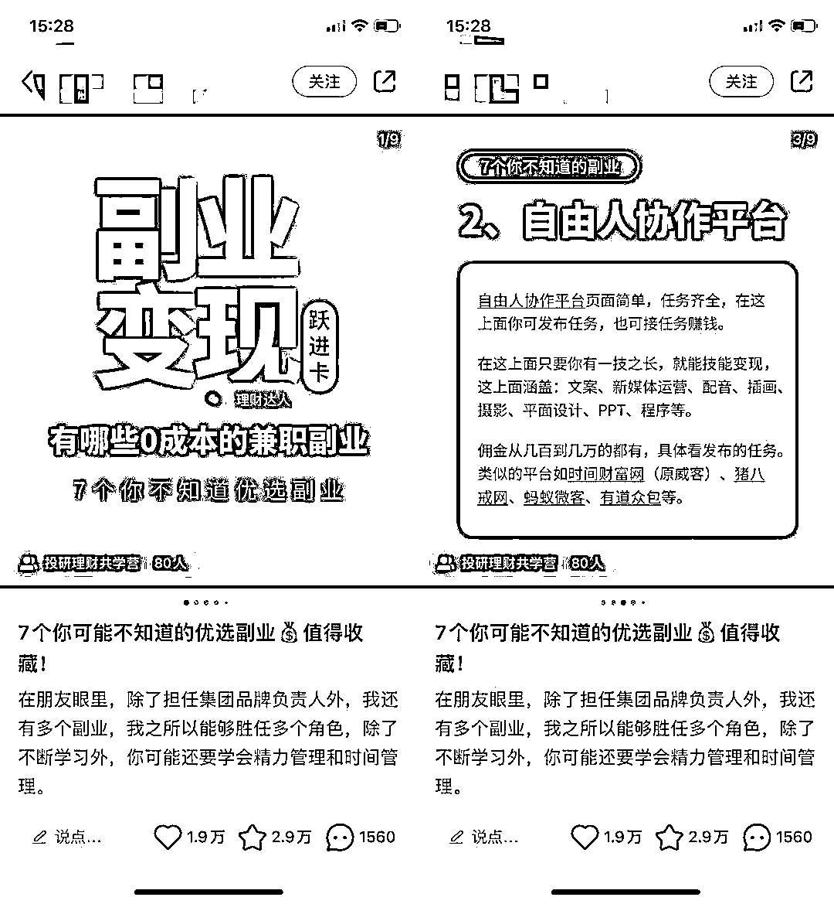
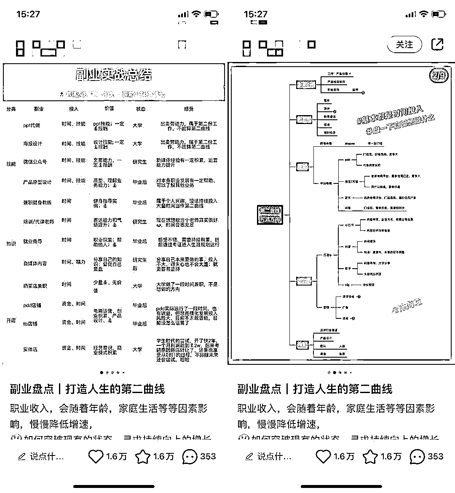

# 资料整理小闭环，到底怎么跑通？

> 原文：[`www.yuque.com/for_lazy/thfiu8/haco6p7fqk5zkndc`](https://www.yuque.com/for_lazy/thfiu8/haco6p7fqk5zkndc)

## 如何跑通资料整理小闭环？

作者： 熊孩子不差！

日期：2023-10-27

各位赚钱的伙伴大家好，我是熊孩子不差，叫我小熊就好。导图有了逻辑的创始人，也在做思维导图陪跑。

2021年4月我入了赚钱会员，一开始闷头研究项目。到了去年10月，首篇精华帖发出，我觉得自己迈过一道坎。随后连续四次登上航海分享台，回头看一路特别幸运，也特别感恩。感谢赚钱团队搭建的交流场，感谢团队的邀约，让我一次次确认自己能行。从当初两手空空，到学会思维导图，再到用思维导图完成变现，副业月入数万。

任何一项技能都值得被尊重，你可以把它藏起来，也可以把它放大。相信今天来听资料整理航海的伙伴，都想把手上的一技之长放大，拿到可执行的回报。

本次分享拆成三块来讲：

一、资料整理是什么

二、21天如何把资料整理学扎实

三、航行中如何管理预期

开始吧：

资料整理直白说，就是把资料规整好。

涉及的范围很广，学习笔记、工作文档、项目素材，甚至你的人生素材，都需要被分类归纳，方便以后快速调用。

一个人的资料整理习惯，其实映射的是他的生活习惯。家里乱丢东西的人，电脑桌面往往也是文件堆成山。

上面的认知是起步层面。在赚钱航海里，一切都要指向结果，所以我们对资料整理的理解会更进一步、更落地。在这里，目标是掌握资料整理的方法，并把它用在你感兴趣的项目里，完成引流。

引流本质上也是一种变现逻辑，有流量才有成交，有流量产品才有意义。

我个人的资料整理走过三段路：

第一段，解决囤积焦虑，提升效率。
第二段，聚焦擅长领域，加速成长。
第三段，开启第二增长曲线，用整理做引流变现。

这三段路也基本覆盖了航海群友的现状：

第一类，还没下场实操，只是想用资料整理提升自我。
第二类，学了不少内容却没系统梳理，想借整理聚焦方向。
第三类，已有积累和沉淀，希望借整理获取流量。

无论你在哪一环，这次我们都给自己定一个目标：整理出一到多个资料库，并跑通引流闭环。

行动上我建议三步走：

第一步，耕耘准备。什么意思？就是认真过一遍航海手册，对资料整理形成整体判断，并选定一个工具作为你的工作地。

手册共分两大板块五章：

板块一：资料整理认知篇，包含第1-2章。主要是清除资料管理的认知障碍，记住核心概念，为后续应用打底。

所有内容都在帮你搭建专属资料库，但成绩取决于你迈出第一步。这里先完整看一遍手册，再配合我准备的手册知识地图一起消化。

第一步选好工具后，第二步就是种学习树。种学习树怎么理解？简单说就是围绕一个明确目标，列出达成目标所需的所有知识点。

为什么要画学习树？就是为了避免像我早期那样只会堆资料，最后被资料堆压垮。

学习树怎么画？

举个例子，比如你想整理的是网赚方向，目标定为整理100个副业网赚方法，这就是树干。

接着画分支，思考网赚方法可以怎么分类？

比如按项目形态分：淘客、中介、产品类项目。
也可以按平台分：公众号、抖音、小红书、视频号。

分类维度只要自洽、能把这棵树理清楚就行。

第三步画叶子。以小红书平台的网赚方式为例，包含小红书接广告、小红书电商、小红书带货等。我以小红书电商为例画叶子，叶子就是具体要学的知识点。

小红书电商的核心链路大致是：养号-开店-定位-选品-拍摄-发笔记-上架-客服-发货-售后

每个环节都要拆出具体的知识点和操作技巧，这些都是树上的叶子。

到这一步，按自己的使用习惯来归类，把内容放到合适的目录里。

可以借助黄金圈法则来梳理：是什么、为什么、怎么做。能把知识讲透就行，其余冗余信息可以舍弃。

如果搜索能力一般，直接在赚钱站内搜关键词，比如“小红书电商”，看个20篇左右，对赛道就有比较全面的认知了。

前面两步是内部建设，接下来就要面向市场。那渠道怎么选？怎么成交？

渠道选择就是决定你在哪个平台实操，比如小红书引流还是抖音引流。

引流方式就是怎么把人带进来。下面以小红书为例说明资料引流的具体做法：

每个方法提炼要点，每点编号，细节只讲关键，避免长篇累赘。

比如：

注意小红书单篇上限1000字，所以不要贪多。一篇分享5条，100个副业项目就能持续更新20篇。

呈现方式：提炼每个副业的核心，用PPT可视化呈现，用其他绘图工具也行。

思维导图能把项目以合集形式展示，同时把细节折叠起来。

以上四种呈现形式，美观是加分项，做不到就把文字写扎实。

你看，资料整理能力在这一步完全能转化为实战基础。

直接建一个群，名字写成“领取100份副业资料包请进群”。有需求的人会主动进来，用小号在群内引导到微信，实现私域沉淀。

思维导图还有一个好处，可以隐藏不想展示的部分，只留框架。用户看不到细节自然会提问，这就是最好的引流时机。

进到私域后怎么办？

可以先以9.9元的价格出售资料包，别定太高。付费本身也是筛选，过滤掉纯白嫖人群。

总之，流量来了要有产品承接。

任何项目真正上手后，都会遇到各种异常。要做好预期管理。

如果某个环节不熟练，就降低目标。原本计划整理100份，当下进度只够20份，那就先把20份做精。

不要内耗焦虑，航海是为了成长，不是制造焦虑。行动永远比观望强。

做自媒体都绕不开流量，记住两点：低调引流，别随意暴露微信号；号被限流也很正常，谁做号不废几个号呢，别灰心。

以上就是关于如何跑通资料整理小闭环的全部分享，接下来就一起实战，用行动换结果，一起龙哥盟。

* * *

评论区：

挽心 : 太牛了

坏脾气的小可爱 : 熊老师的思维导图经验真的很有用，可以自我介绍，还有一些课程归纳总结。

小野 : 熊孩子太牛啦！

马热爱 : 熊熊超棒

自在 : 给熊老师打 call

小浩哥 : 牛

李米乐 : 历害👍

月落 : 厉害👍🏻

* * *