# ('视频号带货4个月收益百万，风口已至！', (2, 20))

四个月在视频号赚到百万，我亲测的三条赛道

我是百万，2022年入行做内容，最初在一个种草平台试了试，之后全力转到视频号。2022年12月正式开干，到现在累计变现超过100万，也带出不少学员拿到结果。这几年，我完整经历了这波红利的五次迭代：

1. 搬运+剪辑起号
2. 二创内容绑商品链接做广告投放
3. 不投流的直播打法
4. 滋补品付费憋单直播
5. 素人出镜口播带货

下面两张是早期学员的案例：

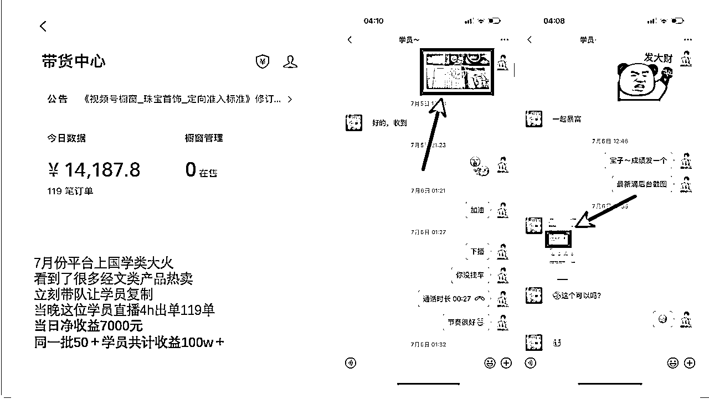

（学员A：国学内容二创搬运号）

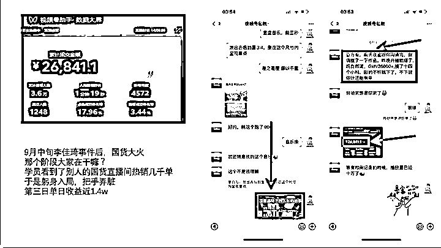

（学员B：国货内容二创号）

今天这篇，我只讲三个亲自验证、目前还有空间的项目。先给出一句我很认同的话：在视频号里赚到钱，说穿了就是找一个已经在赚钱的同行，把它的打法完整抄一遍。

三套分别是：二创+商品链接投放、滋补品付费直播、素人出镜卖货。

第一套：二创内容+商品链接投放

视频号的电商路径，跟抖音当年几乎一模一样。这套打法最早出现在2022年末，最初直接扒视频再做拼接，利润很肥。我2023年6月才下场，试了几天号废得厉害，只能收手。到了7月，系统里全是同类账号，我判断风向变了，又冲了进去。

当时测试的数据如下：

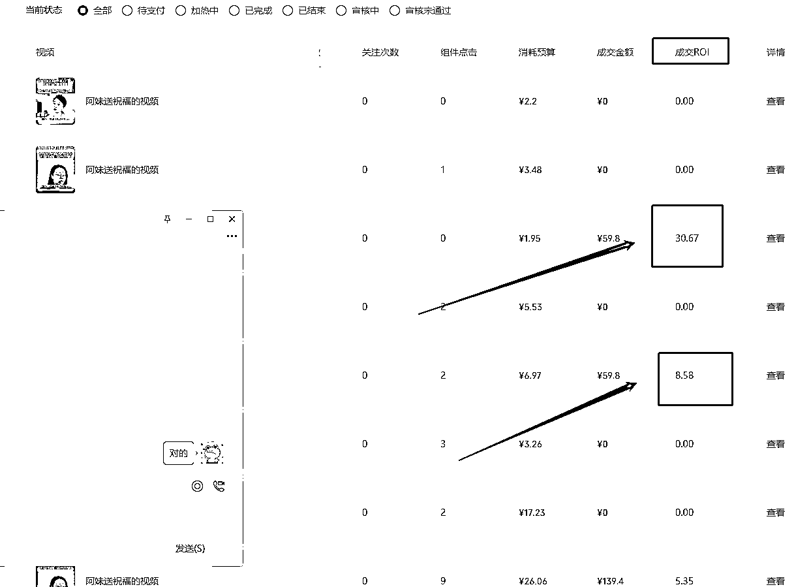

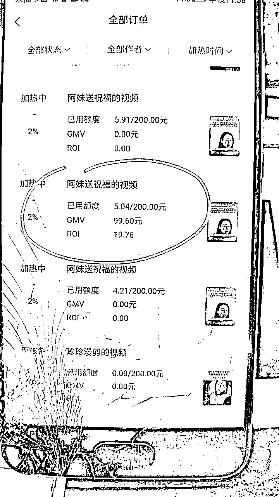

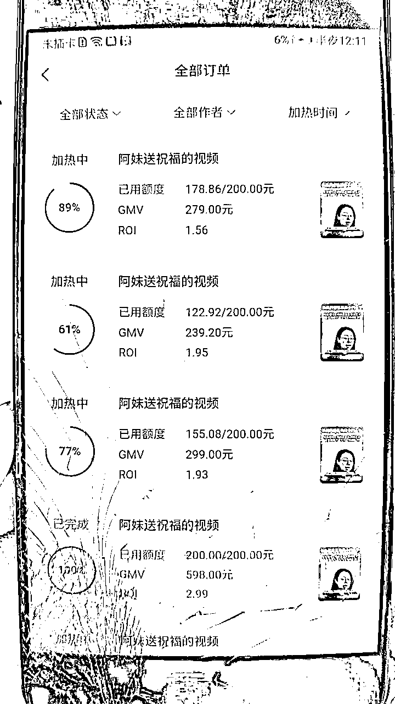

拿到号当天，我晚上选好品、做完视频、投出第一笔钱，效果马上转正。第二天扩到5个号，测试都正常；第三天直接加到30个号。结果平台批量收回商品权限，原因是账号原来的内容和现在做的完全不是一类。36个号只救回3个，其余全成了损耗。因为当时还在跑别的项目，这事就搁置了。

我的体会是：想用投放杠杆放大收益，产品是根本，账号是工具，商品权限是命脉。二创始终游走在平台规则的边缘，一旦判定前后风格不统一，权限就会消失。

这个玩法现在依然能做，关键在权限：新号从第一条内容就锁死方向，发够10条、达到千粉开通商品权限，刷千粉大概250元；或者用个体户执照开店，开店后直接拿权限，同样要全程风格统一。万一权限被收，拿着剪辑软件的项目截图去申诉，说内容是自己做的，但发布时别标“原创”。

现在这玩法就是拼测品速度，大多数品跑不出量，一旦测出一个有量的品，把预算全部梭哈上去，基本稳赚。

第二套：滋补品付费直播

被前两轮废号折腾得够呛，我也想明白一件事：赚钱不靠莽，靠风口和信息差。那阵子我天天泡在平台里看热门内容，发现有一类产品和视频号人群非常契合：女人怕老，老人怕病。从这两个焦虑能延伸出无数产品，但传统药补不能碰。于是我把目光投向食补类产品，挨个直播间蹲，看真实需求、成交额和利润空间。

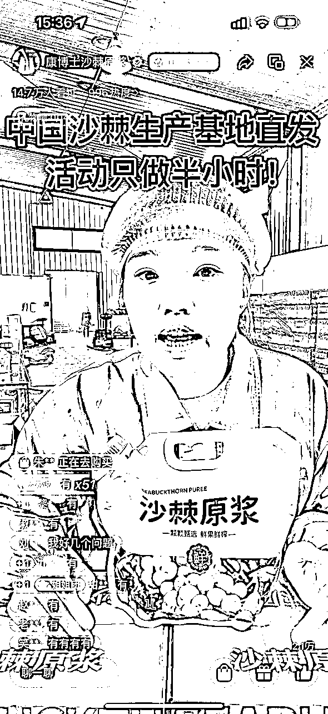

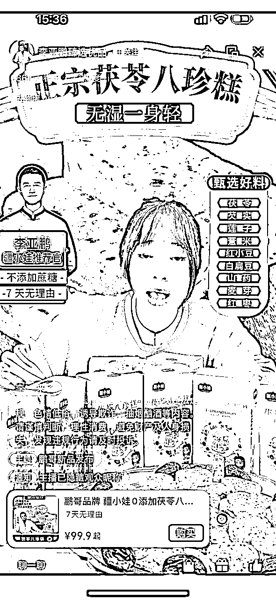

最后筛出几个品，但过程很磨人。好直播间靠人货场，大家条件一样时，好品能带人，普通品只能靠人扛。主播也难找，我试过40多个，才留下一个合格的。先后测过三七、葛根、养生茶，最后定下几款主力。

三个主要问题：一是评分掉太快。在这里购物的人很少评价，甚至找不到评价入口，所以评分一直往下掉，投放又要求橱窗评分不低于4.2，每次接近就得赶紧补。二是话术容易违规。功效词不能直接说，我把功能场景化：失眠就写“晚上怎么都睡不踏实”，湿气重就写“一到冬天四肢发凉”。先自己把话术磨到能过审，再上团队，否则停播一天，人工成本照样要付。三是投放细节。这类品毛利在70%左右，主播熟了以后必须投流，只靠免费推荐不稳定，而且爆品很快会被跟。场景优先实景，绿幕投功效品容易拒审。预约计划要在开播前5分钟送审，先让主播说欢迎，全部过审后再讲核心话术；绿幕直播的前5分钟先别放功效贴片，等计划都过了再放。

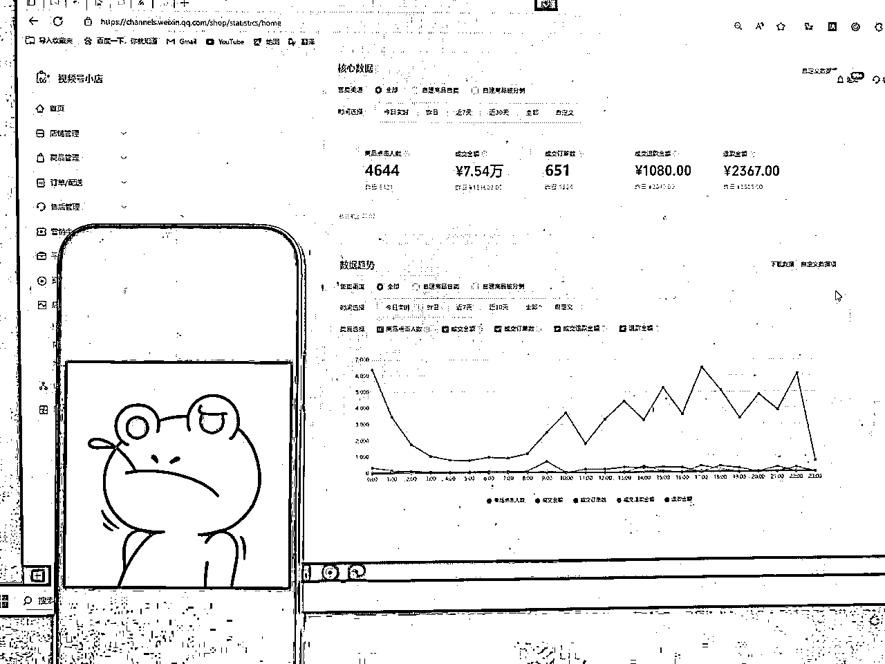

还有三条建议：第一，食补类目集中打一个品，比同时过很多品更稳，后者太吃主播能力。第二，选高单价、大众熟悉、有品质感的东西，像灵芝孢子粉、西洋参、花胶这类，选品决定结局。第三，永远先用最小成本验证。哪怕只有一个绿幕、一台手机、一台电脑，也有人做到单日净赚几千上万。别急着上专业设备和大团队，我曾按正规军配置组了团队，结果评分、话术、测品连环踩坑，亏到肉疼。先跑通，再放大。

第三套：素人出镜卖货

直播项目稳定后，我在线下听到盗坤哥说了一句：视频号会在抖音已经走通的路上重演一遍。那天我灵光一闪，之前图文挂车的问题正是内容不合规，那把内容做合规不就行了？实拍确实有效，但太吃团队。直到刷到这类账号——普通人坐在镜头前讲产品，再把商品链接挂上去。

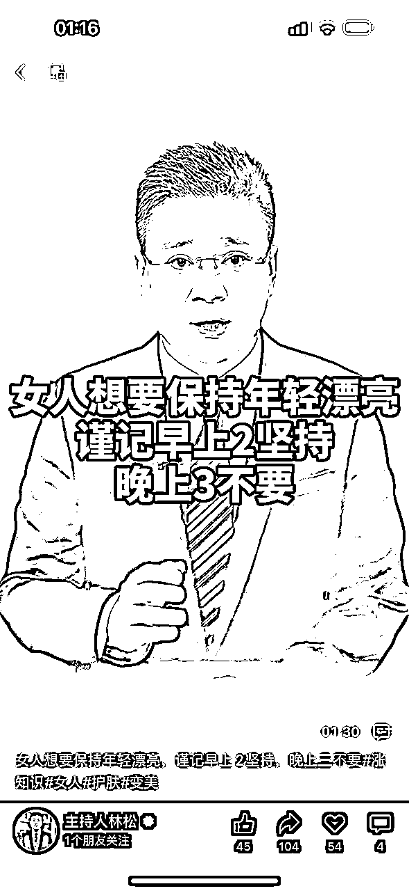

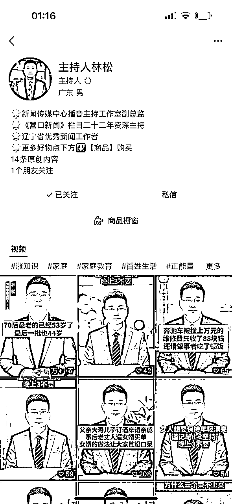

说白了，这就是达人带货的翻版，只是换了平台。赚钱路径很直接，没什么多余操作。有镜头表现力的专业主播不好碰，那就找普通素人。我多渠道面试演员，挑到合适的立刻开拍。红利期比谁跑得快，那阵子我天天通宵磨选品和脚本，总算熬出来了。

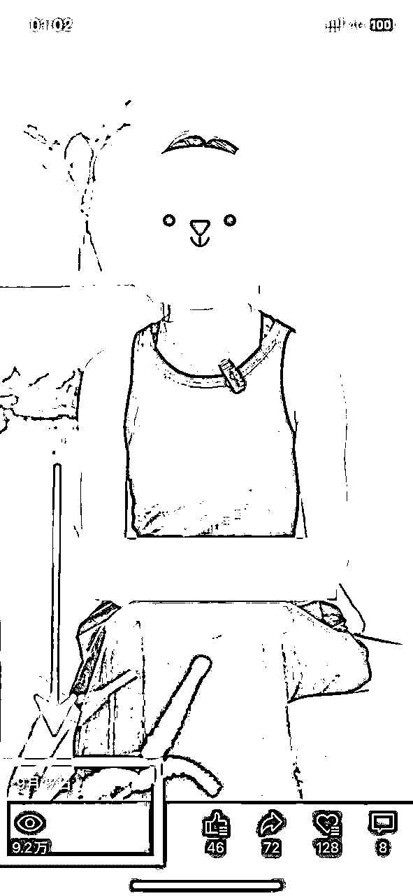

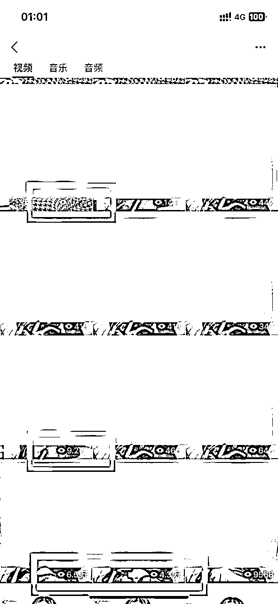

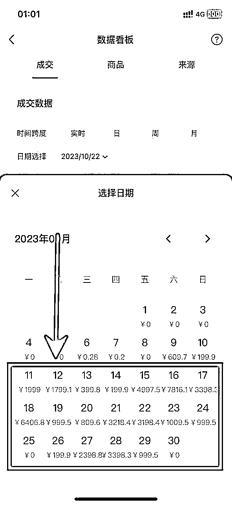

（演员矩阵账号中其中一个）

单个素人号，一款产品就给我带来很厚的回报。下面这张是当时的单日投放记录：

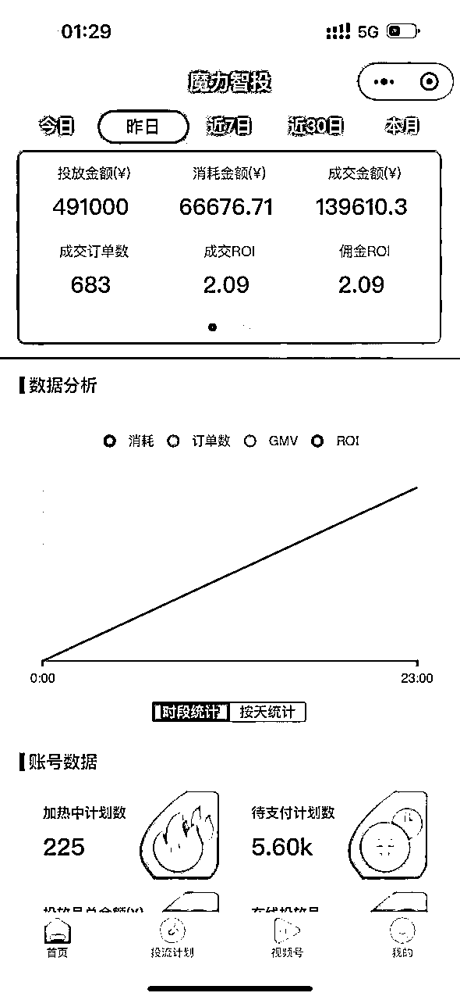

那款品卖199元，综合退货率等开销，ROI 1.31是盈亏平衡线。项目核心还是选品，口播和剧情只是表达形式。这个平台的用户质量很能打，很少比价，所以定价可以大胆一些。

选品我只看四类：应季、强痛点、有源头供应、新奇特。我打的就是一款功能型痛点内衣。

在蝉妈妈上选品时，我一般会进商品数据库，先看当天全类目视频卖货榜，把视频转化占比超过60%的前300个品拉出来；再按季节热度挑类目，比如2到4月减肥旺季看运动健身和家居日用。找到备选品后，先看用户年龄结构，40岁以上用户要占四成以上，再拆解靠前视频的内容形式和时长。

跟同行学选品更简单：刷到卖货视频，进店铺按销量排，再去抖音找同款链接，把脚本扒下来。

剪辑、养号这些细节，圈友纸壳写得很清楚，我不重复。@纸壳

这个项目还在红利期，希望更多朋友一起来试。

最后说点真心话。进赚钱以前，我是一个人瞎折腾；进赚钱以后，慢慢有了团队。晓文哥一直鼓励我，理白哥、靠谱姐、比比一直引导帮助，还有很多圈友默默支持。我出身农村，端过盘子，进过工厂，创业没成还欠着债，穷过太多次。被这么多人托举，我真的非常幸运。也正因如此，我更不想辜负。知道自己要什么，就拼命去拿；受过别人的帮助，就拼命把事做成。既然没有靠山，就只能朝前冲。一起搞钱，干就完了！