# 《两千粉冷启动7天直播场观破万，我到底抓住了哪几个关键点？7天螺旋起号全复盘》

> 来源：[https://b16xnqwk20.feishu.cn/docx/EHJWdFbQBoMSbAxvtGwcjdyqnlg](https://b16xnqwk20.feishu.cn/docx/EHJWdFbQBoMSbAxvtGwcjdyqnlg)

赚钱圈的伙伴们好，我是宋老师，账号叫宋老师帮你做课。

现阶段全网做课卖课赛道头部玩家，年化变现800万+，累计5000多名学员里有200多位做到百萬級變現。

就在最近的7天，我做了一次“自找麻烦”的实验——放弃了十多万粉丝的老号，用一个只有两千粉的新号去直播带课。

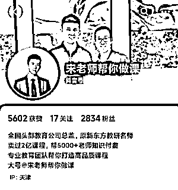

先报结论：零投放、纯冷启动，场观冲到1万，且平均在线稳定在240人。

这7天，我和团队做了逐场拆解。接下来我把做对了什么、踩雷了什么，原原本本地摊开。

市面上很多直播导师会教你下播后大量看数据、扒后台、算场观转化率。但我要说的是，起号期的前7天，这些复盘根本不重要。

开播前一周，你每天只需要死磕两个KPI。

把这两个核心目标守住，场观破万只是时间问题。

在聊干货前，先简单介绍下我的背景，方便大家判断价值：

我的五大标签：

1. 目前自媒体头部做课&卖课博主，具备强流量能力
2. 曾任新东方总监，最高操盘80万学生社群，教学能力扎实
3. 从事知识付费两年，每周稳定2场私域直播，直播能力在线
4. 带过6000多位知识博主，成绩说话
5. 很多百万级博主背后的课程操盘手

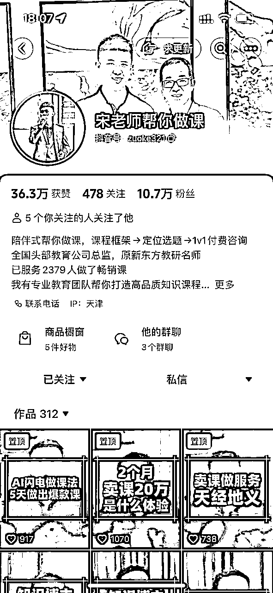

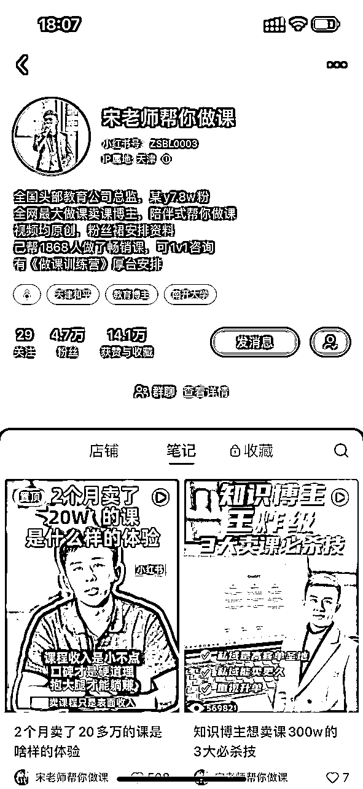

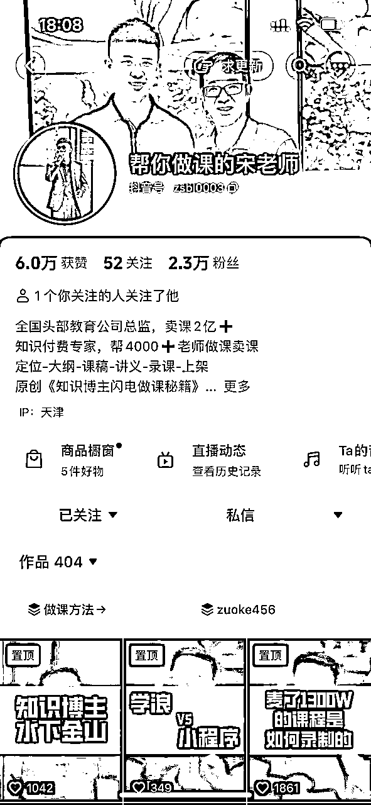

# 第一天

## 当日直播数据

第一天场观877，对新号而言很正常。但有个异常亮眼的数据：平均停留3分24秒。

要知道在知识付费垂类，能稳住1分50秒就已经算不错了。

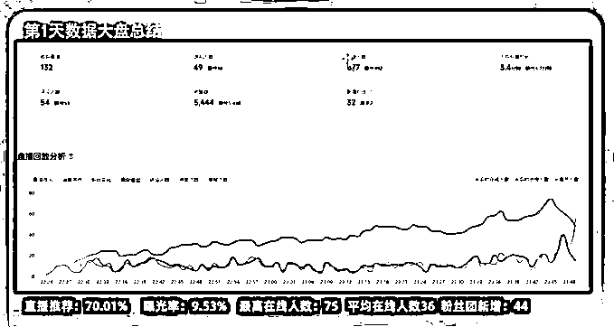

第一天下播是凌晨12点半，团队连夜复盘到三点多。我们逐帧回看直播回放，把每个动作拆开来讲。

结论很清晰：新号首播最该死磕的只有两件事——控停留，和做灯牌。

下面分开讲。复盘时我们也梳理了不少可以改进的细节，后面会提到。

## 核心抓手：停留+灯牌

### 1. 先把停留拉起来

新手首播的首要任务就是提升停留，停留起来了，推流才有可能起来。

第一天我只做了一件事：吊胃口。

你肯定见过那种直播间，主播每隔几分钟就要喊一次点赞。点赞到多少发福袋、送福利、讲干货，这是常规操作。

很多人把它叫做卖关子，但我第一天一枚点赞都沒要。

为什么？先想清楚：点赞重要吗？

点赞权重最低，几乎可以忽略。那为什么大家还要一直拉？

本质是服从性测试。通过点赞看用户是否听话。

比如健身主播在推课前喊点赞到两万就教肩颈秘籍，通过点赞增速判断用户质量和推课可行性。

可首播直播间人少，粉丝也不熟，做服从性测试毫无意义。

第一天更该做的是让人留下。

我的话术策略就是持续吊胃口，憋着不说答案。

拉停留要顺着抖音的推流逻辑走。我们总结的规律是“小考-中考-大考”。

小考：每5分钟一次，上一轮5分钟的内容质量决定下一轮的推流量。

中考：每场直播都是中考，这场成绩影响下一场冷启动的起步。

大考：7天一个螺旋周期，平台会给你一波大流量测试承接能力。你能接住就跃迁圈层，接不住就掉档。

明白这个机制，你就知道为什么首播要猛拉停留。

具体怎么吊？就是给用户埋好奇点。

举例：我要拆解7天把新号场观拉到一万的方法，但不会上来就说。我先讲相关概念、讲准备过程，慢慢把答案往后推，让人想继续听。

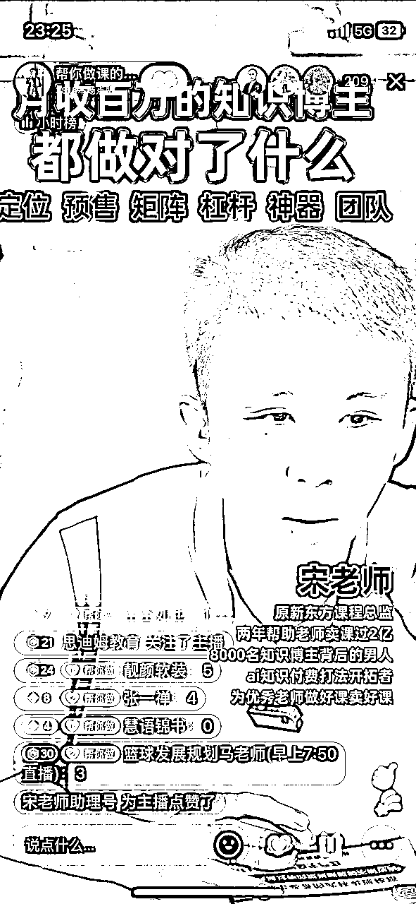

### 2. 有余力就做灯牌

停留搞定后，第二优先级是灯牌。灯牌权重仅次于停留，所以主播普遍会做。

复盘时发现一个细节：飘屏必须用好。

飘屏是运营后台可控的工具，要配合主播节奏。比如下播前我喊关注点亮灯牌、进2群领做课宝典，运营就同步飘出对应文字。

讲干货、发福利时，飘屏也可以作为内容补充。

所以开播前就要把飘屏文案准备好，和运营对好时间节点，直播时直接复制粘贴，配合更顺。

拉停留时还能顺带做灯牌。比如讲到关键点故意停顿，引导用户亮灯牌，再继续讲。一举两得。

## 首日复盘要点

有意识地做了停留和灯牌，但仍有优化空间。复盘后总结：

1. 开播前飘屏提前设好，避开违禁词
2. 提前设计好直播贴片
3. 卖关子要更极致，拉足停留
4. 连麦问得太细，直接引导后台私信加微
5. 连麦流程复杂，直接要礼物
6. 要灯牌要点赞，塑造非乞求人设

这些优化直接推动了第二天的增长。具体sop后面会上。

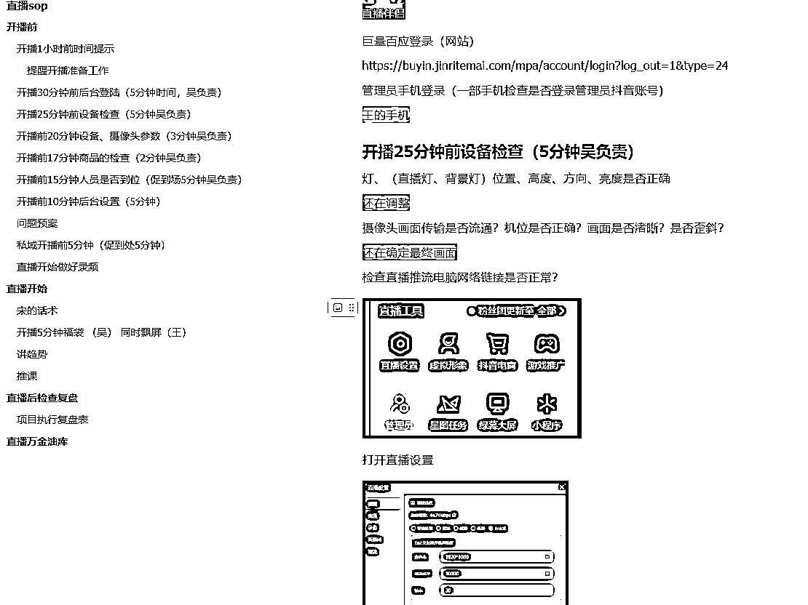

# 第二天

## 当日直播数据

场观从首日的800多跃到3524，说明首日表现被平台认可，拿到了一小波推流。停留也稳定在3分钟以上，流量质量不错。

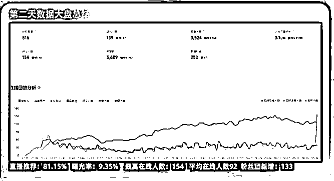

第二天该抓什么？

## 核心抓手：继续拉停留，发力灯牌

### 1. 拉停留仍是地基

第二天直播间仍不稳定，先把底层打牢。

有了第一天的经验，知道什么内容能留人、什么内容能吸人，就不断复盘迭代。

找到你的流量密码，比如我发现直播间里一喊“月入百万”，进人明显增多。那这个词就会反复用。

如果试了半天没反应，就立刻换。

### 2. 灯牌从随缘变主动

第一天灯牌是顺带，第二天要主动要。我用了三种方式。

方法一：发稀缺资料。
要突出稀缺性。比如我分享一个自动录屏同行直播的神器。

话术：这个神器帮很多百万级知识博主解决了从0到1直播的问题，我现在免费分享。想要的评论区打“想”。

然后说：小助理记下评论区打想的老师，22:10截止，没点灯牌的不给，因为核心干货只给自己人。

评论区立刻热起来，灯牌也跟着起来。

方法二：打情感牌。
拉近距离。比如：没关注没亮灯牌的，点个关注亮个灯，成为宋老师的自家人。自家人连麦优先，我能第一时间看到你的问题。

再背书：我曾是新东方总监，线下卖过2亿课，线上也卖过2亿，现在6000多学员，头部大V都是我的学生。

用户觉得你是朋友，自然愿意亮灯。

方法三：点对点要灯牌。
直播间有人提问但没亮灯，直接点名：xxx你这个问题问得好，但你没亮灯，不是自家人吧？想提问的老师先亮一波灯牌，亮了再回答。

表面点一个人，实则带动全场。

下面是我常用的直播脚本模板，供参考。

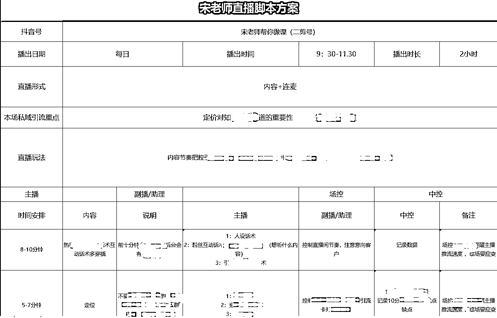

# 第三天

## 当日直播数据

场观冲到5704，增长非常猛。

这一天我只做了一件事：把钩子做扎实，猛做数据。

钩子我总结了几十种，选效果最好的循环用就行。

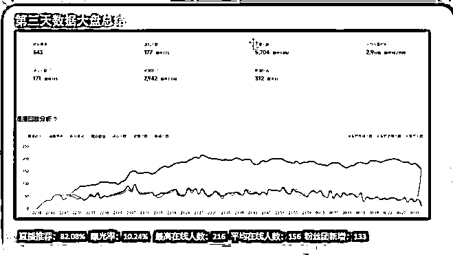

## 数据猛攻三心法

### 1. 连麦中做数据
连麦讲干货时，每3分钟做一次互动数据。最简单就是让评论区刷数字。

比如：先做课还是先直播？先做课扣1，先直播扣2。

评论区刷屏时，你不能干等，要同步做人设话术或要灯牌。话术要短、易循环。

### 2. 砸钩子
第三天我用了两个高价值钩子，反复强调加团才能领。

比如：我录制了【同行抖音直播】的监控神器，能精准复制头部大V打法，快速搭建话术。想要的评论区扣“想要”，统一安排。

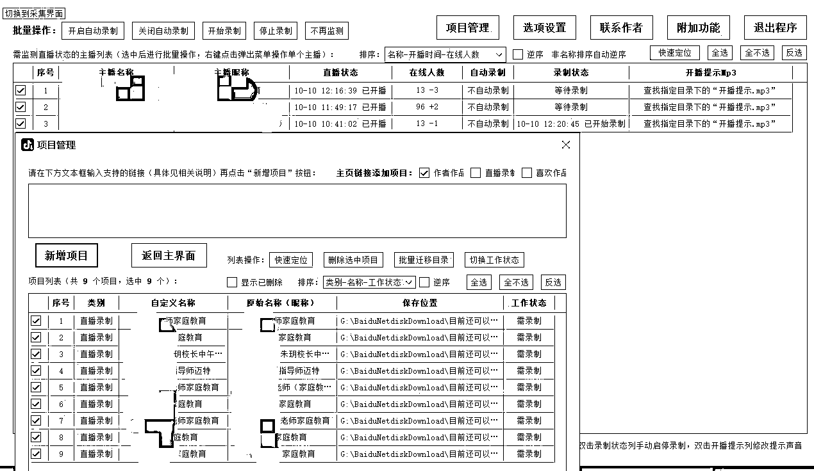

更高级的是，同行开播有提示音。可以让他们听一下。

还有多套头部大V直播话术拆解稿，也同步分享。

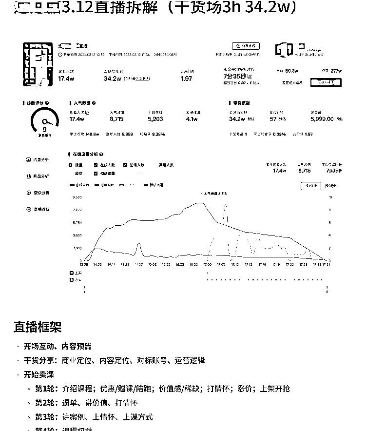

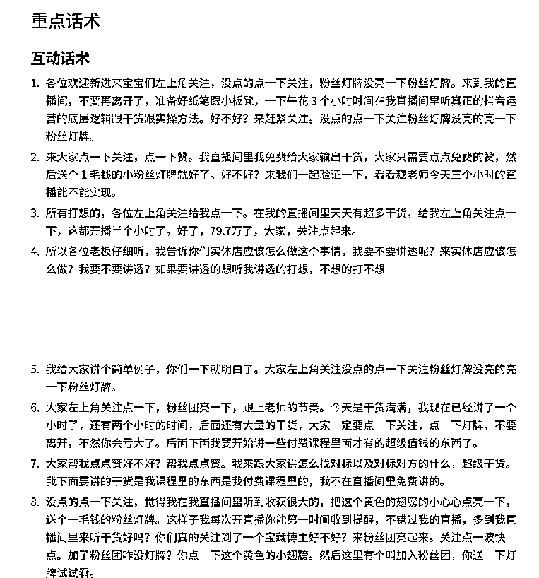

他们觉得东西实用稀缺，根本找不到，自然会进私域。之前我分享过《30天私域卖课60W是什么体验》，感兴趣可以去看。

### 3. 固定连麦SOP
早期连麦容易被用户带偏。后面我们定了固定流程，连麦只问三问：

1. 你做什么赛道？
2. 现在月入多少？
3. 想问我什么问题，只能问一个。

主导权立刻回到我手里。有人要长篇介绍，直接打断，按流程来。

# 第四天

## 当日直播数据

场观跌到5367，比前一天下滑。因为当天我出差了，直播背景是酒店白墙，灯光全无。

但宁可丑着播，也不能断更。断更前三天的积累就白费了。

硬着头皮上，也算虽败犹荣。居然还能稳住200人在线。

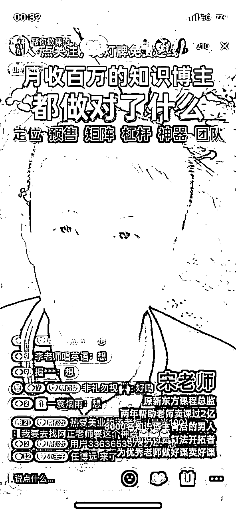

大家感受一下，这么简陋的场景，居然还能在线200。

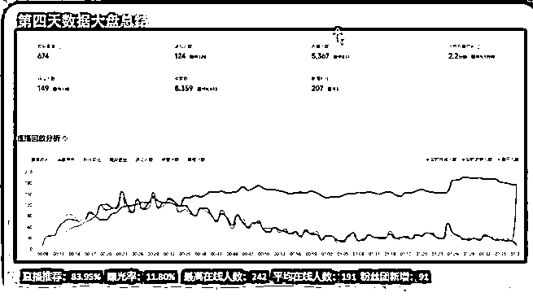

## 两个核心逻辑

### 1. 不断更
直播最忌讳断更，尤其是前7天。7天一个螺旋周期，一旦中断，流量直接崩盘，前功尽弃。

再恶劣的环境也要播。

### 2. 感官很重要
那天我刚下飞机，状态差，情绪会传染。背景是白墙无补光，视觉体验差，数据自然受影响。

但因为没断播，数据只小幅下滑。如果没播，必死。能挣扎着把数据拉回来已算赚。

复盘后判断，如果在公司正常播，当天场观能到2万。

另外，复盘是刚需。我的小助理每次都会实时记录直播节点，方便回看和做贴片。

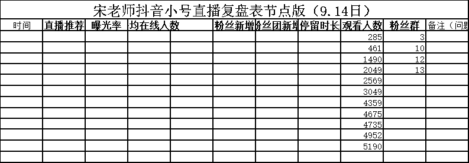

# 第五天

## 当日直播数据

换了个灯光背景都不错的地方，场观回升。

这个阶段直播流程和内容已经固化，知道每个时间点该讲什么。虽然经历前一天滑铁卢，数据仍小幅上涨。

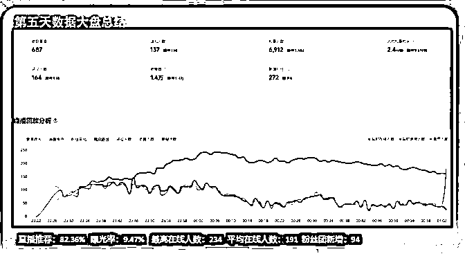

# 第六天

## 当日直播数据

回到公司播，前五天的积累明确了流量密码。开播前和团队微调框架、优化互动形式。

当天连麦12个，场观直接拉到1万。

所以如果第四天没出差，当天场观很可能直接破2万。

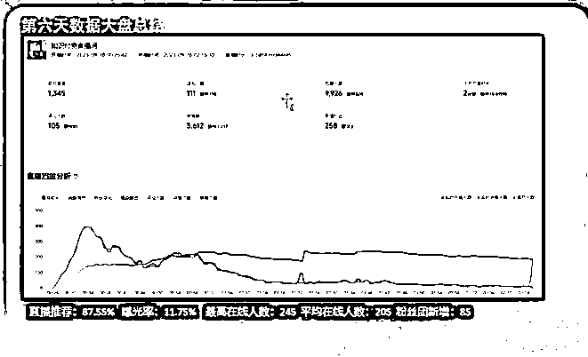

# 第七天

## 当日直播数据

第七天数据又下滑，因为又踩了个坑。

和团队深度复盘后发现，这涉及一个关键逻辑，后面会单独写文章拆解。

前几天的经历已经证明，没有不可抗力，场观过万不需要7天，按方法走3-5天就能做到。

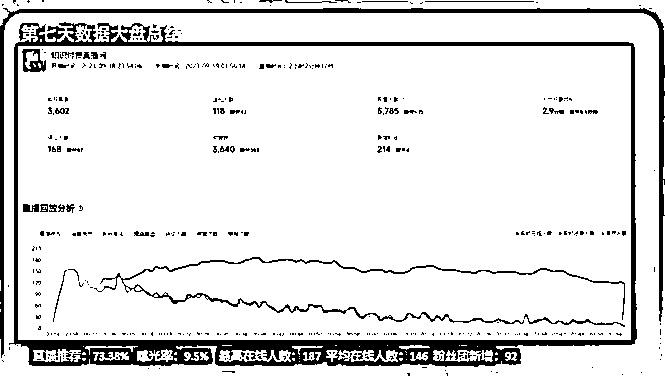

# 写在最后

7天复盘结束，最后总结9个核心点，前三个最关键。

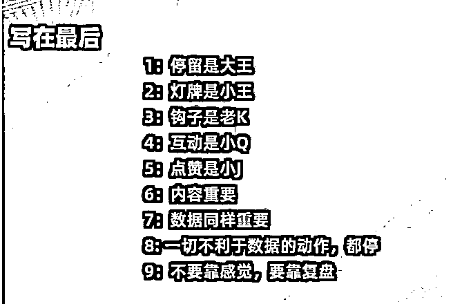

其实直播没那么难，坚持过前7天，卖课百万只是时间问题。

前提是你得有清晰的产品体系，课程是1，直播是后面的一堆0。

知识付费的本质是让你成为超级个体，一部手机、一台电脑、一个账号、一个直播间、一门课程，就能拿结果。

希望大家都能在人均自媒体的时代拿到好结果，成为超级个体。任何知识付费问题，欢迎交流。

我是宋老师，23年帮助500位老师卖课50w，欢迎一起卖课赚钱!