# 别人都在刷项目，我却靠一个积分榜把门票翻了4倍

> 来源：[https://eqc9f6vzuhv.feishu.cn/docx/Ifz1dXrkso0swUx5AY1cyBmUnGd](https://eqc9f6vzuhv.feishu.cn/docx/Ifz1dXrkso0swUx5AY1cyBmUnGd)

晚上好呀各位圈友，很开心又遇到你了。

先简单自我介绍一下：

【昵称】微微
【所在地】深圳
【身份】公司文员 + 自媒体写作副业
【擅长方向】写作技巧、知识管理、成长认知

【个人履历】
1. 写作累计12年，自媒体入局10个月，已完成改稿560+篇，原创300+篇，总字数73万+。
2. 龙哥盟知识星球龙珠碎片持有者，图书共读航海项目连续21天打卡并入选精选，航海成绩位列个人组第一。
3. 多个付费星球的精华帖常客，半年精华贴累计100+篇。
4. 近6年读书336本，笔记49本。
5. 自媒体写作半年实现变现五位数。

在龙哥盟这种顶级知识星球里，项目层出不穷，每天刷新都能看到无数可复制的赚钱思路。

可对刚入场、认知和执行力都还在成长期的新人来说，想在短时间内挑中一个适合自己上手、还能跑通的项目，难度真的不小。能力、思维、下场魄力，都需要时间去沉淀，或者至少需要一个已经验证过的正反馈来托底。

所以今天我想分享一个我亲自跑通、并且极度友好于新手的变现路径，无论你社恐还是缺乏自信，都能做：

盯住各大付费星球的月度积分榜。

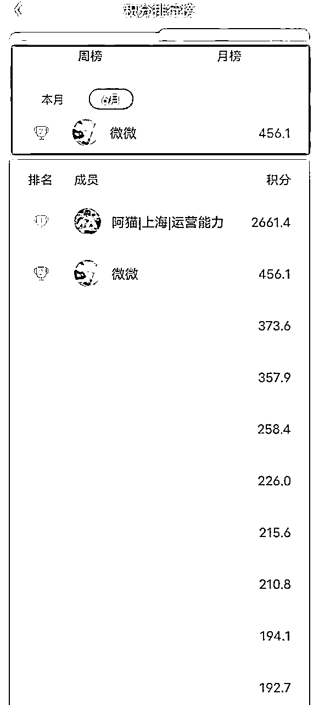

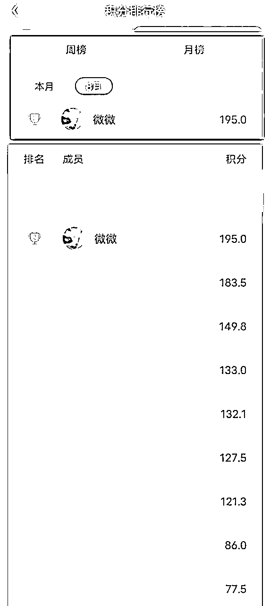

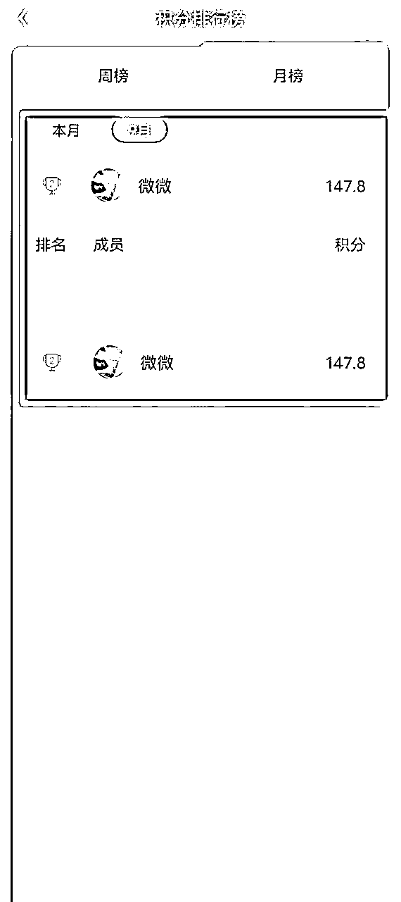

我通过在多个付费知识星球持续更新内容，连续从6月到9月稳定占据月积分榜前三，也因此实现变现8000+。

（9月航海期间，还冲进了龙哥盟知识星球月积分榜前100）

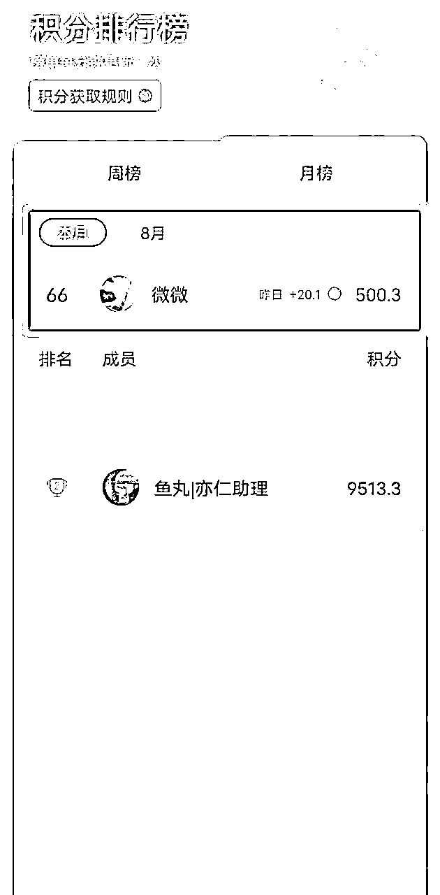

整体打法很清晰：

保持日更输出，争取加精华，同时在文末或评论区埋下互动的钩子，让人记住你、刷脸熟；在被动链接后，用一份高价值的见面礼加固信任，再顺势提升转化率。

# 一、项目是怎么被我发现的

这是个意外撞见的机会。5月时，我在赚钱朋友圈看到有人晒星球积分排名，好奇之下去几个星球翻了翻，第一眼没觉得有什么特别。

第二天我再去看榜单，发现排名变化非常大，尤其是10-50名之间波动极猛，我意识到这并非随机。

随后的一周，我开始用点赞、评论、发短帖的方式往上刷分。那阶段的内容很水，主要是口语化的随笔，利他价值有限。但当排名冲进50名以内后，奇怪的事发生了：

有人主动来加我了，而且是排在我后面的第61名。聊下来才知道，很多人在暗中盯榜单，都想把名次推上去，尤其是前10名，每次打开星球都能被看到。新人老手、大佬都会不自觉去点开这个突然冒出来名字，翻看他的文章，于是曝光和高质量互动就来了。

明白这一点后，我觉得这对新人来说几乎是零风险的练手场：

1. 即使没人链接，持续输出也能把思维、写作能力刷熟，技能点持续升级。
2. 如果有链接，就能积累一批同频精准的好友，后续转化更顺畅。

综合来看，投入产出比极高，值得长期做。

# 二、先把星球的脾气摸清楚

想在积分榜上站稳，首先要了解星球的计分规则。初期私域粘性弱，我主要用的是加精华、点赞、评论这条路：

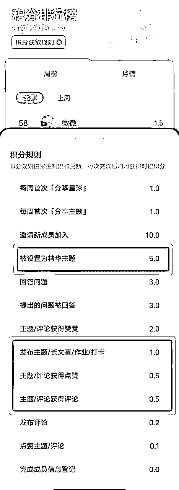

尽量发能打动人、提供干货、有情绪共鸣或正向激励的内容，增加被点赞、被评论、被加精华的概率。

注意：不同星球的偏好差异很大，很多人用的“一文多发”混脸熟法，只能短期露脸，变现没戏。必须对症下药：

搞清楚每个星球用户爱看什么、什么时候活跃、哪类内容反馈最好，然后围绕这些持续输出。

## 精准挑内容，别把时间耗光

同时研究多个星球，每天全量阅读成本太高。我用的提速法是：

锁定近一个月内的精华帖，以及点赞互动率最高的10篇，再看发布时间。三个维度交叉，就能快速锁定当前爆款方向。

把这些帖子找齐后，用“黄金5行法则”拆解：只读每章开头5行和结尾5行。大脑会自动补全中间逻辑，而且核心观点基本都在首尾。中间多是案例铺垫，扫过即可。如发现某知识点难度高且贯穿全文，再回头细读。

我只是要了解风向，不是深度学习。

PS：付费星球优先。付费这道门槛本身就是筛选器，里面的人学习意愿强、付费习惯好，更容易成为用户和未来伙伴。免费群鱼龙混杂，转化成本高。

注：

如果自己还没什么成绩，就别去门槛过高的头部星球，里面的用户段位普遍比你高，输出价值有限，还容易打击信心。按自己的能力匹配星球更稳妥。

除了知识星球，低客单价的付费社群也可用，持续分享感悟和实用观点，解答问题，也能带来被动链接。

# 三、写作是核心武器

思路有了，还得会写。很多想法在脑子里很清晰，一写就散。所以写作是必须打磨的硬实力。

刚开始不用追求文风独特，但要保证清晰、条理、逻辑通顺。干货类内容用“总-分-总”结构最稳。

如果完全没感觉，可以试试这两个练习法：

## 01.写作练习

### 口语倾倒法
不管逻辑，直接用日常聊天口吻把脑中所有相关信息倒出来，知识点、灵感、操作步骤都写，不要管通顺。前言不搭后语也行，写完再整理删减。

整理时别追求完美，保留核心信息就行。多读几遍，把不通顺的句子顺一顺，一篇白话文就出来了。

适合练手，不适合直接当成品发。

### 框架拆解法
我更常用。先列大纲起粗标题，再按1、2、3分段，每段配小标题写下核心要点。之后围绕标题和关键词扩写，再回头修改是否跑题。

## 02.素材怎么来
知道星球想要什么、会写了，就差素材。很多新人卡在这里。

我之前写过《写作秘诀，学会自制源源不断的素材》，有需要可以自取。最轻的方式是多学多看：从书籍、其他星球、社群里吸收，再消化后二次表达。

龙哥盟的信息密度极高，几乎能覆盖自媒体全流程素材。但切记不能直接搬运，学习后用自己的理解重写，既能积累知识，也能慢慢形成个人风格。

# 四、提高留存，建立信任

星球发帖，可以结合朋友圈运营思路，看《IP朋友圈运营航海手册》。

纯干货输出不利于拉近距离，人设要真实、有温度。最终目的是变现，所以必须加一环：增强粘性。

路径是：确定人群→找到他们的知识刚需→学习到及格线→输出利他内容→展示共情面→提升信任安全感→被动链接→朋友圈转化→成交。

## 埋下不动声色的钩子
在专业输出之外，要搭建沟通桥梁。用户停留在你文章前时，用互动把它引到私域。

文末或评论区留钩子，不是硬广，而是共鸣式互动：

1. 我也是新人刚入门，欢迎来看朋友圈；
2. 一起加油，一起逆袭；
3. 在文中反复提及受众可参考复制的操作，比如针对新手小白；
4. 分享自己的从0到1经历，强调真实；
5. 认真回复每个评论区问题。

这种低姿态钩子转化率很高。我一篇80+点赞的文章，带来40+精准被动链接，后续私域成交率达80%。

（注：不要直接留VX或引导关注，星主未允许属于不礼貌行为，可参考我之前的《自媒体入门必修课，社交礼仪！》）

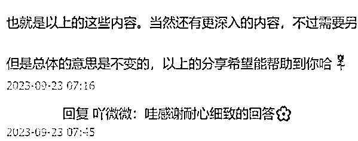

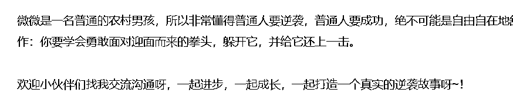

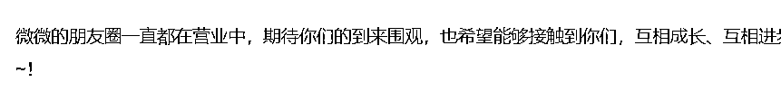

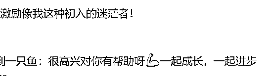

## 日常互动
坚持日更一个月，你在这个星球就不再是路人。把朋友圈运营中的“日常感”融进来：成绩、感悟、产品心得穿插其中，第二个月人设就清晰了：专业+成绩+产品+生活=被动链接。

每天在用户活跃时间点赞评论关注你文章的人，加深联系。三个月下来，我累计被动链接近200人。

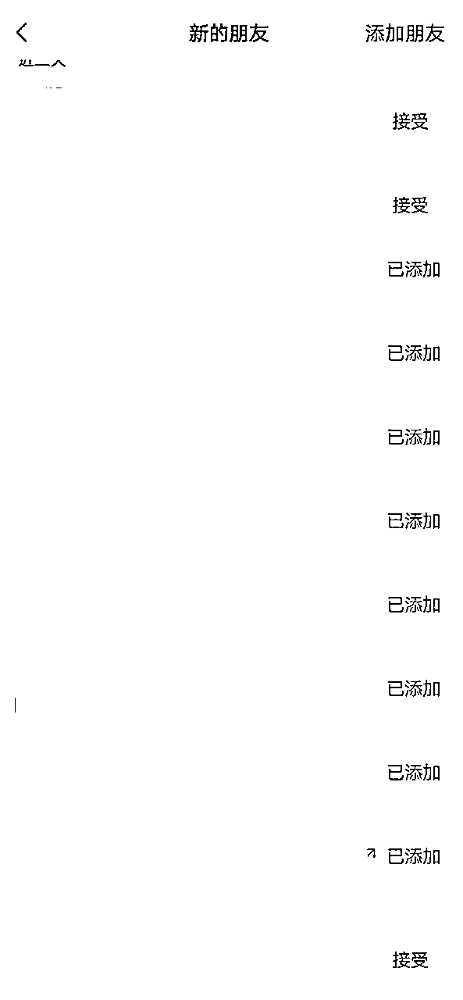

# 五、从痛点切入促成交

两个月下来，写作、思维、储备都会有明显提升，同时会沉淀一批种子用户。他们因你的内容而来，对你有基础信任，能力认知也与你接近。

这时从痛点入手成交就很顺畅：

## 先给礼物，再谈生意
用户进私域后别急着卖。直接推销容易被删。先用感恩心态给予价值。

针对不同星球来的用户准备定制见面礼：写作来的送《新手写作避坑指南》，认知来的送《从0到1的成长认知模式》。用星球外的额外价值刺激“互惠心理”，让对方产生回报冲动。

## 朋友圈自动化成交
基础工作做好后，朋友圈的产品笔记就能自然转化。文案其实很简单：把用户在星球提问的难点、卡点整理成笔记发出来，就能二次吸引。他们因信任和急需，很容易成交。

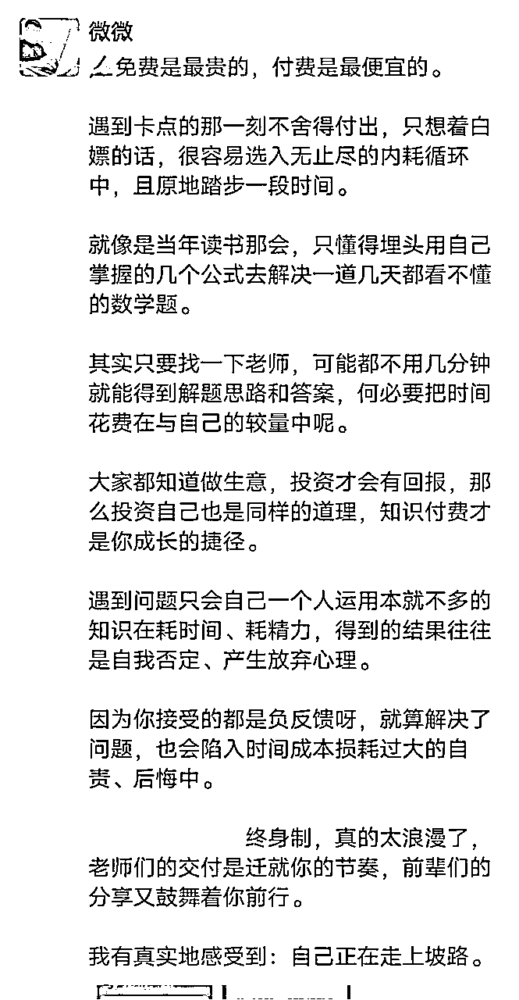

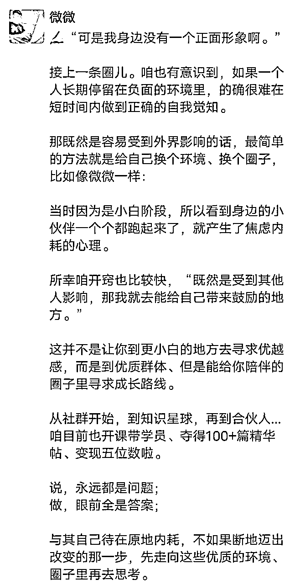

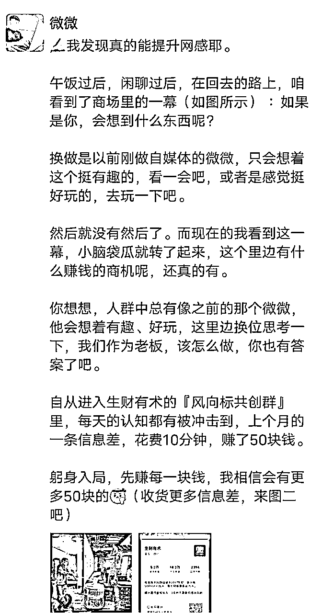

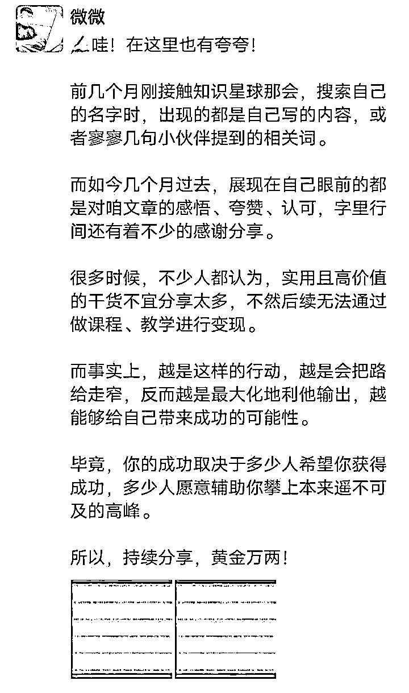

# 六、收尾话

这个路径我沉淀了近三个月，最终实现8000+变现。

对新人而言，这笔投入很值。我们常在赚钱看到“月入五位数”的案例，第一反应是焦虑，这条路恰好容错率高：

三个月没赚到钱，你也输出了大量内容，能力认知全面升级；
三个月赚得不多，但你已经赚到第一笔互联网收入，学会了躬身入局；
三个月足够你磨炼心性，培养长期主义。

记住：没有赚不到钱的项目，只有还没做对的人。