# 高客单定制游实操复盘：新手首月出单率超30%，这套小红书打法值得参考

很多人觉得旅游项目门槛高，既要懂线路，又要有旅行社资源，还要会做内容、会成交。实际上，只要选对细分方向，并且把小红书到私域的路径跑通，新手也有机会在较短时间内拿到结果。

我是阿渡。8月份，我曾在赚钱分享过一篇关于新手如何通过小红书做旅游项目的文章。后续，我们又带着两批学员进行了实操，在不断测试和调整的过程中，积累了一些新的经验。

目前，市场上关于小红书旅游项目的系统分享并不算多，但旅游赛道本身仍然存在机会。下面就把我们近几个月的实操结果，以及在产品、内容、引流和成交方面的经验整理出来，希望能给想入局但没有方向的朋友一些参考。

---

## 一、先看实操结果：新手也能快速获得正反馈

7月底，我们带着一位内测学员“小掌柜”开始做西安定制游。

她此前没有旅游行业经验，也没有相关基础，但从零开始运营后，仅用一周时间，就成交了一笔佣金超过1000元的订单。

后续的表现也比较稳定：

- 8月份成交15单；
- 9月份成交27单。

小掌柜部分订单：

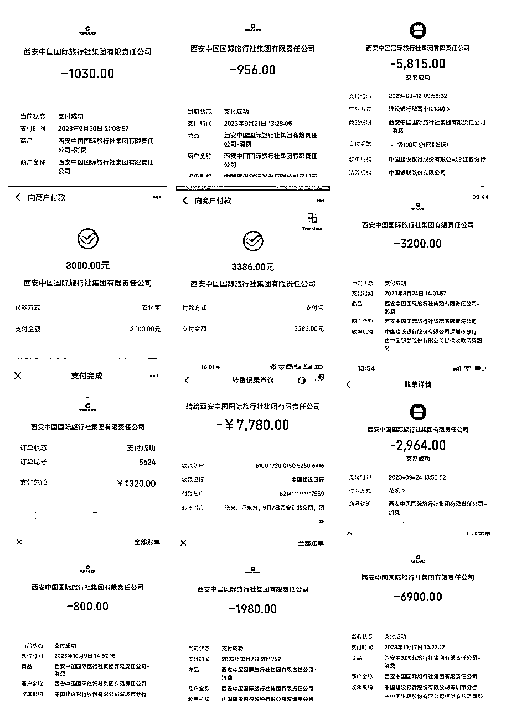

小掌柜部分佣金：

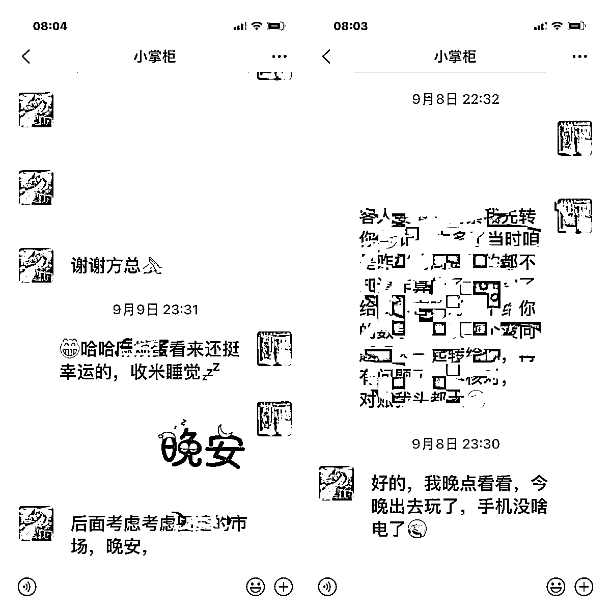

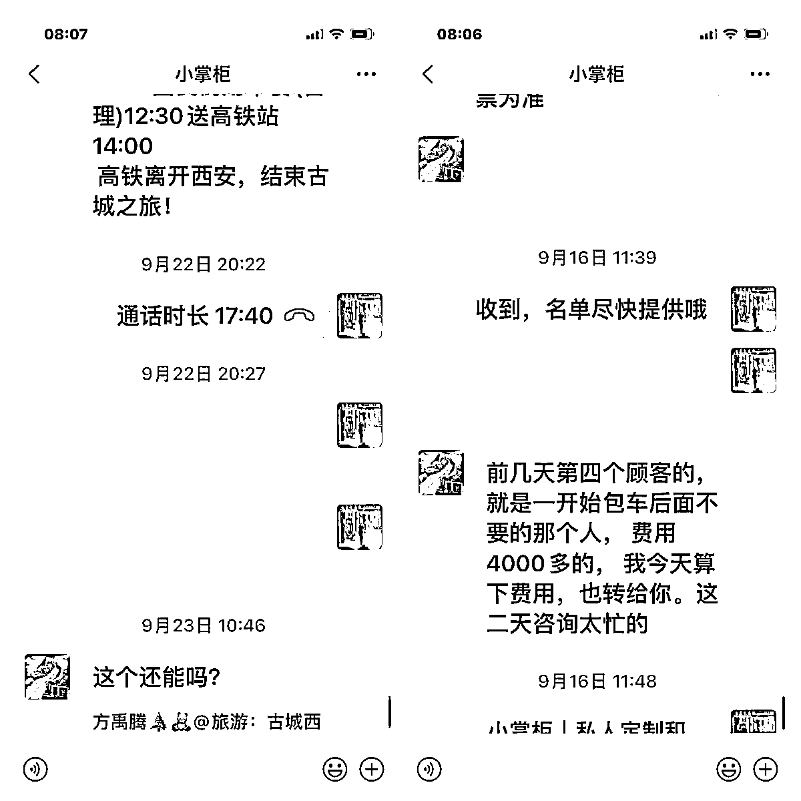

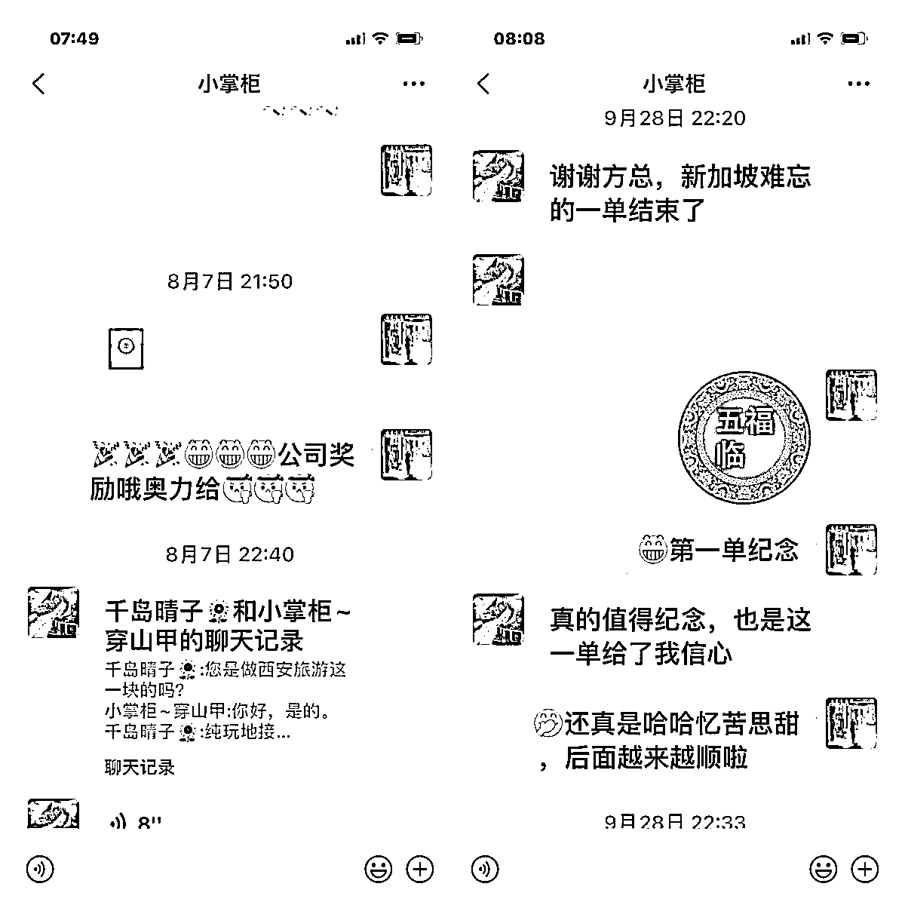

8月18日，我们正式启动了第一期、第二期训练营，共有37名学员参加，并分别对接西安和云南的旅行社资源。

需要特别说明的是，这些学员大多数都不是旅游从业者。经过一个月左右的训练，不少人已经能够拿到实际订单和佣金。

学员对接云南夏令营部分订单：

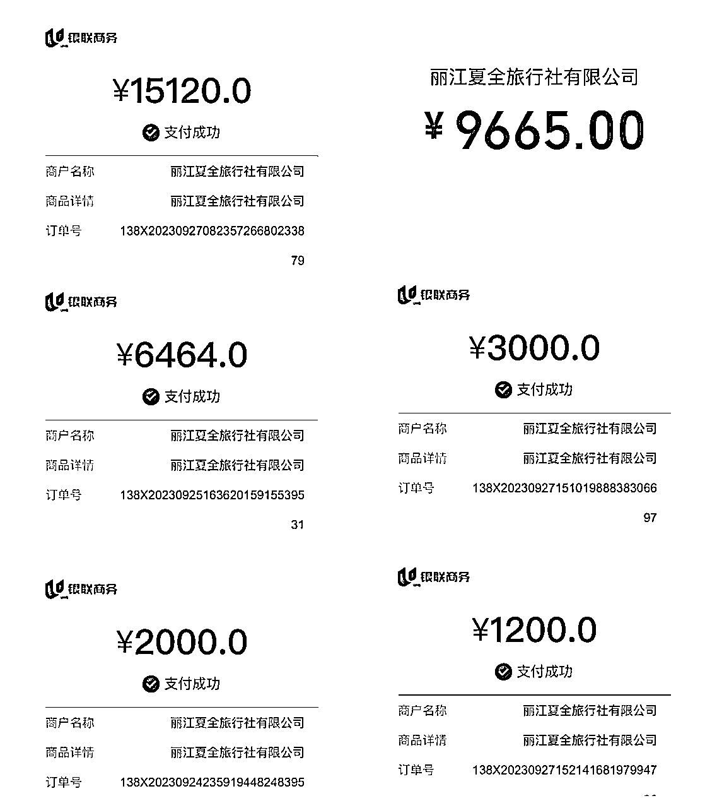

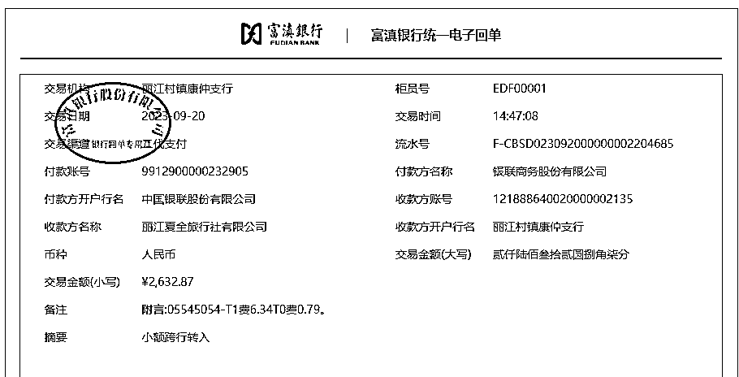

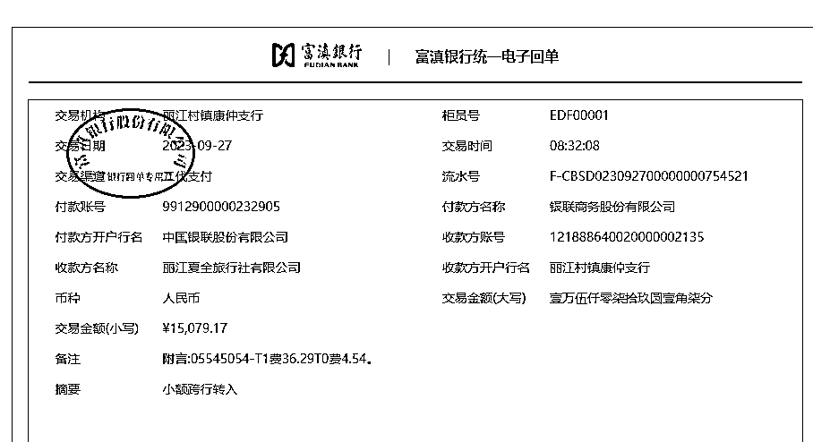

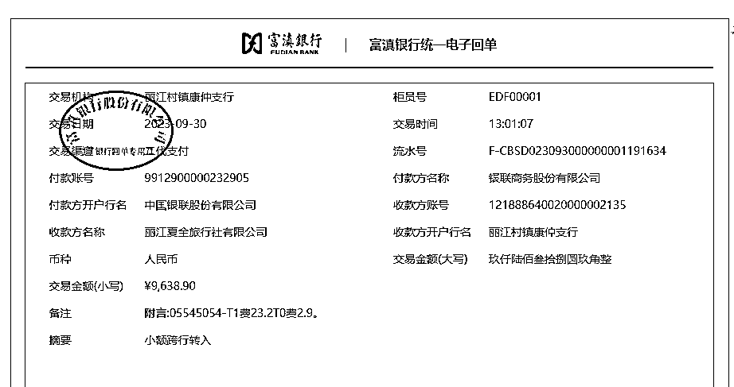

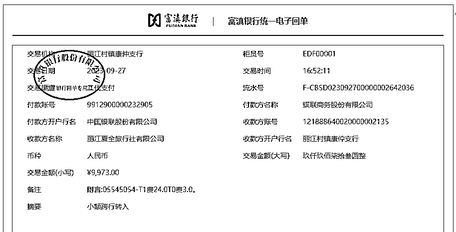

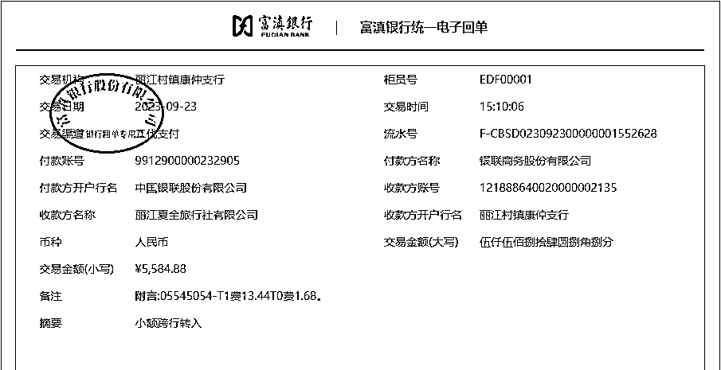

学员对接西安国旅部分订单：

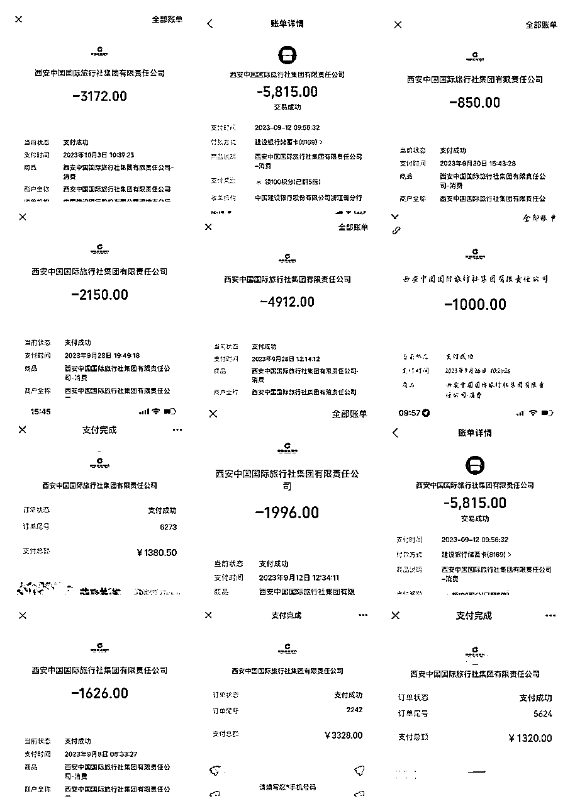

从结果来看，小红书旅游项目对于普通新手来说，确实具备较快获得反馈的可能。

接下来，主要从四个方面展开：

1. 如何选择旅游产品；
2. 小红书账号和笔记怎么搭建；
3. 如何从小红书把用户转移到私域；
4. 新人入局需要具备什么条件，以及有哪些建议。

全文内容较长，完整资料可移步飞书查看。

---

# 二、先确定产品：旅游赛道很大，切入点要足够具体

旅游并不是一个单一项目，而是由很多细分方向组成。

在小红书搜索旅游相关内容，你会看到各种不同的变现模式，例如：

- 销售旅游线路；
- 机票、酒店和民宿预订；
- 运营旅游类账号接商业合作；
- 本地徒步、露营和亲子活动；
- 周边短途游；
- 跟团游、散拼团；
- 定制游和包车游等。

不同方向对应不同的客户、内容和成交方式。

我们前两期训练营重点选择的是“国内定制游”这个细分领域，产品客单价大约在3000元到3万元之间，平均客单价在1万元以上。

## 什么是定制游？

定制游并不是简单地把一条固定线路卖给客户，而是根据客户的时间、预算、兴趣、同行人数和出行需求，重新设计一套旅行方案。

客户可以参与决定：

- 去哪些地方；
- 每个目的地停留多久；
- 住什么类型的酒店；
- 采用什么交通方式；
- 是否安排特色体验；
- 整体预算控制在什么范围。

与固定线路的团队游相比，定制游灵活性更高，也更容易满足个性化需求。虽然价格相对贵一些，但在服务体验和行程自由度上通常更有优势。

国内定制游的价格，大致在每人每天800—1200元左右。以3—4天的行程计算，整体价格通常与部分跟团产品相近，但服务内容和体验差异较大。

境外定制游则会受到当地消费水平影响。例如，新西兰定制游的价格，通常在每人每天2000—3500元左右。

---

## 三种常见旅游产品，分别适合什么人？

### 1. 跟团游

跟团游是大家比较熟悉的形式。

旅行社提前设计好固定线路、固定时间和固定服务内容，游客按照安排统一出行，主要游览目的地的热门景点。

小红书上常见的“几天几夜只要1000多元”，大多数都属于跟团游。

跟团游价格低、标准化程度高，因此更容易成交。但低价产品也存在一定问题，部分产品可能会加入购物环节，甚至属于变相购物团，售后体验和投诉风险都相对较高。

图片：

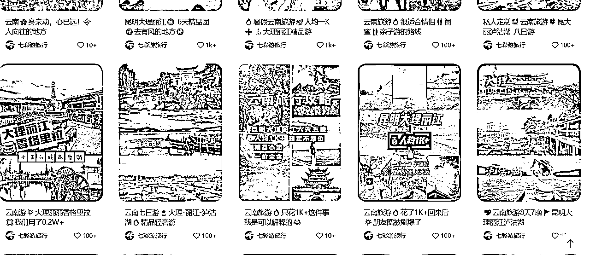

### 2. 散拼团

散拼团更适合想自由行、但又希望参加某个具体项目的游客。

比如游客计划在西安自由行5天，但想单独去一次华山，那么就可能购买“华山一日游”。兵马俑一日游、大唐不夜城一日游等，也属于比较典型的散拼团产品。

这类产品的客单价通常在300元左右，价格不高，用户决策成本低，因此相对容易出单，但相应的佣金空间也会小一些。

图片：

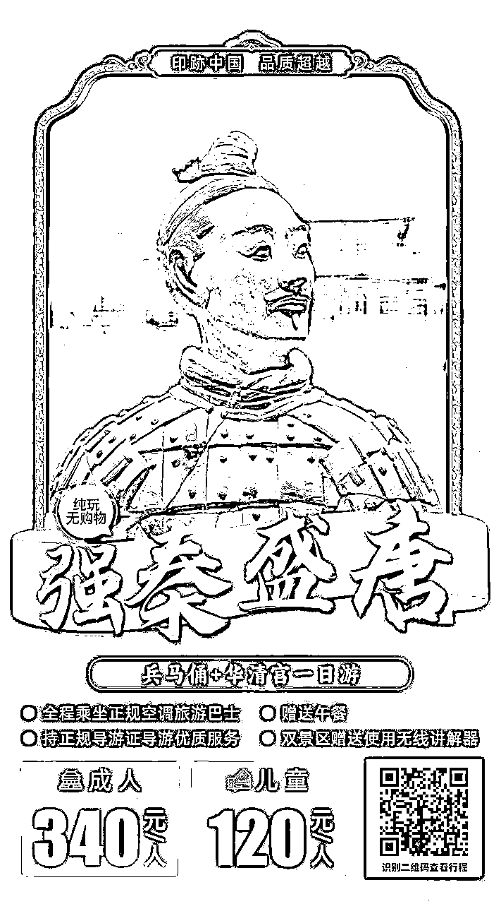

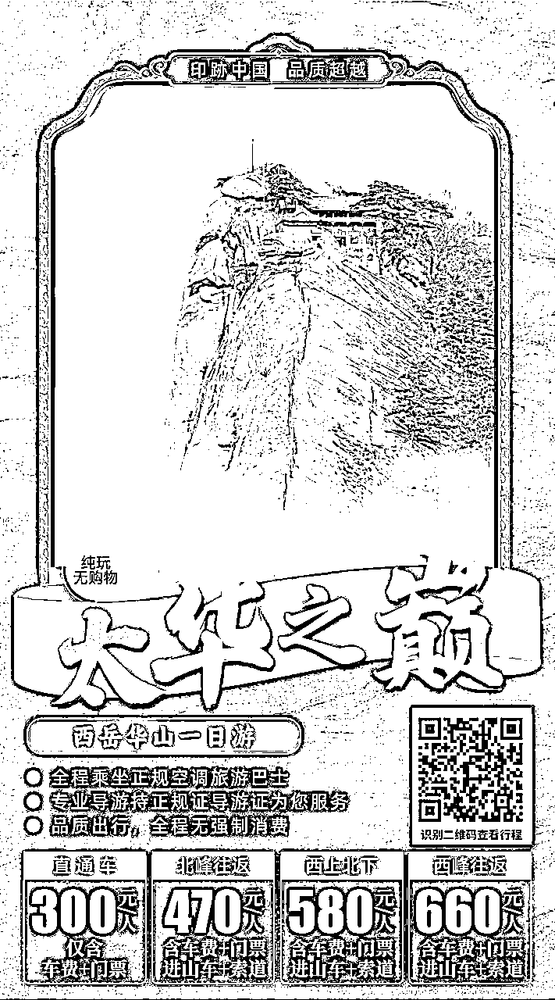

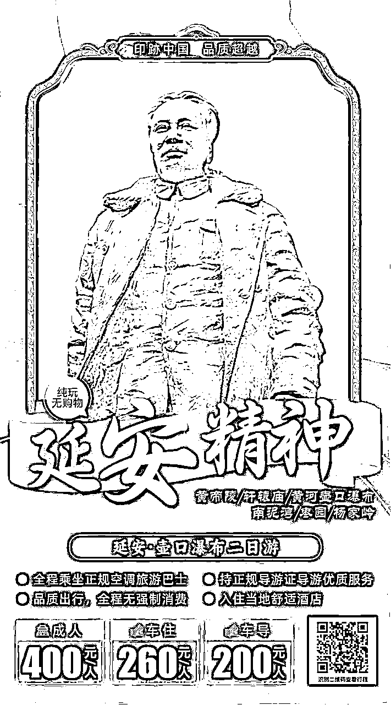

### 3. 定制游

定制游的客单价更高，通常从几千元到几万元不等。

它对产品设计、沟通能力和服务资源的要求更高，前期成交难度也会高于低客单产品。但只要成功成交一单，佣金往往比较可观。

以1万元以上的订单为例，学员单笔佣金可以达到1000元以上。

除了上述三种常见产品，还有两类值得关注。

### 小团游

小团游通常会将人数控制在6人左右，相比传统大团，人数更少、行程更灵活，价格也会高一些。

近年来，年轻人越来越倾向于选择小团出行。不过从产品本质来看，小团游依然属于跟团游，只是人数更少，体验相对舒适。

### 包车游

包车游一般由旅行社提供车辆和司机，同时协助安排酒店、门票等服务。

家庭出游、朋友结伴或小型团队比较适合这种方式。游客可以自主安排出发时间、路线、停留时长和目的地。

它的价格一般高于普通跟团游，但低于完整定制游。大多数综合型旅行社都能提供包车服务，也有部分旅行社专门做包车产品。

---

## 如何选择产品方向？

这几类产品通常都能从地接旅行社获取资源，理论上可以同时销售，也可以只专注其中一个方向。

但个人的时间和精力有限，因此不建议一开始什么都做。

选择时可以重点考虑：

- 自己更擅长哪类用户沟通；
- 能接触到什么类型的旅行社；
- 手里有什么目的地资源；
- 能否承接高客单客户；
- 自己更适合做内容还是做成交；
- 想要追求出单速度，还是单笔利润。

低客单产品更容易成交，但订单数量和佣金空间有限；高客单产品成交周期更长，对信任和专业度要求更高，但一旦成交，单笔收益明显更好。

---

# 三、小红书账号搭建：先让用户知道你是谁

我们的基本路径是：

> 小红书获取精准用户 → 引导进入微信等私域 → 私域完成咨询和成交

因此，小红书不只是发布笔记的平台，更是用户认识你、判断你是否专业、决定是否联系你的第一站。

高客单产品尤其依赖信任，所以账号的人设、头像、简介和内容结构都要提前设计好。

## 1. 昵称：让用户一眼看懂你的定位

用户认识一个账号，往往先从昵称开始。

常见问题是昵称过于文艺、个性化或者模糊，用户看完之后仍然不知道你是做什么的。对于旅游账号来说，昵称最好自然融入目的地、身份或服务关键词，这样既方便理解，也有利于搜索。

可以参考以下几种组合方式：

- 姓名＋地区＋身份：云南导游小X、西安定制师小X；
- 姓名＋地区：小X带你玩云南、法国小X爱旅行；
- 姓名＋类目：小X爱旅游、小X的旅行记录；
- 个性标签＋姓名：不油腻露营大叔、大漂亮的遛娃日记。

核心原则很简单：用户看见昵称，就能大致判断你的身份和服务方向。

需要注意的是，个人号不要直接使用过于“公司化”或“行业大类化”的名称，例如：

- XX旅行；
- XX定制游；
- 云南旅游；
- XX周边游。

这类名字缺少个人属性，容易让账号看起来像企业或营销号，也可能增加违规风险。

---

## 2. 头像：真实感比风景照更重要

头像可以使用两种主要形式：

- 真人照片；
- 文字或地域信息设计图。

文字头像的优势是定位清楚，用户第一眼就能知道你服务哪个目的地、做什么业务。

真人头像则更容易拉近距离，增强真实感和信任感。如果你准备长期打造个人IP，建议优先采用真人出镜。

很多人喜欢用景点照片做头像。虽然这类图片和旅游内容有关，但如果头像只有风景，没有人物，也没有地域或身份信息，用户很难形成记忆点。

因此，个人账号更推荐：

- 清晰自然的真人照片；
- 真人照片＋目的地元素；
- 昵称或目的地文字头像。

真人出镜：

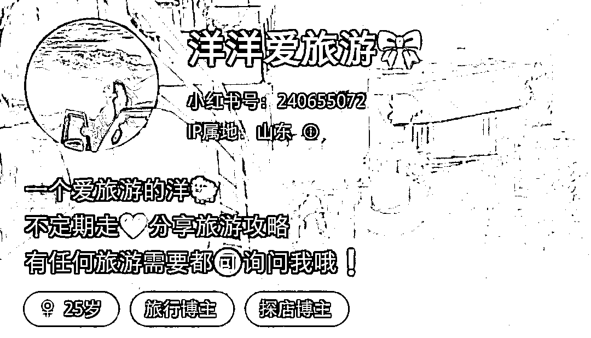

文字形式：

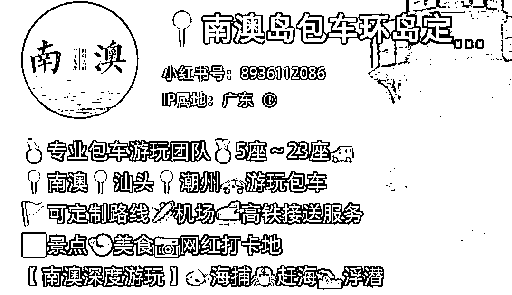

---

## 3. 简介：回答用户最关心的四个问题

用户从笔记进入主页后，通常会进一步查看简介。

一段有效的简介，至少要让用户知道：

1. 你是谁；
2. 你做什么；
3. 你凭什么值得信任；
4. 用户什么时候可以找你。

可以按照下面的思路组合：

**身份和服务：**

> 8年司导｜私人定制行程｜本地跟团｜新西兰旅行服务团队

**专业背书：**

> 新西兰旅游协会TAANZ会员

**差异化和案例：**

> 专注高品质纯玩，累计服务5000人以上，服务过陈道明、靳东等明星客户

简介排版建议：

- 控制在3—4行；
- 尽量使用短句；
- 适当加入数字；
- 不要堆砌大段文字；
- 重点突出服务范围和专业度。

另外，简介是比较容易触发审核的地方。

可以写“私人定制”“定制游”这类定位词，但不要直接使用“提供私人定制服务”“专注私人定制旅行”等过度营销的表达。相关措辞需要结合实际测试，尽量自然、克制。

---

## 4. 背景图和瞬间：不要浪费主页里的展示位置

背景图的作用，是进一步强化目的地属性和专业形象。

可以放：

- 你能提供的服务；
- 目的地代表性景点；
- 真人旅游照片；
- 旅行社门头或工作场景。

如果使用真人照片，要注意画面干净、主体明确，不要塞入过多信息。

### 瞬间也可以成为展示位

很多个人账号会忽略“瞬间”这一栏，但它其实是一个不错的辅助展示位置。

可以适当放置：

- 隐晦的联系方式；
- 客户成交聊天截图；
- 朋友圈生活记录；
- 旅行现场照片；
- 日常工作内容。

需要注意的是，联系方式不要过于明显，否则容易触发平台审核。

成交截图能够增加用户信任，生活记录则可以让账号更像一个真实的人，而不是单纯的销售账号。

---

# 四、先建素材库，再持续发布内容

旅游账号最基础的内容，通常离不开：

- 景点信息；
- 行程玩法；
- 餐饮推荐；
- 酒店住宿；
- 活动体验；
- 交通和用车；
- 目的地图片。

如果每次写笔记都重新搜索资料，效率会非常低。因此，前期就应该同步搭建自己的素材库。

假设你做西安，可以提前整理：

- 西安所有主要景点；
- 每个景点的特色和适合人群；
- 景点之间的距离和交通方式；
- 周边小众景点；
- 可安排的体验项目；
- 不同类型的游玩路线；
- 相关图片和视频素材。

定制游与固定跟团线路不同，最大的特点是景点可以灵活组合。所以，定制游素材库不能只整理几条固定线路，而应该尽量覆盖目的地的完整资源。

## 景点资料怎么整理？

可以按照自己的逻辑分类，也可以按区域、距离或旅行主题来划分。

每个主要景点，建议准备：

- 几种不同角度的介绍；
- 适合什么类型的游客；
- 推荐游玩时长；
- 周边还能搭配哪些内容；
- 不同季节的特点；
- 可组合的住宿、餐饮和活动。

这些资料整理好以后，后面写笔记时就能直接调用。必要时再用ChatGPT进行润色和改写，效率会高很多。

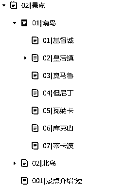

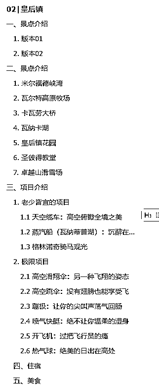

## 图片也要系统归档

景点资料整理完成后，图片分类同样重要。

建议建立两层文件夹：

第一层，按照景点归类。

第二层，按照内容类型细分：

- 景点风光；
- 特色餐饮；
- 酒店住宿；
- 体验项目；
- 交通和用车；
- 游客活动场景。

以后发布某个景点的笔记时，可以直接从文件夹里挑选对应图片，不需要临时到处搜索。

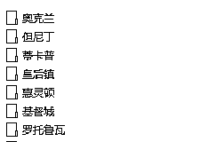

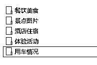

---

# 五、三类笔记要配合发布

小红书旅游账号的内容，大致可以分为三种：

1. 流量型内容；
2. 成交型内容；
3. 信任型内容。

这三类笔记不是相互独立的，而是共同构成转化链路。

---

## 第一类：流量笔记

流量笔记主要承担两个任务：

- 提升账号权重；
- 获得更多曝光和互动。

典型内容包括：

- 旅游攻略；
- 避坑指南；
- 景点介绍；
- 路线合集；
- 行程安排；
- 目的地玩法。

这类内容通常比较容易获得点赞和收藏，尤其是在账号前期，对起号很有帮助。

不过，流量笔记的直接转化能力通常不强。很多用户看完之后只是收藏，并不会马上咨询。

但这并不意味着攻略内容没有价值。攻略类笔记依然是旅游账号前期的重要流量来源。

### 提升攻略笔记转化率的几个方法

#### 方法一：增加行程安排

不要只介绍景点，可以附带一个简单的行程参考，例如每天从哪里出发、经过哪些地方、晚上住在哪里。

#### 方法二：在结尾加入自然的身份说明

可以说明自己是谁、主要做什么、什么情况下可以联系你。

不要写得像广告，尽量让表达自然一些。

#### 方法三：在评论区设计互动场景

可以让朋友或小号以普通用户身份提问，例如：

- 几天时间怎么安排？
- 5个人出行大概多少钱？
- 有没有适合带孩子的路线？

也可以在正文中提示用户留下出行时间和人数，再把相关评论置顶。

#### 方法四：搭配成交型内容

用户通过攻略笔记进入主页后，如果能看到清晰的产品展示，就有机会进一步完成咨询和成交。

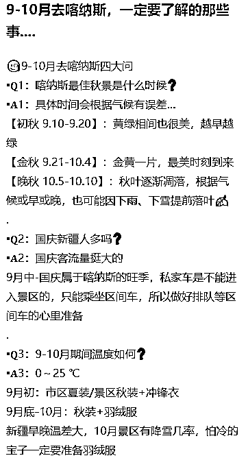

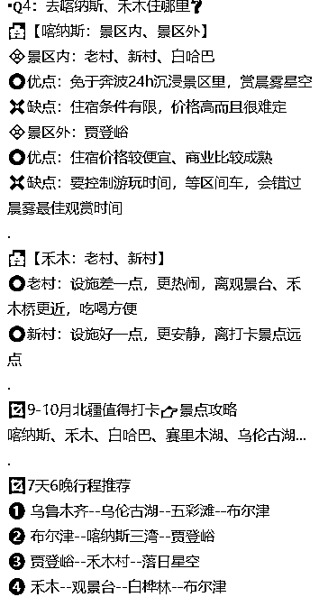

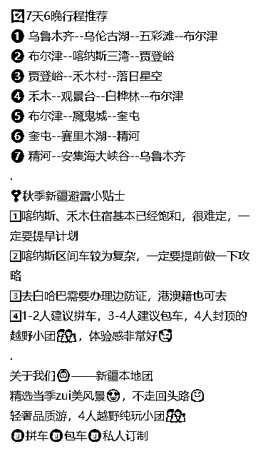

---

## 第二类：成交型笔记

成交型笔记，也就是直接展示产品和案例的内容。

常见形式有两种：

### 形式一：产品展示

例如：

- 目的地；
- 几天几夜；
- 适合哪些人；
- 包含哪些服务；
- 费用大致是多少；
- 有哪些行程亮点。

### 形式二：聊天记录展示

通过真实咨询、报价和成交过程，让用户了解服务方式，并产生咨询意愿。

很多旅游企业号会大量发布产品型笔记，但个人号不能简单照搬企业账号的内容。

企业号的内容往往营销感比较明显，如果个人账号长期复制，容易被平台识别为营销或搬运。一旦出现违规提醒，账号可能进入重点观察阶段，后续发布过于直接的营销内容或引导关注内容时，风险会更高。

---

## 第三类：信任型笔记

信任型笔记的核心，是让用户相信你有经验、有资源，并且能够把事情做好。

这类内容也可以称为“故事名片”。

可以展示：

- 个人从业经历；
- 旅行社资质；
- 服务年限；
- 真实工作场景；
- 客户服务案例；
- 目的地长期运营经验。

建议将其中一篇代表性内容置顶。

这类笔记可能不会带来大量点赞和评论，但它的作用不一定体现在数据上，而是体现在用户浏览主页时的心理变化上。

当用户先看过攻略，再看到你的从业经历和专业资质，信任感会明显增强，后续查看产品内容时，咨询概率也会提高。

当然，干货笔记同样可以建立信任。

只要内容真实、专业、细致，并且确实能帮用户解决问题，用户就会逐渐形成对你的专业判断。

---

## 三类笔记如何搭配？

可以按照以下思路安排：

- 故事名片：置顶1篇即可；
- 攻略和干货：日常占比约20%；
- 账号前期：攻略内容可以增加到40%左右；
- 后期：偶尔发布客户转账或成交案例；
- 其余内容：重点展示旅游产品和服务。

这是个人号的基础玩法。

当账号稳定后，可以进一步注册企业号，与个人号配合运营：

- 个人号负责内容、人设和信任；
- 企业号负责产品展示和承接咨询。

---

# 六、小红书引流：让精准用户进入私域

平台对引流的审核一直在收紧，旅游行业又属于容易出现营销行为的领域，所以引流时不能简单粗暴地留下微信号。

实操过程中，需要不断测试：

- 文字表达；
- 关键词；
- 图片呈现；
- 评论方式；
- 私聊话术；
- 引导路径。

目前比较常用的方式，主要有以下几种。

---

## 1. 从内容源头筛选高客单用户

既然做的是高客单定制游，就不要让所有人都成为你的目标客户。

在笔记中可以提前表达：

- 做的是定制游；
- 服务偏向高品质或纯玩；
- 可以根据人数和预算设计行程；
- 适合有个性化需求的游客。

同时，围绕“定制游”“私人线路”“高品质旅行”等相关关键词布局内容和标签，让平台尽量把笔记推荐给消费能力和需求更匹配的人群。

先筛选用户，再做引流，能够减少大量低预算咨询，也能降低直接引流带来的风险。

---

## 2. 在内容里设置咨询入口

### 文本中的自然提示

可以在笔记中加入一些有助于转化的信息，例如：

- 推荐路线；
- 行程安排；
- 适合人群；
- 大致价格；
- 服务内容。

结尾则可以加入比较自然的提示：

- 自我介绍；
- 什么情况下可以找你；
- 想去某个目的地的用户可以留言；
- 留下出行时间和人数，方便给出建议。

表达不要过于直接，尽量避免让内容看起来像硬广。

### 评论区主动承接

可以把部分转化信息放在评论区，通过评论引导用户留下需求，再将重要评论置顶。

这样既方便用户互动，也能减少正文中出现明显营销引流信息的概率。

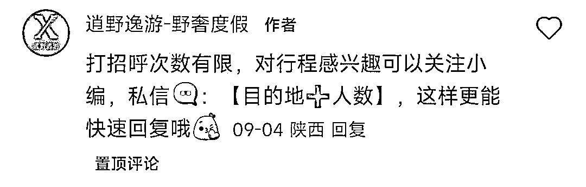

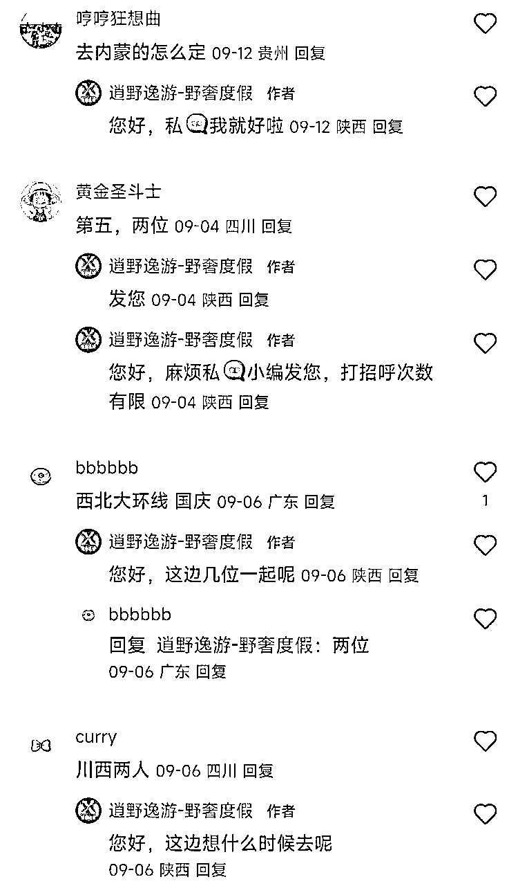

### 评论区制造咨询氛围

这里不是指花钱购买评论，而是让朋友或小号模拟正常用户提问。

例如：

- XX号，XX个人怎么安排？
- XX月份还有团吗？
- XX天、XX个人大概需要多少预算？
- 带老人出行有什么推荐路线？

这些问题可以帮助其他用户理解你的服务，也能让评论区显得更加真实。

---

# 七、几种常见引流方式

## 1. 利用“瞬间”

瞬间是比较隐蔽的展示位置，可以根据账号情况放入与微信相关的信息，但不要过度明显。

同时，还可以发布：

- 客户成交截图；
- 真实服务案例；
- 旅行过程；
- 日常工作记录。

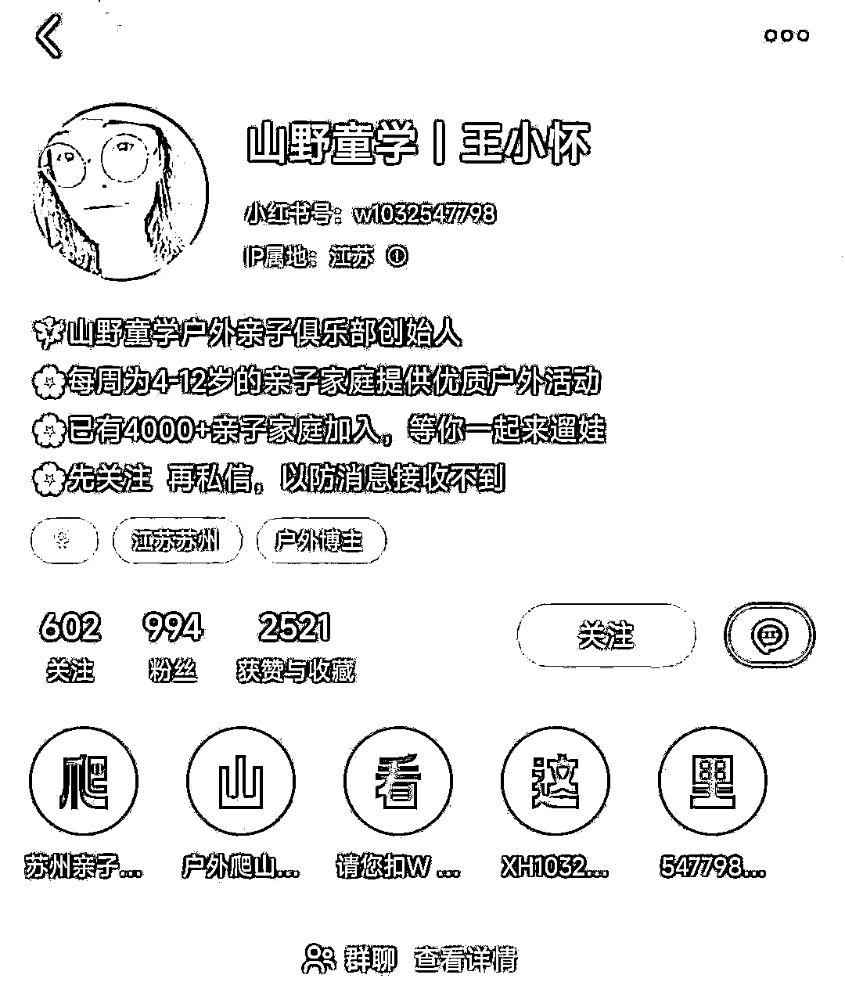

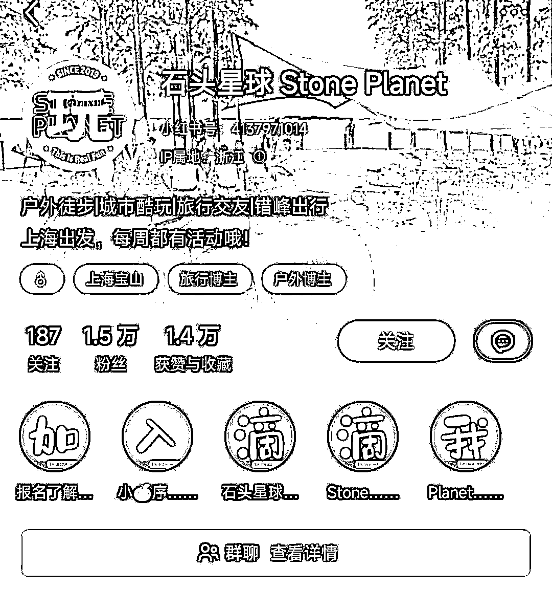

## 2. 将小红书ID设置为微信号

小红书号只能修改一次，因此如果决定使用这种方式，需要提前规划。

可以把小红书ID改成自己的微信号，私聊时再自然提示用户查看账号ID。

例如：

> 想看具体行程和报价，可以先看一下我的小红书号。

用户如果理解其中的意思，就有机会主动添加。

设置ID时建议：

- 使用英文＋数字；
- 或者使用纯英文；
- 尽量不要只用纯数字；
- 控制在8位以内；
- 确保用户能快速联想到微信号。

## 3. 群聊＋小助手＋置顶图片

这是学员使用比较多的一种方式。

基本流程是：

1. 先通过私聊邀请用户进群；
2. 在群内设置小助手或群公告；
3. 将包含联系方式的图片置顶；
4. 引导用户查看群置顶内容。

早期有人会直接用小助手发送微信号，但平台有时会对相关内容进行屏蔽。因此，后来更多是将联系方式放入图片，再通过群置顶进行承接。

这个方法有一个关键因素：回复速度。

如果能够及时响应，成功加到微信的比例可能达到70%左右；如果长时间不回复，成功率可能只有30%左右。

所以，引流工具本身并不是全部，及时沟通同样重要。

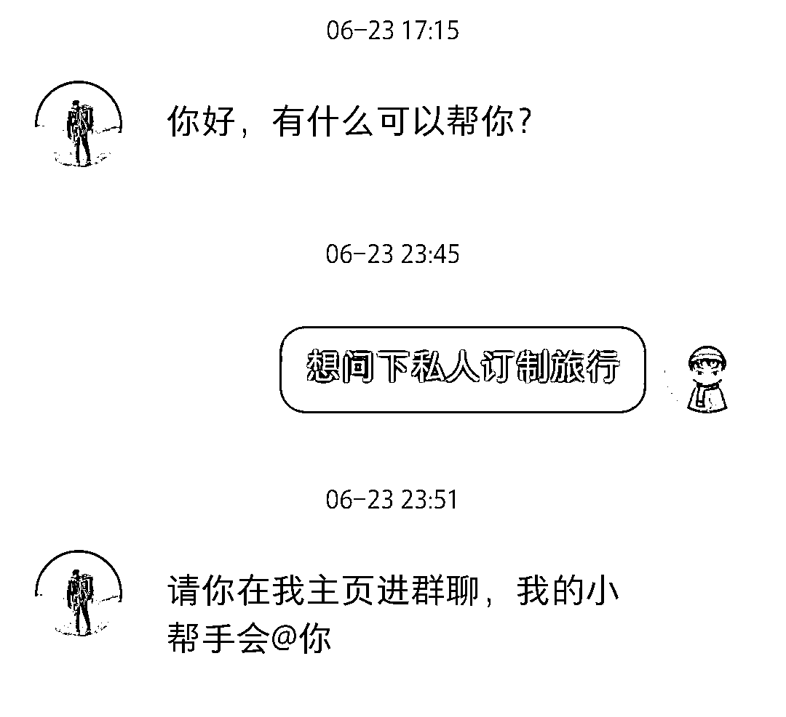

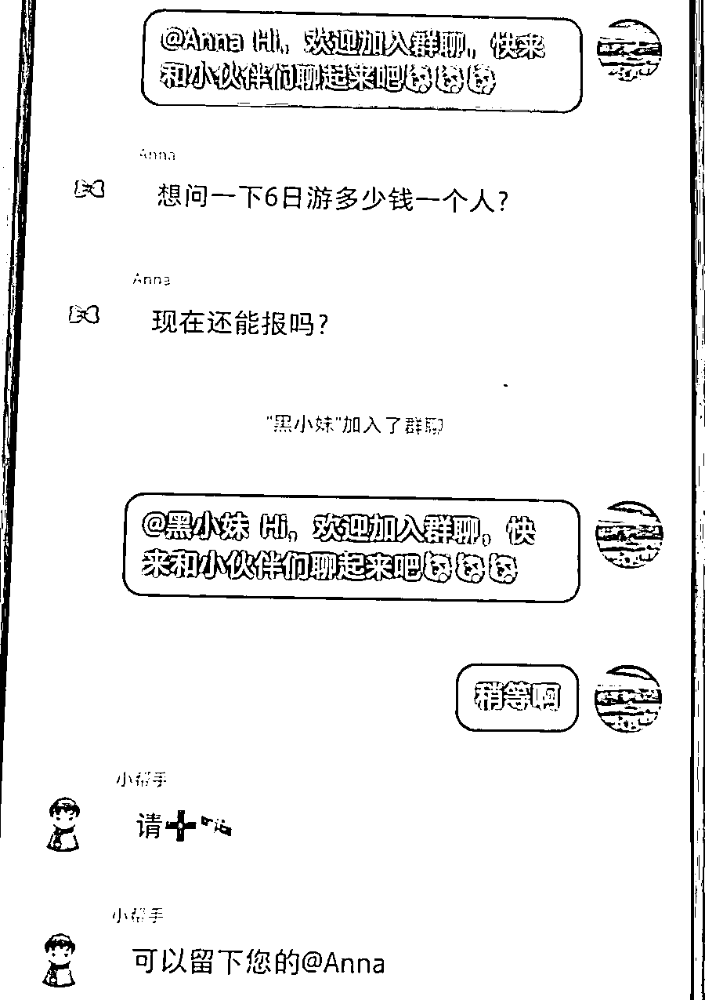

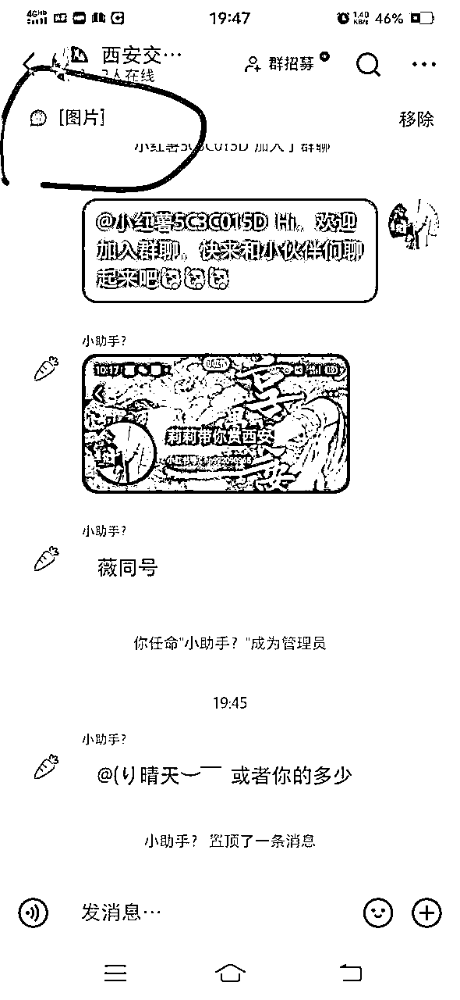

## 4. 使用PK组件

在小红书中，可以通过以下路径找到PK组件：

1. 点击底部中间的“+”；
2. 选择发布图文笔记；
3. 进入笔记编辑页面；
4. 找到“互动组件”；
5. 点击“PK组件”；
6. 设置PK标题和双方观点；
7. 发布内容。

这种方式可以增加互动感，也能让用户围绕目的地、路线和旅行方式参与讨论。

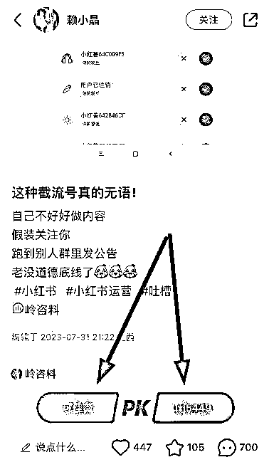

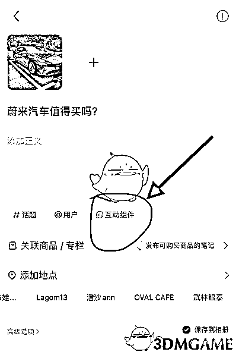

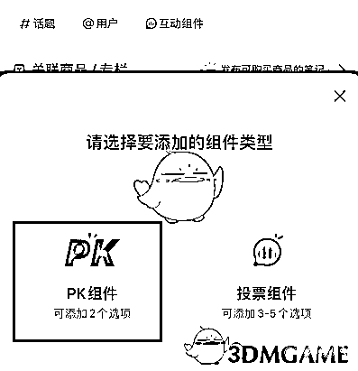

---

# 最后总结：高客单旅游项目，核心不是单点技巧，而是完整闭环

做小红书定制游，真正重要的不是单独学会某一种引流方法，而是把整个流程串起来：

1. 选择适合自己的旅游产品；
2. 找到可靠的地接旅行社；
3. 明确目标客户和客单价；
4. 搭建真实、专业的个人账号；
5. 提前整理景点、线路和图片素材；
6. 用流量笔记获得曝光；
7. 用人设内容建立信任；
8. 用产品笔记承接成交；
9. 通过合规方式把用户引导到私域；
10. 在微信中完成需求沟通、方案设计和报价。

定制游的客单价虽然高，成交周期也比低价产品长，但只要内容、信任和服务能够形成闭环，新手同样有机会较快拿到第一批订单。

对于想入局的人来说，最重要的不是一开始就把所有事情做得完美，而是先选定一个目的地和产品方向，跑通一套完整流程，再逐步优化内容、资源和成交能力。

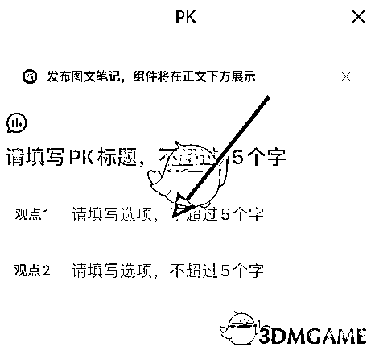

# 小红书旅游赛道，怎么从0做出高利润？我把矩阵、合作、避坑一次讲透

如果你正在观望小红书旅游项目，别急着划走。这篇文章不整虚的，只讲三个核心：怎么放大流量、怎么和旅行社分钱、新人怎么少踩坑。

## 一、放大流量：矩阵账号 + 付费投流

想在小红书旅游赛道放大收益，“矩阵铺号”和“聚光投流”迟早要上。矩阵能跑起来，靠的不是运气，而是背后的素材弹药库。只有素材足够充足，才能支撑你批量造笔记。

素材之外，还要给自己设计一套固定笔记框架。旅游内容没那么玄乎，万变不离其宗，核心模块就这几个：目标用户的烦恼、你的人设、目的地亮点、路线安排、行程中的闪光点、产品包含内容、额外加分细节。

几乎所有旅游笔记都是这几块拼出来的。你可以按自己的表达习惯去定开头，我建议优先试这三种：

**第一，先戳痛点。** 比如做定制游，开头就写跟团游太赶、自由行做攻略太累又费钱。用户只有在你的文字里看到自己的影子，才可能信任你。痛点开完，顺势放景点、路线、亮点、产品细节和加分项，最后再补自我介绍。

**第二，人设开场。** 直接以“我是谁”切入：“嗨，我是XXX，很多朋友想带娃来西安，却不知道玩什么，也不知道跟团、定制还是自由行怎么选。”然后顺理成章介绍景点、路线、亮点，插入定制游产品，最后再回到自我介绍。

**第三，景点安利开场。** 这种开头我刷到最多，但多数来自企业号。企业号本来就是商家，官方一点没问题；个人号如果照搬，用户一眼就觉得你是营销号，系统也可能给你限流甚至判违规。景点开场之后，同样接路线、亮点、产品细节和加分项，最后落回自我介绍。

注意，中间部分其实可以做成固定模块，不用每次重写。模板打磨好、素材也熟悉以后，一篇能赚钱的笔记10分钟就能套出来。当然，你也可以多拆几篇爆款，整合一套属于自己的框架，然后从素材库里取景点信息直接填。

再往上走就是付费投流。这块我们团队也还在付费摸索中，谁的投流经验丰富，欢迎来交流。

## 二、和旅行社怎么合作？三种模式从易到难

我们目前跑的高客单产品，和旅行社的合作主要有三种：

**第一种：给微信客资，拿成交佣金。** 你把小红书流量导到微信后，直接把微信号交给旅行社，按人头结算线索费，转化后给佣金。这有点像我的助听器分销：你只负责提供微信号，成交和售后全归对方，自己拿提成。好处是省心，坏处是做得少、提成点也低。

**第二种：收199元定制费再拉群。** 你把用户从小红书引到微信，先做一轮意向判断，觉得有戏，就引导用户转199元行程定制费，然后拉群，后续由旅行社转化交付。

怎么做意向判断？就问几个关键问题：什么时候来？几个人？有没有小孩？有没有65岁以上老人？如果是70岁以上，建议别接，很多保险都买不了。还要问玩几天、想去哪些景点，看符不符合定制游的预订条件——毕竟这类产品需要提前排期。如果符合，再介绍价格和包含内容，比如800-1200元/天/人，包酒店住宿等。用户能接受，就收199元拉群，剩下的事交给旅行社。

**第三种：拿结算价，自己报价。** 旅行社直接给你一个结算底价，你爱报多少报多少，多赚的部分都是你的。这种模式对新人最不友好，几乎不可能短期内上手，更适合组团社或有旅游行业经验的老手。前提是你能吃透目的地景点，微信成交也得够硬。一旦做成，佣金非常可观。

## 三、新人入局：三个门槛 + 三条建议

### 先说门槛

1. **靠谱供应商。** 旅游项目本身不难，旅行社也不难找，难的是合作细节。比如产品到底行不行、佣金怎么谈、能不能按时结算。我们早期踩过不少坑：旅行社嫌答疑麻烦不配合、后端掉链子、佣金变动、返款不及时，甚至还有购物1.5万的雷。新人如果想谈，最好走朋友链接，或者直接去当地旅行社面谈。

2. **平台选择。** 主流内容平台里，小红书和旅游用户最重合，图文笔记又比视频门槛低，所以新人首选。但旅游类目管控严，很容易违规。我们有的学员注册账号时，光昵称和简介就连续违规好几次。这部分可以回头看人设五件套的内容。

3. **微信成交。** 新人最容易谈成的合作，大概率是自己加微、拉群，让旅行社来成交。难点在于加微后怎么聊。你不能一言不发就拉群，那会变成旅行社的负担。你得会判断用户意向，会基础答疑，甚至客户暂时不成交，还要懂怎么靠朋友圈养着，等他有出行计划时再转化。

### 再说建议

1. **现在进场刚刚好。** 过去三年，旅游行业洗了一轮牌，今年游客需求大、同行竞争者少。你去翻小红书就会发现，很多旅游爆款和账号都是今年4到6月才冒出来的。这意味着你现在入局，起点并不落后，执行力到位，完全有可能吃到时间差红利。

2. **优先做高客单，别陷在低客单里。** 算一笔账：100个定制游咨询，成交10个，佣金就能过万；500个跟团游咨询，成交100个，每单40到100元，最终也就4000到10000。再看其他成本，跟团游要引更多流量，账号被盯上封号的速度也更快；咨询时间就更明显了，假设每人聊10分钟，定制游只要1000分钟，跟团游却是5000分钟。副业时间本来就有限，一小时赚50和赚100，一天也只有24小时。所以想做，就做高客单，把时间花在更高回报的事上。

3. **条件合适就升级企业号，吃投流红利。** 现在小红书聚光投流还是红利期，投到一定额度可以进白名单，安全引流不封号，还能设置自动回复，整体转化率都会上一个台阶。旅游企业号认证需要旅行社营业执照和经营许可证，我们目前用的是合作方资质。新人想认证，可以试试线下找家小旅行社，花点钱请对方帮你搞定。

最后，希望这些经验能帮到正在观望或刚入场的你。如果你已经在做旅游赛道，或者准备下场，欢迎来链接，咱们互相交流。分享让人越走越幸运，我是阿渡，祝大家都能赚钱有术。