# ('从零到一，电商小白快速上手视频号达人带货，拿到正反馈', (2, 28))

最近好多朋友问我：“视频号带货现在入场还来得及吗？”  
我想说，真的来得及。我自己就是最好的例子——一个电商小白，从零开始跑视频号达人带货，不到两个月，GMV破了10万，纯利5万多。今天我把这段经历完整分享出来，希望对想入局的你有点帮助。

先简单介绍下自己，我是易秋，自由职业，毕业后一直专注互联网项目。2020年靠抖音小程序变现过40多万，后来试过不少项目，目前全职做视频号带货。八月底跟着赚钱有术的航海计划开始实操，到现在一个半月多，做出了一点小成绩。说实话，加入赚钱以后，我的成长速度比过去几年都快，也特别感谢这个圈子让我看到了更广阔的世界。

下面是我几个主力账号的历史成交数据：  
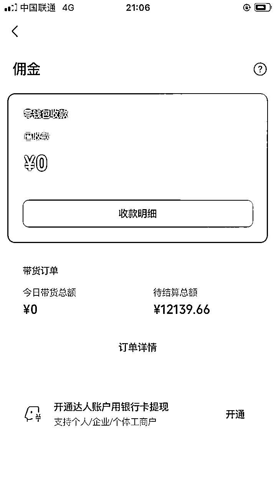  
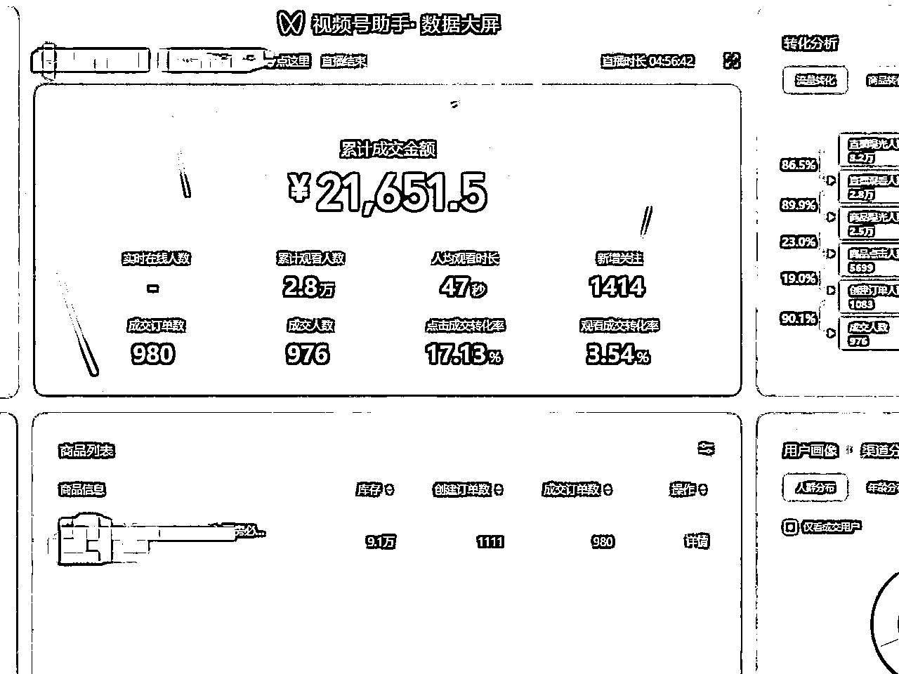  
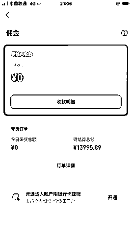  
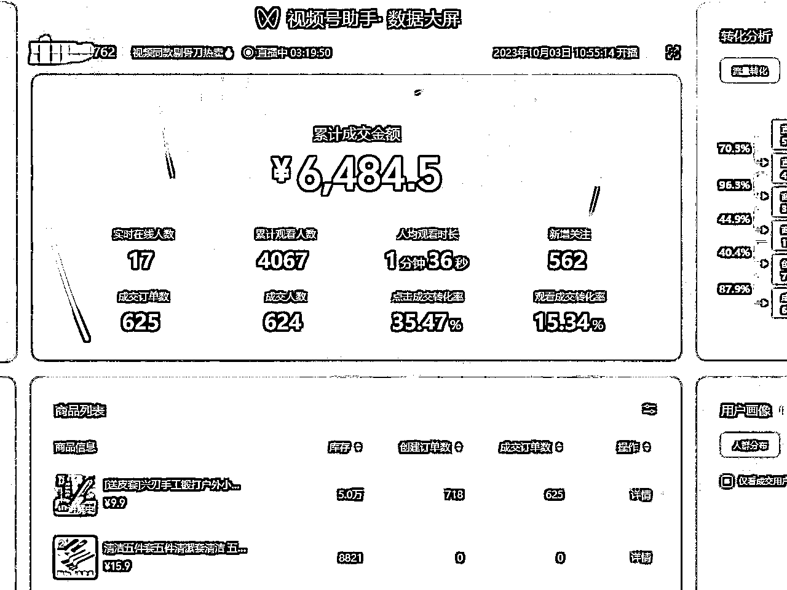

很多人问，视频号现在还有机会吗？  
说实话，我一开始也犹豫过。那时候觉得视频号风口早就过了，不像去年随便搬运就能捡钱，加上腾讯封号力度加大，普通人入局是不是太晚了？  
后来我发现，朋友圈里越来越多的人靠视频号赚到了钱，我才幡然醒悟——任何一个赛道，先入局才有资格谈机会。就像王拾柒老师说的，先坐上牌桌，别急着下桌，你才有下一步的方向。于是我决定ALL IN。

先说说视频号的三大红利：  
第一，流量红利。虽然没抖音那么稳定，但起号阶段的流量比较容易拿到。  
第二，利润红利。抖音卷得不行，视频号同类产品价格普遍能高出1到3倍。  
第三，人群红利。三四线城市和中老年用户，触网少、信任度高、退换货也少，都是非常优质的买家。

理顺变现路径很重要。我当时先花了整整一两天，把赚钱里关于视频号的帖子和航海手册翻了个遍，把关键知识点都记下来。盗坤老师有句话我印象很深——想做一个项目，先把赚钱里相关帖子全找出来看一遍，你就知道怎么做了。看完以后，我心里就有了清晰的框架。  
我玩的是自然流达人带货，对新手特别友好。核心逻辑就是：混剪其他平台已经爆过的品，去重后发布视频撬动自然流，流量来了就开播承接转化，主推低价高佣产品。说白了，就是找到抖快上已经被验证过的爆品，再找对应的素材混剪，卖给视频号上的人群。

项目前期准备四步：找对标→分析对标→模仿→实操。  
实操路径是：注册视频号→养号→交保证金开通橱窗→选品→选素材→剪辑→发布→直播人脸实名认证→直播。  

冷启动怎么玩？  
第一，找对标。同行就是最好的老师。你平时刷视频号或者逛直播广场，会看到一些看起来不太“高大上”的直播间，场景普通，中间贴着产品图，这些就是我们的同行。他们玩的都是自然流、极致性价比低价品，佣金大多在50%。  
  
  
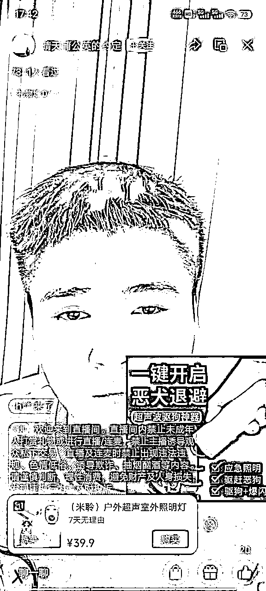

找到对标后就要分析模仿。看他的视频形式是混剪、图文还是原创，判断自己能不能复制；直播话术一定要录屏整理成文档，慢慢学。  
现在主流的混剪带货视频有三种：  
硬广类，直接介绍推销产品。  
  
  
软广类，用软性方式间接种草。  
  
  
剧情带货类，搬运去重后把广告植入剧情，流量大但转化稍低。  
  
  
其他还有图文、好物分享等类型，可以自己研究。

接下来是实操，先说注册和养号。注册视频号直接在微信入口发作品就行；养号其实不用太复杂，随便刷两条中老年内容，隔天就能发视频。保证金交了就能开橱窗选品。  
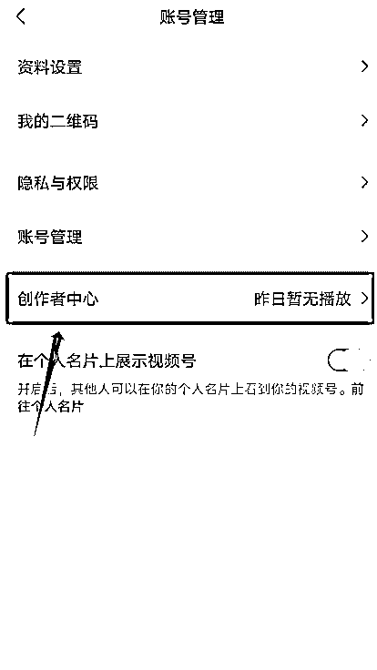  
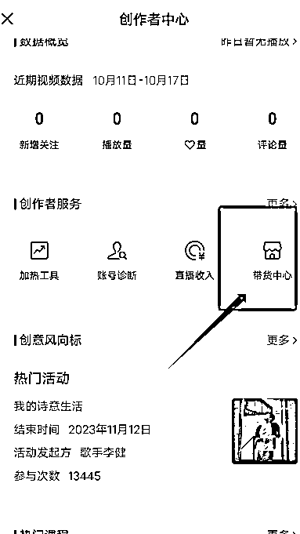  
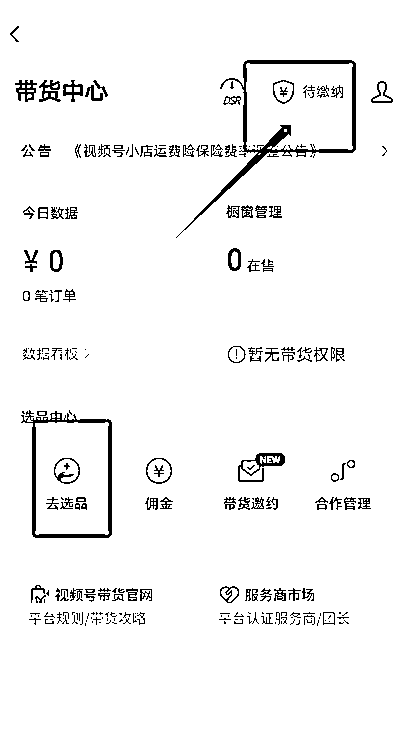

选品定生死，这句话一点不夸张。  
新手最推荐的方法是“刷视频跟品”。单独准备一个账号，专门刷同行的视频，把账号养成带货类标签。抖音、快手、视频号都刷，看到不错的品就记录到表格里，再分析筛选。账号养成后，同行刚爆的视频系统会主动推给你，你就能快速跟进吃流量。直播广场也可以逛，只要封面有产品贴图的基本都是同行，进去互动点赞，系统就会给你推同类型。  
我有个真实案例：国庆期间起床刷到“剔肉刀”这个品上了直播广场，9.9元有价格优势，视频也不复杂。我马上跟品，快速在抖音找素材剪辑发布，一个多小时打了7000多GMV，虽然佣金只有35%，利润也有2000多。没过多久，整个广场都是剔肉刀了。时间就是金钱，这话真没错。

系统化选品也有几个技巧：  
一是便宜极致性价比，比如9.9的抹布、19.9的调味料；  
二是新奇特、视频素材好，像什么小滚刷、栗子开口器，自带停留效果；  
三是强卖点解决痛点，比如老人除味剂，子女和老人都是受众；  
四是节日热点和应季品，比如国货、国庆反光贴、冬天泡脚艾草。  
还可以借助考古加、蝉妈妈这类第三方数据平台，快速发现爆品和素材。

找素材的话，抖音快手直接搜产品名或用图搜，筛选优质视频点赞收藏，然后用猫抓插件或IDM批量下载。  
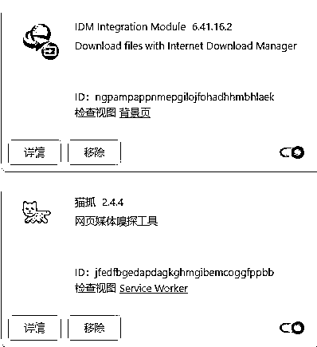  
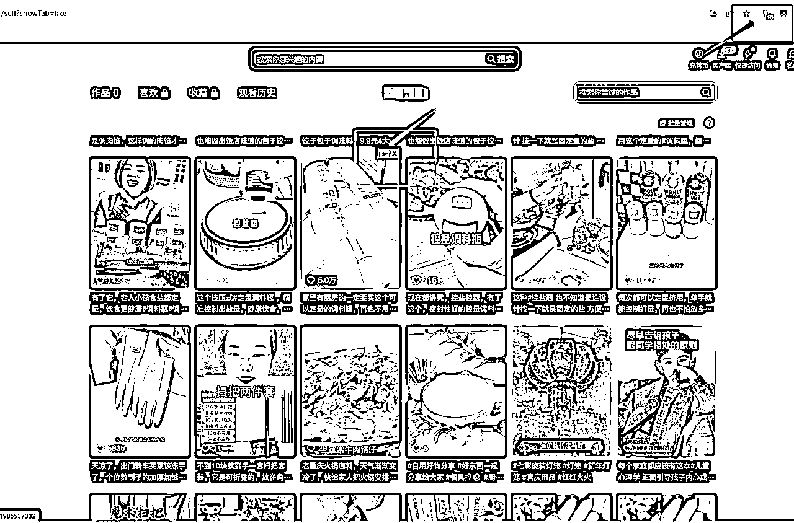  
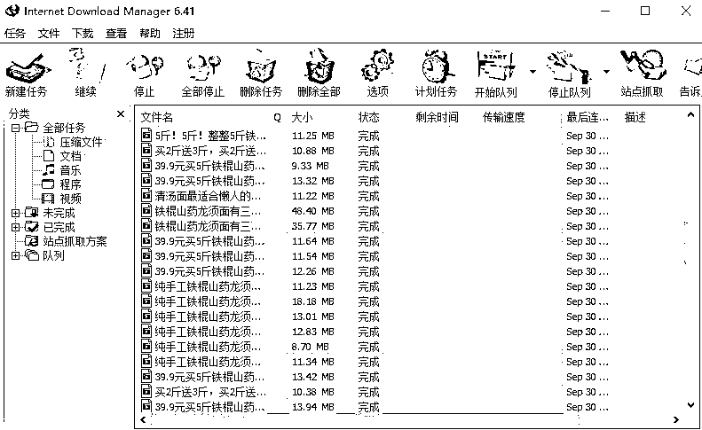

剪辑一定要精细，去重做到位，这样才能跑大流量。筛选爆款音频脚本，参照爆款框架和前3秒，把多个素材分割混剪成新视频，加上变速、转场、画中画、滤镜、特效，四个角贴贴纸，只要不影响清晰度就行。  

发布也有讲究。有条件尽量实拍原创，品好就能出大单。有账号一场直播能出5000到1万单。  
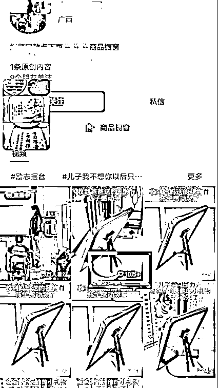  
  
混剪发布的话，第一条视频有200播放说明正常，后面按自己节奏补视频，15分钟、半小时、一小时都可以。现在有的视频推流慢，可能等几个小时，要随时观察。  
市面上很多卡封面、卡特效的做法，本质是绕过系统原创检测，用视频号拍摄功能拍一段，平台就当原创了。但核心还是品和素材，技术只是放大器。你素材是金子，加持了变两坨金子；素材是屎，再多技巧也是两坨屎。

什么时候开播？我一般是视频播放量到一两千、获得推荐的时候开播。流速快就上，拉时长拉成交。如果直播间进来人、有成交，会反哺视频播放；如果半小时不进人，就可以下播了。  
直播可以用手机或电脑，开播前要人脸认证。封面用产品图或头像，少放文字，免得有违禁词限流。直播主题可以写“视频同款点这里”“同款热卖中”。画面放产品首图加文字，比如“原价xxx，现在xxx，工厂直销”，最好真人出镜。没样品就贴图，有单了再买样品回来播。  
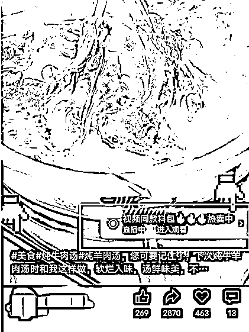  
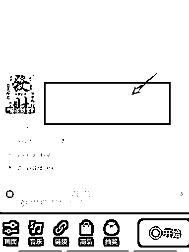  
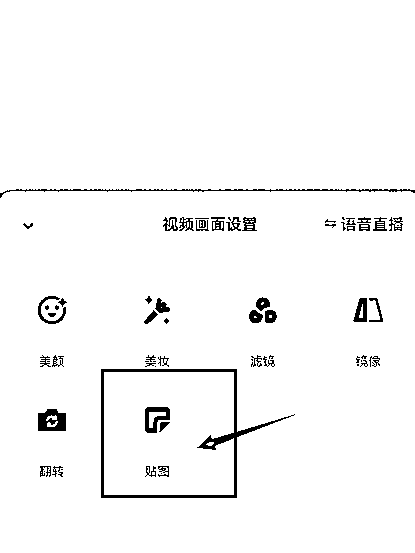  

话术方面，多录同行直播整理成文档。通用话术给大家几句：  
“欢迎新进直播间的哥哥姐姐，今天工厂直销价，平时卖XXX，今天新号开播只要XXX，想拍的抓紧。”  
“支持七天无理由，喜欢就拍回去试试，不合适直接退。”  
“别犹豫，犹豫就没了，库存最后三单，拼手速。”  
低价产品不用塑造价值，因为用户已经被视频种草了，你只需要反复强调划算、快没了。高SKU产品要引导买贵的，说更划算。说完记得让拍了的人扣“已拍”加急，增加互动数据。

账户库管理也很重要。视频号容易违规，建议备几个账号，用表格记录状态，有没有违规、能不能加热。  
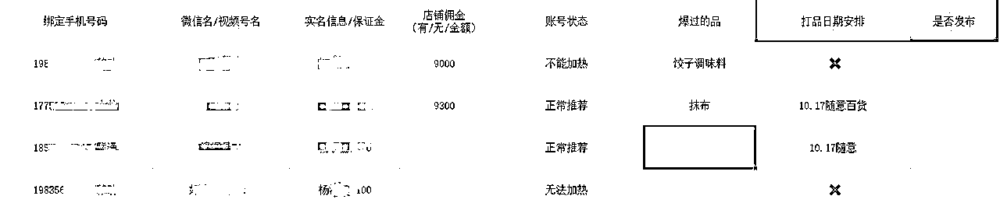

最后，新手最常见的十个问题，我统一回答一遍：  
1. 害怕直播怎么办？把话术写下来照着读就行，流量来了自然能出单。叔叔阿姨们都很友好，只问产品问题。  
2. 账号不够？自己搞5个，再加家人实名的，十几个没问题。  
3. 不能加热违规了？发10条原创风景或自拍，再申诉，基本隔天恢复。申诉话术可以用：“尊敬的工作人员，我知道视频号是正能量平台，我的作品都是自己辛苦剪辑的，绝没违规，可能有些细节没注意，不是故意的，我会认真学习规则，恳请复核。”  
4. 一直不出单？拼执行力，每天至少3个号测不同的品和素材。品不垃圾就一定能卖。  
5. 播多久？看流量，有流量就播，累了找人替，没流量就下。  
6. 限流申诉要多久？快一两天，慢一个月。别干等，同时起新号，有备胎才不被动。  
7. 要不要养号？我一般当天注册隔天用，刷一两天中老年内容就行。  
8. 要不要做数据？没必要，跑起来后在评论区引导去橱窗和直播间。  
9. 供应链怎么找？选品广场基本都有，或者私信同行客服说你带货款，要个定向。新手先跑线上佣金，线下有风险。  
10. 注销重注册有影响吗？基本没影响，除非严重违规有连坐。

最后说点真心话：迈出第一步永远是最难的，但迈出去了，后面就有路。运气这东西，建立在多发视频的基础上。你发得多了，概率自然会站到你这边。  
以上就是我一个多月做视频号达人带货的完整经验，希望能帮到你。也感谢赚钱有术，感谢航海的各位教练、领队和志愿者，特别是百万哥、蓝色眼镜、李诚、瑾糖、纸壳、睡飞、Rice和梁初一。项目还在继续，我们一起加油。

兜兜转转，还是想认真地说一声谢谢——谢谢赚钱有术这个圈子。它带给我的改变，不是那种立竿见影的“赚到多少钱”，而是像春雨一样，悄悄渗进认知的缝隙里。

在这里，普通人真的被看见、被托举。我们能近距离接触那些原本够不着的好项目，能下场去试、去练、去把想法变成行动。更重要的是，链接到了一群同频的伙伴，大家彼此照亮，相互打气。

每次刷到优秀圈友的分享，都会忍不住感叹：原来世界可以这么大，人生还有那样的活法和可能。而这种“看见”，本身就是一种向上的力量。