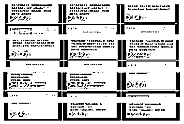
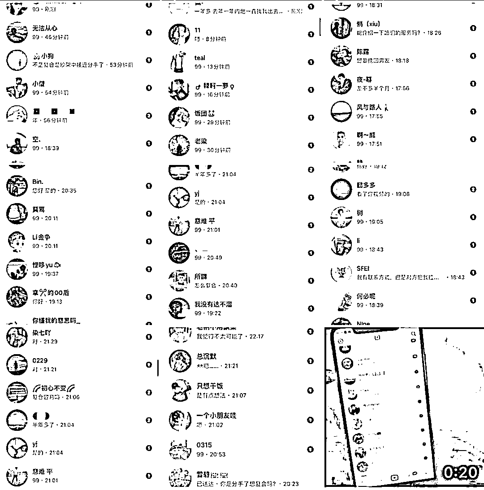
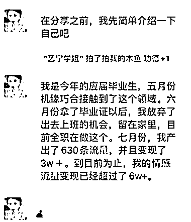
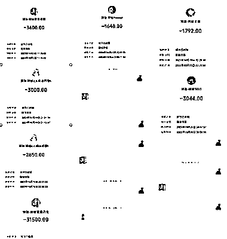

# 四个月变现8万+，婚恋赛道到底能不能做？我的实操复盘

> 原文：[`www.yuque.com/for_lazy/thfiu8/qd8rula49mtkbgd4`](https://www.yuque.com/for_lazy/thfiu8/qd8rula49mtkbgd4)

## 婚恋赛道能否入场？一份四个月8w+变现的实战拆解

作者：挽心
日期：2023-11-03

婚恋赛道能不能做？四个月撬动8w+的经验，我来聊聊

各位圈里的朋友，我是挽心。

今年是我深耕婚恋流量变现的第四个年头，同时也是我正式入局自媒体创业的第一年。想在赚钱里把这些年摸索出来的干货摊开来聊，也结识更多志同道合的同行，带大家一起破圈。

目前在赚钱社区，围绕婚恋变现的系统性分享其实并不多，但不可否认的是，这个赛道的需求体量巨大、用户付费意愿强。所以这篇笔记，希望能给正在观望婚恋赛道、或者想做流量变现却不知道从何下手的朋友，提供一些可参考的思路和方向。

下面我会围绕七个关键点展开：婚恋流量的玩法怎么选、时间与精力的分配、账号如何运营、抖音内容怎么拍、引流闭环和成交转化，以及新手入场需要跨过的门槛和具体建议。

全文篇幅比较长，详细内容我整理在了飞书文档里，方便大家完整查阅。

[`p9z0j9usen.feishu.cn/docx/SakVdAbZGowVKVxHfspcrH9Jn3e?from=from_copylink`](https://p9z0j9usen.feishu.cn/docx/SakVdAbZGowVKVxHfspcrH9Jn3e?from=from_copylink)

* * *

评论区：

执 笔 写 洪 顺 : 大佬，牛逼

阿懒 : 大佬是找了机构合作吗？自身负责引流，有机构帮忙接粉

挽心 : 是的，自己暂时还没有做转化的打算。

清一 : 大佬牛逼

凌心 : 挽心，牛🐮

坏脾气的小可爱 : 情感这方面市场真大哇！

小浩哥 : 牛

张万敏 : 客户质量好不好

* * *