# 三层漏斗，筛出更值钱的定位方向

做内容最怕的不是不努力，而是方向错了还在死磕。我见过不少人，今天做干货，明天追热点，最后什么都没留下。这篇文章，我想把一套自己反复在用的筛选方法摊开讲：三层漏斗，帮你找到既擅长、又热爱、还能换成收入的定位方向。

有段时间，我也在定位上反复摇摆。一位朋友发来几句提醒，我存了很久：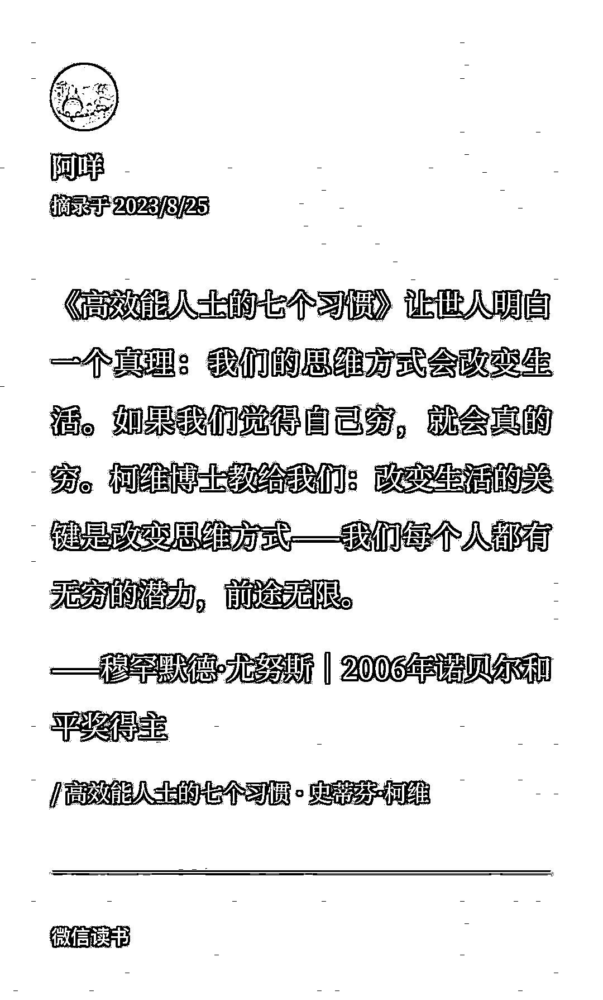
那段提醒让我明白一件事：一个人能被记住，从来不是因为什么都会，而是因为某个点上特别清晰。

先说说我对IP的理解。说白了，IP就是用户凭什么记住你、信任你、又愿意为你买单。就像路边卖麻花的摊位很多，但能让人专门认准“天津麻花”的，才是特产；同样，用户信任你的判断，才会不只买你推荐的第一样东西，还会持续买下去。

落到个人品牌上，我把它拆成四个部分：细分赛道的专业能力、带温度的价值观、长期更新的影响力、可信的背书。再具体一点，就是三个标签：定位、身份标签、故事标签。身份标签负责证明“你行”，故事标签负责展示“你是谁”，两者都要服从同一个定位。

有商业价值的账号，还需要打通三件事：让人记住你、让人愿意留下、让人知道你能卖什么。如果早期产品还不完整，也可以借成熟平台做分销，比如赚钱有术，口碑和交付都很稳。

定位可以按四句话展开：我是谁、对谁说、因何而说、如何说。先把自己的行业、特长和服务写清楚；再画出目标人群的画像；然后找到他们真正的麻烦、旧方案的空白，以及你比其他人强在哪；最后定下表达形式，图文、口播、视频都行。普通人不要求面面俱到，先从一个点切入，再慢慢连成线、铺开面；只求留下一个鲜明记号，可能是一句口头禅，也可能是一段特殊经历。

更值钱的定位，可以用一个等式表达：离钱近 + 有积累 + 发自内心想做。三个圈的交集，才是值得长期投入的方向。

接下来，就是这套三层漏斗。

以小红书为例，平台里的赛道划分非常细致，几乎每种兴趣都能找到对应方向。我第一次梳理时，把主要类目画成了一张图：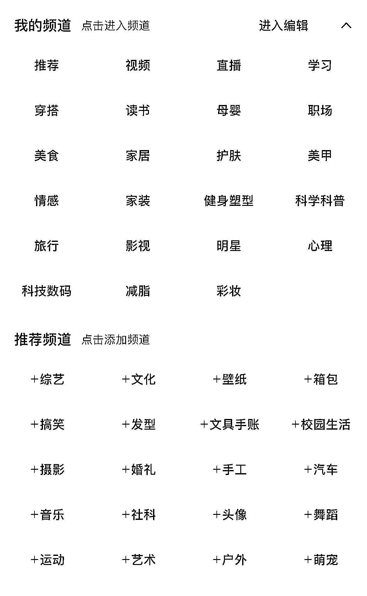

第一层，筛有积累的方向。可以是知识，可以是资源，也可以是经历。以我为例，我学过心理学，能做知识类内容；养过猫，能碰宠物赛道；改造过出租屋，能聊家居；喜欢研究手机、相机这类数码硬件，也能写科技方向。

第二层，筛更贴近变现的方向。这一步要冷静盘问：用户愿不愿付费？广告主多不多？客单价高不高？有没有后续产品线。我逐一盘了刚才那四个方向：宠物赛道接过猫砂置换，但猫粮这类入口商品我不敢乱接，一旦出事，对不起的是信任我的猫主人；数码方向广告确实找上门，可报价很低，200粉只能收到几十块，这是当时留下的接单截图：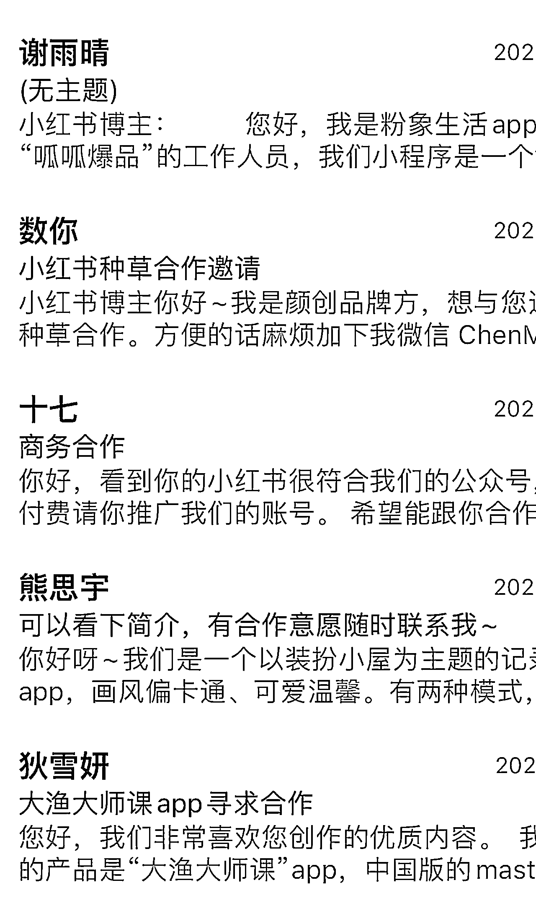；家居方向虽然置换价值高，但前期要掏钱布置，成本至少几千上万，我扛不住；最后是知识咨询方向，单次就能收到几百，后期还能用社群、课程和分销来拉长收入。经过这轮比较，我决定主攻知识类方向。

第三层，筛自己真正愿意长期聊的方向。这一步最容易被跳过，其实最像护城河。知识类方向里分支也很多，我按表达欲和长期价值感选了情感与教育，因为就算短期没回报，我也愿意继续写下去。

三层筛完，别等一个完美的答案。先拿一个大概方向开始跑，再边做边调整。你会发现，真实感和成长感，比完美人设更能打动人；这样的账号也不会掏空你，反而会陪你一起长大。

如果你已经做了很久单一方向的内容，却遇到“点赞多、涨粉少”的瓶颈，那就要试试能力叠加。说白了，就是在原来的内容框架上，再叠一种别人不具备的视角或技能：

比如做阅读分享的账号，不是只能发封面和书评。可以穿插真实经历，可以展示阅读中用到的好物，也可以用Notion做笔记方法分享。有人早期只做app合集分享，后来照片被一位头部博主转发，他开始讲拍摄技巧，结果一步步转型为科技数码作者，还拿到了品牌合作。机会，常常就藏在这种“叠加”里。

所以哪怕现在的履历还不够漂亮，你也可以做一个养成系账号。真诚分享你正在学的东西、经历的弯路和新的思考，这些都会变成最好的素材库。

定位说清楚了，再聊聊选题。

我的经验是：不要凭感觉猜用户想看什么，而是去用户的行为里找线索。早年做淘宝电商时，我习惯用生意参谋找蓝海关键词，再看下拉词和直通车数据，专门挑高点击低竞争的词。这套方法搬到内容选题上，一样好用：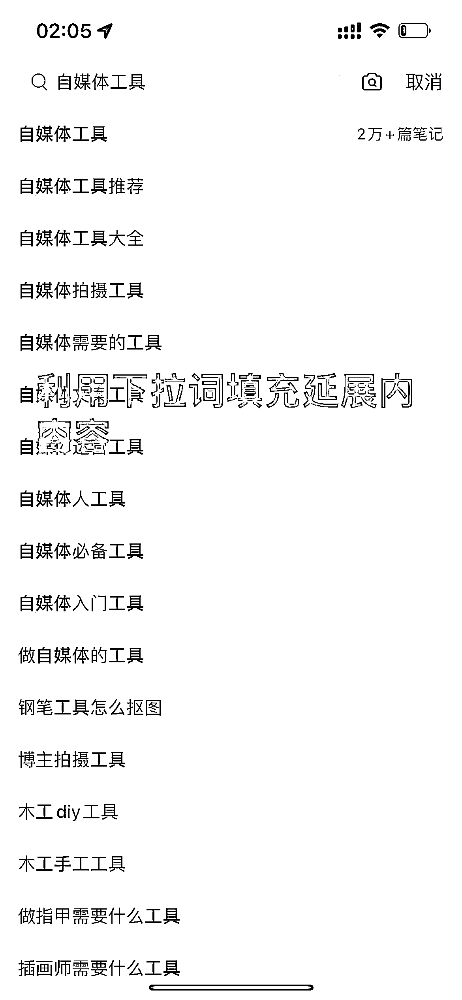

具体有三条路径。
第一，观察用户搜索什么。灰豚、新红、百度搜索数据、平台热榜，都能挖到高频词。
第二，观察用户购买什么。电商榜单和购物分享里，藏着清晰的消费需求。
第三，观察留言区。不少人会忽略评论里的真实抱怨，但那里常有精准灵感。

另外，人都有围观欲。就像天津那位跳水的伯伯，怎么就火遍全网？因为大家都想凑过去看两眼。大量的关注，本身就是流量。

还有一招：把自己当成用户，捕捉每一个闪现的念头。很多纠结，反复出现就是需求。

找参考选题时，尽量避开太冷门的方向。爆款往往是被反复验证过的，所以可以直接去拆爆款框架，看它们的标题节奏、情绪点和结构。我拆过不少高赞笔记，把它们共有的框架整理了出来：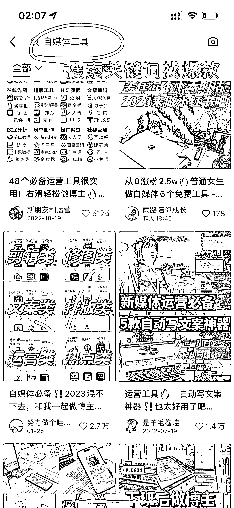
但记住：框架能借，内容必须来自你的真实经历。假如写的不是亲历的事，很容易越写越像原作者。

如果你想系统收集选题，可以建一个群，把目标用户聚在一起聊问题。具体操作我分了几个步骤：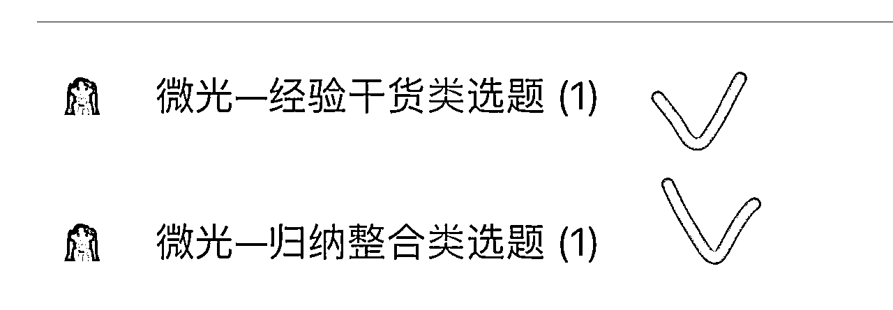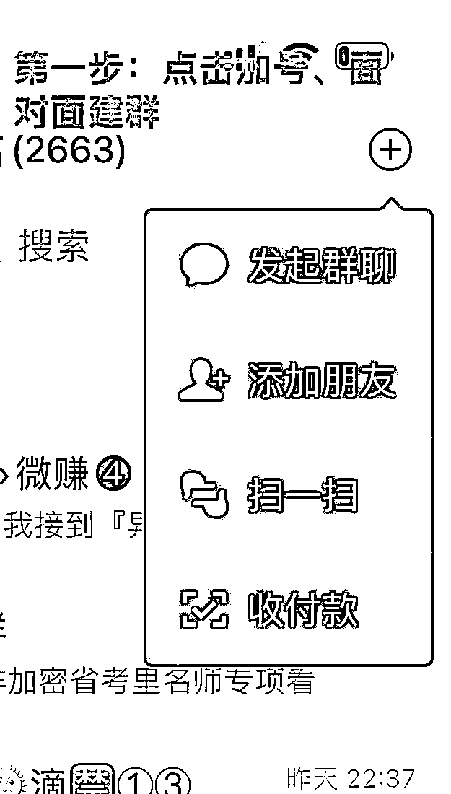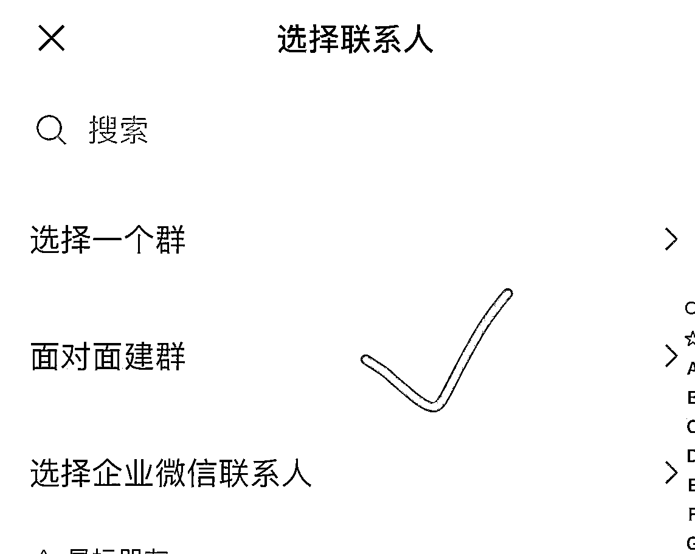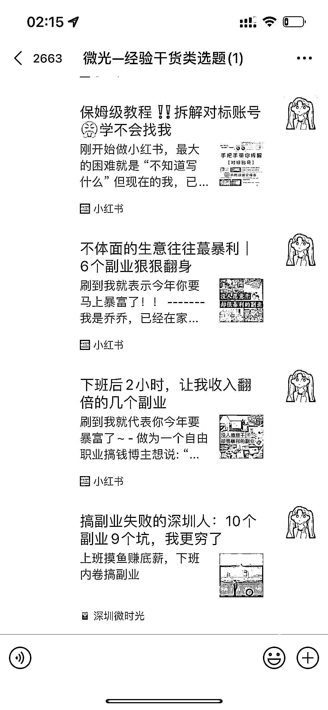
随后把聊天记录整理成表格，慢慢补充，就会积累成一份选题清单。筛选时，优先挑点赞超过2000、带有明显爆款基因的候选话题。

账号门面布置好以后，先别急着发布，要留几天养号。像正常用户一样刷同类的笔记，单篇停留超过10秒，顺手点赞评论，再关注一两位头部账号。这样系统会更快识别你的方向。
有条件的话，可以开会员增加一点权重。同时，把个性化推荐关掉，让平台偶尔给你看看另一类内容，反而能打开选题思路：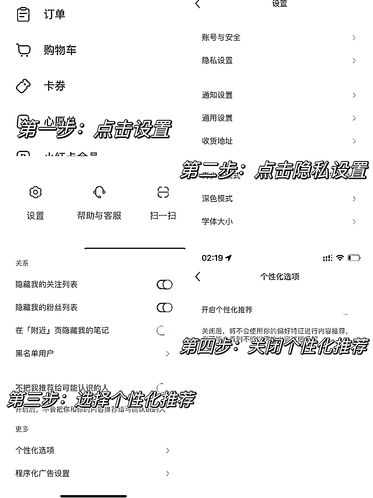

热点也可以成为选题来源：热播剧、热门综艺、节日、热搜事件，只要角度够巧，都能借势发力。从受众角度看，还可以戳共情点，比如年轻妈妈渴望被认可、中年人的压力、女孩对经济独立的执念。但要小心，痛点戳多了会麻木，时不时换个角度，效果更好。

举个例子。不少人点外卖前会犹豫：“该不该点外卖？” 这个念头的背后，是又嫌贵、又怕胖、又懒得做饭的多重纠结。把这种纠结放大来看，外卖周卡减脂餐能成立的原因就清楚了：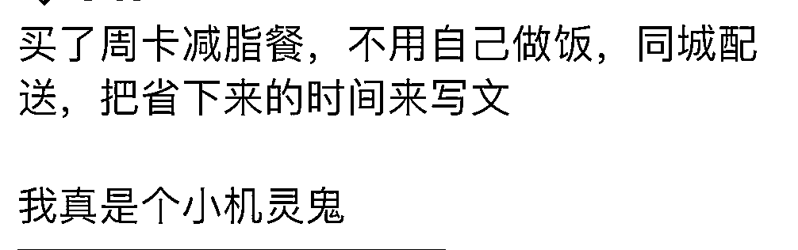

最后，说回定位本身。
我见过不少人迟迟不动手，不是没有方向，而是既担心自己不够好，又不愿意将就。这种感觉太正常了，就像有人写过的那个比喻：一边担心自己不是美玉，不敢用力雕刻；一边又隐隐觉得自己应该是块玉，不想和砂石为伍。可真相是，没有谁从第一步起就是成品，所有作品都是一刀一刀磨出来的。

先让三层漏斗帮你筛出那个“有点擅长、有点热爱、也能赚钱”的方向，然后立刻开始。走起来，才有机会修正；修正多了，你真正的位置会越来越清晰。

你的定位困惑是什么？欢迎在留言区聊聊，也谢谢你看完：