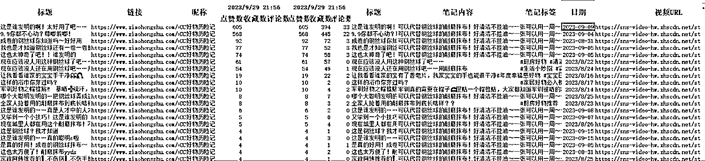

# ('用影刀十倍提升小红书店铺带货跟款效率', (2, 20))

别再手动刷小红书了！我用影刀把店铺跟款效率整整拉高了10倍，今天把方法全部分享出来。

先简单介绍一下自己：我是书豪，坐标杭州，龙珠圈的老圈友，连续四年年入百万，目标30岁前突破一千万。前阵子作为小红书店铺航海的教练，被龙哥盟视频号直播间邀请去做实战派访谈，当时我提到借助影刀工具能让跟款效率成倍提升，结果评论区不少人都在问“影刀是啥”。看来还是有很多朋友对这个神器不太熟，所以干脆写篇文章，顺便还录好了操作视频。

现在的行情下，效率就是竞争力。你一定要学会用影刀同时批量管理多店铺、多账号，把重复劳动交给自动化，这样才有余力去研究内容、盯数据、做决策。

怎么做跟款？核心是对标拆解：把小红书上那些卖得好的同类型账号翻出来，重点看他们的封面、笔记、标题，以及内容的点赞量、收藏量。筛选时按数据排名来，优先参考前10名、前5名的竞争对手，直接拿他们销量最好的笔记素材、封面和标题当样板，研究清楚背后的套路，再去优化自己的打法。

详细的拆解思路和影刀操作视频，我都整理进了一份飞书文档，方便大家直接查阅，链接在这里：

https://tb9qrhlhl7.feishu.cn/docx/LDgXdlFkxoXgZqxCRtmc1m9LnPf

温馨提示：工欲善其事，必先利其器。别一听新工具就觉得难，飞书文档里已经放好了视频教程，跟着操作就能学会，影刀一定要用起来。

如果你也在做小红书店铺，或者想进一步放大带货效率，欢迎在评论区交流。觉得有启发，也别忘了点个赞、转发给需要的朋友。

