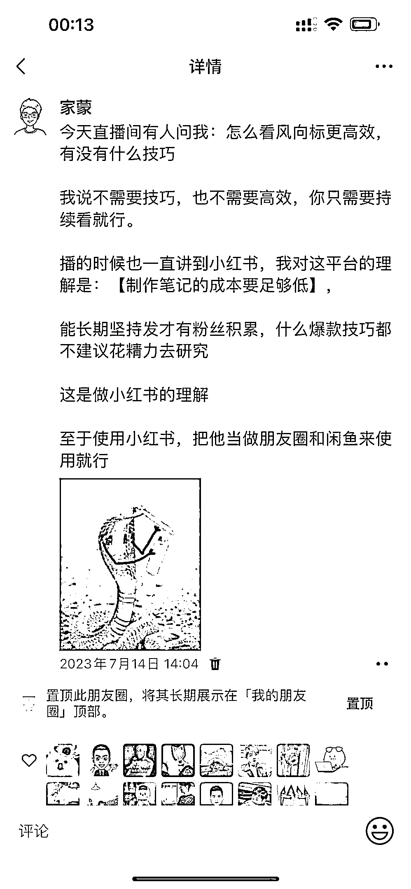
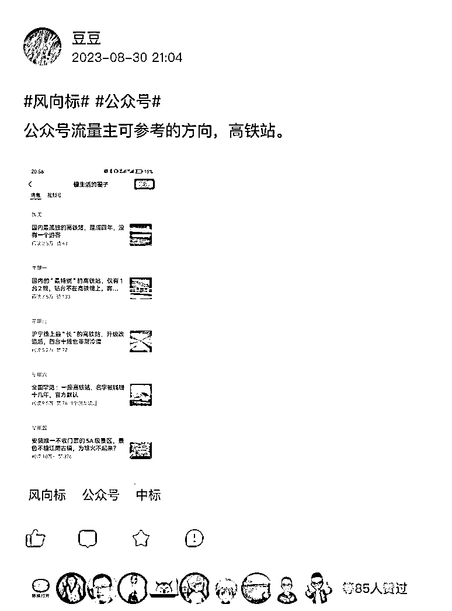
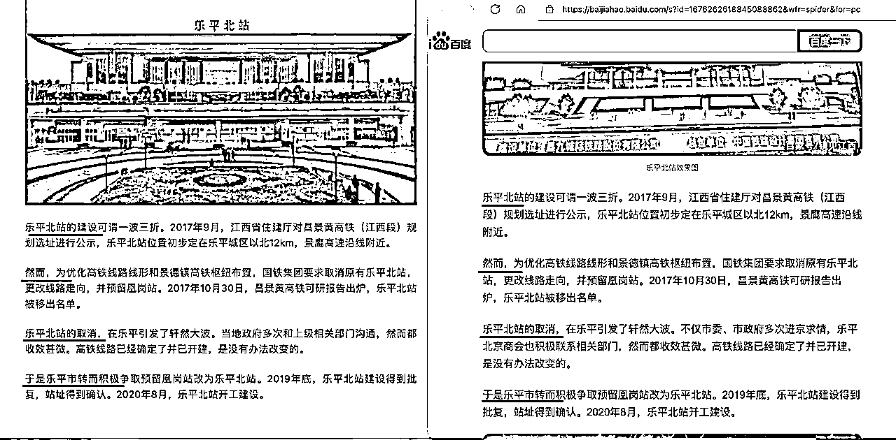
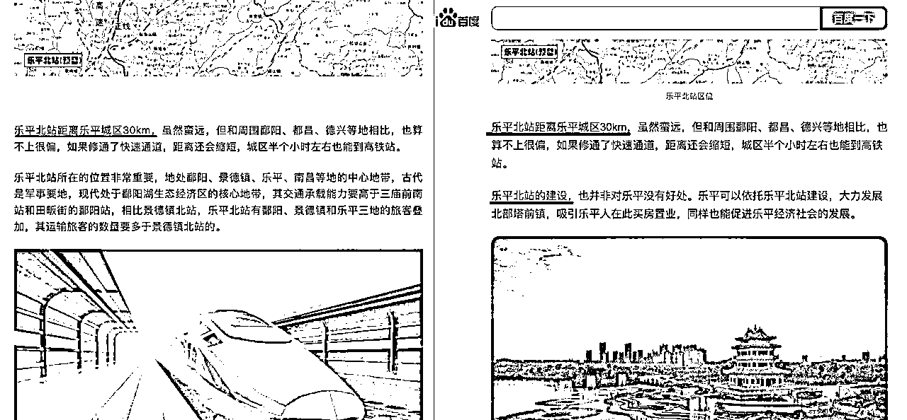
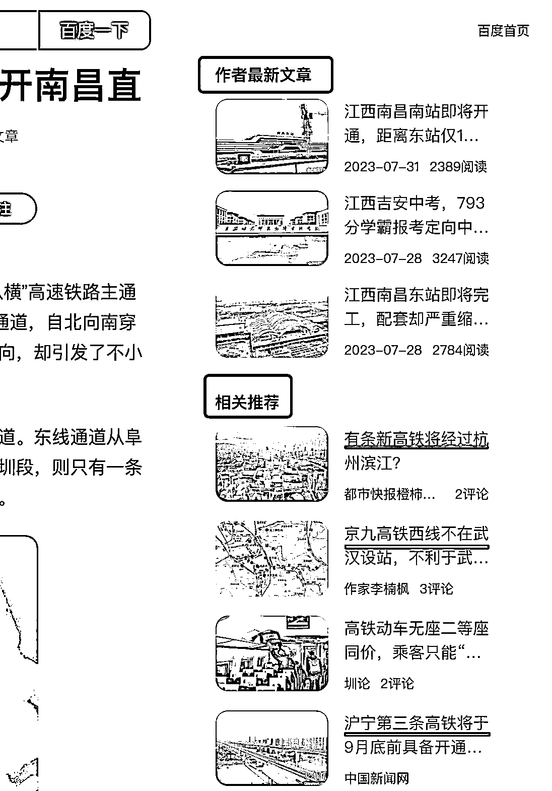

# ('关于风向标的几个复盘思考', (2, 14))

风向标看了一大圈，我最想说的几句大实话

大家好，我是家蒙。前阵子受邀去了赚钱有术的风向标直播，那阵子刷到了好多稀奇古怪的赚钱路子。有些小机会只要放大去做，短短几个月，收入就能抵得上打工人一整年。

不过我看得多、动得少，也正因为站在旁边看，反而憋出了一些特别真实的体会，今天一次性说透。

做项目最讲究一个“省”字：省钱，省力，门槛低，能快速试错。省的不光是真金白银，更是创作难度。你随手拍一条5秒的短视频，和正襟危坐写一篇千字长文，哪个更容易日复一日坚持？答案不言自明。要知道，用心做出来的东西没人看，才是常态，可这种常态特别磨人心态。要是成本低到随手就来，发出去没反应也无所谓，反正没花多少力气。心态一松，动作就停不下来，时间拉长，你反而比那些一上来就憋大招的人更容易活下来。

所以我常跟身边人说：我希望你一年之后还在做同一件事，而不是第一个月就把自己榨干。

我见过太多这样的范本。有人把社群里的精华随手截几条发朋友圈，既有深度，又做了宣传，顺手的事儿；有人开着民宿，顺手把装修过程、客人入住、接待细节拍成小红书，反正平时也拍照，零额外负担；还有一个人，守着三平米的书桌，硬是换了100多个角度去拍，每次都在琢磨新花样。这些都是把经营里的边角料，碎片化地往外抛，成本极低，反而最容易长期坚持。别小看这些不起眼的碎碎念，持续更新，攒成一个小红书大V也真有可能。

直播那会儿，因为我在不同领域里来回转，有人就问了：家蒙，你看了这么多，自己到底做了多少？这话里多少带着点“光说不练”的意思。确实，我真正执行的很少，但每一个被我选中的，都会认真对待，至少要撑过一段时间。至于我手头正在做的，其实不太乐意公开讲。你可以关注我，但别指望偷懒到直接照搬我的操作。我的成本和你的成本，从来不是一回事。我挑出来玩的东西，你无脑跟风，第一个死的就是你。

小机会确实多，拼信息差、拼勤奋，但凡是碰到“囤货”两个字，我总会在直播间把大家拦住。比如某个平台卖奶嘴看起来不错，可如果你本来就不是做母婴的，只因为看见一条缝隙，就冲进去进一批货，这流程从一开始就不健康。创业小项目，十有八九是试不出成绩的，我不想看你钱包受罪、内心自责，最后对着一屋子库存进退两难。努力可以，勤奋可以，千万别囤货。

还有一种风向标，引流特别顺滑——拉个群、留个微信，一气呵成，但翻到结尾一看，变现方式写着“也许可以卖货、卖服务、卖信息”。这个“也许”一出来，我就不踏实。这是典型的先易后难，先把人圈住，再琢磨怎么变现。可你拉一个群，不代表群友就认可你；没有信任，哪来的成交？所以这种虚假繁荣，我通常劝退。千万别想着“以后能干点什么”再变现，要以终为始。你要建群，就直接说：这个群啥也不提供，就提供一个圈子，9.9元进群，爱来不来。这样反而离钱最近。我的读者群就是必须付费，不付费就别进。要是让我先进群，之后再推课程收割，那才叫扯淡，我自己都会嫌累。别不好意思，开口谈钱，这事就对了。

最后，把我在风向标里悟到的这套拆解流程分享给你们。遇到陌生项目，可以照着走：

1. 先看对标玩家做得怎么样。
2. 把自己代入“创作者”，盘一盘需要哪些素材。
3. 判断这些素材能不能低成本、长期拿到。
4. 问自己：这在我的能力圈内吗？我真心喜欢吗？会不会两周就腻了？

拿我最近刷到的公众号流量主项目举例。

先看数据：那个号的阅读量，低的有2万多，高的接近10万，谈不上现象级爆款，但胜在每天都稳。按流量主收益算，10万阅读对应大几百到一千的收入，2万阅读也有一两百，一天一篇，月入几千是稳的。

那我要模仿，需要什么原料？注册一个公众号，找内容素材，最好有现成的合集，抄一抄、改一改就能发。每天排版、找图、发文章。要是能扒到几百条高铁站信息，就能轻松日更几百天，成本一下压到谷底。所以，找到“源头素材”才是这个项目的七寸。

我逆向找了好几个源头，发现号主把配图换掉了，文字基本没大动。这是他昨天写的乐平站故事：

找素材时，瞄一眼右侧推荐，果然刷出来一堆同类文章：

原料齐了，剩下就是加工：图怎么换、字怎么改？自己来、找兼职、还是丢给GPT批量改写？机器改完要不要人工核对？谁来发布？前期工作量不大，一个人全包也扛得住。

技术上的细节都不是事，最关键的是第四步：你愿不愿意长期做？成本压得够低，坚持就不算难事；中途还能赚到钱，坚持就更顺理成章了。

拆完这个标，你会发现，原来号主也是东抄抄西抄抄，赚点流量费。心里难免嘀咕：赚钱居然可以这么low、这么粗糙？信息差居然这么值钱？那我也可以啊！给自己定个15天或30天的期限，试试看。

观察风向标本来就是一场长跑，短期里的正反馈，可能来自一篇精华帖，也可能来自每天打卡的日志。聚沙成塔，我们在山顶碰头。

我是家蒙，谢谢你看到最后，后会有期。

