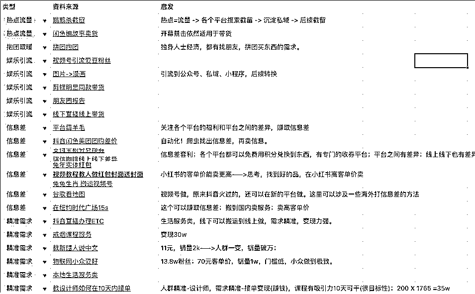
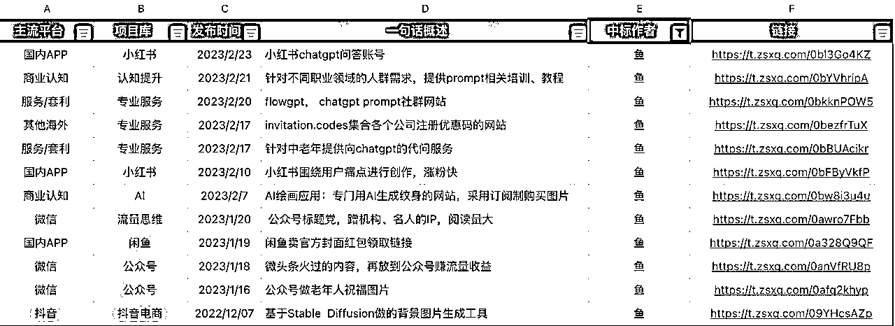
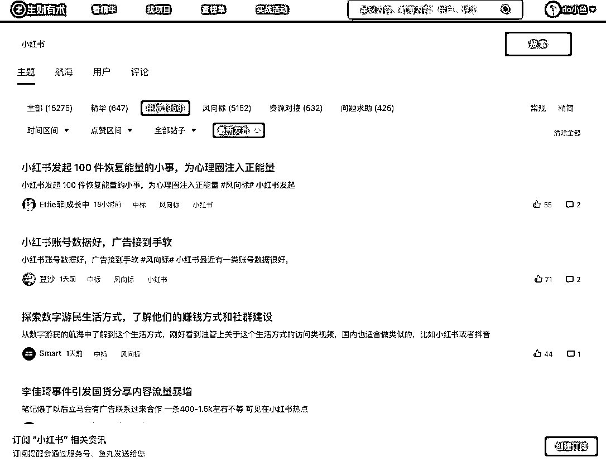

# 如何用风向标，升级你的赚钱段位

> 原文：[`www.yuque.com/for_lazy/thfiu8/gkd60bgizg9egnfk`](https://www.yuque.com/for_lazy/thfiu8/gkd60bgizg9egnfk)

## 风向标实战笔记：不同阶段的人怎么玩转风向标

作者：do 小鱼

日期：2023-11-16

《风向标使用说明：如何赋能不同段位的赚钱人》

大家好，我是小鱼。

今天想跟大家聊聊风向标这件事，是怎么陪着我一步步走出来的。

先简单介绍一下自己，我在路上探索自由职业的小鱼。辞掉大厂工作后，我尝试过远程工作，也加入过创业团队。去年因为项目资金问题离开了上一家团队，又回到自由探索的状态。那段时间我才真正沉下心来研究赚钱有术里的内容。

能自己赚到钱这件事对我来说很关键，可除了给别人打工，我还没掌握这项本领。这次我想为自己打工，做自己的老板，争取早日财务自由。但说实话，我既没有创业经历，商业嗅觉也比较弱，这条路挑战很大。

我的目标很清晰：打造一套属于自己的商业系统，找到合适的赛道，成为真正意义上的一人公司。而赚钱就是我的外脑和宝库，通过里面的信息和实战活动，我一步步靠近理想状态。

下面就用我自己的三段经历，来拆解下不同阶段怎么用风向标。

**第一阶段：建立商业嗅觉**

刚决定单干时，我发现自己对商业的判断力几乎是空白的。那要怎么培养敏感度呢？

我开始大量阅读赚钱的内容。相对精华帖来说，风向标更碎片、更易吸收，单位时间内能吞下很多信息。我的建议是，把每天刷朋友圈的时间换成刷风向标，坚持一个月，你对商业的嗅觉必然会超过那些只刷社交媒体的人。

我当时就是像审阅奏折一样，一条条认真看。

小技巧：看风向标时顺手点赞，这样系统会记住你的阅读进度，下次打开就能快速回到最新位置。遇到特别有共鸣的，我会收藏，甚至整理到自己的表格里做沉淀。表格里会记录信息类型、原帖来源、以及这条风向标给我带来的启发，方便以后复盘。

定期回看收藏夹里的内容，研究这些案例背后的底层逻辑和共通点。大量输入后你会发现，很多商业本质是相通的。

比如做内容无论是小红书、抖音、公众号还是视频号，爆款逻辑都类似：追热点、借风口、制造反差，最近甄嬛传解读的再火就是例子。又比如无论卖实物还是虚拟品，核心都是找细分需求、差异化选品、打产品组合，用低价甚至免费引流，再转化高客单。

在不断输入和拼接中，我的商业敏感度慢慢起来了。

怎么验证自己真的变敏锐了？开始用生活找机会，并且积极发风向标。我的命中率出奇地高，也证明了判断在变准。

如果你也想检验自己的商业直觉，可以多尝试发风向标，中标多了就说明你捕捉到了价值。你的嗅觉会越来越准，而且还有机会获得龙哥老师的认可和术值的奖励。

**第二阶段：从输入到实操**

嗅觉提升后，我进入了实操期。刚开始刷风向标时总觉得处处是金矿，想全都要。但精力有限，必须做取舍。我更倾向于选最契合自己兴趣和能力的，而不是表面上看起来最赚钱的。能力圈外的、违背价值观的，我一律不碰。

知道很多事，和真正做到是两回事。很多门槛看着低，实操全是坑。

怎么判断适合不适合？要看投入产出匹配度。

短平快的项目比拼的是时间差，适合手快、执行力强、时间充裕的人。而有些项目需要长期深耕，需要时间、金钱、精力、执行力的持续投入。你的资源决定你能做哪类风向标，你的目标决定你该做哪类。

举个例子，4月份我刷到抖音 AI 小程序换脸的风向标，评估后觉得自己能做、有空做、是轻资产且有兴趣，就去做了。单条视频最高播放30w，也确实赚到了钱。但后来被风控，风口过去，卷度加大，评估后我决定停掉。

这次经历让我明确了方向：不要在风口之间反复跳，更要找能长期做、具备一定门槛的赛道。于是我锚定了海外工具+AI的方向。

选风向标前先问自己：我想要的是项目经验、短期现金流，还是长期专业积累？目标清晰了，选项目才不会迷路。

**第三阶段：精准聚焦**

当方向越来越明确，我就不会无脑刷风向标了。我会每周看鱼丸整理的合集，只盯自己赛道的内容。

日常我更常用赚钱的搜索功能，精准关键词检索+筛选“中标+最新发布”。比如做小红书，就直接搜“小红书”，立刻就能看到最新的中标风向标。

这样找信息的效率大幅提升。我现在做的海外工具项目，就是靠这种精准检索从中标里挖出来的。

如果你也在船上，面对风向标无从下手，可以对照我的三段路径自检一下。

完全没经验、没方向的，可以把风向标当成朋友圈来刷，培养微习惯，慢慢建立商业全局观。

已经有想做的项目，就定一个明确目标，给自己一段试错期，完整走一遍从0到1，判断是否值得长期投入。

方向已经清晰的，就把风向标当成自己赛道的一手情报源，用来服务更长期的目标。

以上就是我从0到1再到聚焦的实操心得，希望能帮你更快找到热爱、擅长且可稳定变现的项目。

* * *

评论区：

能量菌 : 优秀

* * *