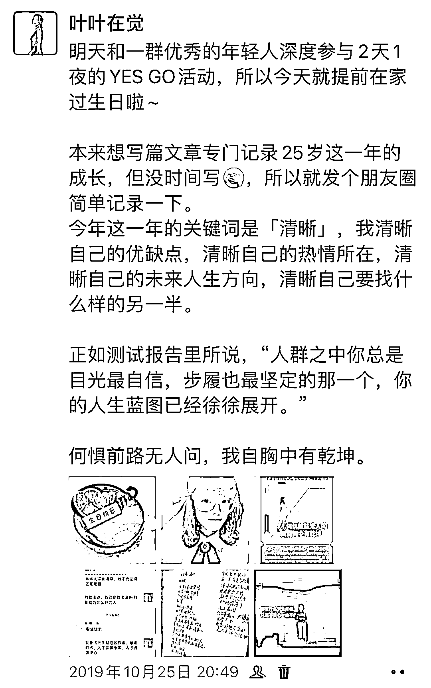
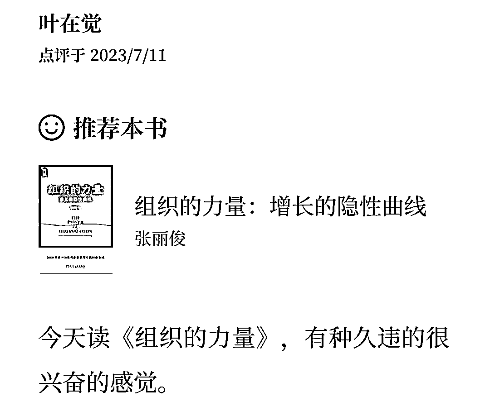
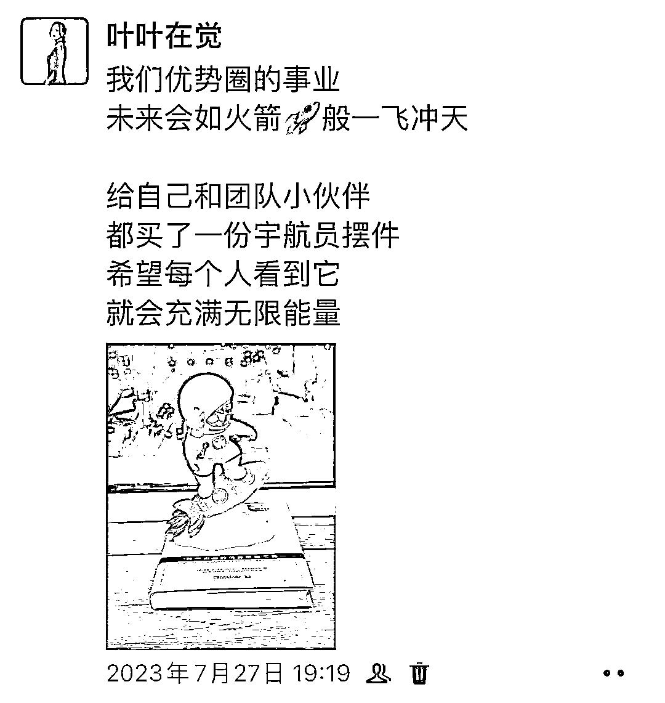

# 29 岁，创业的第四个年头，我重新找回了当年的那股快乐劲儿

> 原文：[`www.yuque.com/for_lazy/thfiu8/ca3ytgfkv763vbnh`](https://www.yuque.com/for_lazy/thfiu8/ca3ytgfkv763vbnh)

## 29 岁，创业第四年，重新找回少年时期的喜悦与激情

作者：叶叶 _ 优势教练

日期：2023-11-14

回望 2023，这一年像是从漫长的拉锯中解脱出来，过去那种反复的自我消耗终于画上了句号。从离开工作岗位创业以来，这是我最认可自己的一年。

我又能真心喜欢现在的自己了，久违的满电感回来了，也找回了创业初期那种每天清晨都对新一天充满期待的雀跃。

上一次拥有这种对未来满怀希望的情绪，要追溯到四年前的那个夏天。

29 岁，意味着我可以用“2字头”介绍自己的岁数，只剩最后一年了。所以年初的紧迫感特别强烈。

我希望把每一分钟都榨干，除了吃饭睡觉，其他时间全砸在工作上，好把因怀孕生子耽误的事业进度抢回来，在 30 岁前交出一份让自己点头的成绩单。

于是我请了枕棠当我的时间管理私教，逼着自己往前冲。

**总之就是拼命内卷，急着在 30 岁到来前把落下的盘子补回来。**

可即便卷到极致，5 月份受邀担任龙哥盟个人优势挖掘航海的教练，单月营收翻了好几倍，我依然无法对自己满意，仍然很难给出认可。

那种怎么都喜欢不起来自己的无力感，让我眼眶发酸。

我记得那晚脑子里全是在否定自己的声音，循环到连呼吸都带着苦味。

那一刻我多么希望有个咨询师能把我从这团情绪里拽出来。

转机出现在 6 月，老友猪先生办的闭门会送了我一张票。现场让我忽然照见现状：这样的状态，根本吸不来更高能量的同行。

更现实的问题是，业务似乎撞到了天花板。无论走低客单像小报童那样做量，还是走高客单重交付的路线，我都觉得触顶了，不知道该如何升级商业模式。

**想不明白的时候，我选择先给自己放个假，停下来取悦内心的真实感受，而不是硬撑出一副我很强的样子。**

我不再强求自己每天更新朋友圈，转而更扎实地去经营线下的生活。

奇妙的是，下半年人的状态反而一路回暖，内心的能量愈发稳定。

这一年我最大的体悟是：**生活不是全天候都要冲刺的，适度松弛并不会错过好机会。**

**人生需要雪藏期、养精期和蓄力期，有了这些储备，爆发才更持久。**

从 6 月底起我开始上私教课，每周保持 2 到 3 次的频率；

7 月和 8 月我辗转杭州、成都，和七小、荔枝、茄子等好友深度交流，还走访了龙哥盟、爱拍、吴晓波公司、岐飞直播基地、堆雪球、CD life 等几家公司；

去看不同赛道的打法，商业视野在被不断拓宽。

同时也在补组织管理的课，跟各路人请教实操问题。

读《组织的力量：增长的隐性曲线》时，书里的观点正好撞上我的困惑：

可看见的业务增长，背后必须有组织创新的支撑。真正的飞跃，往往是组织迭代甚至重塑带来的结果。

我把这条支撑业务前行的组织创新线叫做“隐性曲线”。

**于是从 7 月起，我主动放下了高营收的一对一咨询陪跑，放下了朋友圈的强运营，放下了短期的曝光，开始全身心投入到团队的建设上。**

xs 的加入是个转折点。她是我早期的铁粉，也是老乡。找对人真的太幸福了，她无论我做什么决定都会无条件支持，而且对优势事业的热爱溢于言表。

我们的客户也被她的朋友圈打动，很多人说她一点都不像其他冷冰冰的助理。

不止一位客户告诉我，正是因为喜欢柚子，才选择加入优势圈。这更让我意识到团队的价值。

花心思带团队后，我逐渐开窍了。

**过去我只盯着任务和结果，问有没有完成。现在我更在意成员的需求，重视沟通的温度，会聊业务规划，也聊对个人的期待。**

我开始引入绩效管理、定期复盘、沉淀 SOP。说实话这些对资深管理者是常识，对我这个从零起步的管理新手，却是点滴摸索的学习过程。团队越来越规范，氛围也越来越好。

因为对业务方向足够笃定，我不再担心自己给不出成长，反而坚信这里能给成员无限的成长空间。

我也明显感受到自己的个人魅力在回暖，团队遇到难题能得到及时解答和传授，状态自然不一样。

除了团队，今年我开始更多地做战略层面的思考，**对已经跑通 0 到 1 的人来说，赚钱不难，赚到更多钱才考验战略判断力。**

**战略决定了你把精力放哪里，也决定了你每天在做什么。**

说人话就是，战略是你实现目标的路线图。

有人选择做高客单服务少数人靠口碑裂变，有人选择重流量轻交付，有人选择养团队来支撑产品矩阵。

**战略没厘清，所有的努力都是瞎忙，甚至是浪费。**

我之前坚持每天发朋友圈、做小红书，本质上只是战术上的勤奋，突破不了天花板。

看起来很努力，效果却一般，最后只会更丧更累。

**根子上是战略模糊，有执行力却没有方向，就像无头苍蝇一样混乱。**

为了理清方向，下半年我不再急着推出新课去变现，而是反复自问：我的差异化优势在哪？我最擅长服务哪类人群？用什么产品组合去满足他们？主次如何排列？做社群还是训练营，线上还是线下？

这些选择直接决定获客逻辑和精力分配。

**一旦战略清晰，你会发现过去很多看似正确的努力都要被推翻。**

**也许小红书不是现在该all in的渠道，也许朋友圈不需要日更。**

今年我给自己的战略排序是：

**优先级 1 团队建设**

招到合适的人，能否合伙，匹配优势岗位，打造有凝聚力和执行力的团队

**优先级 2 老客户的交付与回访**

从流量里筛选高认同客户，做好交付、回访和持续跟进，深挖需求，孵化新产品线，提升复购

**优先级 3 案例沉淀**

整理客户案例，降低决策门槛

**优先级 4 社群和 KOL 关系维护**

与圈内 KOL 保持互动，维护口碑

**优先级 5 私域运营**

朋友圈、公众号的日常更新

**优先级 6 公域获客**

先把团队、客户、渠道的链接做扎实，再去做公域放大。

框架定下来后，我整个人不焦虑了，不再渴望被更多人看见，因为我相信扎实的内功终究藏不住。

**财富是对认知的回馈，而不是对勤奋的奖赏。**

过去限制我的那些天花板，像流量获取、商业模式、商业认知、人性心理，现在我都开始逐渐融会贯通，能解更难的题。

**现在的我像个求仁得仁的状态，周边的一切都顺畅，我相信会越来越好。**

如果你也像曾经的我一样，对自己充满不满，不如也给自己一段假期，清清楚楚地认识自己的核心优势，搞明白自己最有热情、最有优势做哪块业务、服务哪类人群，多跟不同行业的人聊聊，看看经验能否迁移，找到突破口。

**有时候慢就是快，焦虑时做出的决策质量往往很低，甚至是错的，后续还要花更多成本去修补，错过真正高回报的机会。**

慢下来，给自己思考的空间，提升认知，**很多问题在更高维度自有答案，焦虑和内耗也会不请自去。**

* * *

评论区：

暂无评论

* * *