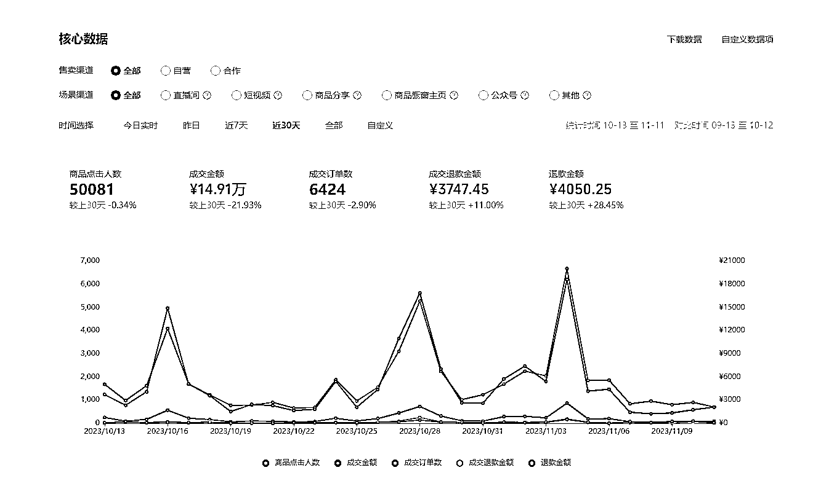
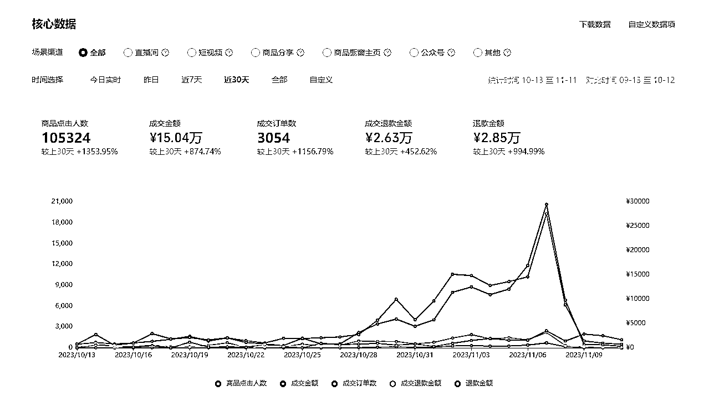
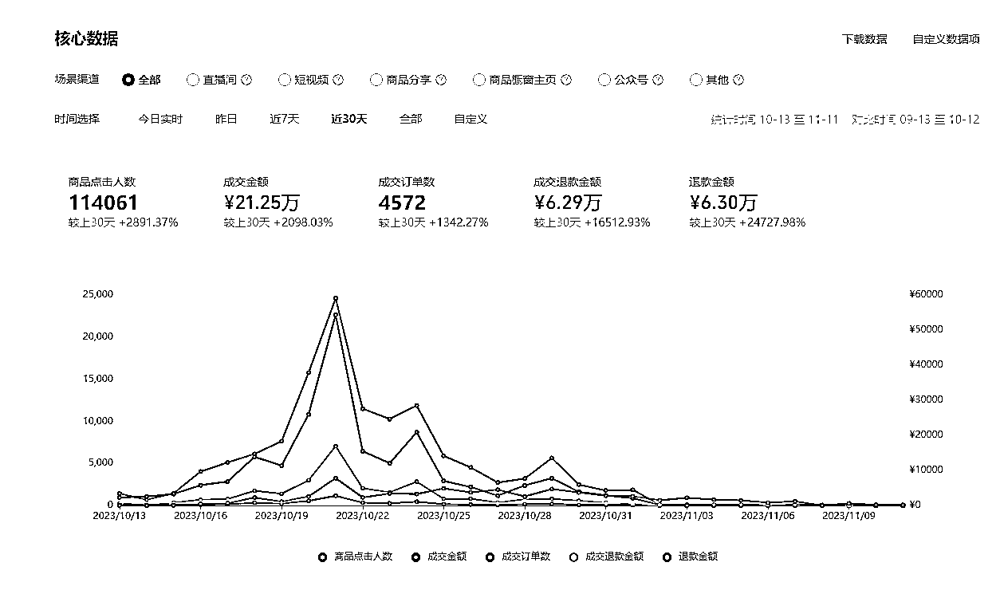
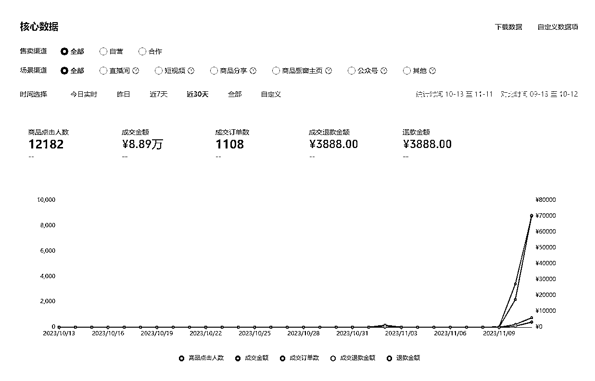

# 从封号到月入十万，我用三个月在视频号小店重来一次

> 原文：[`www.yuque.com/for_lazy/thfiu8/yrbf0lh4per2pcgt`](https://www.yuque.com/for_lazy/thfiu8/yrbf0lh4per2pcgt)

## 视频号小店如何从零做到月入10万：一次踩坑后重建的实战复盘

作者：潇洒哥
日期：2023-11-17

打个招呼，我是潇洒哥。今年3月才入局赚钱，7月第一次在社区发帖就被选为精华，那条关于从抖音亏钱转投视频号最终赚到50万+的经历，详情可以看我之前的分享 [赚钱新人从抖音亏损到转做视频号利润 50W+心路分享](https://paqni5a8o81.feishu.cn/docx/JmC4dzdc1omOl3xZ7RNcjXr7ncg?from=from_copylink)。那段时间给了我很大的信心。

之后几个月我几乎全身心扑在店铺运营上，很久没在社区冒泡了。今天利用周末的空档，把这段时间的经历重新梳理一遍，也算给自己做个复盘。想跟大家聊的是：我的视频号小店在8月份遭遇了全部店铺永久封禁的打击，仅仅三个月后，在11月份又重新把月收入拉回了10万元的体量。

下面放的是近一个月有成交记录的店铺数据截图。扣除退款后，实际有效销售额超过50万元，整体毛利率维持在20%上下，其中几款爆品的利润能做到25%-30%。算下来毛利润在10万元以上，勉强算是实现了月入十万的目标。

更完整的复盘和细节，移步飞书查看：[`paqni5a8o81.feishu.cn/docx/TJqudHwrRoI1kVxi8tOcAqC9nRc?from=from_copylink`](https://paqni5a8o81.feishu.cn/docx/TJqudHwrRoI1kVxi8tOcAqC9nRc?from=from_copylink)

* * *

评论区：

雄 : 于总 YYDS

添奇 : 兄弟留个微，链接一下

新世界 : 厉害 666

潇洒哥 : hbutacm

川少少 : 于总 YYDS

刘成 : 于总帅气

anyun : 写的很好

* * *