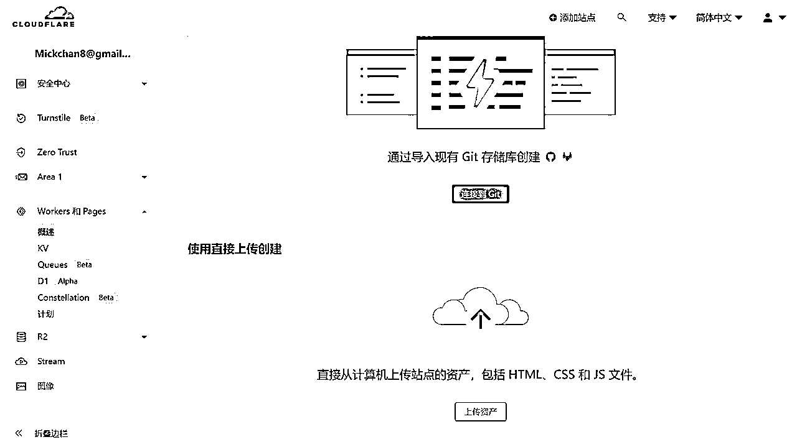
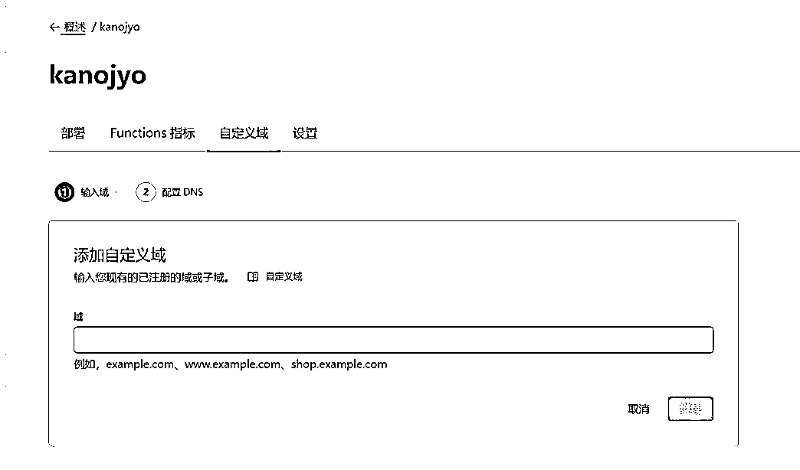
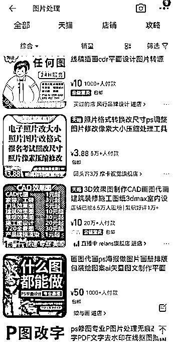
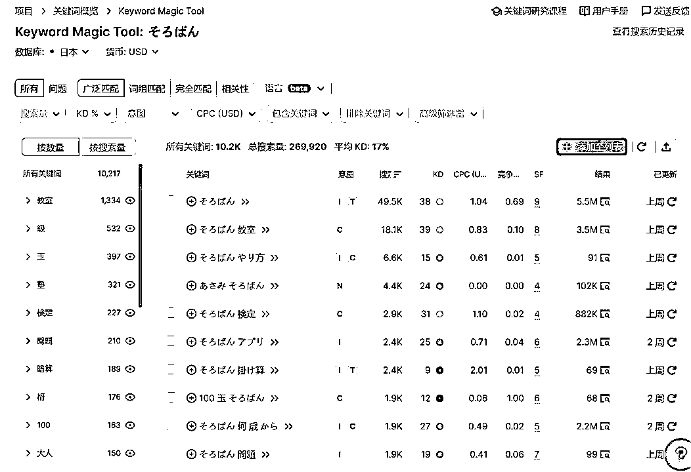
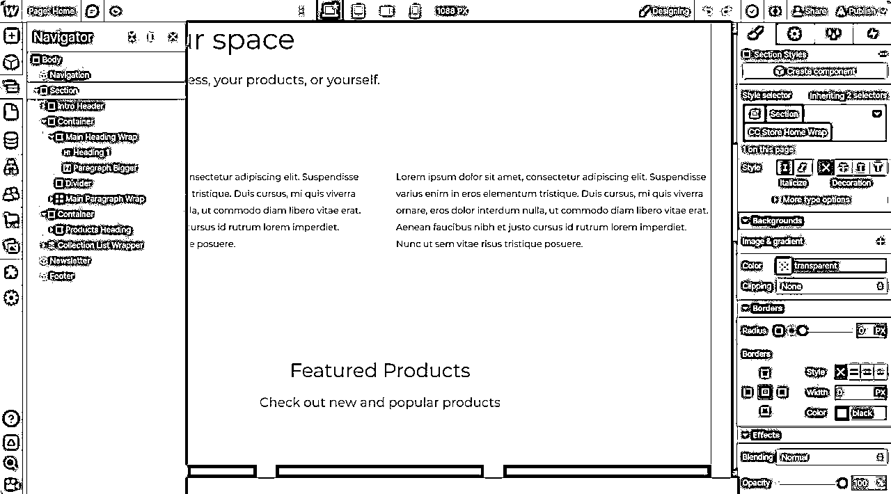
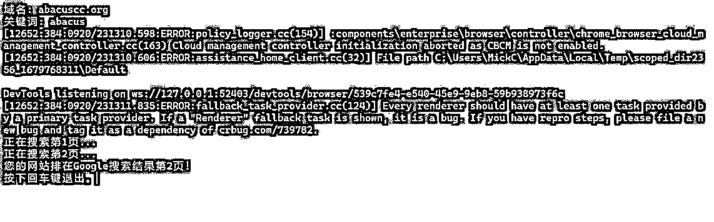
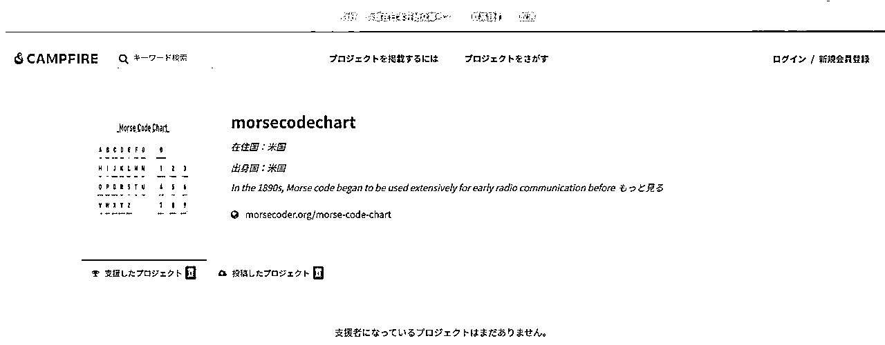
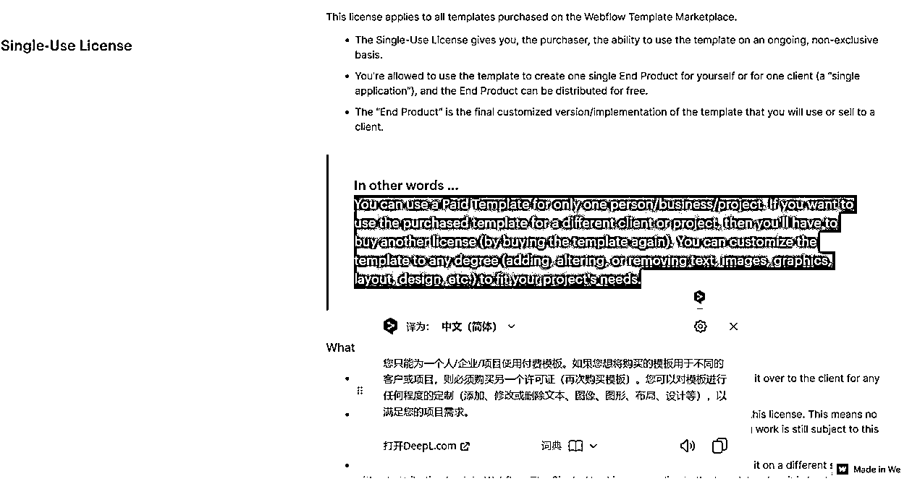

# 连续上线三次才理清的网站实操笔记

> 原文：[`www.yuque.com/for_lazy/thfiu8/ew7fm7gu8iivi0g4`](https://www.yuque.com/for_lazy/thfiu8/ew7fm7gu8iivi0g4)

## 我的多次建站踩坑经验分享

作者： 小宇 Mick

日期：2023-11-15

感谢龙哥盟给我这次分享的机会。

先做个自我介绍，我是95后软件工程师，目前在一家服务日本客户的外包公司。技术方向偏后端，编码能力一般，但对日语学习一直保持热情，自学拿到N1。

ChatGPT走红后，AI话题被推到台前。真正意识到模型价值的人，已经在生产环节尝到甜头。

以我自己的编程工作为例，过去要翻遍文档、求助社区才能解决的卡点，现在一句提问就能给出思路。

对本次航海的伙伴来说，这份提升更直接。网站搭建的相关教程遍布网络，而这些内容恰好成为大模型的训练数据，所以它基本能覆盖建站过程中绝大多数的提问场景。

言归正传。接到邀请时我心里没底，和大部分人一样我也是新手，至今没有变现，第一笔海外收入还在路上，很羡慕已经拿到结果的同路人。

因此这次分享集中在起步阶段的实操体感。内容比较入门，希望这些粗浅的试错能给还在摸索的同学一点参考。

先说进度：目前已有两个站点对外，第三个正在搭建中。

这里需要澄清，并不是前两个已经收尾现在才启动第三个，而是三个项目的推进是交叉进行的。

第一个项目其实在航海正式开启前一周就开始了。我提前研读了航海手册，先做了一个练手Demo。顺便说明，往期航海的资料随时可以回看，不必等开营才动手。

航行第二周又上线了第二个。现在精力主要放在第三个上。

先讲第一个站点。

playabacus.net

那时对关键词研究和流量判断几乎为零，粗略看了手册就开干。灵感来自X上一条日本家长吐槽孩子珠算等级考试的动态，于是做了一个中英双语的在线算盘演示。谈不上解决刚需，就是觉得有趣就做了。

在星球看到刘小排教练谈十倍速全栈程序员，我兴起一试买了Copilot，随后在GitHub找了个Vue的基础模版，让它在零基础的状态下帮我改出可用页面。

我平时写后端，前端非常薄弱，CSS调得痛苦不堪，移动端屡次崩掉。折腾许久才勉强可用，然后在Cloudflare注册域名，把项目放到Pages上就算完成部署了。

感兴趣可以点进去看看，就是一个很简朴的单页。

这里给非技术背景的同学快速介绍一下在Cloudflare上搭最简站的流程：新建一个Pages服务，它会提示你从代码仓库导入还是直接上传静态资源。

直接上传更省心，你只需要准备一个包含index.html的文件夹即可。CSS、JS这些新手阶段可以先忽略。

不会写index.html可以直接让GPT生成一份。

随后在Cloudflare购买心仪的域名，在已建的Pages项目里设置自定义域名，将刚买的域名指向站点，网站就上线了。整个流程都在Cloudflare内完成，体验很顺滑。

回头复盘第一个站点，我归纳出四处问题：

前两点必须补上，我在航海开始后立刻做了补救。好在核心词的竞争尚可，英语区已有同类在线工具，日语区也有一款类似产品但看起来是付费的。

第三点解决办法很直接，下一个站点换一套技术栈即可。

第四点和习惯有关，我平时很少查看邮箱，除非收验证码。主要是海外使用习惯差异，如果要做面向海外的项目，最好养成每日检查邮箱的习惯，避免错过关键通知。那次账号被异常拦截，就是靠GPT帮我写了一封申诉邮件才恢复的。

再补充一点，建站绕不开素材。至少需要一个站点图标和封面图。

大多数独立开发者不可能样样精通，这时候就要借力。

比如我的算盘素材，就是在淘宝找人把原图的算珠抠出来并补齐背景。专业的事交给专业的人，省下的时间比自己硬啃更划算。

目前这个站点暂时没有更新，主要还是我还没学会单页的SEO优化。后来查了Semrush，数据显示大词难度偏高，但第3、5、7位的相关词有机会冲上去，2和6相关度不足，4明显是品牌词。

接下来讲第二个站点。

ai-kanojo.net

做这个站的初衷很单纯，就是好奇。群里哥飞教练分享了一个能批量生成SEO页面的ChatGPT指令，我随手挑了一个搜索量约3k、KD低于30的词，让它生成页面。目标是尽快上线一个做过SEO优化的页面，观察多久能拿到自然流量。

站点名称取作AI彼女，直译就是AI女友。虽然主题是AI，但可以延伸出很多高流量的长尾词来承接。

搭好后又是一阵手忙脚乱，一地鸡毛。

过程中我发现了一个宝藏工具：Webflow。

对后端开发者非常友好。它提供可视化编辑，只要在画布上点点拖拽，结合模板就能做出好看的页面。

最关键的是它支持导出html、css、js，相当于把前端工作台的成果打包带走，能直接并入自己的项目里，省去自己写前端的痛苦。而且它提供多终端预览，页面在不同设备上不易崩。

如果CSS让你头疼，用它效率会高很多。当然不会代码也可以直接在Webflow上部署使用。

后台大致长这样：左侧Navigator列出页面所有元素，可拖拽增删改位置；右侧实时调样式，改动立刻生效。右上角点Publish就能上线，也能导出源码。我就是导出后部署到Cloudflare的Pages上的。

唯一的小门槛是导出源码需要付费订阅，几个人拼一个会员分摊下来成本很低。

说到省钱，Semrush、Copilot这类工具在淘宝上都能找到共享账号，比官网订阅便宜不少，后续碰到付费工具可以先去搜一下。

开发遇到卡点需要人帮忙，我更推荐闲鱼。上面多是个人开发者，议价空间大，而且合作几次很容易变成朋友。借用惰总的一句话：花钱认识一个懂技术的朋友。

目前这个站刚被Google收录，前几页还没看到。接下来准备继续优化页面的细节，目的不是把站做大，而是把它当成练手的实验田，观察每次改动后排名的变化。

为此我用Python写了个小爬虫，输入关键词和自己的根域名，就能分页查询自己的排名。虽然目前不稳定，Google有时做灰度测试不是分页展示，这时会出错，以后会再适配。大家如果有好用的排名查询工具也欢迎分享。

再说说第三个站的规划。

重新做了一轮关键词分析，发现同类站点已经有人做了。但在Semrush上看到仍有一些月搜索量几十上百K的词，KD值低于30或在30左右，说明入口还没被完全占据。

我的打算是，功能上参考竞品，然后针对这些空白关键词做差异化调整，看能否吃到流量。

答案只能靠实践。

目前找词的一个思路是跨语言圈子。我们熟悉的英语内容里头部关键词都被卷爆了，可以换成法语、德语等再查一遍，往往能发现更宽松的市场。

另外SimilarWeb和Semrush联用很有用，能从一个站点发散出同类型站点。Semrush的反向链接查询也能学到别人的SEO打法。

比如下图标注的是一个日本众筹平台，有人利用用户注册后的个人简介页，在简介里放自己的外链，成功被收录。同样的操作被批量复制，权重累积下来效果不容小觑。

还有一个容易被忽略的点，使用海外素材资源时一定要核对License。有的可以免费商用，有的仅限单项目使用，重复使用需要重新购买。

最后做个小结。截止目前我还没有什么漂亮的成绩，但一直在重复动手、试错。我印象很深的是航海手册里刘小排教练讲“一直失败怎么办”的回应。

海外建站的单次成本并不高，失败一次对我的伤害很小。那为什么不加快失败的速度，用更快的频率积累经验呢？

希望这些浅薄的试错记录能对还在建站阶段的大家有一点帮助。

* * *

评论区：

暂无评论

* * *