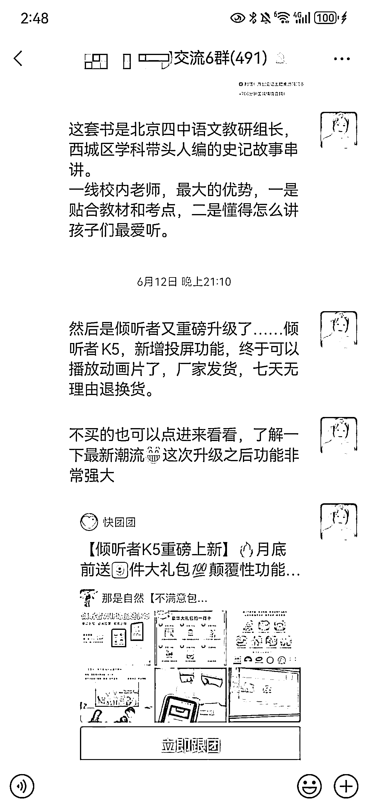
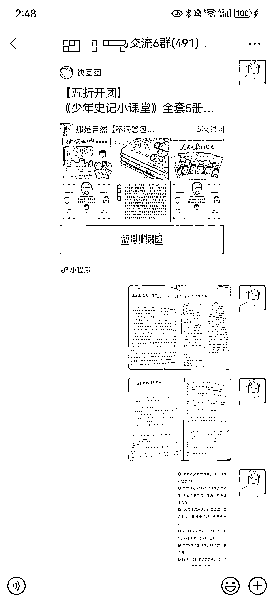
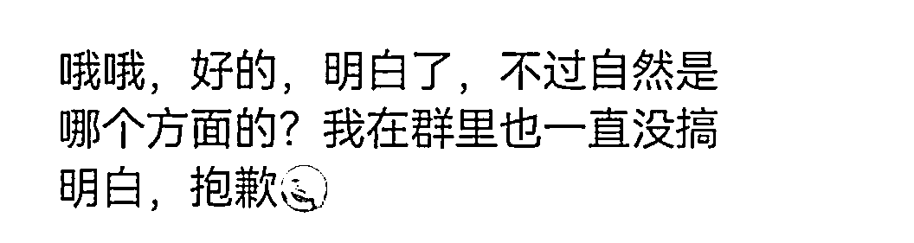
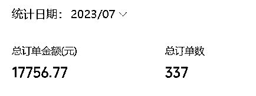
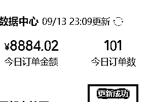

# ('快团团：月出 0 单到日爆百单，我做对了什么？', (2, 25))

从连续挂零到一天卖出100多单：我的快团团经验复盘

大家好，我是大晨。熟悉我的伙伴可能知道，我是靠跳绳做到单日120单的。这次被九儿邀请来分享，其实挺意外，因为我加入航海刚满一个月。今天想掏心窝子说说，我是怎么从快团团月月0单做到日爆百单的，这里面的每一个坑，都是用真金白银换来的。

今年3月，我无意间接触到快团团。当时手里正好有9个已经满员的500人学习群，也有一定的粉丝基础，总觉得这些资源不用太可惜。快团这个平台属于私域，关键还不向个人收费，几乎是零门槛。于是我没多想，撸起袖子就开干。

但刚开始，我根本摸不清快团团的玩法，完全陷入“自嗨式选品”。我觉得用户是中小学生家长，那就上电池、充电宝、水果、零食、绘本、教辅……想到什么上什么，没有固定时间，每次扔10到20个品上去，然后就不管了。我当时天真地认为，只要东西上架，用户就会自己看到、自己下单。不看点击率，不看购买率，不做人群分析，更不推广。就这样熬了一个月，上了300多个品，结果一单没出。说实话，心态崩了，差点想放弃。

事情转折发生在4月底。我发现身边好几个朋友也在做快团团，而且做得有声有色。我这人胜负欲有点强，一下子被刺激到了，又重新振作起来。这次我没有再蛮干，而是开始认真向别人学。我混进许多同行社群，观察他们几点发链接、发的都是什么品、文案是怎么写的。蹲了一个星期后，我开始模仿他们的选品和文案，简单修改后发到自己的学习群里，没想到真的有人下单了！那一刻特别兴奋，原来只要发对链接和文字，真的能出单。

尝到甜头后，我立刻在9个学习群里铺广告，文案加购买链接，每天轰炸。

订单确实来了，零零散散。但副作用也随之而来。有群友私信质问我：“这群到底是干嘛的？学习资料一个没有，全是广告。”那一刻，我真的挺挫败。

我也开始反思：这种做法太伤社群了。我建群的初心，是想给家长提供一个交流鸡娃经验的地方，顺便推荐一些性价比高的好物。结果我连续刷屏，把群搞得乌烟瘴气，大家自然觉得我是为了自己赚钱。于是，我马上调整了运营方式，降低了广告频率，重新把学习资料分享放在前面。慢慢地，吐槽声少了，很多家长找资料还会第一时间艾特我。因为我的IP定位是“学习小助理”，大家愿意相信我推荐的东西，单量也因此涨了不少。

再往后，我在同行社群里持续观察了两周，重点关注了6个问题：群定位是团购群吗？群主有没有打造个人IP？选品都选什么类型？广告和链接几点发、是否固定时间？一天发几条广告？平时和用户有没有互动？通过对比，我找到了自己的想法：我的群定位是“资料分享+团购”，个人IP就叫“鸡娃资料库”，专门分享中小学电子资料；选品80%选学习用品羊毛团，20%选家庭日用品；广告链接不定时发送，但会做“链接+文案+产品图”的搭配；每天发10多条；用户下单后，在群里晒单还能领指定红包。这样调整下来，7月的GMV做到了17000多。

可问题也跟着来了。我看别人卖的爆款，拿过来自己卖，根本卖不动。冷静分析后，我意识到：之前的销量提升并不是因为我真的懂用户，只是因为我上的品多、还做了适度推广，碰巧踩中了几个大众需求点而已。

这半年我一直在磕磕绊绊中摸索，销量忽高忽低，内心很焦虑。我还找过市面上的快团团课程，结果大多是割韭菜，没有实质性帮助。直到8月22日，我通过理白的朋友圈知道了龙哥盟，果断加入了。正好赶上快团团航海，看到了小野老师的文章，一下茅塞顿开。她写的全是小白可落地的实操干货，每篇我都至少看了3遍，看完就照着执行。后来，一款跳绳帮我出了100多单，单日GMV突破了8000。对我来说，这真是个巨大的突破！

通过航海手册，我终于搞明白了，做快团团最关键的是三件事：选品、推广、售后。选品决定了你面前的潜在用户池有多大；如果你选的是非常冷门的小众品，那用户量自然就少；反过来，像沙式跳绳这种刚需品——它被列入中考统一考试器材，用户有硬性需求，就会自主下单。推广则决定了你能从整个用户池里吸引多少人到自己这里；假设一个品有10万人需要，你能拉来多少，就看你的推广水平。售后和社群维护同样重要，把老客户服务好了，复购和转介绍都能成为你的基本盘。

我前几个月之所以失败，就是选品没有正确概念、推广没有章法、售后更没做过，全靠几个学习群撑场面。要是早点想明白这些，可能早就不一样了。

学习之后，我立刻开始重新梳理用户画像：我的用户是中小学生家长，以30到50岁的女性为主，还有部分奶奶或外婆；她们平常买得多的东西包括学习用具、厨具、护眼产品、水果、蔬菜、五谷。接着我明确了选品时的三个考虑维度：品类尽量选蓝海、且复购率高的；品牌要有一定知名度，用户更容易接受；价格根据用户群体调整，高、低客单都要有。

选品时，我总结出三个实用筛选方法：
第一，尽量不选家门口、超市就能买到的东西，而是选有稀缺性、有特色、价格又不太高的品。
第二，快团团同质化太严重，新手起步尽量不要硬碰大爆款，而是在爆款里找“有差异”的子品类。比如希沃学习机前段时间很火，但大家都在做，新手没有价格优势，不如考虑同功能的其他学习机品牌，这样才有机会脱颖而出。
第三，多选转化率高的品，像标题带【品牌清仓】【临期产品】【重点选择】的，通常是大品牌清仓薅羊毛，信任度高，更容易转化。

关于上品，我还有三条个人经验：
一是自己先买回来试，不满意坚决不上。自己用着好，再拍实拍图、写真实使用感受。这种有温度的文案，用户是能感受到的，后面都会用订单回报你。
二是选对帮卖团长。尽量找品质相同、价格更优、售后服务跟得上的小团长，别盲目追大团长——大团长一天发千单，品控很难保证，售后也不如小团长细致。
三是主动和线下、淘宝比价。前期可以适当让利，让用户觉得在你这里买不仅价格有优势，服务还好。毕竟现在的快团团这么卷，拼的就是服务。

建立社群同样是关键一步，我认为要想清楚三个问题：大家为什么聚在一起？我们的目标是什么？为什么非得是我？我的回答是：社群定位为学习交流群，大家信任我，能从我这里获得鸡娃资料；同时还能薅羊毛，甚至拿到更优惠的线下课程。我的目标是让用户感受到真诚分享，提高用户体验和粘性。至于为什么是我——因为我推广的每一款产品都亲自试用过，先替大家避坑，是真心为大家着想。

方向定了之后，我会从三个维度持续精进：把鸡娃资料库做得及时、齐全，让别人很难找到替代；提升选品的质量、价格和稀缺性；优化售前售后服务，让用户买得安心。

做快团团，贴心就是竞争力。我始终认为，用户服务的核心是态度。虽然有些问题卡在团长或平台那里，我们解决不了，但要让用户感受到我们持续关注、非常重视的态度。我给自己定了几条硬要求：每天跟进发货，物流异常就及时反馈，超时没发货就联系团长催；主动加下单用户，询问收到货是否满意，如果满意就继续问满意点在哪儿，找出用户的需求点，再发个红包表示感谢——这也是挖掘需求和选品的好方法；如果不满意，第一时间给出处理方案，合理要求尽量满足；另外建立会员群，每月组织抽奖或免费试吃，邀请用户反馈意见，为后期选品做参考，同时增加粘性。

最后想聊聊心态。做快团团真的特别考验人，不出单就容易焦虑，甚至会直接放弃摆烂。我前几个月就是把快团当任务做，又累又受挫，天天想撂挑子。后来为什么坚持下来了？原因很简单：我想搞钱。快团团是我看到的最适合突破的平台，除去手续费几乎零成本，发发广告、选选品就能赚佣金。每天下班抽2小时来选品，一天赚100块，一个月也有3000。就靠这个念头，我坚持到了现在。

我之前最大的毛病是自控力差，又没有同行的人一起，总是三天打鱼两天晒网。后来想放弃时，我会停下来调整自己。想休息就休息，千万别用力过猛。明明今天已经很累了，心里极度抗拒选品，却还要硬做，反而适得其反。累了就放空大脑，去看看那些正向伙伴的朋友圈，给自己补充正能量。

我最大的转变，是加入赚钱后看了【小野】老师的文章。她是一位靠卖包浆豆腐做到150w GMV的职场宝妈团长，我几乎每天都刷她的朋友圈。她的每篇文案都很打动人心，每款产品都是亲自试用、真诚分享。我是因为读了她的文章，才做出了单日100+单的成绩。强烈建议大家都去反复读她的文章，实操性真的太强了。

说到底，我们都是平凡人，但我也渴望变成像小野老师那样的人。哪怕一天只转化一个客户，每天进步一点点，30天以后，也一定会有一个巨大的变化。与大家共勉。

