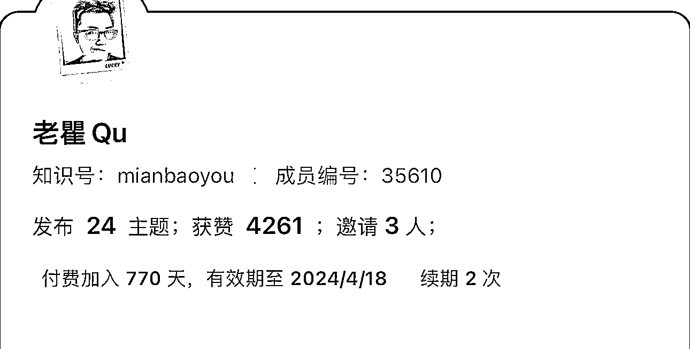
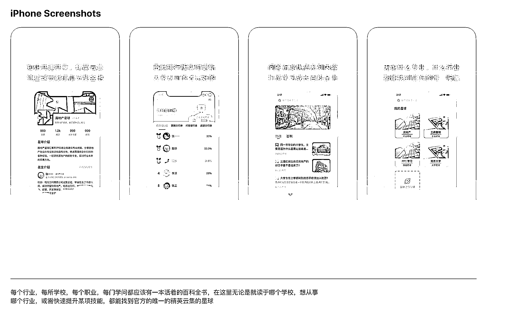

# ('看盗坤 10 年创业复盘，写下老瞿创业 3 年的反思', (2, 28))

创业第3年，我读了盗坤的十年复盘，终于想明白了这些

我是老瞿，今年是我离开职场、自己单干的第三年。加入龙哥盟第770天，陆陆续续发了24个主题，拿到11篇精华、5颗龙珠，还攒了4261个赞。

最近把盗坤那篇《十年复盘：星星之火可燎原，狂朝控股的发展之路》翻来覆去看了好几遍，心里挺有触动。说实话，他现在的段位比我高出两三个层级，但我总有种错觉——这是他走过的路，我正一脚深一脚浅地在上面走着。所以今天想借这个机会，聊聊我创业这3年的一些反思。

每个人在看盗坤的时候，看到的东西大概率不一样，因为你所处的阶段决定你的视角。有人觉得很厉害，也有人可能会想：都月销几千万了，还来赚钱发帖子，是不是想割韭菜？我的建议是，别急着评价，先对照他的10年经历，看看自己现在在哪一步，有哪些可以吸收的营养，有哪些可以提前布局的事。

下面我从三个问题展开：第一，为什么放着高薪不拿，非要出来创业？第二，这三年我到底经历了什么？第三，接下来我打算怎么走？

一、为什么离开职场？

很多人问过我：2021年地产还没爆雷，你为啥放弃高薪，跨行业创业？原因有三。

首先，我工作了8年，开始思考工作到底有什么意义。那时候地产行业已经末日狂奔，一个行业要崩盘之前的典型征兆就是极度内卷，卷到怀疑人生。每天干的都是对企业和对社会都没啥价值的事，心真的累了。

其次，碰巧那段时间我给董事长做了一份PPT，叫《房地产的前世今生》，从土地、人口、银行政策、城镇化率，再到日本韩国地产的发展史，彻底分析了一遍。做完PPT我得出一个结论：这个行业凉了，撤吧。

第三，也是让我有点飘的原因，是一个投资人聊得投机。在啥都还没有的时候，我用梦想换来了100万融资，拿出去10%的股份，当时觉得整个世界都是我的。

和盗坤最大的不同是，他大四就开始折腾创业，而我在世界500强从员工一路干到总监，勤勤恳恳8年才出来。很多人经常问：到底应该先积累再创业，还是直接创业？工作几年开始创业比较好？

这个问题没有标准答案。但如果让我把现在的认知带回到10年前，我一定毫不犹豫地选择大学就创业。不是因为我现在混得多好，而是我发现那8年的工作并没有给我留下什么积累。离开职场时，我几乎一无所有，什么都带不走。反而在那种环境里慢慢被“奴化”了，赚钱的能力变得越来越弱，这也是我创业初期特别痛苦的原因。

我不随便劝人裸辞，容易挨骂。但我希望每一个打工人都能看懂两件事：

第一，职场给你的，不是你在这里的时候拥有什么，而是你离开的时候能带走什么。这里不是让你去贪污或是吃拿卡要，而是要学会为自己积累——资源、能力，甚至是有超过工资收入的副业。别甘心当一颗跟着机器转的螺丝钉，别把人生的方向盘完全交出去。

第二，一个人的主业从来都不是“上班”。真正的职业能力，是你离开任何一家公司后，作为一个独立的人，靠什么赚钱。我们的一段段工作经历，其实都是副业，是为你未来的主业做铺垫。

哪怕你在龙哥盟一个项目都没跑通，只要你真正想通这两点，开始为自己蓄力，你不但上班会更积极，将来面对行业崩盘、中年危机，也会从容很多。

二、创业这三年

到现在我已经创业两年多，但感觉这两年多经历的事情，比上班八年还要多得多。

第一年（或者说前半年）：幻想融资上市

2021年5月底我从地产出来，接下来半年，拿着那100万融资，我的梦想是做一个知识付费平台，干掉知识星球。当时特别幼稚：市面上的交流圈子太多了，赚钱的圈层也五花八门，难道不能只留下一个龙哥盟吗？理想的情况是，让每个行业、每所高校、每一种技能，都能有官方范儿的讨论圈子。

结果折腾了6个月，APP上线那一刻，基本就是它完蛋的时候。之前一直沉浸在做老板的快感里，每天对接外包团队开发APP，感觉很有事干。但APP真上架了，发现内容和推广都没着落。内容不知道怎么生产，推广也推不出去，6个月就死了。

后来我也复盘过，为什么当时那么认死理，谁来劝都不听？大概是因为我们90后在大企业待过的人，看到的创业都是千团大战、滴滴快的这种剧本——做个平台，融资烧钱，最后赚大钱。我们在房地产聊天动不动就是“个十百千万亿”，总觉得要那样才算创业。

于是半年时间，融资的钱花光了，还贴进去几十万，梦碎一地。

第二年：从疯狂找项目到老老实实做二手书

APP梦碎之后，经济压力瞬间就来了。我开始病急乱投医地找“快钱”项目，算下来交了20多万学费。亏最多的是拉新工作室，加盟、场地、人员砸进去近20万。看起来挺赚钱，但订单结算不了，而且有点擦边，同行互相举报，我隔三差五被叔叔请去喝茶，三个月就撤了。

所以你看网上那些大V采访拉新工作室，说多么赚钱，还是理性点看待吧。这个行业现在除了卖加盟还能赚钱，可能就剩下人工很便宜的十八线小城市还有一点空间，整体真的很难。

后来我又试过短视频混剪、撸茅台、中视频、绿幕直播等等项目。要么没结果，要么能力匹配不上，要么有些项目实在过不了自己那关——比如打架，道德底线一直在作怪。

那为什么会选二手书这种不起眼的项目？因为之前做APP的时候，为了引流，我在大学里建了一批二手书交易群。本来是给APP导流的，结果APP死了，书群还在。试着倒腾二手书，居然能赚钱。于是我就去学校收书，从小仓库干到大仓库，慢慢有了十几家淘宝店和闲鱼店。

创业第二年，除掉工作室亏掉的钱，大概有20到30万的利润。但管仓库是真的累，全是苦力活。跟传统电商比起来，二手书的链条长很多，而且不是你什么书卖得好就能补什么货——80%的书，都是靠毕业季去学校废品收购站淘回来的。

第三年：丢开仓库，死磕无货源，并开始知识付费

仓库太辛苦了，几乎绑住了我全部的精力，而且很难进一步放大，资金投入也越来越重。最后我把仓库交棒给合伙人，自己全力做闲鱼二手书无货源，店铺一路扩到30多个，同时开启了知识付费，成了龙哥盟里“最懂二手书”的一个人。

创业第三年，二手书的利润破了100个，知识付费的收入也破了100个。

我最近认真想了想，这两年多到底是哪些改变让我慢慢爬了起来——也就是凭啥开始赚到钱。整理成下面几点。

1. 把赚钱的计量单位，从“月”换成“天”

打工的时候，我们已经习惯每个月到点收工资，所有事情都以月为单位。创业初期，我天天做着融资上市梦，6个月一分钱没进，每天沉浸在“老板”身份里。直到公司撑不下去、团队解散，才一下子清醒过来。

从那以后，我把赚钱的节奏改成按天计算。每天都会算一算今天的收入有多少，本月的目标完成了多少。一笔又一笔实打实的收入，成了我安全感的唯一来源。

有人说这样会很焦虑。但我实操下来的感受是，这个办法能让自由职业者更清晰地感知时间的流逝，也更快赚到钱。

在职场的时候，我们其实有大把时间摸鱼、划水、上厕所（除了特别忙的时候），慢慢地，你对赚钱这件事就不敏感了。就算你习惯记账，记的也只是花销，而不是收入——因为除了工资，你没有别的收入来源。职场就是这么一点点消磨掉我们赚钱能力的。当初刚出来创业的时候，我真的怀疑自己：一个211毕业、在全球500强干了8年的人，论搞钱，居然可能比不过一个初中毕业生。

当赚钱周期被缩短到一天，你对收入的敏感度从一个月被刺一次，变成每天被刺一次，等于刺激频率加强了30倍，搞钱能力自然就慢慢练出来了。

2. 学会拆解别人赚钱的套路

当每天关注收入成为习惯后，我又多了一个条件反射，那就是看到一个公司、一个人，或者一个自媒体账号，第一反应就是：它靠什么赚钱？具体拆下来就是：产品是什么？流量从哪来？转化是怎么做的？

分析多了你会发现，这些人的套路翻来覆去就那么几种。要么卖货，所以那些网红折腾到最后，大部分都会走进直播卖货；要么卖课，课包含了课程、咨询、社群、陪跑、训练营、线下课等等。还有接广告的，本质上也是帮别人卖货或卖课。

说到底，做生意这件事，核心就是“卖”。打工人最不擅长的恰恰就是“卖”。以前在地产公司，我跟别人介绍自己都得补一句：我不是搞营销的。

为什么？因为我们从小到大都比较反感被推销；在没创业之前，我们是公司体系里的一颗螺丝钉，不需要直接面对客户，自然就形成了一种清高的姿态。

后来我拆解了大量案例，就会根据自己的判断去选一些认可的人付费学习。现在每年在知识付费上花个3到5万很正常。

花钱买别人的经验，是我成长最快的方式。要明白，人际关系的底层逻辑是价值互换，当你没什么价值可交换时，付费就是最省事的办法。当然你要有自己的判断，别太盲目。

万一真被割了韭菜，也别太难过，投入一般不会特别夸张。静下心来想想自己为什么会被收割——对方到底做对了什么？还是我认知不够？每一次复盘，都能有所得。

3. 学会筛选对自己有用的信息和人

现在信息爆炸，快速筛选出对自己真正有用的东西，是一项特别重要的能力。这个“东西”可以是信息，也可以是人。盗坤说要做正确的判断，本质上也是看你认知够不够、筛选做得好不好。

这个能力又分心态和认知两个层面。

先讲心态：很多人项目没跑出结果，就开始死死盯着社群有没有兑现承诺、有没有犯错。这其实是走入了思维误区。你盯着这些，对自己毫无价值，只会严重影响做项目的心情，陷入恶性循环。

我每年花3到5万的知识付费，也有很大一部分打了水漂。但我的心态是：尽可能吸收对自己有用的部分。实在觉得被割了，就安慰自己是给认知交学费，毕竟对象是自己挑的，怪谁呢？这样心态不崩，才有继续探索项目的动力。

再讲认知：龙哥盟算是一个质量很高的创业社群，但里面信息量极大，分享各种赚钱方法的人都有。很多小白进来会觉得割韭菜的人太多了，我最初从传统行业转过来的时候也是这样，看什么互联网项目都像看天书。

有什么办法？多看，多实操，慢慢提升自己对项目的理解。熬了两年以后，现在我看到一个新项目，很快就能判断出适不适合我、需要什么能力、前景怎么样，然后做出选择。我再也不会因为几张截图就莫名心动，更不会相信那种“零门槛、不用能力、稳赚大钱”的项目。

对人的筛选也是一个道理。刚创业那会儿，是人是鬼都能聊很久，动不动还约线下见面。现在我基本拒绝无效社交，只要觉得对方对我没有价值，就不会瞎聊，更不可能约饭。

但如果是自己认可的人，而我现在对他还没什么价值，怎么办？就去看看人家有没有付费产品，比如合伙人名额，或者转个8888的红包，总能约出来当面聊一聊。

自由职业者精力很宝贵，一定要学会做筛选。

4. 拥抱这个时代，去积累长期价值

以前上班的时候，我们是被工作推着走的，培训也是公司安排的，很少主动去修炼什么能力。

前两天和朋友撸串，他感慨：“可惜没抓住ChatGPT这波风口，要是当时敏感点，像李一舟那样去卖课，现在也赚几千万了。”因为关系铁，我直接反问：“今天就算再冒出一个ChatGPT级别的东西，你凭什么赚钱？你有李一舟的短视频能力、直播能力、投流能力吗？”

机会往往只有做好了准备的人才能接得住，先把自己练好，等风来了才能起飞。李一舟、粥左罗能在ChatGPT爆火的时候赚一波——不管他们交付怎么样——他们都赢在掌握获取流量的能力上。一个是视频+直播，一个是靠文字，而且这些能力都攒了很多年。

如果2024年又出现什么新风口，无论是元宇宙也好，还是别的也好，这些人赚钱的概率依然比你大得多。

自媒体确实卷，但现在依然是属于表达者的红利时代。写作、短视频、直播，是值得长期打磨的三项核心能力。比如你一旦掌握了短视频的能力，相当于拥有一份月入好几万的自由职业，哪怕花一年时间打磨都值。抖音中视频干不下去了，可以转混剪带货，可以做中医书单号，可以转真人短视频带货，还可以玩视频号中视频。

问题是，你认真写了几篇文章、拍过几条视频、开过几次直播？你为这些能力投入了多少精力？

这些改变让我创业心态平和了很多，能静下心去沉淀、挖掘自己，等到机会来的时候接得住。

三、未来怎么走？

盗坤的复盘里写得明白，他真正的突破发生在最近两年——果断拥抱短视频和直播，放弃传统电商，也放弃混剪搬运那套短期玩法，转身变成MCN加投资模式，迈入年入千万的梯队。但我们也要看到，他第一桶金，恰恰是靠无货源、搬运、混剪赚来的。

每个人所处阶段不一样，不管是大佬还是小个体户，好像都要走这么几个阶段：

踩坑期：反复试错、亏钱、找不到出路。很多小白现在就在这一趴，总觉得同样一个项目，为什么别人行我不行？这个阶段只能硬熬，熬出对项目的理解和对创业的认知。你越拼命，这个周期就越短。有句话说得挺对：当你卷到极致，会发现成功的路上并不拥挤。

萌芽期：有些项目开始赚点小钱，几万块的业绩，但项目本身可能有生命周期，特别是一些短期项目，可能刚有点利润，项目就凉了，于是被迫重新找项目。不过因为你经验攒下来了，后面再做项目，成功率会越来越高。

生长期：找到一个相对长期的项目做基本盘，比如盗坤的淘宝蓝海，我的二手书。很多人会在这个阶段开始做知识付费，然后突破年入百万。因为问的人多了，没有付费产品的话精力也跟不上，各种付费需求自然就出来了。

瓶颈期：生长期过了之后，很快就会摸到天花板。这个天花板可能是项目带来的，比如闲鱼的天花板相对就低；也可能是认知问题，一段时间怎么都突破不了。这个时期千万不能停止学习。

突破期：势能、认知积累到一定程度，打破圈层，链接更多大佬，收入冲到千万级，就看见更远的路了。

在突破期这个节点上，我在赚钱的大佬身上看到两条比较典型的路：

一条是盗坤标本式的公司化打法——把业务摊子铺开，自己专注管理，靠孵化和合作做乘法。

要么学粥左罗走超级个体路线——个人死磕产品与流量，其余事务全交给助理去接住并放大。

我不知道自己最后会走哪条路。一来还得花些时间才有能力冲破瓶颈，二来也要多试错，才知道自己更适合哪种打法，或者哪种打法能让我活下去。毕竟路都是走出来的，不是想出来的。

所以今天我赶紧报了航海家，正等着龙哥审核。希望能在龙哥的指点下，在航海家这个圈子里找到适合自己的突破方式，让认知和业务再升一级。

不管你正处在哪个阶段，都别停下来。多思考，多学习，多交流，咱们龙哥盟。

顺便提一句，老瞿之前的精华帖里，有关于自由职业转型的《如何从0-1完成自由职业转型，实现月入20W+》、做电商项目的《如何从0到1做起来一个电商项目》、还有《闲鱼二手书2.0：从月入过W到年入100W》等等，感兴趣的话可以去翻翻。

在某个领域摸索打滚了整整两年后，我沉淀出不少实战心得。今天先挑两篇很值得读的分享给你，一条聊平台玩法，一条聊赚钱本质。

第一篇，关于闲鱼二手书赛道：无货源模式怎么操作、绝版书怎么玩，还有其他几种思路，总共整理了5种项目玩法。想仔细看的点这里：[`t.zsxq.com/11HcVYHr5`](https://t.zsxq.com/11HcVYHr5)

第二篇，聊一个很扎心的话题：那些真正靠项目赚到钱的人，到底赢在哪？所谓捷径，其实是有共性的。具体拆解戳：[`t.zsxq.com/11KG4nmwT`](https://t.zsxq.com/11KG4nmwT)

评论区里有朋友问：知识付费群怎么进？统一回复一下：