## 公众号还在自嗨式日更？清醒一点，用“术”才能赚到钱

公众号还能做吗？纯文字还有人看吗？为什么我天天更新，阅读量就是上不去？如果你也有这些困惑，先别急着放弃。今天这篇文章，我想把一位鹅厂算法工程师朋友私下教我的“出题人思路”全部分享出来。顺便晒晒我的真实战绩：从最开始失败，到第一次变现四位数，再到现在稳定日入两千，靠的并不是天赋，而是搞懂了平台推荐背后的逻辑。

先说一个很多人没注意到的王炸变化。9月开始，公众号把“群发”和“发布”合并成了一个“发表”按钮。你写好的内容，只要不勾选“群发通知”，就可以无限次发出去，并且依然有机会被系统推荐。这意味着，哪怕你的文章只有一小撮人感兴趣，平台也可能把它推给更多人。对普通人来说，这就是一张入场券。

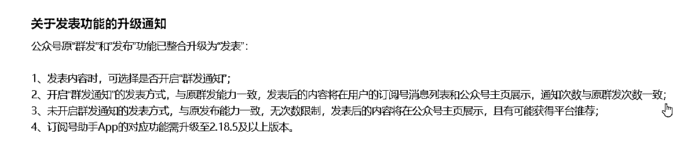

看看我后台最近的数据，97%的阅读都来自推荐。你说这不是捡钱是什么？

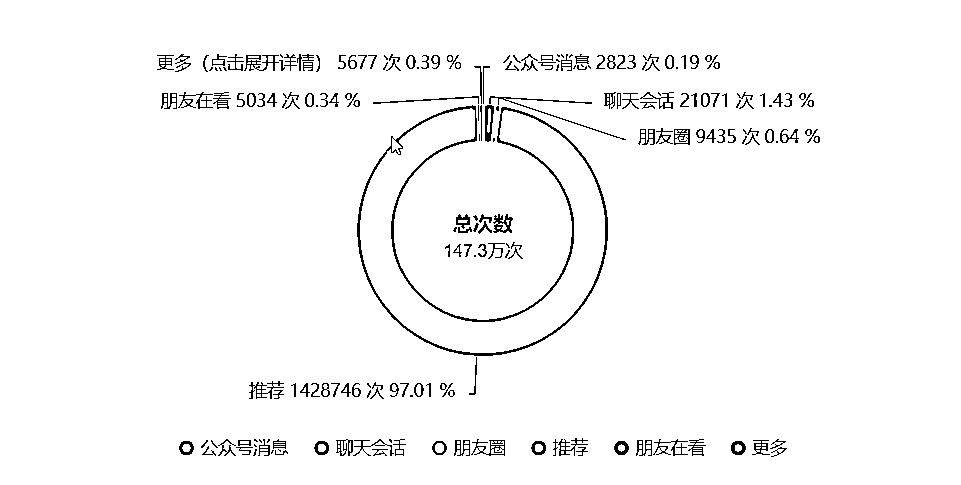

说实话，能有今天，要感谢赚钱圈里的各位大佬。他们的精华帖给了太多实用的赚钱思路和可直接上手的方法，否则我这种小透明，连捡钱的门都找不到。

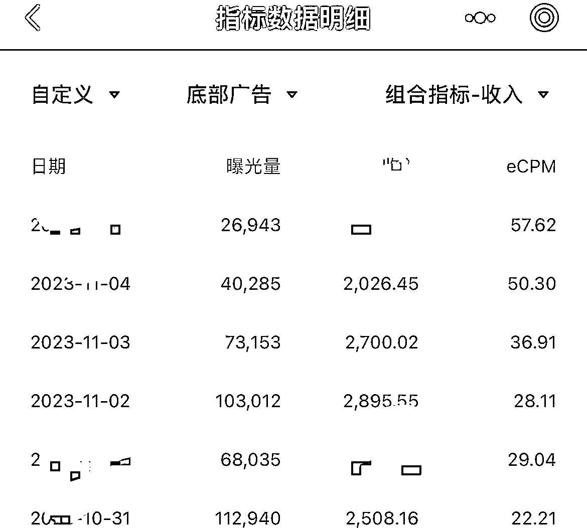

如果想抓住这波红利，得先弄明白两件事：排序模型和赛马机制。

排序模型，简单说就是系统会盯住最近一段时间窗口内，读者的阅读量、点击率、点赞率、在看率、完读率等数据，再结合每个用户的标签，算出读者和你的文章有多匹配。

赛马机制更直白：文章先丢给小部分用户，看数据表现。跑得好的，就推给更大的人群，一轮轮赛下去，内容够硬的话，10w+不是梦。

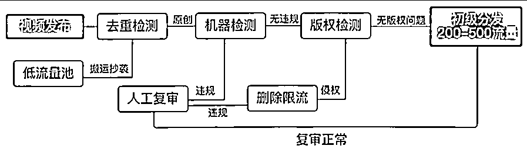

用人话说：让对的人，在对的时间，看到对的文章。

具体从哪里能捞到推荐流量呢？这几个入口很关键。

一是公众号首页。读者刷订阅列表的时候，系统会在中间穿插推荐类似内容，依据就是读者的兴趣画像和个人标签。

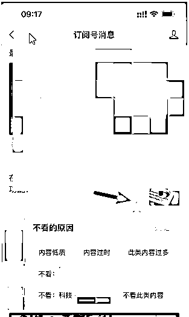

二是文章底部的“你可能喜欢”。这里的推荐逻辑是社交关系+内容标签，要么是你的朋友读过，要么是和当前文章足够像。

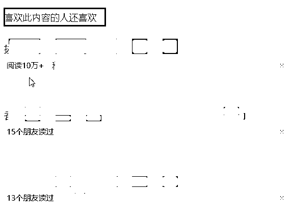

三是“看一看”页面。你看它的排序就知道，图文排在第一位，而视频、在看、热点都在后面，这难道不是明摆着给图文送流量？用Midjourney、SD生成的优质图片，也可以发到这个战场碰碰运气。

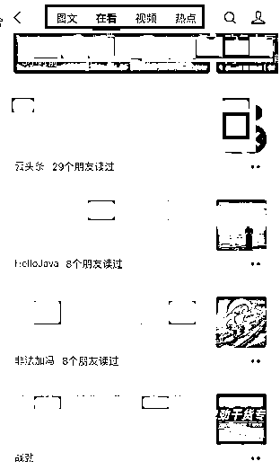

四是合集推荐。这招适合做系列内容，比如旅游攻略、吃瓜合集、赚钱笔记、美女图集，一篇爆了，整个合集都跟着沾光。

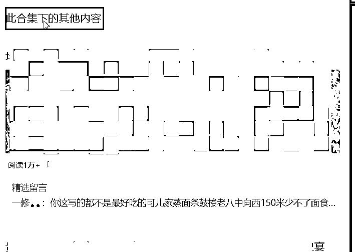

五是文章划线/分享。读者划线的内容、分享的动作，都可能让你的文章出现在其他人的公众号首页。所以，别舍不得写金句，多写点能戳中人的话，本身就多了一次曝光机会。

另外，新号有新手保护期，系统会给你一定的奖励和扶持，类似小红书早期发流量券，所以别想太多，持续更就对了。还有一种容易被忽视的搜索长尾流量：有些号平时阅读不过百，突然冒出一篇高的，很可能就是搜索或推荐带来的。

说白了，这么多入口摆在那，不管你是手写还是AI写，只要内容够精彩、够有趣，就总有一束光会打到你。

不过，赛马机制下，第一波流量能不能赢，往往取决于你的标题和封面。酒香也怕巷子深，好文也怕烂标题。

标题既要抓眼球，又要和内容对得上，别做标题党。封面要一眼突出重点，别拿模糊不清的图糊弄人。还要提醒一句：别用违规词，别碰版权图，尤其是视觉中国，小心赔到哭。

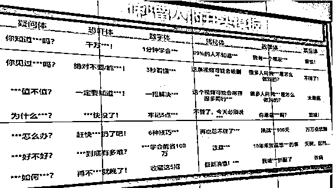

原创度同样重要。现在有AI帮忙，只要提示词给得好，分分钟写出一篇原创度99.99%的文章。对新号来说，原创度越高，被推荐的概率越大。

有人可能会问：我自己的爆款能不能原封不动再发一遍？视频可以，但文字真不建议。一字不改地发，第一轮赛马可能就被淘汰了。想发的话，至少去重修改一下。

更新频率也要稳住。排序算法里有个“时间窗口”，账号最近越活跃，权重越高。我的建议是每天2-3篇。热点类的要及时追，长期断更的号会被降权，严重时连自己的名字都搜不到。有条件的话，找一个带留言功能的号，互动起来还能再加一波权重。

说到底，内容才是硬通货。你不需要当莫言、余华，AI能帮你写出超过80%的人的文章，只要你保证有趣、有共鸣，点赞和完读率自然会帮你保送。

有趣怎么来？去拆解那些10w+文章，让AI帮你捋出套路。

完读率怎么提？新手前期最好把文章控制在500-1000字，太长容易划走，读完了才有点赞的冲动。

还要注意垂直。很多人突然进流量池又停了，多半是写得太杂，账号标签乱了。公众号助手每周会给你一份创作者周报，上面就是你的账号标签，照着这个方向写，流量才稳。

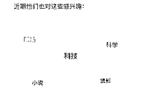

最后别忘了发布时间，这又回到赛马机制了。文章发布后的3-7小时是黄金窗口，想在第一轮赛马中跑出来，就要让这段时间的数据足够好看。所以尽量别半夜发文，早一点发，还能蹭上朋友圈和看一看的社交流量。

我自己用数据测过，20点左右是高峰，13点左右有个小峰值。

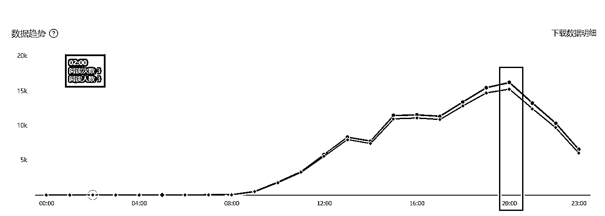

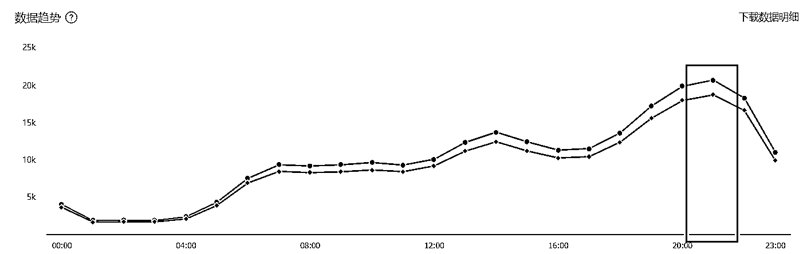

所以我的结论是：最佳发布时间是13:00左右；如果没写完，20:00之前发也来得及。第一轮数据好，第二轮推荐就会跟着来。

再聊一个很多人忽略的流量池：微信搜一搜。你会发现有些号日常阅读只有几十，偶然一篇冲到几百上千，这就是搜索带来的。这类流量特别精准，适合用来做二次转化。怎么接住？提供原创稀缺内容，深度剖析、独家数据都行，让读者看完忍不住感叹“原来还有这种操作”，自然就愿意转发和留言。

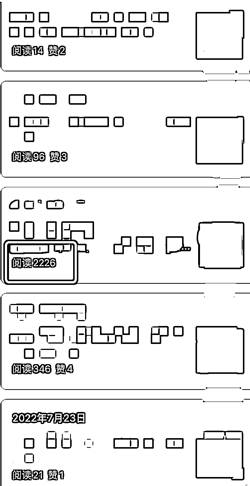

还有合集功能，相当于SEO里的长尾词。一篇火了能带动整个合集，新写的文章也可能自带推荐流量。目前它在手机上有两个入口，一个在文章开头，一个在文章末尾，点开后读者还能订阅合集，有新内容第一时间就能看到。

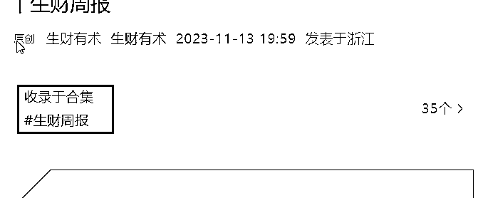

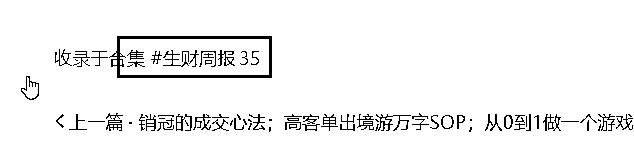

那怎么找合集关键词？去新榜找对标账号的10w+文章，看他们用的什么合集标签，拿来直接用就行。

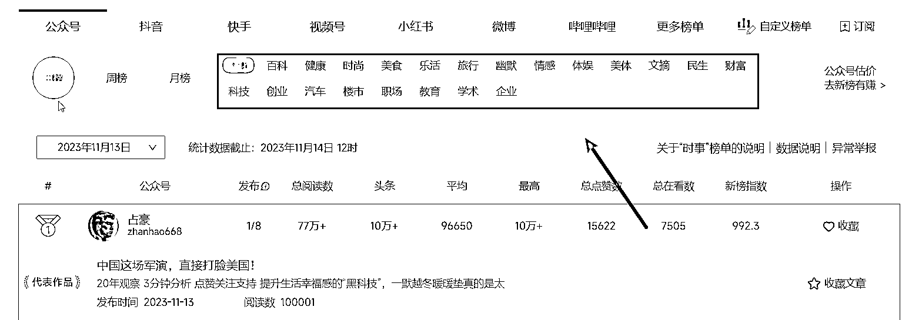

标题和封面实在没做好呢？还有一个补救动作：划线+分享。

把文章里最扎心的句子划出来，分享到朋友圈，别人看到后可能也跟着划，你的文章就会在公众号首页多一次露面机会。划线长这样：

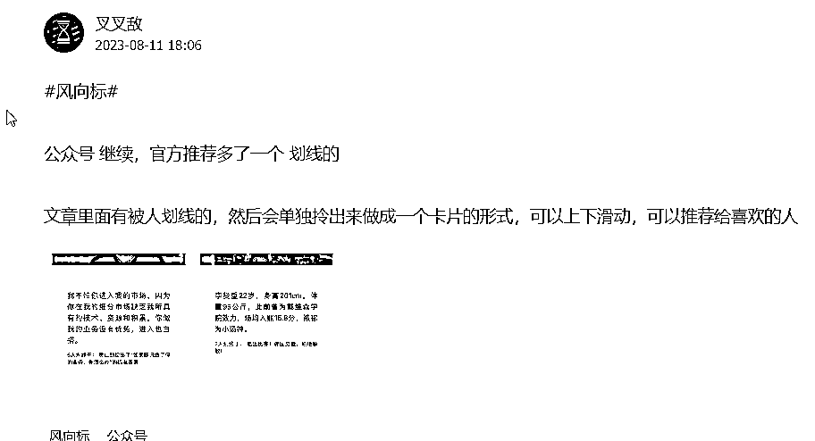

这个功能用的人其实不多，但它和点赞类似，能触发推荐。具体怎么玩？

第一，找出容易引发共鸣的金句，比如那些让人眼前一亮的创意表达、直击痛点的感叹句。

第二，金句怎么积累？平时刷到好句子就收进素材库，写文章时拿来用，慢慢就有了自己的弹药库。

回到开头那几个问题。

现在进场还有机会吗？几年前就有人说公众号是红海了，可蛋糕就摆在那，你进来就是多一个抢食的，想赚钱的人当然劝你别来。反而是赚钱圈的大佬们真的在分享，龙哥说过，赚钱就是让大家赚到钱。

平台那么多，公众号还能做吗？我试过百家号，同样10w+阅读，收益才几十块。公众号不一样，这是实打实的真人流量，价值完全不是一个量级。

大家都在刷视频，纯文字还有戏吗？我拍视频就是灾难，根本拿不出手。但文字不一样，AI几分钟就能写一篇，哪怕我天天加班，都能同时更几个号，你也一样。

所以，别再站场外当观众了，袖子一撸，下场干吧。出题人已经把答案给你了，这要是还考不好，就说不过去了。

感谢看完，赶紧把技巧用起来。祝大家篇篇爆文，一起龙哥盟。

