# 从朋友圈静默成交到月入3万+：一位知识管理教练的颗粒度复盘

> 来源：[https://x6n09emgmm.feishu.cn/docx/BMYedjKcjoFvgwxJuKhc7Wg6nWf](https://x6n09emgmm.feishu.cn/docx/BMYedjKcjoFvgwxJuKhc7Wg6nWf)

大家好，我是赚钱圈的 Andrew。做了多年知识管理教练，也在钻研“知识管理五维模型”。

一年前我还在做995的上班族。去年裸辞后全职做内容创业，主攻IP知识管理，帮助更多人用体系化整理和持续输出提升IP的商业价值。

今年十月，我的月收入第一次站在了3万+，对我来说是个真正的里程碑。

这个月流水的截图如下。

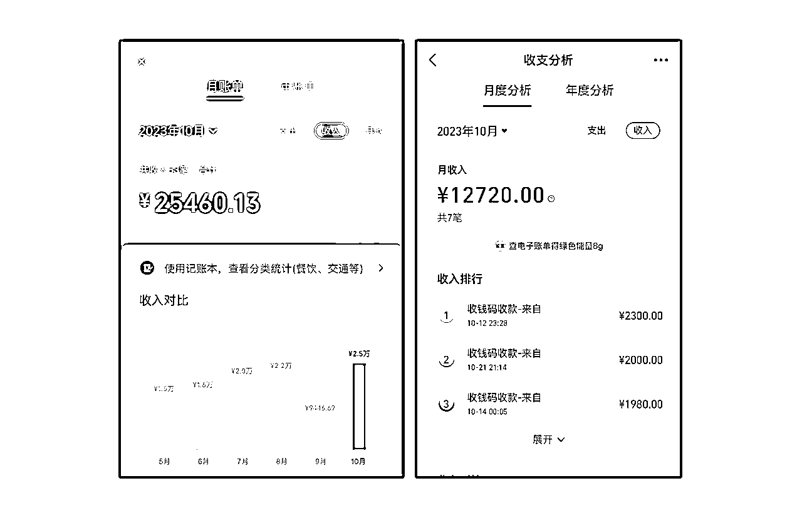

去掉老学员复购和上月定金尾款后，剩下的营收几乎全靠朋友圈发售完成。

这次发售只持续了四天，售卖的是我的知识管理私教课。成交方式很安静——很多学员直接私信表达想报名，甚至上来就直接转账。最终拿到13位全款和5位定金，总计约2.8万。

和头部大佬比不算惊艳，但在我过往多次朋友圈发售里，这次算得上一次非常漂亮的成绩。

回头来看，成果背后必然有可复用的“因”。趁着空档，我把过去半年日更朋友圈的实践，以及这次发售的全过程做了一次沉淀。

一是为了自己提炼方法，二是我本就是个服务型人格，希望这些实操笔记能帮到同样在发圈和成交上卡住的朋友。

全文约1.1万字，阅读约20分钟。目录如下，PC端侧边栏可直接跳转。若只想看发售实录，可直接跳到第三部分。

1. 如何跨过发圈心理障碍，让自己真愿意发
2. 如何跨过信任障碍，让客户爱看
3. 如何跨过成交障碍，让客户秒付

# 1. 如何跨过发圈心理障碍，让自己真愿意发

## 1.1 我曾经的发圈困境

过去我几乎不发朋友圈。一年也就除夕说句新年快乐，外加偶尔转发自己的公众号文章。在朋友圈里，我基本是个隐形人。

不发的原因归结为两点。

## 1.2 卡点一：自我意识过度膨胀

我太在意别人怎么看。源于高敏感的性格，从小活在他人目光里，让我觉得“公开表达”是一件羞耻的事。

一篇朋友圈文案打磨好后，发布前脑子里会演一出戏：怕没人点赞，怕观点被说幼稚，怕篇幅太短被嫌水，怕论据不够硬，怕某些句式显得装被挑刺……

这些念头反复拉扯，让我迟迟不敢点发布。后来接触阿德勒心理学才明白，这就是典型的“自我意识过剩”——把自己想象成全场的焦点，仿佛所有人都盯着自己评头论足。

发朋友圈就涉及人际互动，于是我开始预演未来：所有好友都在围观并议论我。于是陷入自我消耗，精神反刍。

真相是大家都忙，没人会专门拿你的朋友圈开批斗会。真正上心的，只有你自己。

针对这个卡点，我总结了三点做法：

### 1.2.1 先认清根源在自己

我之所以脑补这么多，是为了避免在人际里受伤。根源在我，解法也在我。

### 1.2.2 先接纳再练习

坦诚接纳那个写得糟糕的自己。即使写得很烂、很垃圾，又怎样？

娜塔莉曾说：“我才不管笔记本页边或顶端的空白，我把整页写得满满的，我已不再是为老师或交作业而写，我是为自己而写，不必顾虑任何限制，连页边空白也不必在意，这让我得到心理上的自由和许可。”

李笑来也说过：“学习能力也好，执行力也罢，核心只有一个，在刚开始的时候，平静地接受自己的笨拙。”

先承认写得差，然后观察改进点，去写、去练。因为写得差不是永久属性，刻意练习会让神经回路变强，写作自然变好。

如果我当初不接纳自己的笨拙，现在就不可能做个人品牌，也得不到持续输出带来的改变。

### 1.2.3 做课题分离

用阿德勒的方法问自己：这个选择的后果谁来承担？

不发圈，导致影响力起不来、IP做不起来、机会流失、现状不变，后果由我承担，这是我的课题。

别人怎么评、怎么骂、怎么笑，后果由他人承担，是他们的课题。

我只负责我自己的部分。想干涉他人的反馈，就是越界。

推荐一本对我帮助极大的书：《被讨厌的勇气》。

## 1.3 卡点二：怕没人回应

好不容易点完发布，下一关是怕冷场。以前我一发圈就每隔几分钟刷新微信，看有没有红点。十分钟没动静，挫败感瞬间上来，甚至直接删了。

这是因为我把“无人回应”定义成了负面意义。

成甲在《好好思考》里提到艾利斯的ABC理论：我们对事件A的反应C，不取决于事件本身，而取决于信念B。阿德勒的目的论也同理——决定感受的不是过去经历，而是我们给经历赋予的意义。

朋友圈的价值感，不该由点赞数决定。

### 1.3.1 给发圈赋予积极意义

一条朋友圈有没有价值，取决于它带给我什么：解决了问题、梳理了情绪、复盘了失误、得到了客户认可……写完的那一刻，我就已经赚到了。

发布只是把这份价值打包分享，扩大受益面。没人点赞不影响它有价值；1个赞是惊喜，5个赞就是赚到。

总结起来就是“成人达己”。先找到自己：看见心结、接纳自己、聚焦自己的课题、基于自身收获赋予意义。再用公开的方式放大价值。

# 2. 如何跨过信任卡点，让客户爱看

愿意发只是第一步。更难的是，用户愿不愿看。很多朋友圈发出去就被划走，发售时咨询寥寥，还得靠话术、逼单、拉扯。

我也曾深陷其中，后来发现根源是忽略了成交的底层逻辑。

## 2.2 成交的底层逻辑是信任

信任是前提，也是内核。信任没立住，用户需求再强，也会质疑：为什么要从你这买？靠谱吗？会不会跑路？

传统销售靠说服，静默成交靠信任。客户在主动找来之前，已经把自己说服了。

当客户说“吃瓜都觉得上瘾”、“每天看你的朋友圈有种想成为你的冲动”、“老师你闪闪发光，忍不住翻你朋友圈，太有魅力了”，我几乎不用额外说服。

很多客户进对话框第一句话就是：“我想报名你的私教。”那一刻成交已经完成了80%。

信任像千军万马，能抵消客单价、交集深度、聊天历史等所有阻力。我有个做中端俱乐部的创业朋友，加我仅一周，互相只做过自我介绍，发售半小时内就全款打过来了。

## 2.3 如何让朋友圈变得“想看”

我习惯在 Notion 里记录朋友圈数据：内容、发布时间、点赞、咨询数、评分、类型。半年日更后，我发现高赞朋友圈有个共性：都在讲“我”。

加入个人故事的圈子点赞高，纯干货的圈子反馈平平。即使是产品软广，只要揉进我与学员、我与产品的故事，反响依然不错。

靠谱说过：你会吸引到情绪共鸣、经历共鸣、价值观共鸣的人。TA认同你这个人，自然认同你的产品。在私域，人的IP先于产品。

芷蓝姐说：内容要紧紧围绕自己，真实是无法被复制的壁垒。工具、逻辑、文笔都能抄，真实的生活抄不了。

小鹿说：IP的核心是用户奔着你这个人来。同样的产品，他们更愿意信任你，这就是IP的魅力。

让客户爱看的关键，是持续输出真实的自己。能分享的维度有：

### 2.3.1 分享生活切片

美食、做饭、风景、宠物等，让人感受到温度，知道你是有血有肉的生活者。

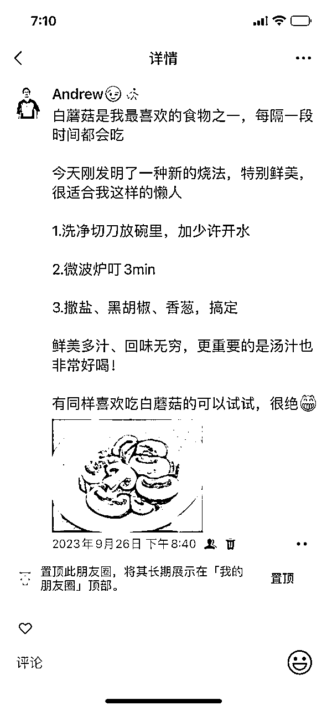

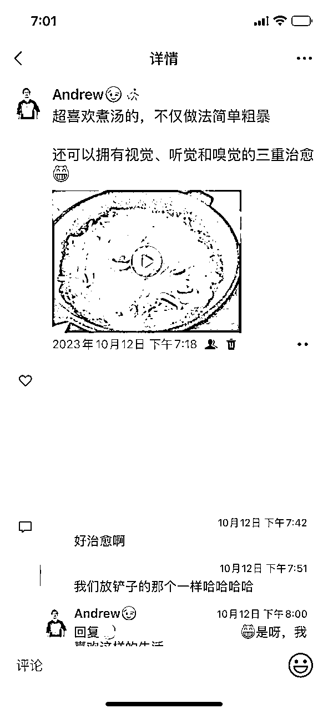

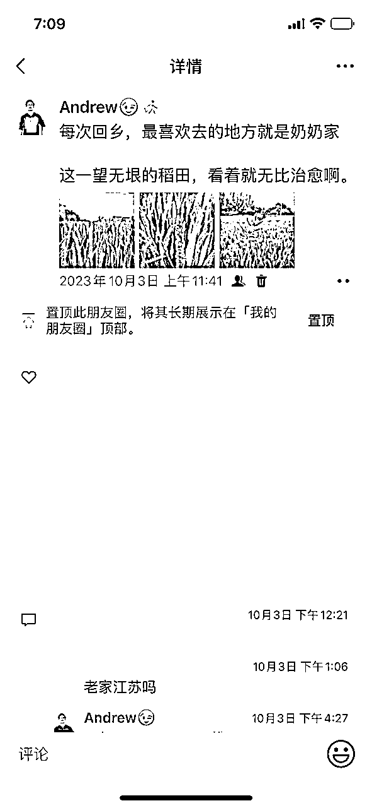

### 2.3.2 分享童年记忆

童年是共有的情感矿。节假日发童年故事更容易共鸣。

七夕那年我写了小时候听外婆说下雨天去葡萄架下听牛郎织女说悄悄话却什么也没听见；中秋那年写父亲骑二八大杠买苏式月饼，油纸包装、五仁挑出红绿丝。那两条圈互动极高。

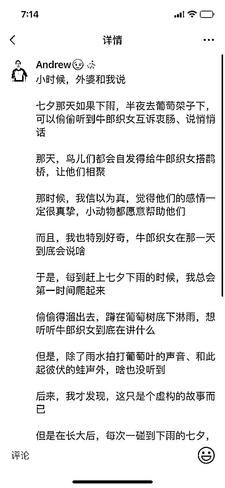

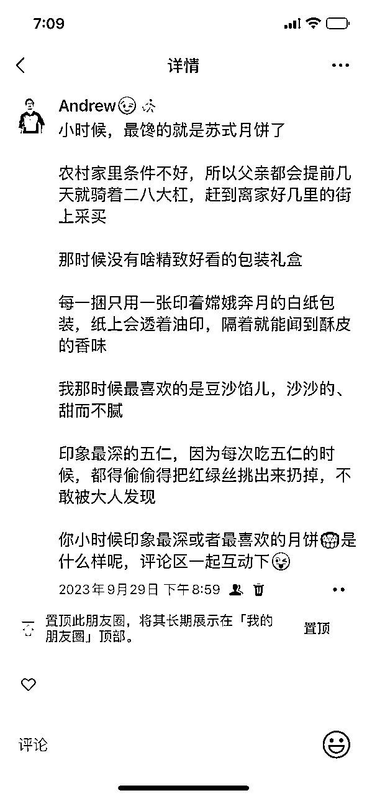

### 2.3.3 分享弱点与软肋

IP不是完美人设，而是完整真实。暴露弱点反而增加真诚度。

我曾发过自己内向社恐的经历，其中一条直接带来5个以上客户下单。

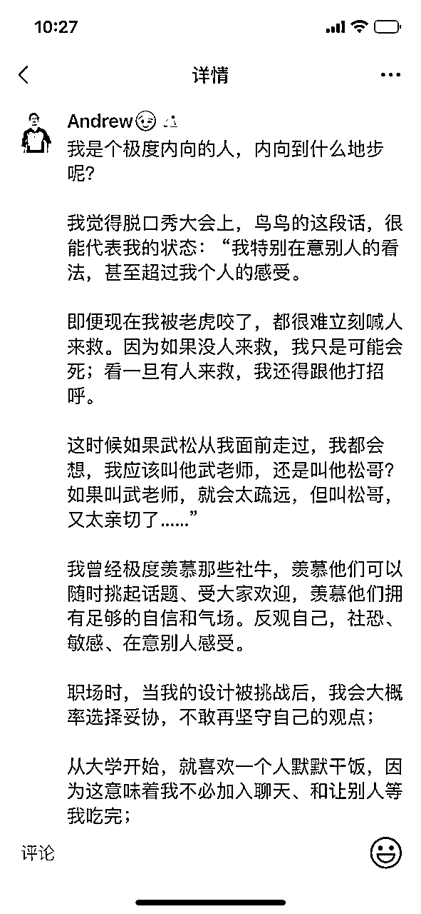

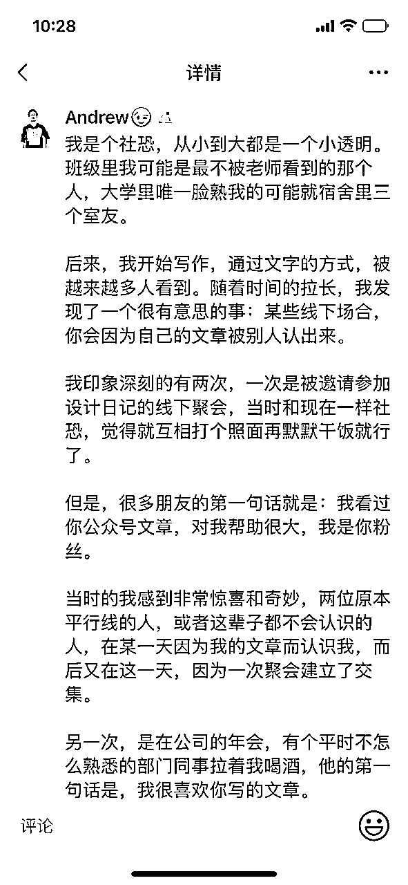

### 2.3.4 分享烦心事与化解

把日常挑战写成小电影，先有困境再有转折，大家爱看。

上周我跑老远去办公积金，材料带错很郁闷，顺路逛逛心情变好，便发了圈。不要让到手的肥鸭子飞走，每个小事都是生产资料。

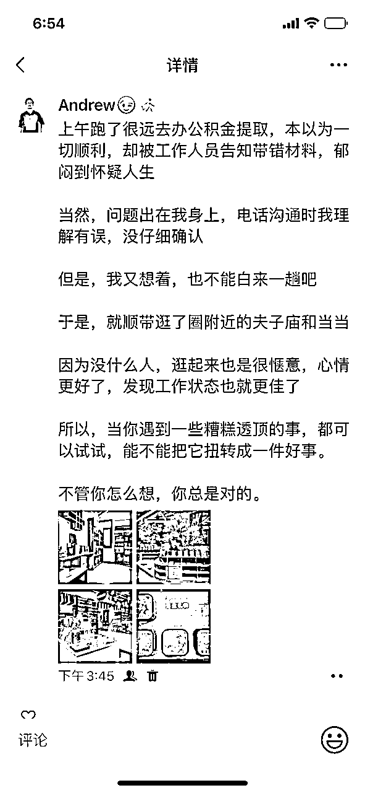

### 2.3.5 分享小成就

过往的、刚发生的都行。用一次次小突破告诉大家你在成长。

第一次被赚钱邀请做高手分享、被思念老师邀请社群分享；第一次拿到航海巨人前三；Flomo一个月输出15万字……尤其是“第一次”，一定要发。

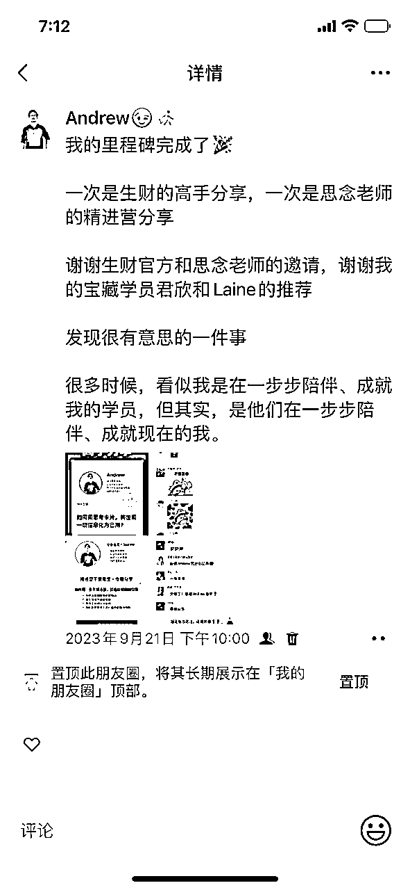

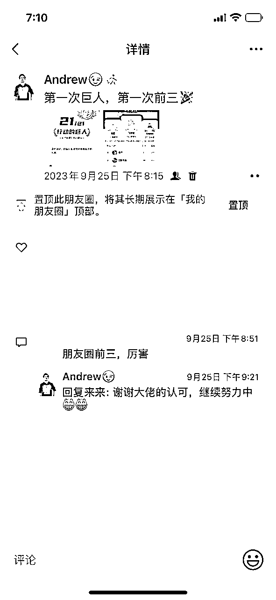

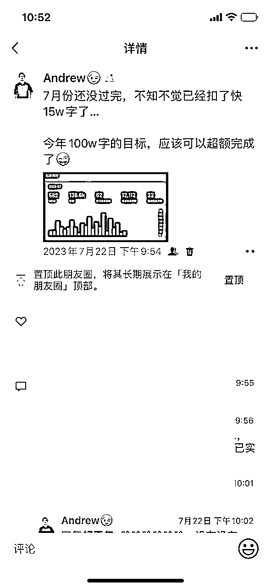

### 2.3.6 分享与学员、产品的故事

把广告变成故事，抵消排斥感。

熬夜做涨价海报就是产品故事，暗示即将涨价；拿到学员认可就是用户证言；第一个成交就是温和的提醒。

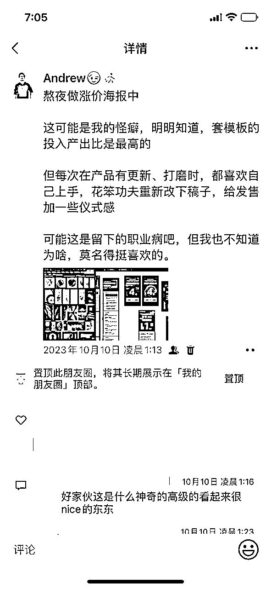

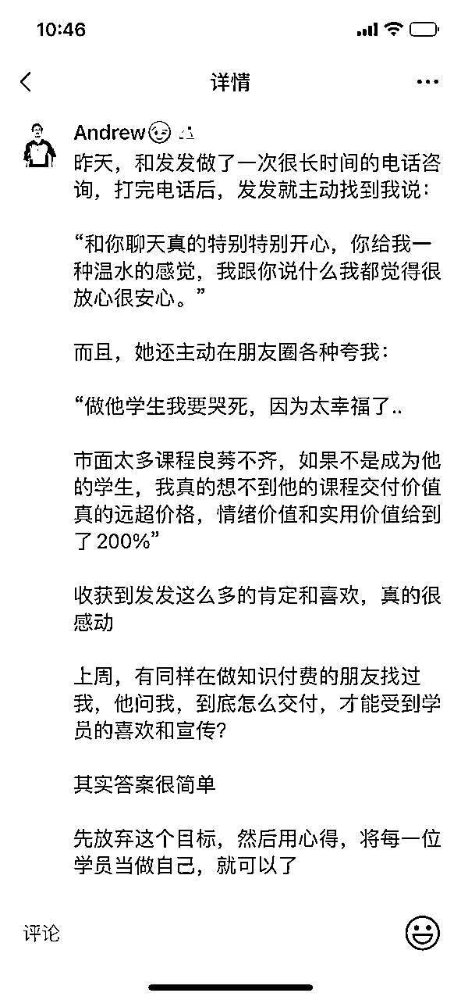

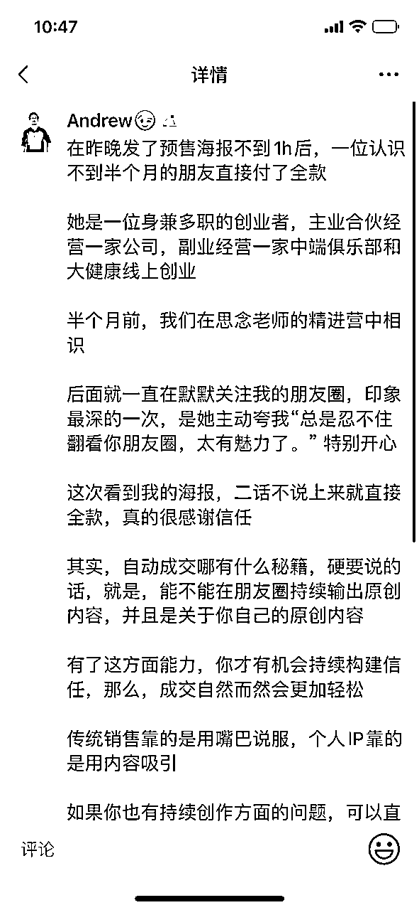

### 2.3.7 分享问题与解决过程

直接给到实用价值，让用户觉得“有用”，信任自然累积。

有时候我把自己卡住的点直接摊开来写，就能帮到一批正在经历同样困扰的人。比如那段时间我被 PDF 资源管理折腾得够呛，最后全盘梳理出问题根源和真正管用的解法，整理成一条朋友圈，立马就有人来私信说被点醒了。

碰到更棘手的事，我会主动去「互动圈」里抛问题，借大家的脑力一起来想办法，同时也能把互动热度带起来。

举个例子，有次我的 iPhone 突然狂闪退，我就直接发了条求助动态。一来想收集有效的处理经验，二来也能让朋友圈更活跃。

问题解决后，我会再补一条跟进圈，把原因和操作步骤完整复盘，并顺手感谢提供建议的朋友。这样既给了后来者一份现成攻略，也用“接上条”的方式把流量往回拉，朋友圈的曝光自然就上去了。

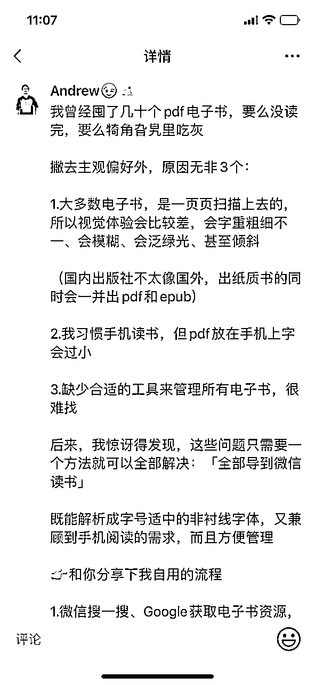

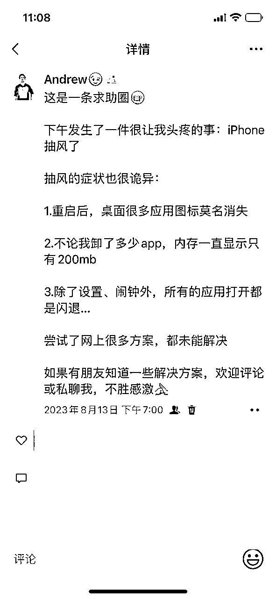

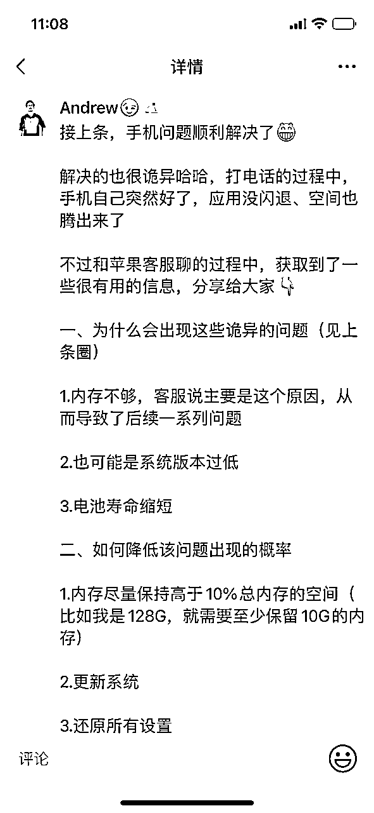

但随之而来的新难题是：故事从哪里来，总不能凭空编吧？

## 2.4 持续捕捉素材的两个方法

我常用的其实就两招，效果都很扎实。

第一招是日更复盘。到现在我已经坚持了 600 多天。复盘最大的好处是让我对自己的“无字之书”保持觉察，日常里那些容易被忽略的细节都被记录下来。等到要输出时，直接从复盘里挑就行。

第二招是做思考卡片。用卡片做联想发散，能一点点挖出过往的经历和感悟。

关于思考卡片的具体用法，可以看我之前在赚钱分享的一篇干货，讲得很细：https://search01.shengcaiyoushu.com/docx/HsqKdEhyvok44XxxGCRcgwsBnIg

只要持续输出“关于自己的东西”，信任就会像滚雪球一样越积越多。当信任达到临界点，产品一推出，成交往往会水到渠成。

# 3.怎么让成交更顺畅，让客户主动找上门来？

接下来的部分，就是我一次朋友圈发售的完整实战。

## 3.1 产品是什么

这次发售的是客单价 1980 元的知识管理私教课。

主要服务自媒体创业者，通过搭建一套知识管理系统，帮助他们建立可持续的内容输出能力，从而放大个人 IP 的商业价值。

下面是课程最新的宣传图和大纲。

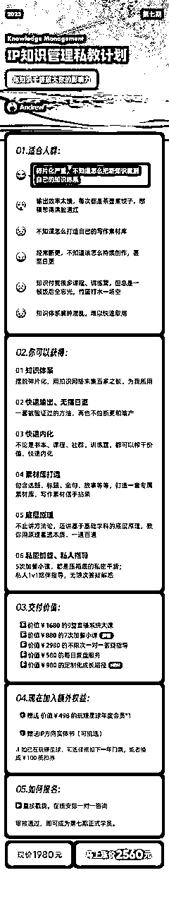

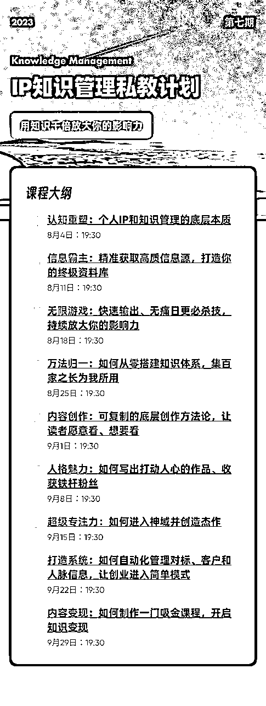

产品定位的初衷和更多背后的思考，我在上一篇复盘里有详细拆解：成功转型自由职业，知识管理赛道单场群发售营收2.5w的颗粒度复盘，适用于所有创业者

## 3.2 这次发售的背景

9 月份我没有开放招生，因为课程和服务模式正在做全面升级和打磨。升级很耗精力，所以当月就停止了对外招募。

与此同时，老学员也在催我涨价。综合再三考虑，我决定 10 月重启招生，并正式官宣提价。

这次发售共持续了 4 天，成交方式很安静——很多人直接来找我表达意向，甚至直接付款。最终拿到 13 位全款和 5 位定金，总营收 2.8 万。

我觉得核心原因，还是前期持续做“输出关于自己的一切”，让用户愿意看、愿意信。信任一旦建立，大家会因为相信这个人而自我说服，实现隔空成交。

信任建立后，如何在朋友圈里进一步推动下单？我把这次的流程拆成了 8 个环节。

### 3.2.1 先埋下涨价的伏笔

芷蓝姐在《我是如何在30天内用朋友圈剧本＋快闪群成交，给我的新舞蹈室赚了6万块钱的？》里说过一个观点让我印象很深：用户不喜欢被告知和硬推，一旦强推容易产生抗拒。

所以我没有直接官宣涨价，而是先通过朋友圈造势，为涨价做铺垫。

造势其实很简单，专门发一条讲清涨价原因的朋友圈。

比如 9 月 24 号我就发了这样一条。

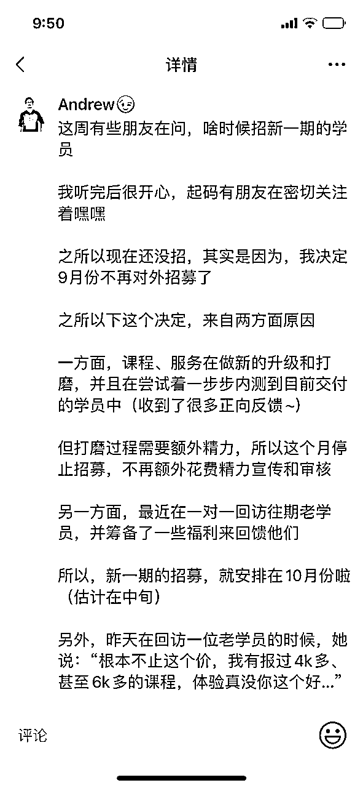

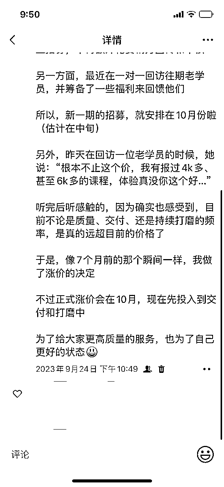

拆解下来，这条圈里包含了三层信息：

1.解释 9 月没招生
课程在升级，同时在做老学员回访和福利赠送，这两件事占用了大量精力，说实话即可。

2.说明涨价理由，这是重点
一方面是学员反馈：“这课程根本不值这个价，我报过 4k、6k 的课都没这个体验”，用真实证言来体现性价比和超值感。这样的反馈，后续都是涨价的底气。
另一方面是我自己的判断：质量、交付、打磨频率都已经远超当前定价，也是在传递对产品的信心。

3.点明涨价时间
给用户一个缓冲期，同时制造紧迫感。

### 3.2.2 增加软广，为涨价预热

发完涨价原因后，就开始适度提高软广频率，为后面做热身。

我发的软广主要是学员好评和成果报喜，通过别人的结果告诉大家：这套方法真的能解决问题，从“输出困难”到“轻松驾驭”。产品有效，涨价也就说得通。

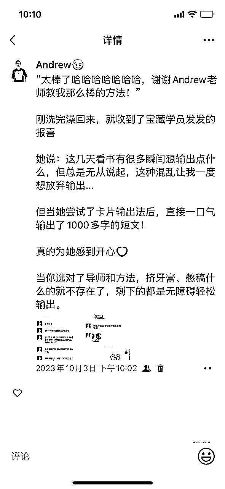

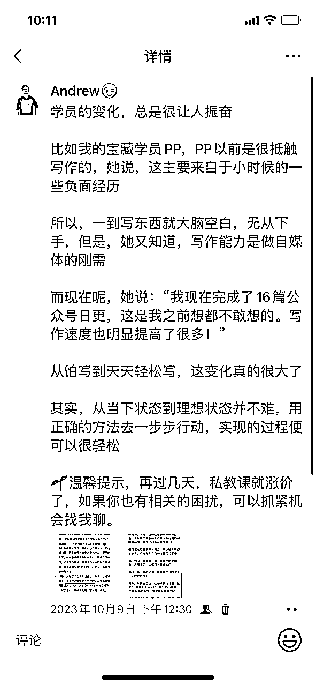

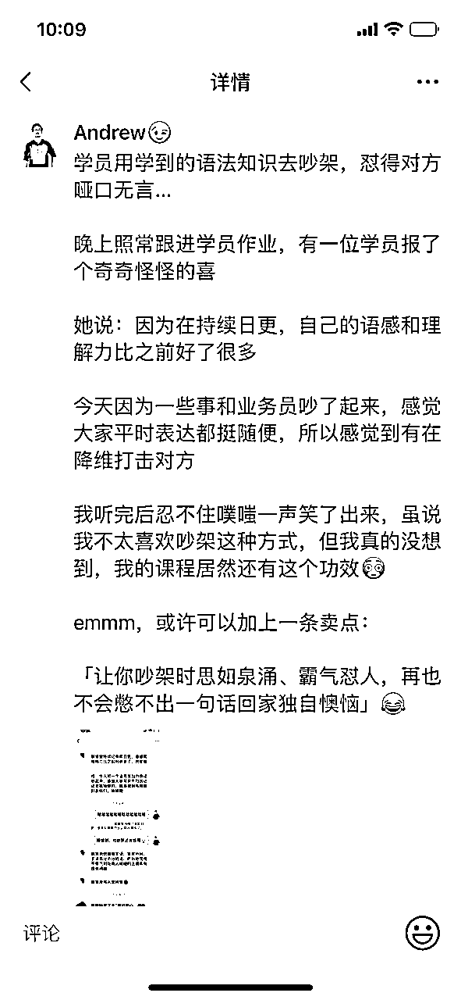

### 3.2.3 多展示自我，强化信任

做预热不等于只发软广。我反而会更频繁地分享个人日常。

成交的本质是信任，而信任更多是对“这个人”的人格信任。卖货先卖人，在正式发售前要用更多篇幅让大家认识你、被你吸引。

这一类内容大致就是生活片段、成长故事、价值观碰撞等，和前面提到的思路一致，这里就不展开了。

比如国庆去乡下看奶奶，我就晒了乡间的风物来传递状态；看书时想起几个月前被朋友挑战观点的经历，就用那个故事引出我的价值观；朋友圈被夸，我也会晒出来，侧面展示朋友圈的价值。

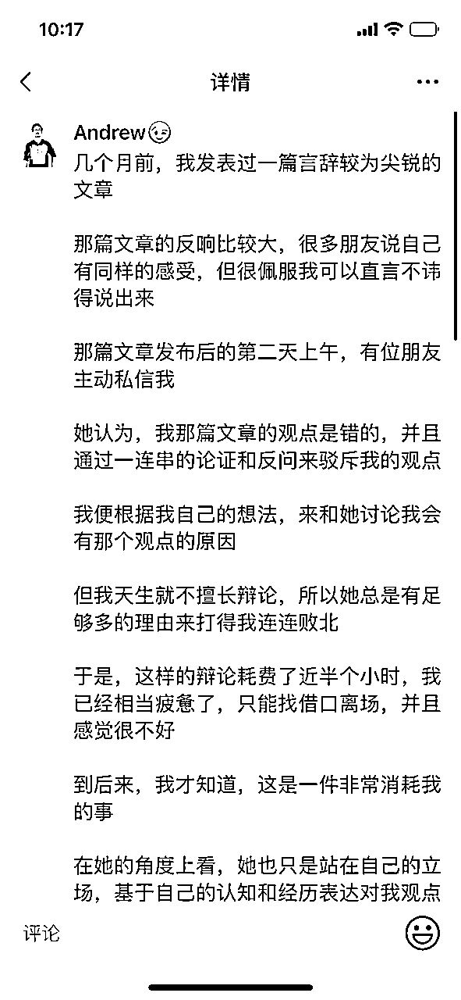

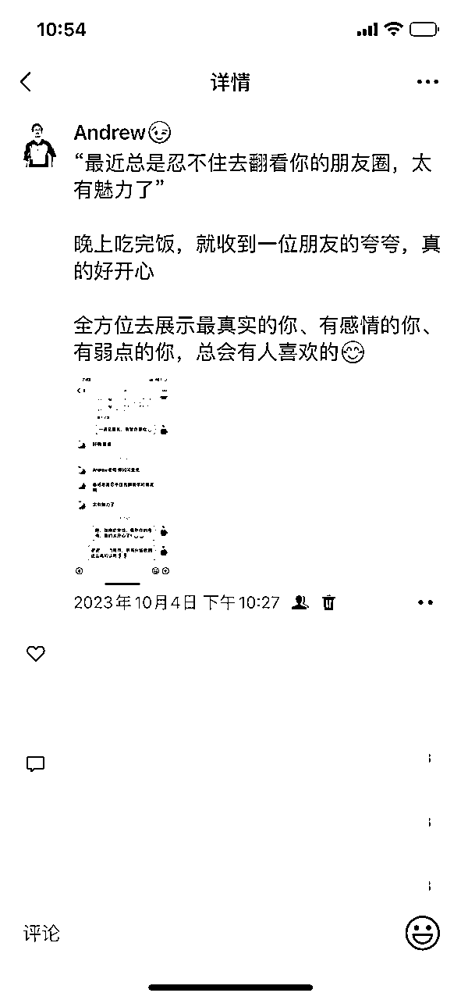

即便是发售前的准备过程，也可以拿来展示。

官宣前一天我在熬夜做海报，突然想到何不把做海报的过程也发出来？于是凌晨一点多就截了图配了文字发圈。

一来让大家看到真实的工作状态，增加真诚感；二来也传递出“每次发售我都非常认真”的信号，加分项。

海报上的倒计时也无形中暗示离涨价只剩 4 天。

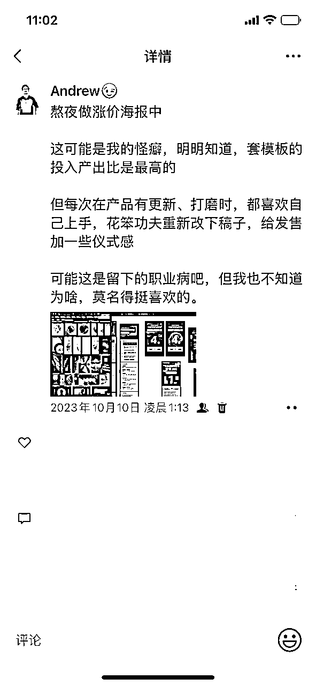

一条图就能承载多重信息，很划算。所以在宣发前，如果你在做准备工作，不妨用故事的方式让大家看到你的用心。

### 3.2.4 成交后及时晒单

因为提前埋了涨价预期，所以在涨价前会陆续出现成交。这时完全可以晒出来，并在结尾带上涨价信息，传递两个信号：现在就能买，过几天就涨价了要抓紧。

我的那两条晒单都在底部暗示了涨价时间。

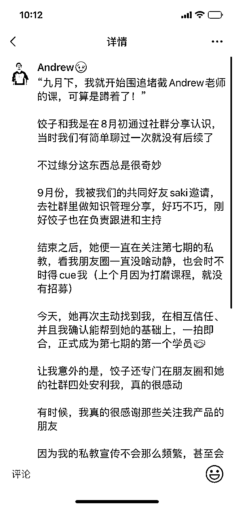

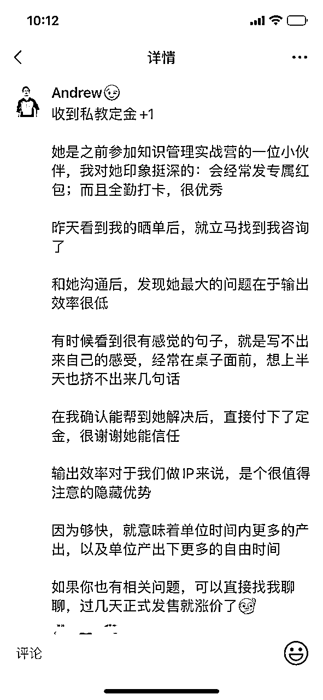

### 3.2.5 正式涨价官宣

【对应时间】发售第 1 天

我之前学习过小鹿老师的朋友圈课程，她的发售模板给了我很大启发。这次我结合自身情况做了改动，效果不错，当天就收了 2 个全款，通过这条官宣成交的共有 5 位。

框架大概是：正式官宣 + 背景数据 + 客户证言 + 卖点 + 涨价细节 + 行动指令

#### 正式官宣
开门见山，告诉大家发售开始了，即将涨价了。

#### 整体情况
用交付人数、成果数据、好评率、转介绍率等侧面证明产品受欢迎，并引出证言。

#### 客户证言
挑选最有冲击力、情绪最饱满的反馈，比如“太值了”“完全解决了我的问题”。

#### 卖点
解决什么痛点、能获得什么价值、额外权益有哪些。要覆盖目标人群的普遍痛点或痒点。

#### 涨价细节
说明涨价时间和幅度。

#### 行动指令
给出明确的下一步：怎么找我、怎么报名。没有指令，感兴趣的人也容易卡在行动上。我还在评论区同步了指令，多次提醒。

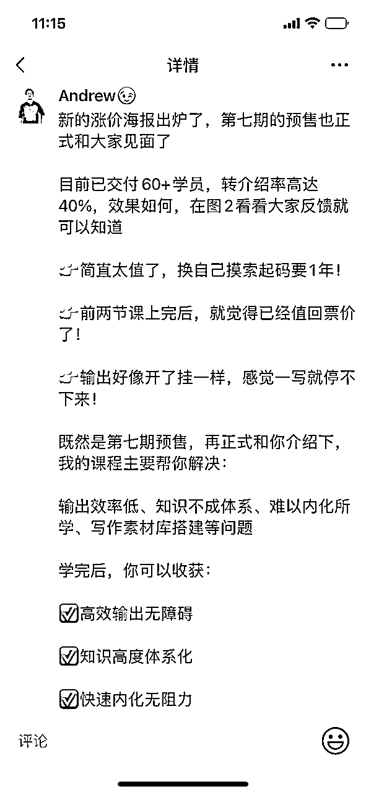

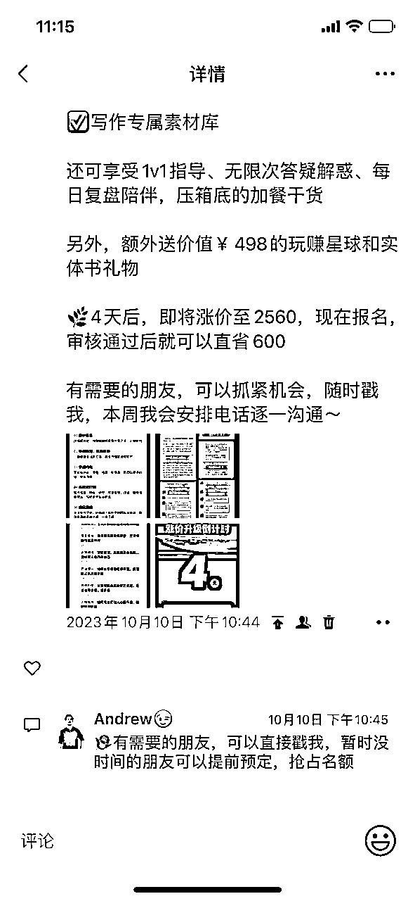

### 3.2.6 持续软广 + 晒单

【对应时间】发售第 2~4 天

有新反馈就晒，有新订单就晒。用学员反馈证明课程有效，用成交订单制造从众效应。

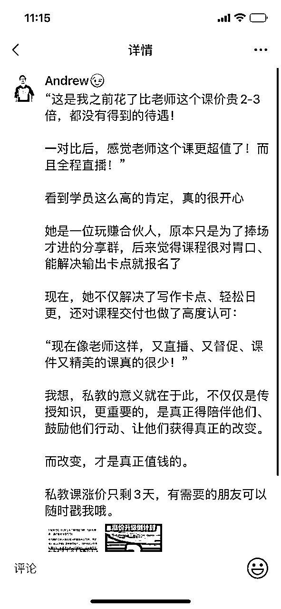

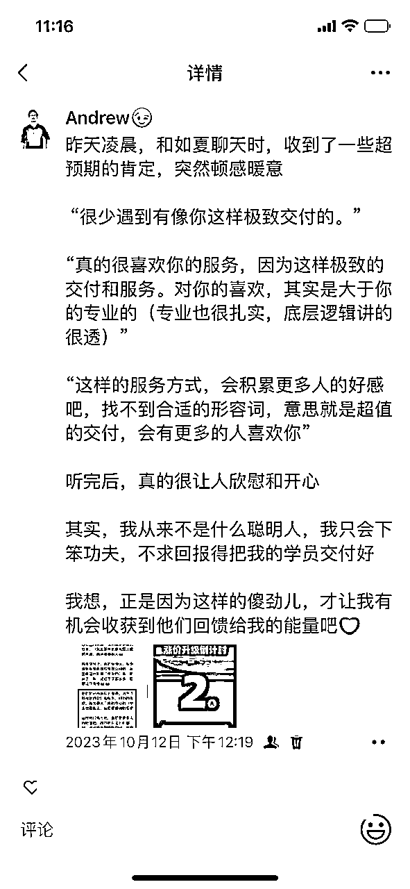

这个阶段我有几个小习惯：

1.提前把优质反馈攒好，发售期才不会断更。
2.配图加上倒计时海报，视觉冲击比纯文字强。
3.软广可以用对话体，穿插真实反馈，增加代入感。
4.官宣那条置顶，方便新加好友第一时间看到产品。

### 3.2.7 最后的倒计时冲刺

【对应时间】发售第 4 天

第 4 天结束后就要涨价，所以这一天我发了 8 条广告。一开始担心太频繁会招人烦，后来想明白不是每天都刷，而且不是每个人都会刷完所有动态，所以节奏要慢下来反而没人知道。

这一天就是集中晒证言和成交过程。

总结了 4 点注意：

1.时间越近，发圈频率越高。临近截止，“马上没了”的感觉最能刺激行动。最后 2 小时我约 20 分钟发一条，发了 5 条。
2.第一句加 emoji 抓眼。我的开头常是“涨价最后 x 小时/分钟🧨”，鞭炮图标更容易被注意。
3.越到最后文案越短。情绪高点时没人想看长文，几句话点明指令就够了。

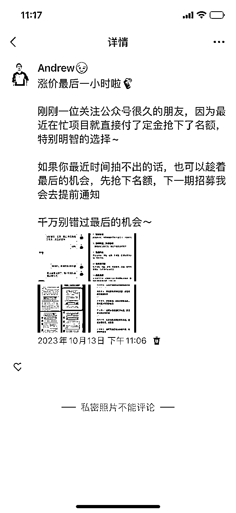

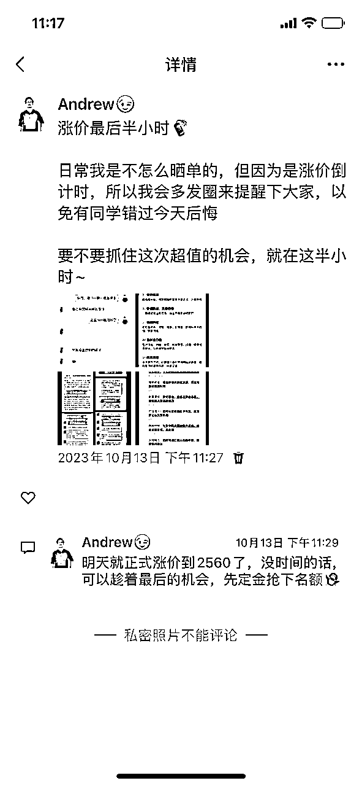

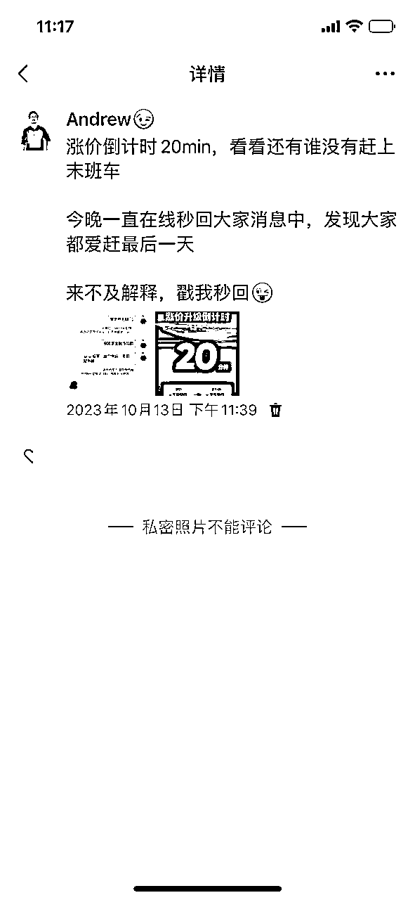

4.倒计时颜色做区分。我把最后几张海报的数字改成黄色，和之前的白色区分开，更醒目。

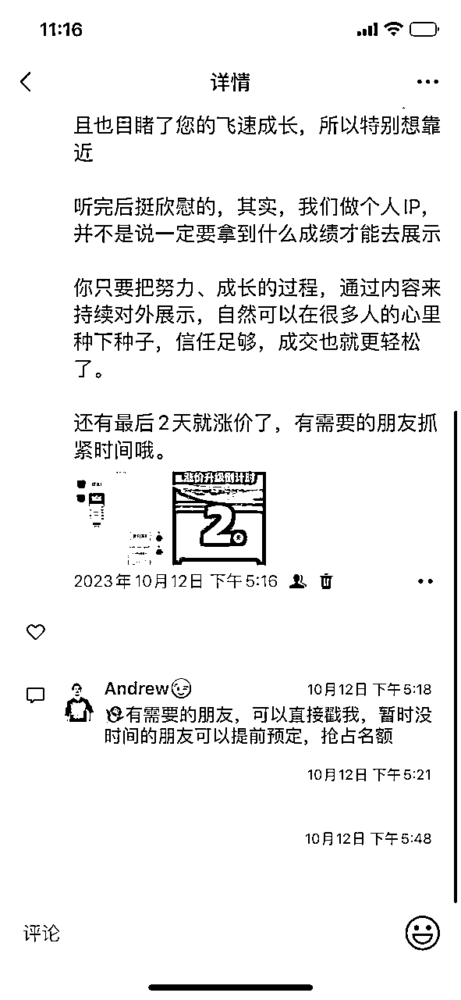

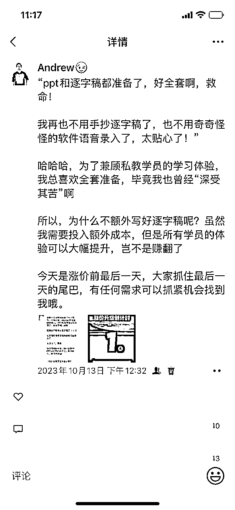

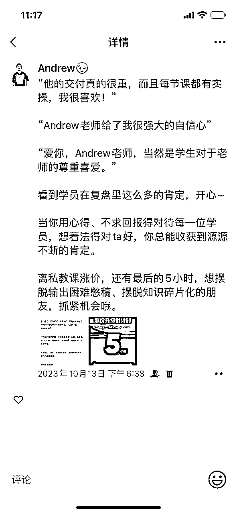

5.临门一脚做个收尾。倒计时剩下几分钟时做个总结，给已成交的朋友致谢，提升信任感，再点一下共同痛点和可解决性，最后给一个行动指令。

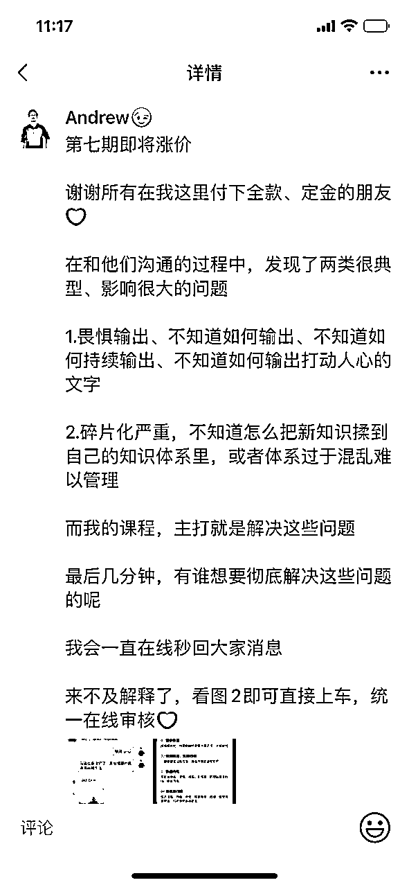

### 3.2.8 发售结束后的收尾

1.把硬广设为仅自己可见。因为新加的好友会翻朋友圈，一屏广告体验很差。倒计时结束立刻把之前的广告设为隐私，只保留置顶的官宣。

2.发售后要收敛广告频率。朋友圈的节奏本质是价值交换。非发售期你要用分享提供价值，信任才够；发售期索取价值才会被接受。发售后要用更多日常和感悟把价值补回来，维持信任。

# 4.最后

以上就是这次朋友圈发售的复盘和我的一些实操思路。

特别感谢靠谱、芷蓝姐一路的扶持指导和资源支持，没有她们我可能很难突破 2 万营收的门槛。

也感谢 saki 的主动合作，以及小鹿的朋友圈课程和行动营，里面的观念和方法对我帮助很大。

在朋友圈这件事上，我可能连入门也谈不上，今天的分享只是个人经验。

如果能给到你一点启发，就是最好的结果。

我是 Andrew，文中如果有任何细节看不懂，欢迎交流探讨。有需要帮忙的地方，我也很乐意协助。

祝我们一起龙哥盟。