# 当RPA遇上ChatGPT：赚钱日报周报全自动生成，还能量身定制推送，我是怎么做到的？

> 折腾了近十天，踩了一路的坑，终于把“赚钱有术”的日报/周报、关键词推送、甚至合集整理全部交给了机器人。这中间有太多可以聊的细节，今天分享给你。

先说个背景：赚钱圈内聊RPA的帖子其实已经不少了，鱼丸还专门整理过一份合集。很多人看完精华帖后，自己上手影刀，把业务流程自动化效率提了好几倍。这里把主流能用的RPA工具捋一捋，发现国外产品居多，尤其是一些小众工具。本质上都是低代码自动化，说白了就是把英文代码翻译成能拖拽的功能块和中文指令。

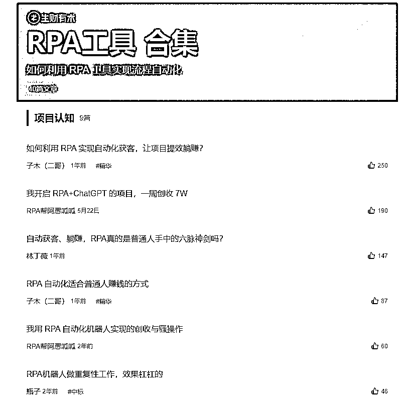

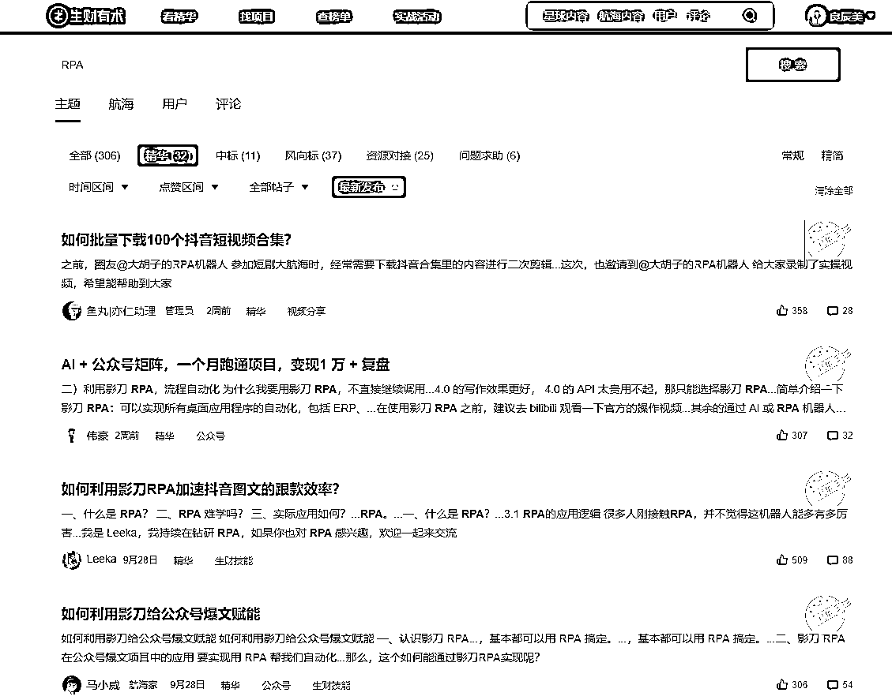

## 第一篇：日报/周报是怎么跑通的（基于赚钱搜索引擎）

从想法到落地花了差不多十天，其中大量时间耗在工具测试上。起因是上周龙哥发了一篇周报，我随口评论了一句“用RPA也许能实现”。结果话一出口，就成了自己给自己挖的坑。

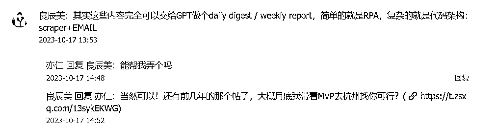

真正动手才发现，知识星球和赚钱的搜索引擎都对内容抓取做了层层限制。光是第一步——批量获取帖子标题和链接——就卡了我三四天。

我先后试了Uibot（自己最熟悉）和Automa（谷歌浏览器插件）。效果都不太理想。Uibot能全自动跑，甚至把ChatGPT的prompt都调了几十遍，但跑一轮要一个小时。Automa呢，插件太轻，代码稍微一多就卡成幻灯片，速度倒还行，可最后还是得靠人工把内容丢给ChatGPT——因为浏览器插件压根没法像桌面软件那样直接操作本地文件。

为了准确拿到每个帖子的链接，我花了一整周。赚钱和知识星球的网页都做了反爬处理，我只能让RPA完全模拟人工操作慢慢磨。结果就是又慢又卡，代码量逼近两万行，还容易出错。虽然最终文档版能用，但总觉得不够完美。

当时一度怀疑自己技术不行，交不了差。

一开始不想用影刀，是因为免费版看不到代码，也不能导出共享到其他电脑，感觉就是个被阉割的免费货。直到后来发现影刀其实支持“相似元素循环”和“模拟键盘点击”这些高级操作（以前真没注意到），还研究出了怎么查看它底层的脚本源码，以及怎样把配置复制到别的账号和机器上——这个涉及影刀商业利益，就不展开说了。这才意识到，影刀在对付那些复杂、多流程、带反爬的项目上，确实有两把刷子。

这里特别感谢阿盛@邹培盛和我交流影刀的使用心得。

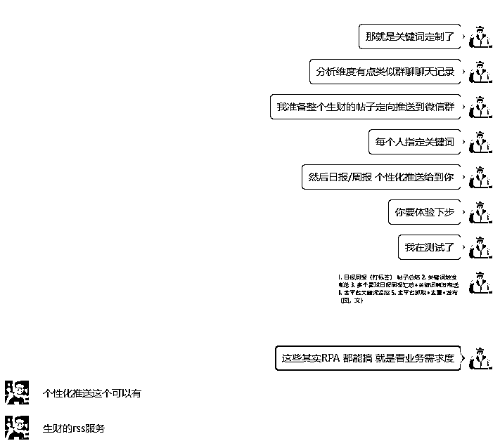

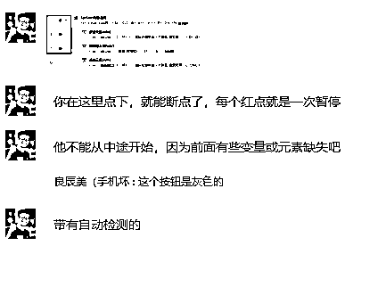

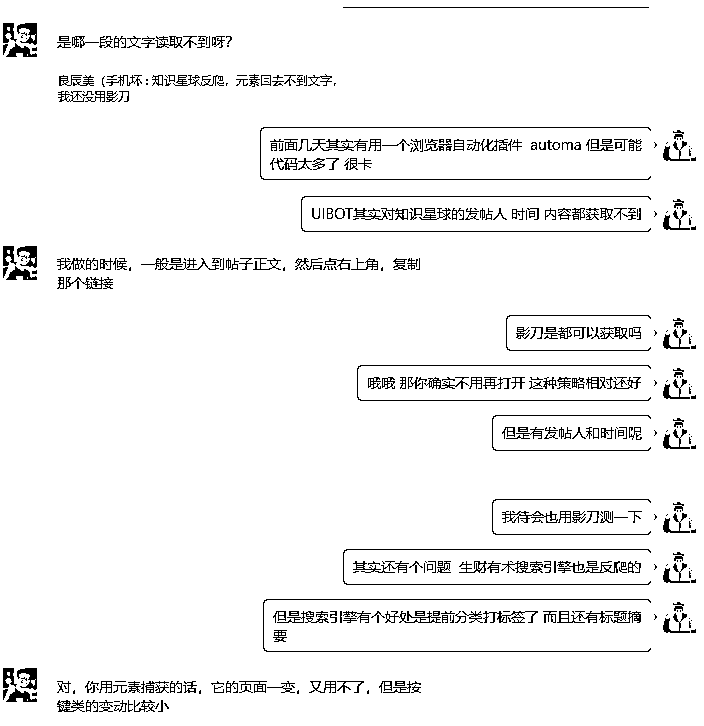

### 极简上手教程（Uibot版本）

先说明：这里只公开Uibot和Automa两个流程压缩包和插件安装包，因为它们可以用于非商业分享。影刀版本只展示流程，不分享具体代码文件——毕竟有商业风险。想用影刀成熟方案的朋友，可以私聊详谈，行家应该自己都能想通。

#### 必备条件（Windows系统）

- 软件：Uibot（+插件）、Excel/WPS、谷歌浏览器  
  https://www.uibot.com.cn/  
- 账户：Uibot、ChatGPT Plus、科学上网工具  
  https://chat.openai.com/  
- 状态：已登录赚钱有术、已登录知识星球、已加入星球  
  https://search01.shengcaiyoushu.com/  
  https://wx.zsxq.com/dweb2/index/group/1824528822

#### 使用指南

注册账号 → 安装软件和插件 → 导入压缩包。

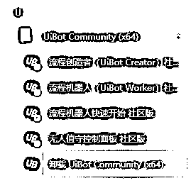

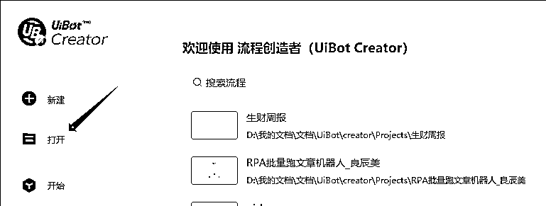

注意：Uibot社区版的流程包导入后，一定要先按自己电脑的环境做基础调试。会RPA的都懂。

然后确认表格文件夹，点运行即可。后续会升级成文件地址自动读入，加上周报自动生成的新流程，就能真正实现全自动——机器人自己把文件丢给GPT，再自动下载回结果。

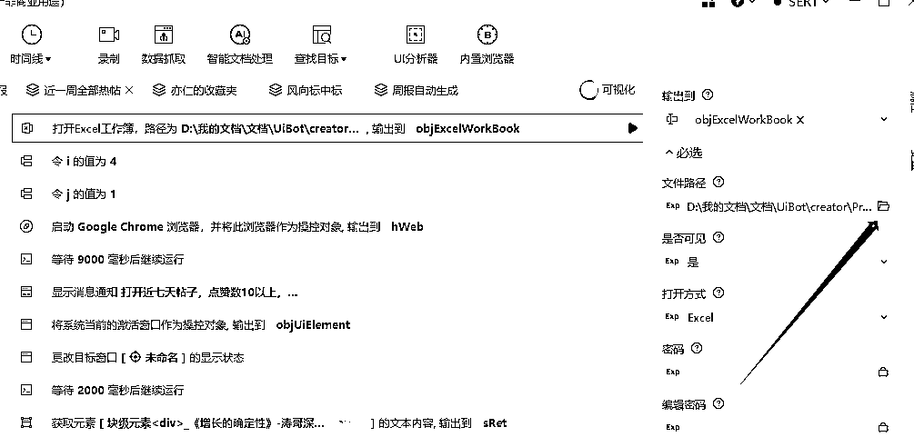

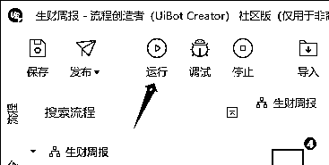

### 自动化流程的设计思路

最简逻辑只有两步——看起来就像在岸上看别人游泳，觉得不就是两条腿往后蹬嘛。

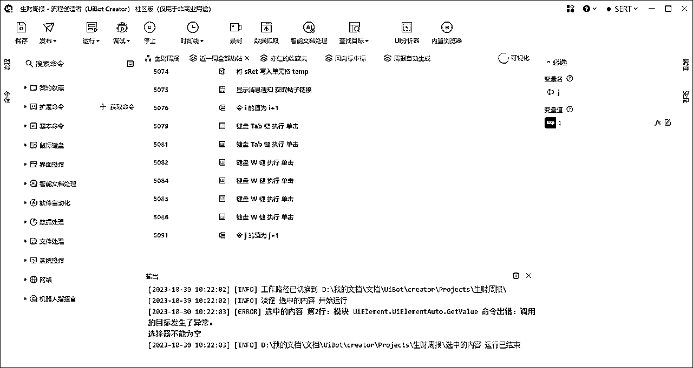

但实际落地时，RPA代码量超过2万行，大概两千个步骤。因为要绕过帖子反爬，完全没法用循环简化。这下体会到了下水的滋味：在岸上练了再标准的动作（Uibot闭着眼都能写基础流程），一到水里还是胸闷气短、腿使不上劲，还老呛水。真实项目里，我反复试了各种方法和方向，还没算调试，光方案就部署了七八套。

简单说，RPA的核心不在代码，而在流程设计。你得先把自己人工操作的SOP理清楚，剩下的交给机器人。当然，为了批量效率，流程里可能还得再叠加插件或新工具。

换句话说，两个同样懂RPA的人，面对同一个项目，设计的流程可能完全不同，选用的工具也可能天差地别。

这个想法是看另一位圈友做公众号RPA批量自动化时冒出来的——他的思路跟我的差别真挺大。

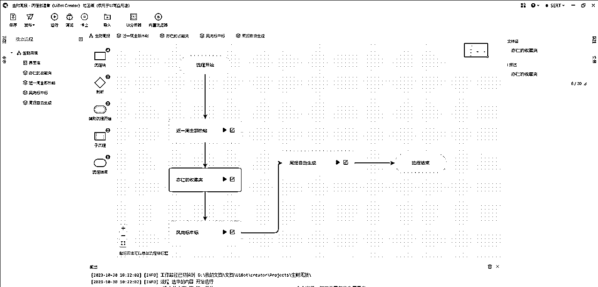

Uibot不像影刀有“相似元素循环”，所以代码量被拉高了很多。影刀500行就能搞定（内置20次循环×8倍），Uibot却花了5091行（外置循环因反爬用不了）。当然也可能是我学艺不精，没徒手写自定义代码，找不到更高阶的用法。总的来说，Uibot我部署了三天，影刀只用一天。有效制作时间其实就三个小时，其余全在调试——我写代码和流程时总考虑不周，错误要靠一遍遍测试去纠正。

### 实操中遇到的各种问题

本来以为逻辑就两步：获取帖子信息 + 发给ChatGPT，简单得很。

结果第一步就卡了三天。赚钱搜索引擎和知识星球都不让抓取帖子详细信息，RPA锁不住页面元素。换Automa插件来抓，元素太多照样卡死。最后退回Uibot，只能取到三部分数据，大量信息叠在一起，ChatGPT连正则表达式都提取不出详情。所以最早那版只能是粗略版。

后来所有问题基本都解决了，代价就是代码量大。最完美形态是VPS + RPA：我用腾讯云VPS，把机器人放在云端，24小时不间断跑，定制消息就发到一个独立微信号上，完全不用人管。

#### Uibot自动抓取信息 → ChatGPT整理周报（耗时1h+，全自动）

- 机器人流程压缩包（装好必备软件和插件后，直接导入即可）

#### Automa插件获取帖子信息（发给ChatGPT需人工介入）

https://chrome.google.com/webstore/detail/automa/infppggnoaenmfagbfknfkancpbljcca

这里要特别说明：Automa方案依托的是赚钱搜索引擎的元素获取模块。它本身拿不到链接和太多数据，只能尽力模拟人工点击，抓到的链接还会带上知识星球个人标识——所以必须要有付费会员才能看内容。另外，一旦搜索引擎的网页元素改版，这套RPA很可能失灵。这也是很多工具需要持续维护的原因。帖子里的代码可能在未来某天失效，但思路是始终有效的。

### 注意事项与调试

不同电脑环境下，以上代码可能需要额外调试，时间取决于环境参数。

#### 机器人层面

- 流程包导入后，确认表格文件夹路径。
- 机器人会自动打开所有网页和表格。
- 第一次打开赚钱搜索引擎时，有30秒左右的等待窗口，可人工调整筛选条件。

#### 外界环境层面

- RPA稳定性高度依赖电脑环境，换机器后要重新调试。
- Uibot没有Mac版，建议用Windows或腾讯云VPS。
- 没有科学上网工具打不开ChatGPT；IP不稳定或速度太慢会卡顿报错。

#### 影刀机器人注意事项

- Excel文件要先绑定。
- 主题帖在sheet1，风向标在sheet2。
- 必须开科学上网才能打开GPT。
- 所有账号要默认登录。
- 影刀切换页面靠搜索引擎，关闭页面靠zsxq，所以其他相似无关标签页必须关掉。

### 后续优化（待定）

目前ChatGPT还不能做到完全准确的文章分类，可能需要人工辅助判断。同时，我想在prompt里加入更多分类下的关键词命中规则，提高准确率。

欢迎各位圈友多提意见！

其实我一直想早点做出成熟版，所以才同时测了三种工具。目前效果最好的是影刀，但时间也耗得最多。后续优化看排期。

---

## 第二篇：知识星球原生网页（理论上适配所有星球）

做这个的初衷，是觉得流程应该挺简单的——结果大意了。

为什么在这上面死磕？因为不想让人看出RPA水平差啊，连这都搞不定说不过去。

至于为什么还要做这些延展思路的机器人？既然想到了，不如就做出来，也是在等有缘人交流。

据我所知，目前只有赚钱有术和淘金之路这两个知识星球搭建了自己的搜索引擎系统。其他大量星球，似乎都在靠人工统计做周报。

现在机器人来了：RPA + GPT 完全可以部署自动定制化日报 + 定期周报，星主只需要做最后的删减。

知识星球官方可能以后也会做这个功能，但RPA的部署成本极低，而且完全定制化——流程想怎么设计，全按你的想法来。有需求的朋友可以找我，我还挺喜欢研究批量自动化的。

### 极简教程

#### 必备条件（Windows系统）

- 软件：影刀（+插件）、Excel/WPS、谷歌浏览器  
  https://www.yingdao.com/client-download/  
- 账户：影刀、ChatGPT Plus、科学上网工具  
  https://chat.openai.com/  
- 状态：已登录赚钱有术、已登录知识星球、已加入星球  
  https://search01.shengcaiyoushu.com/  
  https://wx.zsxq.com/dweb2/index/group/1824528822

#### 使用指南

- 注册账号，安装软件和插件。
- 按照下面展示的流程逐步操作。
- 或者购买影刀企业付费版（据说年费好几万），直接使用发布到市场的现成脚本。

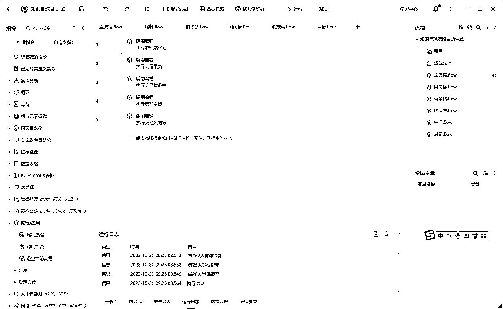

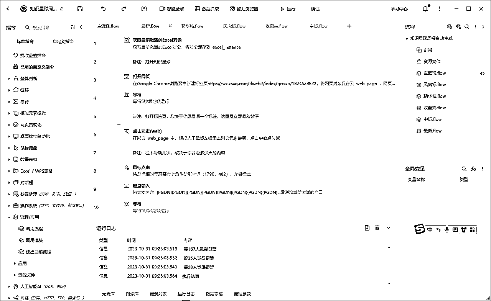

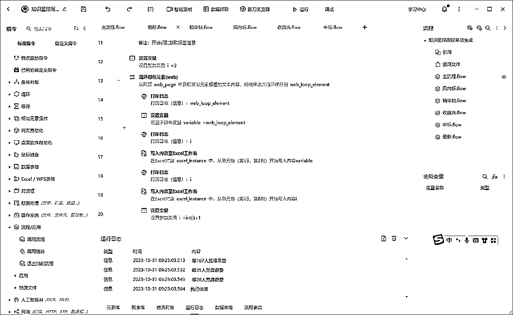

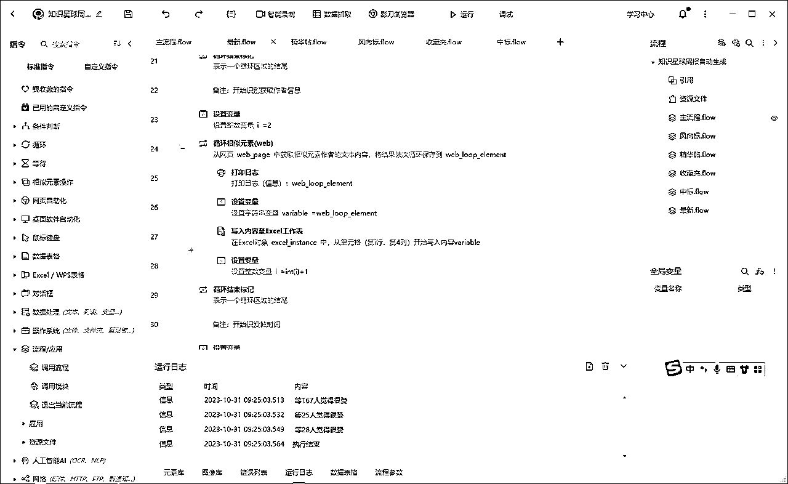

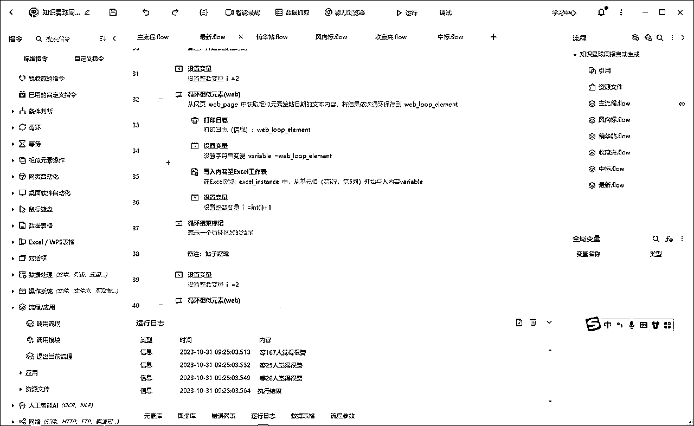

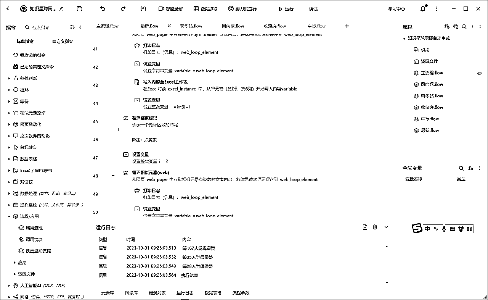

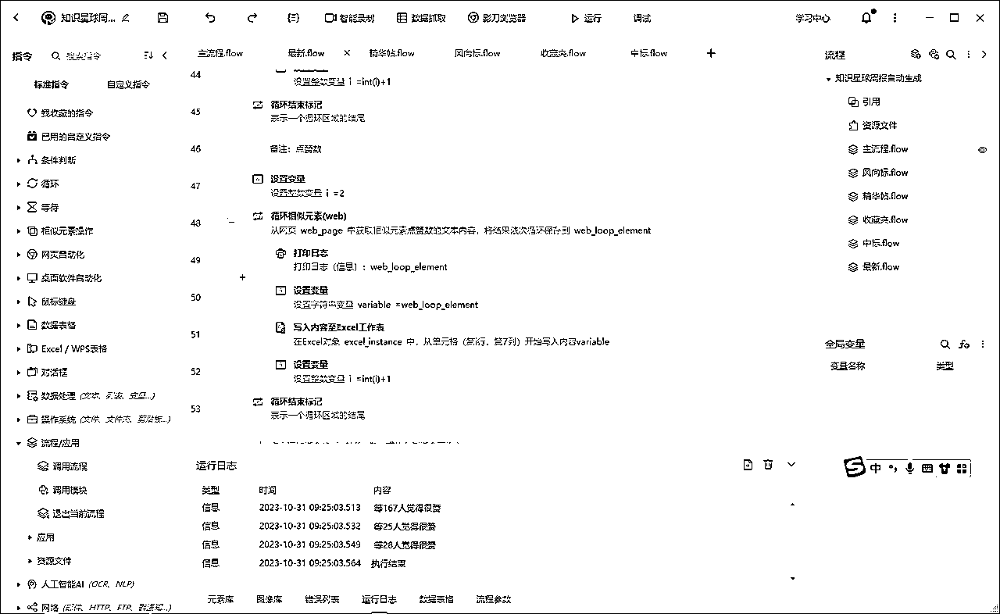

### 自动化流程设计思路

逻辑看上去也很简单：循环获取相似元素——作者、发帖时间、文章内容、关键词标签、链接。

不过大部分文章都挂在飞书等外部文档，我们不需要全部抓下来，有个概览就够了。

然后把内容发给GPT，可以用GPT4上传文件，也可以直接复制粘贴（但受token限制）。其实用Claude或国产Kimi Chat也行。

### 实操中遇到的各种问题

真正跑起来才发现：当帖子没有被任何人打标签时，该元素根本不存在。

用Uibot，这里可以当作空白处理；但影刀的相似元素循环会直接跳过，导致左右两列数据对不齐。

### 注意事项

- 流程依赖谷歌浏览器，电脑上必须安装。
- 起始时要绑定一个已打开的表格，不能关闭，而且表格里要有五个已创建的Sheet。

### 后续优化

- 不同电脑可能需要调整适配性。
- 看看圈友们的实操反馈再说。

---

## 第三篇：订阅关键词，个性化赚钱日报推送微信（含历史精华帖和每日新增帖）

### 极简教程

这步你干脆来找我，省得自己配置一堆软件。

前期想找一些圈友测试，毕竟真实效果还不清楚。花钱买服务，付费就是捡便宜。如果你对这个方向感兴趣，评论区可以聊聊。

实际上，可实现的方式和可玩的路径非常多。RPA只是最低级的配置，当然成本也最低。

### 自动化流程设计思路

- 可以单独获取某个标签或板块下的帖子，也可以只取最新一条。
- 帖子信息（标题、链接、标签、正文大纲、作者）交给GPT，按你给的prompt筛选出想要的结果。
- 通过企业微信/个人微信/QQ/飞书，发送到个人或社群。

这套思路对全平台通用。如果换成代码脚本化，通过API对接，速度会更快。

### 实操问题 & 注意事项

- 同一台电脑上调试稳定后就比较省心，换电脑则需要重新调整参数清单（比如增加微信账户）。
- 不能太频繁地刷新和循环，可能会触发风控。

### 后续优化

- 如果人数过多，可能会拆分成多个流程来跑。

---

## 第四篇：赚钱合集制作

之前鱼丸发RPA工具合集时，评论区有人问能不能做个“年入百万”和“年入千万”的帖子合集：

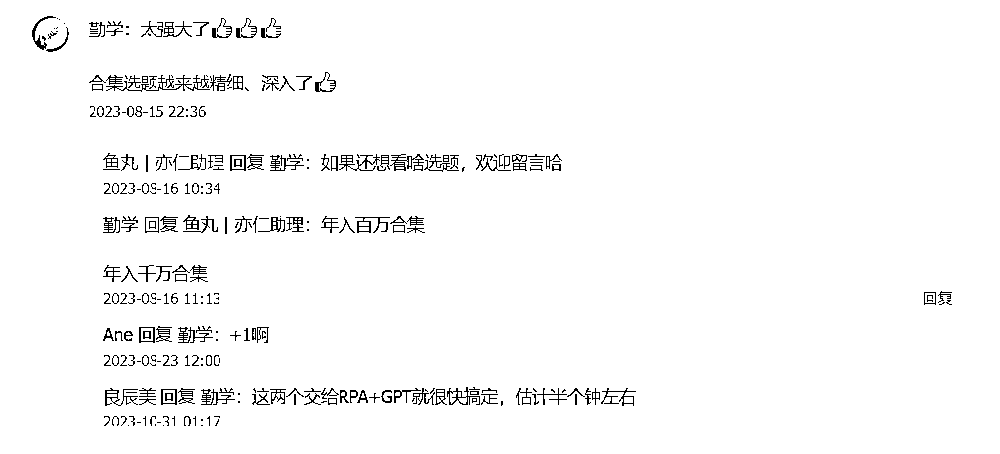

那咱们就简单测一下。流程本身已经跑通了，稍微调整就能做：

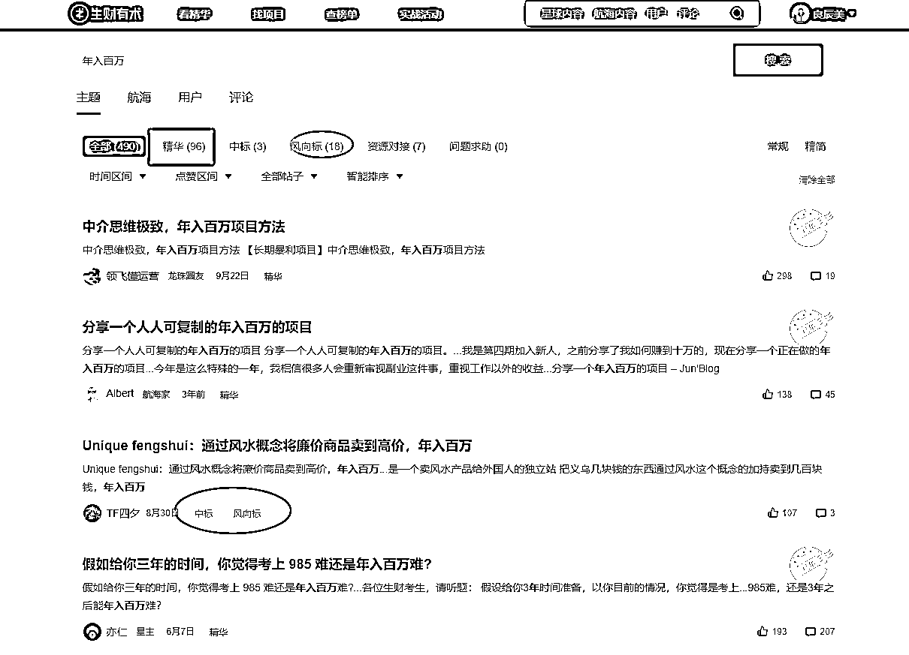

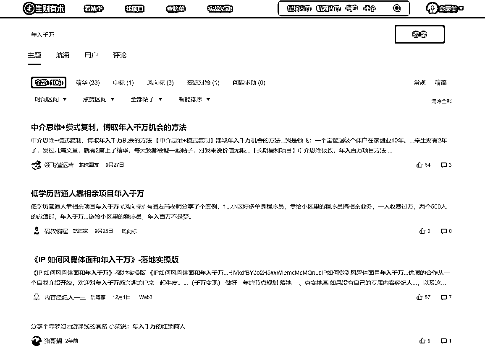

左边是“年入百万”的帖子，全部用RPA抓下来，交给GPT做分类。粗看精准度还挺高，甚至能精确区分风向标和主题帖。右边是“年入千万”的搜索结果，相关帖子和数量都不太理想，给GPT后可能还要人工花时间筛一筛。

当然，你也可以换别的关键词来获得更多命中，比如“赚一百万”、“赚一千万”。读到这里的圈友，不妨自查一下关键词差异，把结果截图发评论区，大家看看区别在哪。

### 实操结果

（处理完发上来）

这套东西同时还能交给GPT做“新人QA百问百答”。

后面我可能会陆续抓一些关键词下的精华帖，自动发给自己，每天慢慢看个几篇。帖子里只带标题+链接，所以想看内容还是得靠会员权限，别打歪主意哈。

---

## 第五篇：龙哥几年前的一个小产品设想

龙哥早在2017年5月9日就发过一条思路：

#思路分享#
https://wx.zsxq.com/dweb2/index/topic_detail/15285125851282

“如何找到一些好的操作思路？”

主关键词：Amazon、blogging、mobile affiliate、niche sites、Adsense、YouTube、Instagram、Whatsapp、淘宝客等  
副关键词：Journey、follow along、income report、实战、记录等  
搜索条件：最近三个月、最近一年等  

组合起来搜索，就能看到很多目前可以学习并且能落地的思路。

把搜到的相关主题都过一遍，记下关键点，梳理思路就可以开始干了。

边做边遇到问题，就边重复上面的搜索思考。

搜索挖掘能力，可能是人最重要的能力之一。

### 极简教程

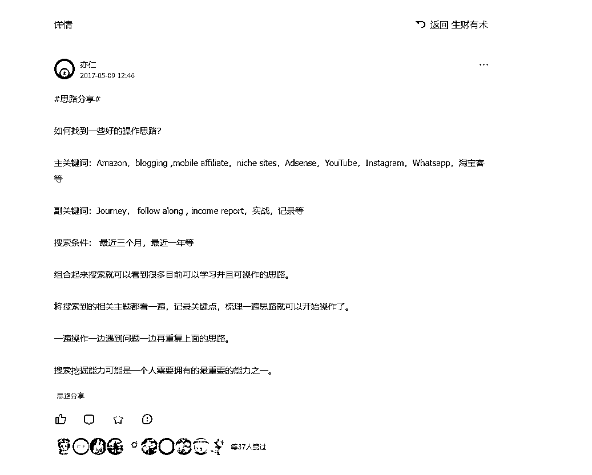

如果你对这个想法感兴趣，照着上面的思路，自己也能搭出来。帖子里的信息和方法永久存在，做完之后可以来交流，再做一次思维碰撞。

### 流程设计 & 问题 & 注意事项

- 这个机器人太过庞大，换电脑调试会很复杂，所以一直放在VPS上跑就行。
- 抓到的很多内容其实是无效的，ChatGPT判断不算精准，得换个GPT模型再测。

### 后续优化

- 可以换成甚至全用五大搜索引擎：Google、Bing、搜狗、百度、Doge。
- 可以新增关键词做动态列表，加入GPT做自动化筛选和判断。
- 还能做成网站形式，提供RSS订阅服务。

---

## 第六篇：RPA通吃全平台——我做公众号和抖音的思路

### 历史RPA机器人汇总

出于个人使用，我做了不少机器人。因为这是完全可视化的中文语言编程，就算出错了，也能根据错误日志很快定位调试，完全不用学代码。

### 公众号

具体代码可以看这篇精华帖：  
《公众号爆文项目：批量公众号自动化发布文章和生成草稿 流程分享》  
https://wx.zsxq.com/mweb/views/topicdetail/topicdetail.html?topic_id=188525588245142

几个月前做美女号项目时，还整理过一份SOP：

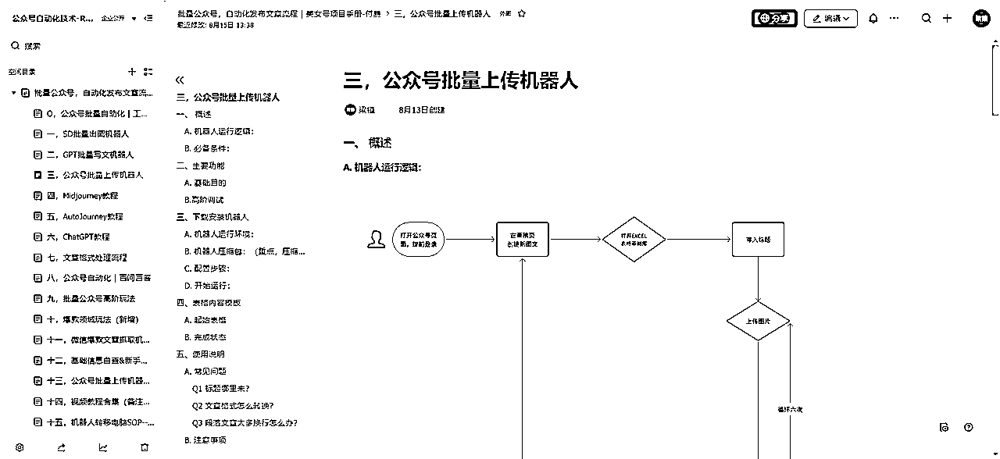

### 抖音图片批量

（这里留待后续补充）

---

最后总结一句：RPA+ChatGPT这套组合，潜力比想象中大得多。从赚钱日报，到星球周报，再到定制关键词推送，本质上都是在“模拟人工”和“自动化判断”之间找到最佳平衡点。希望这些踩坑经历能帮你少走弯路，也欢迎在评论区一起交流你的玩法。

我们合作的那个项目，最后是靠RPA把流程彻底跑起来的。结果发现，在赚钱圈里，这类主题的帖子还挺多，随便刷都能看到：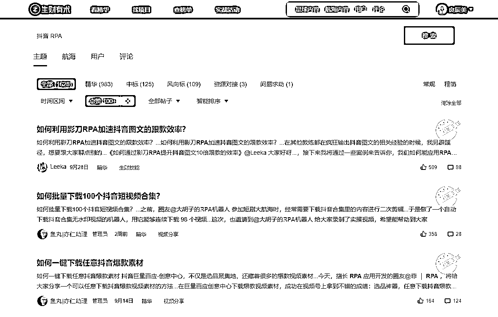

这里简单总结下，RPA能帮我们自动搞定这些事情：

- 自动输出日报、周报，顺便打标签、总结帖子；
- 设定关键词，一命中就自动推送消息；
- 把多个星球的日报/周报集到一起，再按关键词精准分发；
- 全平台监控你关心的关键词，有风吹草动立刻知道；
- 从各平台抓取内容，自动去重后以图文形式发出去。

其实，代码和工具从来不是核心，最关键的是业务需求梳理和逻辑设计。你得先想清楚做什么、怎么做，RPA才能为你所用。

我前前后后实操了有十天，这篇内容从昨晚十一点一直写到今天中午十二点多。总算快完成了，还差第五部分的一个小MVP，之后会补上。如果你感兴趣，可以免费订阅体验，毕竟我也还在测试阶段。

补充一下：赚钱合集市场以及影刀应用的发版链接，我还在抓取和优化中，稍后会放出来。另外，这篇文章写写停停，凌晨还打瞌睡，可能有些语句不通顺或错别字，过几天我会通读一遍再修改。

以上，希望你读有所获。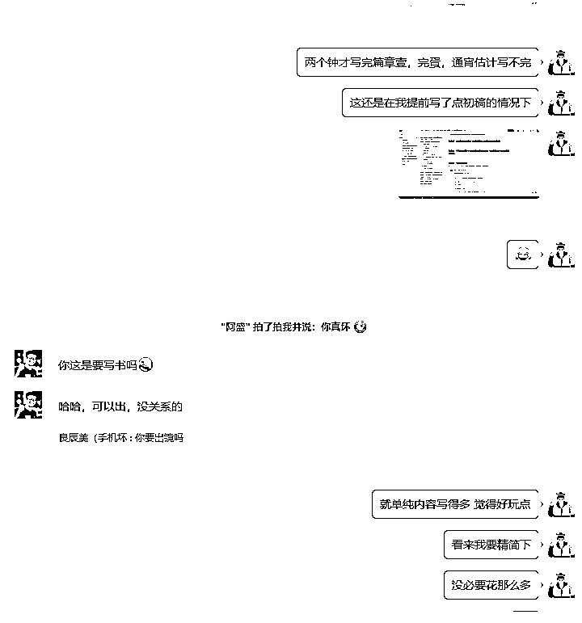