# 双十一7天卖出58个名额：我的得物终身陪伴群发售全记录

> 来源：[https://jvx6nnxr4va.feishu.cn/docx/IdKbdtd0ToZZ5GxQ5TVcz2kDnrd](https://jvx6nnxr4va.feishu.cn/docx/IdKbdtd0ToZZ5GxQ5TVcz2kDnrd)

大家好，我是“左手带娃、右手做自媒体”的全职宝妈小又。

双十一档期，我们把得物终身陪伴群放上了架，7天时间收了58人，团队到账约1.3万。今天把这波发售的实操经验摊开讲讲，给同样想做产品发售的朋友一点参考。

原本我和合伙人只想着能招满50人就算达标，毕竟我们这种小体量IP，流量有限、预热又仓促、窗口期也短。最后能冲到58人，真的要感谢陈舟老师的助力，没有这份支持很难有这个结果。

产品虽然小爆了，但回头看问题也不少，下面把思路拆开了说。

# 一、为什么最终选择做陪伴群

这个想法诞生在我和搭档清欢意准备在【同舟共富】星球得物打卡营开营之前。我们在自己的星球【副业变现圈】第一次做得物打卡营时，就不断有学员追着要进阶课。我们也考虑过，但后来发现新问题一直在冒出来，旧问题学员也还在反复问。

再开一期进阶课，招生难度会变大；再说了，得物是购物平台，种草逻辑跟小红书很像，平台规则会频繁调整，既要保证真实种草，又要刺激成交，所以玩法一直在变。

权衡下来，陪伴群的形式更灵活。灵感来自攀哥的闲鱼社群交付方式。我跟意儿聊了，她跟我想法一致。随后我请教了陈舟老师，老师也认同这个方向。确定后我立刻去做了一轮市场调研。

先看平台：得物APP在各大短视频平台的投放力度非常大，从头部到腰部博主都在接广告，说明平台势能很稳。

再看变现：得物上五百粉以内的达人月入大几百到一千很常见，两三千粉的月入几千到一万也不少，粉丝越多收入越高。同等粉丝量里，得物比其他平台更能变现。除广告和带货赏金外，还有免费拿样和创作门槛低，拍摄和设计不需要太精致，真实体验更重要。普通人完全能上手。

再看供给：我搜遍了各种平台关于得物好物种草的训练营，几乎找不到。龙哥盟上也只有一篇长贴。等于说这块的知识付费目前还是空白。

平台好、变现快、竞争少，时机刚好。陪伴群还能滚动招生、长期交付，值班式陪伴体验好，执行压力也没那么大。方向大概是没错的。

# 二、我们怎么分工

方案确定后就开始梳理运营。社群是我和意儿一起做，分工自然就分开了。

意儿带过小红书新手课、两期打卡营，得物学员累计260+；我带过一年多私教，也刚结束一期朋友圈IP打卡营，教学交付没问题。

我更擅长运营和传播，手里有点流量，所以引流、社群运营、宣传节奏和文案素材基本归我。

意儿是实操派，对平台玩法钻研得深、更细心，得物教学这块由她主导。

日常答疑我们轮流值班，帮改文案、做加餐、出图、拍片指导。种草动态的核心要素也就这些，问题解决闭环了，赛道基本就能跑通。前面两期打卡营的成才率不错，陪伴群应该也没差。

# 三、发售氛围怎么造的

方案出来就开推，短时间内的氛围感我觉得做得还行，具体拆一下。

## 1. 先预热，埋个伏笔

正式发售前，我们在朋友圈和公众号就已经有意在推得物相关内容了。

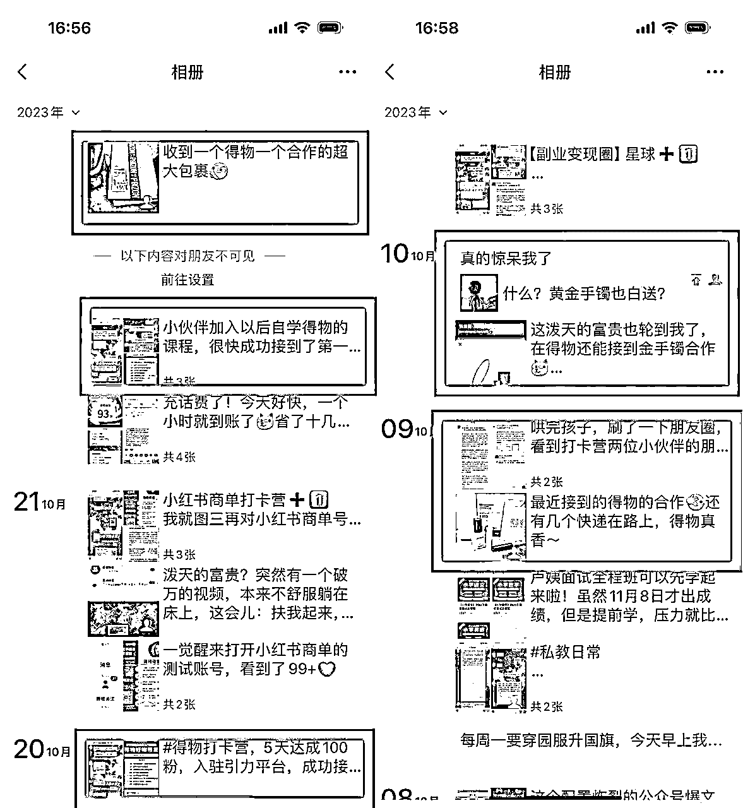

想推一个产品，就得提前在日常里不经意地提及，让大家意识到你一直都在做这件事，这样正式启动才不会突兀。

## 2. 先收盲订

盲订这个打法是我从大佬发售里学来的。

写方案的同时，在星球的微信群里先放出消息：我们要做得物社群了，可以先盲订，定金99元，最终价格未定但首发肯定划算。

消息一出，就有几位伙伴直接转了款。

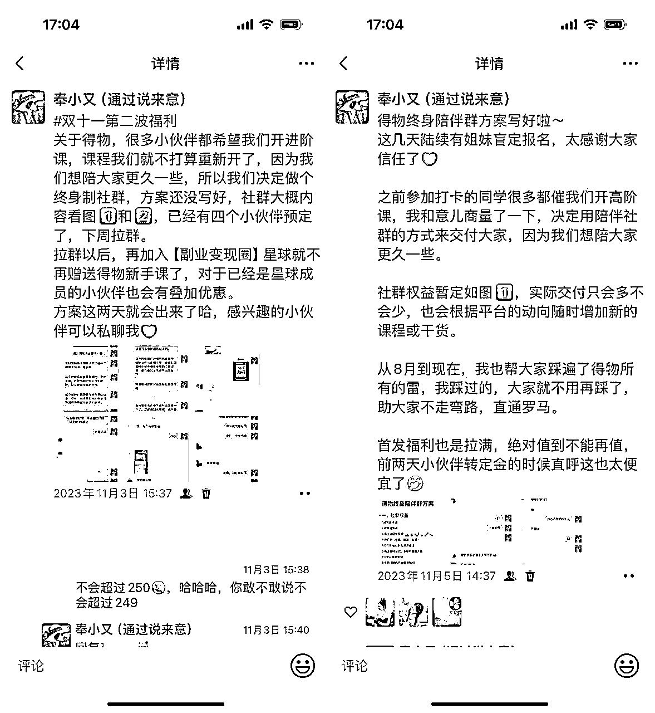

因为准备真的很临时，盲订量不多，最终只在星球微信群收了8人。要是能再提前一段时间，效果会更好。

方案当天海报还没好，我就直接截方案图去宣传，官宣要做社群。方案一出咨询量上来，两三天就进了二十多人，到【同舟共富】打卡营结营时有四十多。我们的底线是50人，双十一结束后最终是58人。

## 3. 用故事而不是硬广

好的宣传不是喊“快来买”，而是讲故事给干货。

我做分销很久了，做资料项目时从不硬广，总是从自身经历出发。

粥左罗说过：用户买单买的不是知识，是你，或者是你+你的知识。我们在罗永浩直播间下单，往往是被他的经历吸引；在新东方下单，也是因为内容+故事。

所以宣传时我会讲自己做得物的心得和踩坑，也会讲学员的成果，很少说“得物好，快来跟我做”这种话。

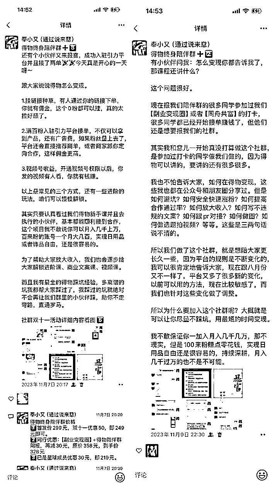

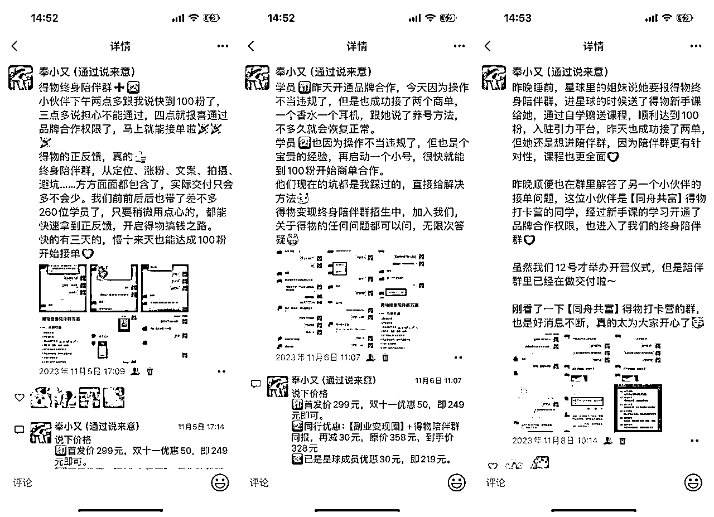

我分销别人的产品时，也很少直接用官方文案，我会写下自己对产品的真实感受，以及和主创者的一些互动。用户更吃你本人的态度，而不是生硬的广告。

## 4. 朋友圈密集发

推产品时别怕朋友圈营销感重，我双十一期间朋友圈至少五条。

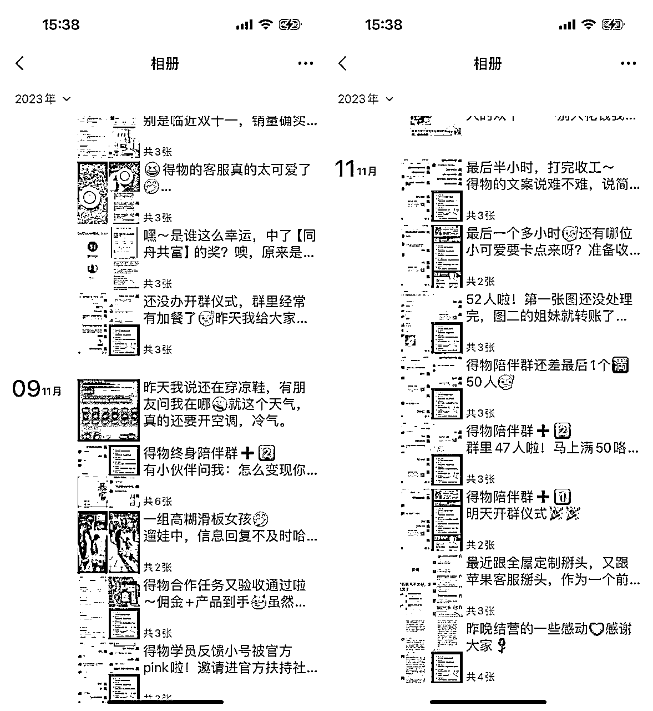

通过我报名的，公众号来4个，其余基本都是朋友圈直接成交，来一个发一个。

被折叠不用怕。我一开始也用防折叠工具，后来发现没用，该折叠还是折叠。我就放手了，关键信息放第一行，平时内容有吸引力的人，促销期也会点进来。实践下来，基本每条都被折叠，但成交照样有。而且折叠是针对性的，有人看到是正常有人看到是折叠。

只要内容做到了，折叠不影响转化。

## 5. 外部合作补流量

单靠我们俩招生压力还是大。除了舟舟老师帮忙宣传，我还谈了几个外部合作，去别人社群做分享+分佣。

这块操作得不够细，效果没达预期。

如果自身流量不够，外部合作是条路。我去年就开始关注这个打法，当时在自己待的社群看到有人分享招生，就意识到应该是跟群主有合作。后来验证很多招生都是这个逻辑。这次我也用了，虽然转化不多，但一篇一两千字的分享稿能投多个社群，成交一两个就是几百块，稿子还能发到各个星球引流，还是很值的。

# 四、交付要做得超出预期

价格不高，但该有的流程我们一个没少。

## 1. 仪式感不能省

做任何产品都要有仪式感。打卡营开营要讲初心、可行性、成绩、规则，把该说的和“丑话”都说在前面。结营要颁奖、发言，最好再配个证书，这本身就是二次传播。

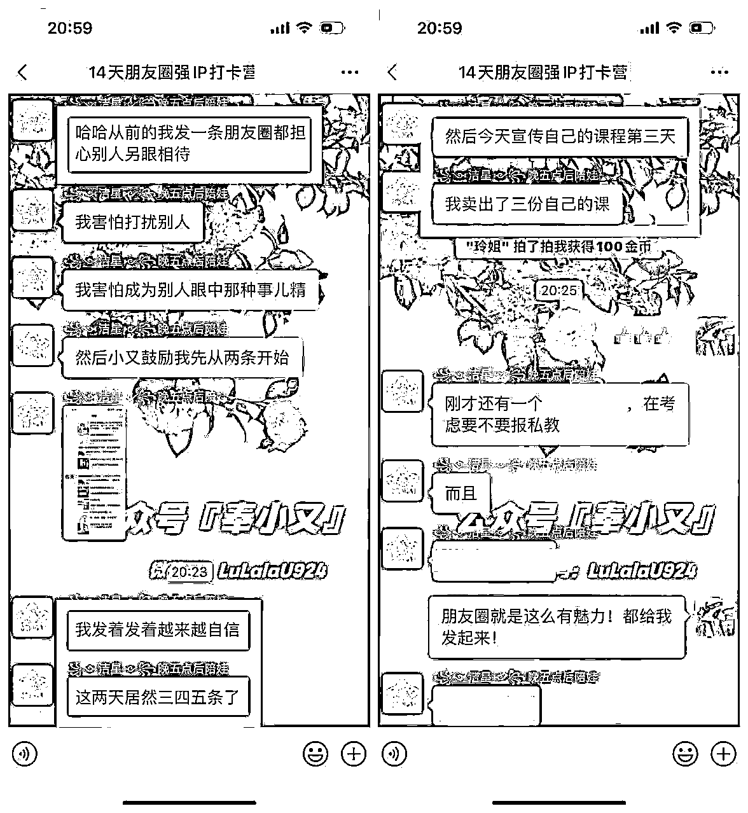

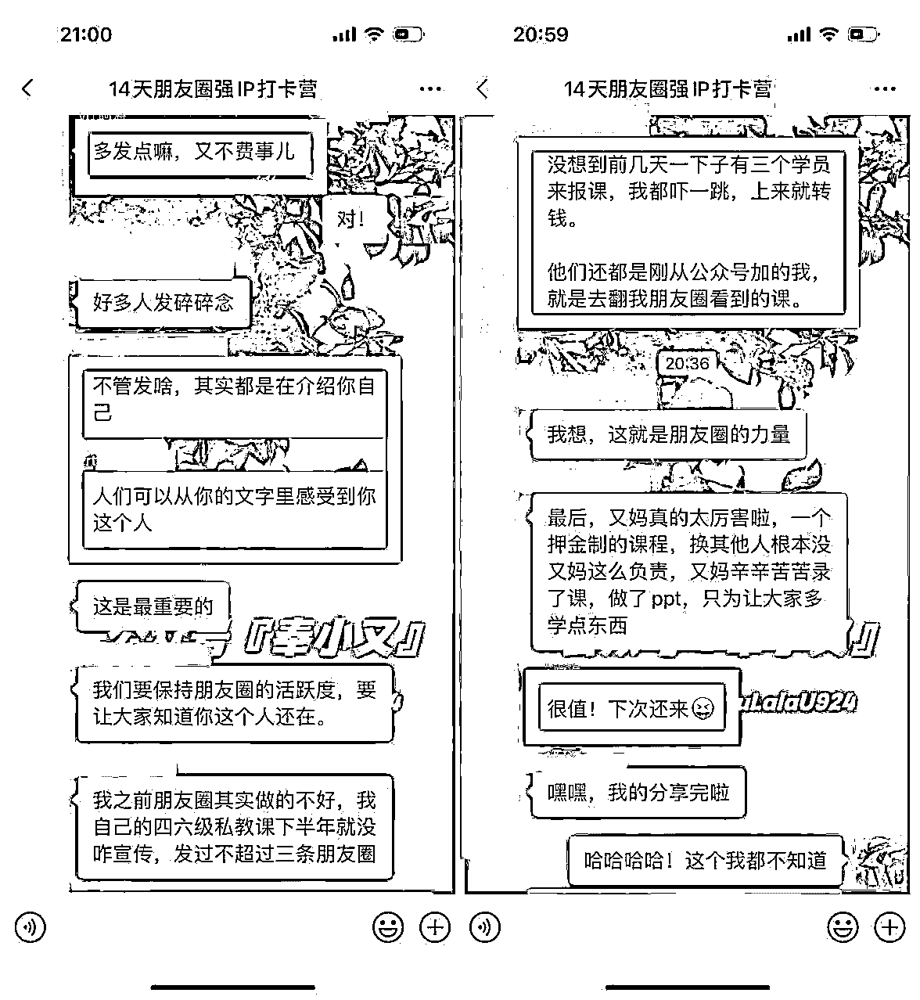

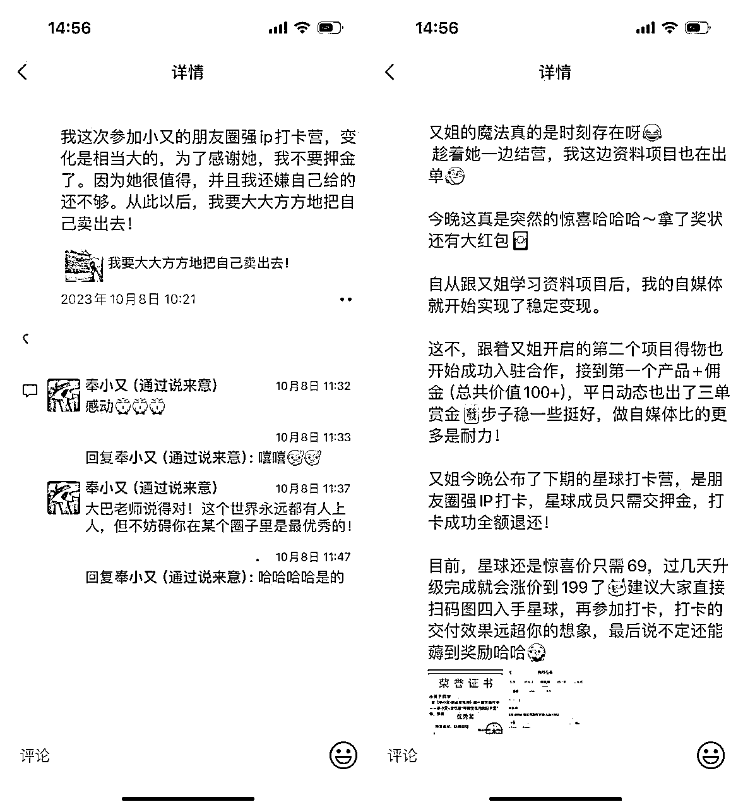

比如我做朋友圈IP打卡营结营时安排了荣誉证书和优秀学员分享，效果很好，部分学员自发发圈和公众号宣传了。

得物陪伴群是永久制的，没有结营，但开群仪式我们花了心思。

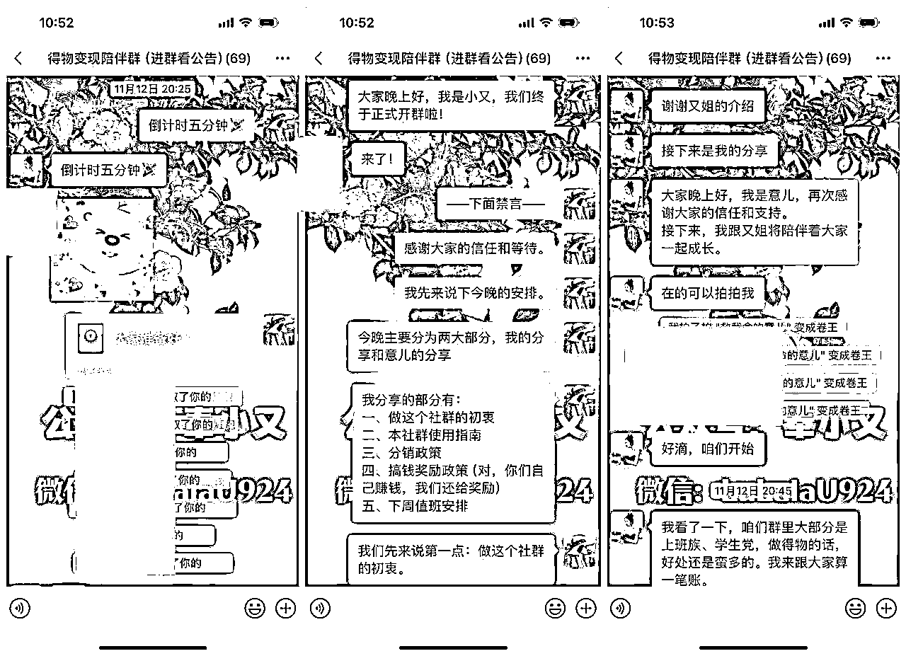

因为是合作社群，开群仪式按分工来，我侧重讲社群初心、功能和奖励机制，意儿讲专业性内容。

## 2. 让学员感到惊喜

对外宣传时我们并未提奖励，开群当天才公布。得物上赚到一定金额有阶梯奖励，分销也有额外激励。

一开始我只想做分销，后来觉得需要点激励去调动大家，所以设计了三个等级的赚钱奖励，拿完奖项基本能回本。

案例多了宣传素材就不断。

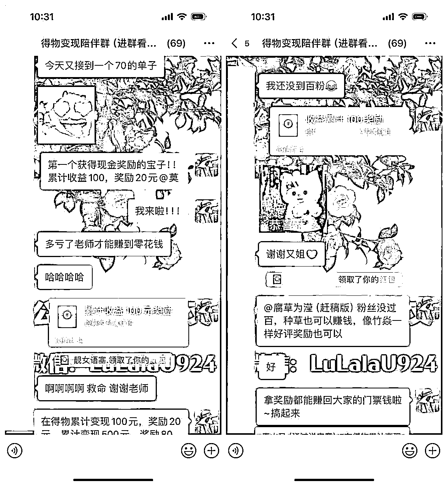

另外我们有不定期加餐、不定期抽奖，还提供拍摄用产品。这些加在一起，性价比就上来了。

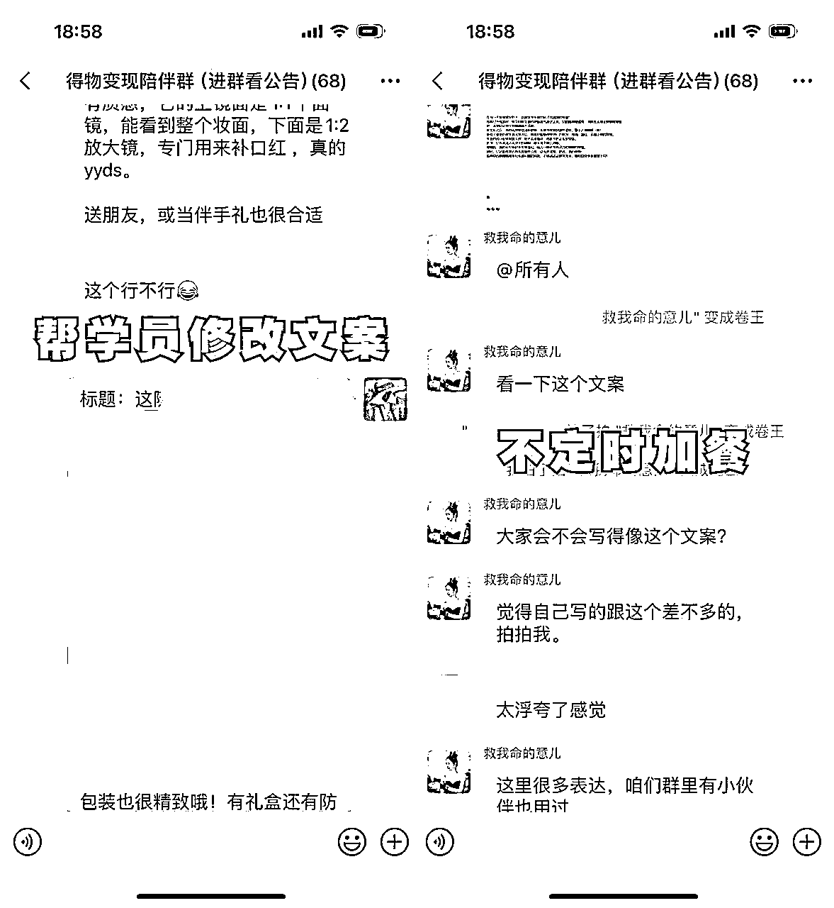

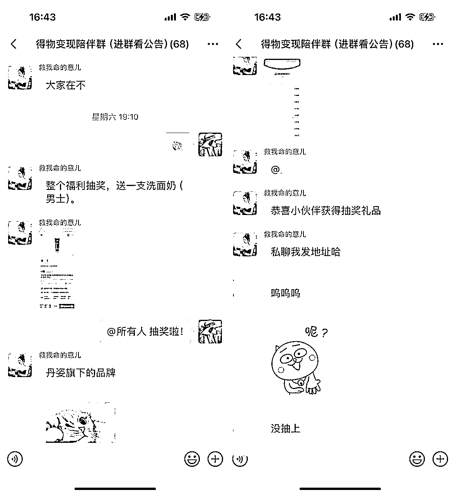

有学员开群前就分销了，当天就赚回了近一半门票，后续我也会围绕分销做更多活动。

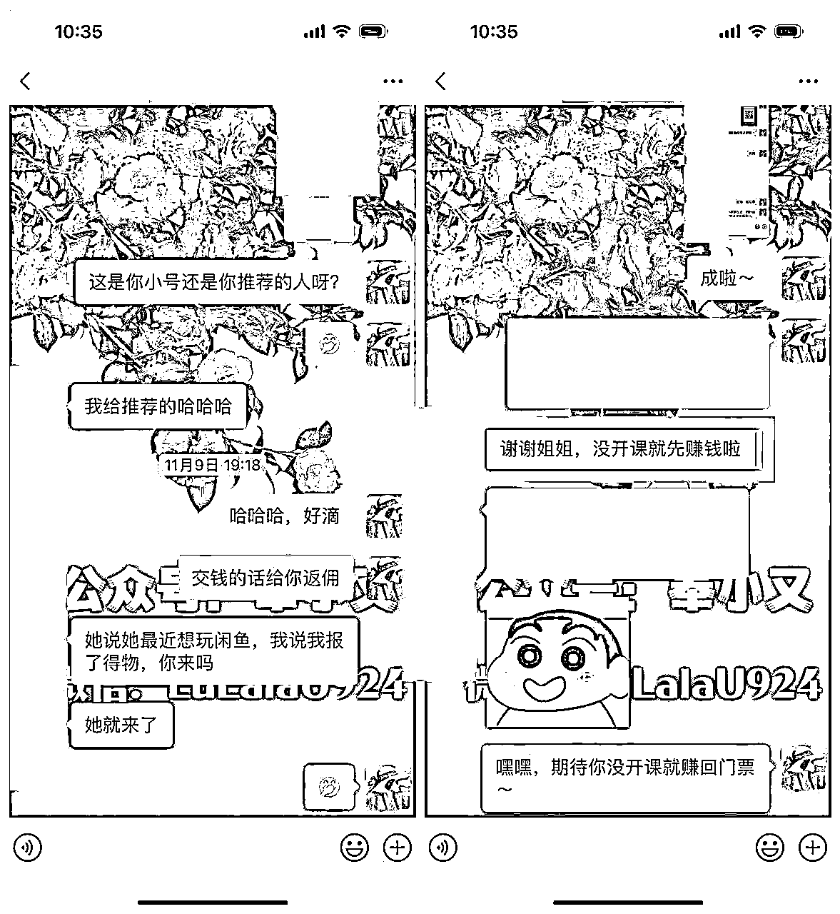

# 五、复盘反思

## 1. 预热期太短

从启动到结束，宣传周期只有7天。如果让我重来，至少提前15天，高客单可以提前一个月。

之所以这么赶，一是想等【同舟共富】得物打卡营结营后再推，二是手头事太多没时间写方案，后来又觉得双十一是好节点，就硬上了。

宣传期可以从四个维度展开：①你本人的干货 ②学员故事 ③写课进度 ④盲订故事

## 2. 学员故事没用好

我们其实有很多学员案例没宣传出来。朋友圈和公众号是基本盘，更理想的是公域+私域联动。

我可以约优秀学员写稿，或自己整理成案例发公众号和各大公域平台。老师好不算真好，带出来的学员也好才是真的好。优秀案例是最好的信任背书。

## 3. 流量合作没做深

准备仓促，物料没整理好，合作目标也没完成。双十一大家都有自己的活动，我们推新品有点撞车，被礼貌拒绝了两次。

另外素材准备不充分，合作形式太单一，当时只想到去社群分享，也可以去要朋友圈转发、公众号置换等。

以上是我这次发售的完整复盘。相比大佬我的方法还很稚嫩，很多打法也是学来的皮毛。后续我会继续尝试，把社群做得更扎实。下次发售，希望能做得更好。