# 用AI撬动拼多多写作单店，月入过万的可复制打法全拆解

> 来源：[https://cxqeimz77vr.feishu.cn/docx/T1F5dn3tqo1TIcxSEQNckV46nUe](https://cxqeimz77vr.feishu.cn/docx/T1F5dn3tqo1TIcxSEQNckV46nUe)

大家好，我是饭饭，赚钱的龙珠群友。长期在电商赛道摸索，最近全面拥抱AI，在赚钱首席医官梁靠谱的指导下，我的写作店铺越做越稳，很快摸清了方向，也在赚钱连发数篇精华。

上期我在《AI市场有多大？适合下场做的细分赛道拆解》里和刀姐黄小刀交流了不少普通人可落地的AI玩法，不少朋友就此加我私聊，对高客单的写作业务格外感兴趣。这期我就把自己的核心主营业务摊开讲，《AI+拼多多写作店铺拆解》，万字干货，少说理论多看操作，希望能给圈友带来实际收益。

## 1、AI+写作店铺项目概览

AI+写作的玩法在星球里已经被讨论很多，公众号爆文、头条百家号等都是热门分支。相比之下，写作店铺的优势在于短平快、先付款后交付，确定性更高。

我做写作变现最大的转折点就是ChatGPT的出现。这款文字类万能助手直接把产品毛利拉满到100%，不再依赖写手老师也能完成交付。如今借助GPT，效率和利润双升，我们甚至扩充了团队，用AI辅助撰写，收益进一步放大。

当前变现逻辑很简单：在电商平台开设写作店铺，精准承接客户需求单，用GPT撰写或辅助撰写，满足要求即可收款。

熟练掌握GPT指令后，产出质量完全可控。

收益情况：

经过一段时间积累，我们的操作已经比较顺畅，接单量稳定。最近一个月，拼多多单店月均轻松破1w。用AI辅助写作，单价相对更高。如果你在做写作变现，这套运营方法能直接帮你增收。

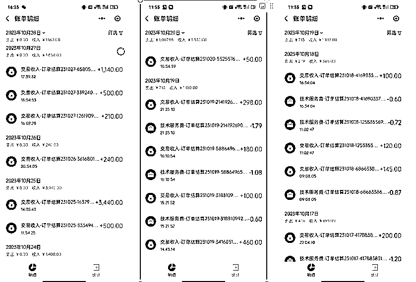

## 1.1 何为ChatGPT

ChatGPT是基于OpenAI GPT-3.5架构的大型语言模型，今年的标志性技术产物。它在大规模语料上训练完成，可生成自然语言回复。

其核心目标是通过对话交互，为用户提供有意义、准确、有用的答案。可用于问答、概念解释、建议提供、创意写作等。训练数据覆盖书籍、文章、网页、论坛等海量文本，因而能理解并模仿人类表达方式，根据输入做出连贯回应，并多角度思考问题。

简单说，它能生成多种类型、难度、风格的文本。给出正确指令，即可获得演讲稿、商业计划书、读后感、公文、新闻稿等丰富内容。

实际应用来看，GPT在自然语言生成任务上表现惊人，几乎能模仿人类语言模式和思维，输出自然流畅。将其设定为博士、编辑、各领域专家、资深顾问等角色，就相当于零成本创作，随后实现100%利润。

## 1.2 写作店铺是什么

任何带“代”字的生意里都藏着巨大市场。如图显示的付款人数只是冰山一角，真实需求庞大。按客户下单需求代写文章，属于典型的定制类服务，价格灵活。我们目前主要通过电商平台获取精准咨询，双方沟通后报价，虽然多为私域对接，微信、支付宝或银行卡付款，但市场体量依然庞大。淘宝、拼多多、闲鱼、小红书等都是可操作的写作店铺平台，且流量充足。

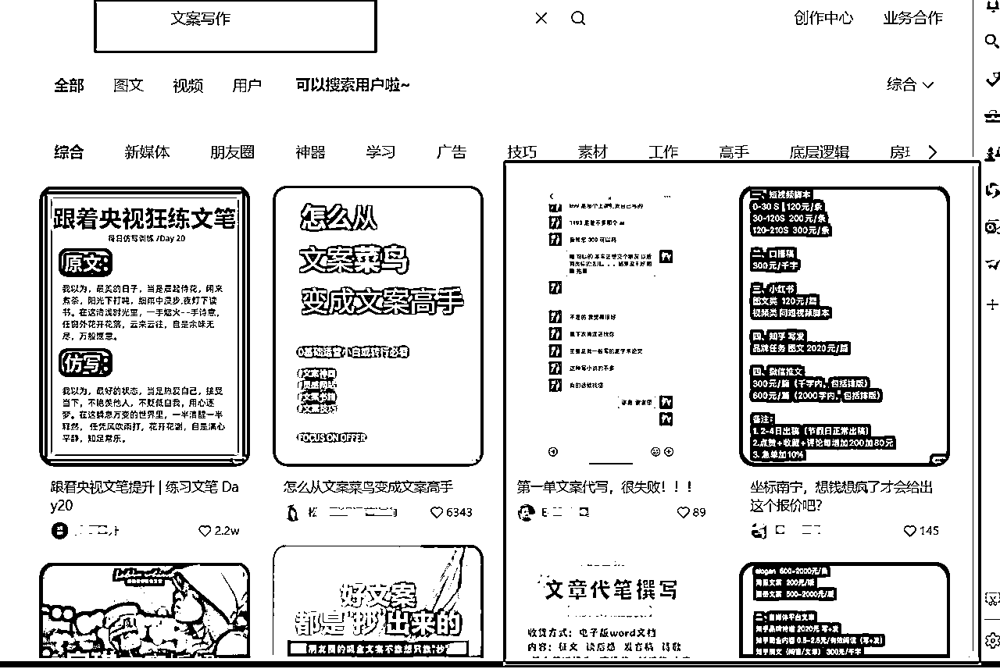

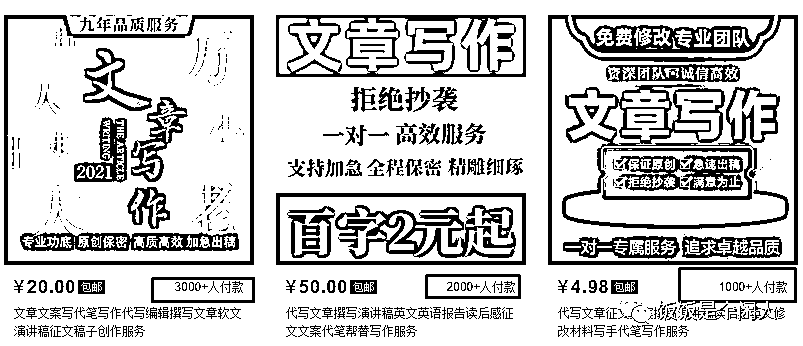

很多人不了解这个行业到底能写什么变现，下面我列举常见高频需求，仅供参考：

演讲稿、新闻稿、读后感、征文发言稿、总结报告等...

情书、道歉信、感谢信、节日祝福等...

软文广告类、宣传软文、短视频文案、广告文案等...

产品介绍、品牌故事、品牌软文、营销软文等...

网店类文案、详情页文案、剧本、脚本等...

回忆录、公文、会议纪要、思想报告、商业计划书、创业计划书等...

## 1.3 ChatGPT+写作店铺的结合

掌握ChatGPT后，就拥有了超级核心竞争力，相当于一个万能助手。如何变现？结合写作店铺做接单自由。选定平台开店承接订单，用ChatGPT功能为客户提供写作服务和支持。

写作店铺的核心就是开店接单，为客户提供各类文章、故事、推广文案等定制服务。接到订单后与ChatGPT对话，输入指令，按客户要求生成稿件。客户可与模型共同探讨写作需求。

开店过程中客户大致分为三类：

1. 重质量型：最看重交付质量，希望高质量稿件，高姿态服务，质量是关键。
2. 求急单型：可接受较高单价，对质量要求不高，只要能过关。常见于领导临时布置、学校作业等。
3. 低价应付型：到处比价，沟通成本最高，建议直接过滤，赚不到钱还消耗精力。

基本流程：获取用户 → 解答咨询 →

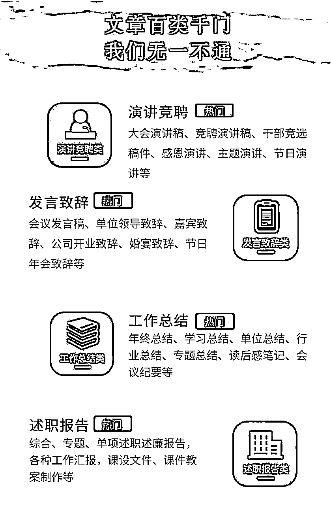

# 2、拼多多写作店铺解析

## 2.1 拼多多概况

拼多多是中国主流移动互联网电商应用之一。2021年全年GMV达24410亿元，现已成为用户最多的电商平台。截至2020年底，年活跃买家数达7.884亿，成为中国用户规模最大的电商平台之一。短短几年超越阿里成为用户规模第一，开店平台首选自然绕不开它。

## 2.2 在拼多多开写作店的优势

1. 用户基数大：拼多多是中国最大的社交电商平台之一，数亿用户意味着巨大的潜在客户池。
2. 门槛低：相比其它平台，拼多多仅需1000元保证金，无需特定制作技能即可开店写作。
3. 社交属性强：用户可通过分享、点赞提升曝光和粉丝数，有利于店铺冷启动。
4. 起店快：掌握方法后，新店可快速启动并获得正反馈。
5. 竞争相对小：在严格规则下，大部分商家难以长期存活，竞争压力较小，有助于放大项目优势。

## 2.3 在拼多多开写作店的劣势

1. 单价偏低：拼多多用户整体付费能力偏弱，写作单价相对较低。
2. 平台规则严：开店需谨言慎行。写作单需沟通字数、要求、交稿时间等内容，易触及敏感词，必须合理规避。

# 3、拼多多开店实操步骤

## 1.开店准备

拼多多支持企业店和个人店，新手建议个人店：准备一部手机、一张电话卡、身份证、1000元保证金。保证金属于平台押金，结业可退，实质零投入。

## 2.开店注册

很多朋友没做过电商，我已整理完整注册流程：按要求填写信息即可。

## 3.商品标题撰写

标题决定流量，错误标题会导致封店或扣保证金。以下是我在实操中验证可用的标题示例：

1.撰写商业计划书代做路演ppt项目创业融资策划方案可行性研究报告
2.撰写文章原创演讲稿作诗主持写诗答辩稿作文读后感
3.商业计划书撰写代做创业融资项目路演可行性研究报告立项策划方案

切记，标题必须参考平台上存活的大店铺，不要盲目创新，否则极易被封。

## 4.详情页制作

文章类目详情页无需复杂，一张主图加副图即可。虚拟产品平台支持度有限，不要用实物的思路做虚拟。主图上避免出现“代写、代做、论文、公文、党政”等敏感词。制作主图可直接套用模板。

推荐工具：【搞定设计】【创客贴】

常见主图尺寸：800*800px
图1 图2

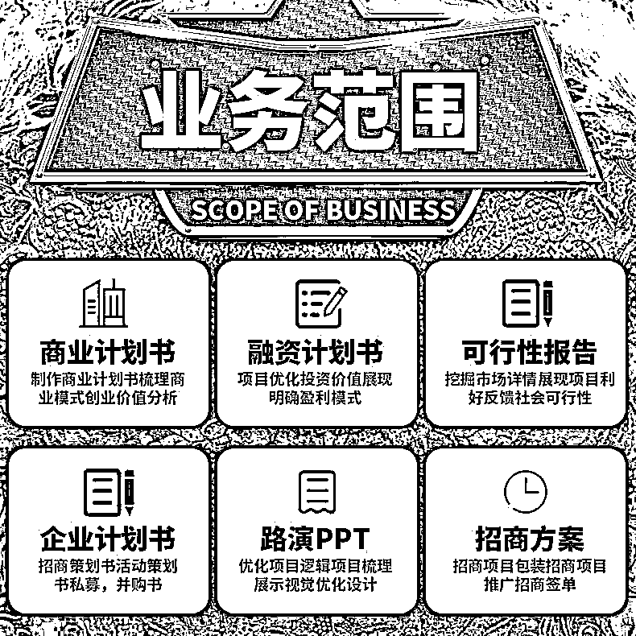

## 5.商品发布如何规避4W保证金

这个技巧目前了解的人不多，不少人卖教程收费上百，请看点击蓝色部分查看教程

## 6.线下引流技巧

目前系统审核趋严，引流是最难环节，稍有违规易被限制。推荐3种话术与方法：【平台规则变动频繁，仅供参考】

方法1.这边怎么跟您发文件呢？
客户会主动提供联系方式，你再添加即可。客户主动发送不触发违规，你主动发送风险极高。

方法2.图片引流
提前准备几张引流图，隐晦留微信号，微信号越简短越不易被识别。发送时需用不同尺寸图片轮换发送，降低识别率。

方法3.先拍下再联系
报完价后让客户先拍下链接，可看到真实电话，通过卡券查看联系方式，再电话添加微信。

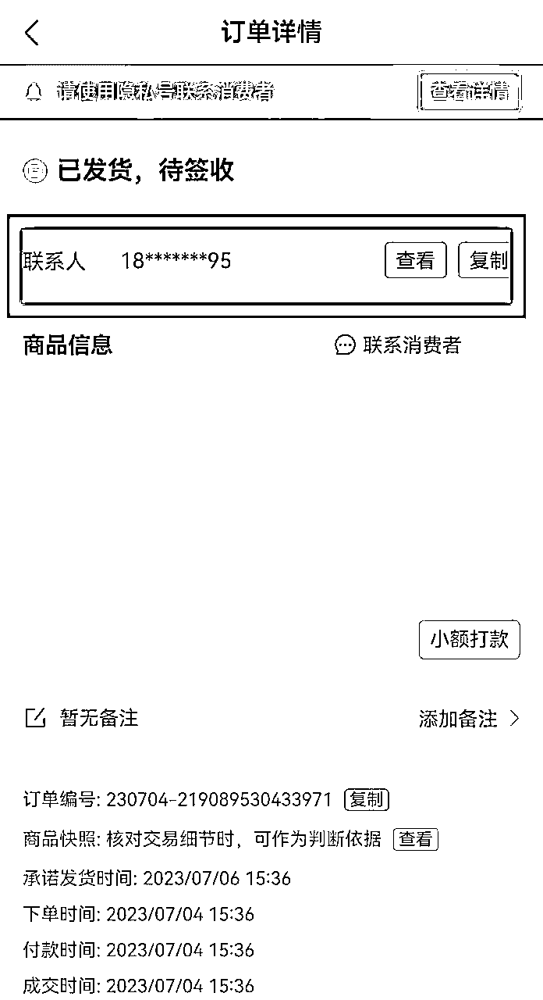

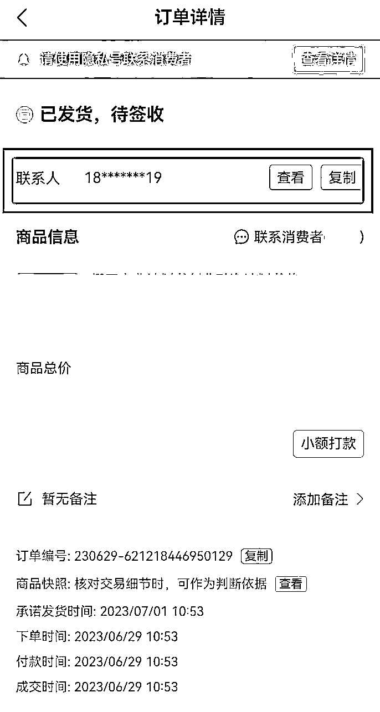
方法4：百度网盘跳转
提前将微信号留在网盘文档中，上传后生成链接。沟通时发送网盘链接，客户提取即可看到微信，实现引流。

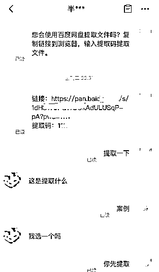

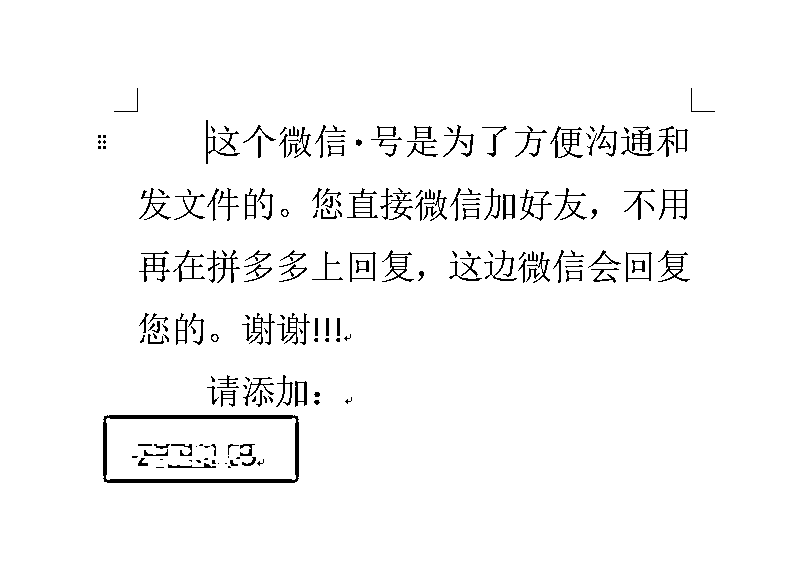

## 7.项目风险提示

1.错误引流导致封店
前期因不熟悉规则，错误引流直接封店。建议结合已有方法优化，形成自己的SOP，实在无法总结就直接沿用成熟方法。

2.接单违禁内容导致封店
操作中必须清楚违禁词范围，涉及违禁类订单一律拒接。

# 4、运营起店方法

多多写作店铺起店很简单，合规运营即可长期盈利。多多客户体量庞大，店铺经营久了自然有流量。以下是我总结的快速起店打法。

## 1.人工干预补单

虚拟文章类目操作技巧不高，稳健发育即可，通过补单建立基础数据。

第一天
早上8点100元 下午3点100元 晚上8点150元
通过链接进店自补，干净鱼塘进店下单补充流水。

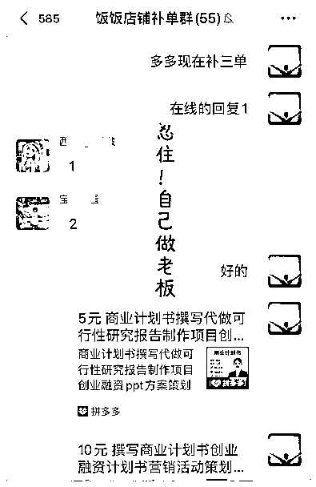

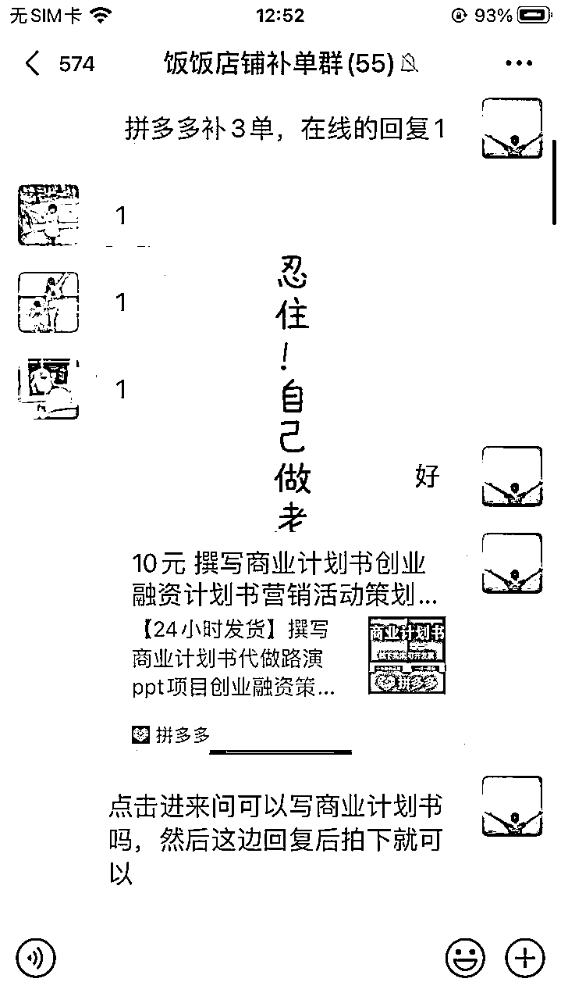
第二天
早上8点100元 下午3点150元 晚上8点200元
第三天
早上8点150元 下午3点200元 晚上8点200元
第四天
早上8点200元 下午3点250元 晚上8点300元

四天为一个周期，营业额递增。第四天后保持该节奏持续刷，稳定数据撬动自然流量即可出单，见效快。

注意：
补单后三天内让刷手签收并带图评价，带图评价至少20条。达标后优先满足小单，尽快做DSR评分。官方要求50条，实际约60条左右会出评分，写作类带图评价偶有无法上架情况。

客服要点
1.前期重成交。多多市场价千字约55元，淡季初期千字30-40元也可成交，前期成长最重要。
2.报价话术：XX元亲，包通过包修改。发送后观察是否迅速已读，若已读迅速追问“您看怎么样？”逼迫回复，避免流失。
3.原创可赠送查重报告，提升感知价值。交付后尽量做降重，免费查重网站出报告即可，提升店铺评分。
4.发货时效：尽量4小时内发货，影响DSR。
5.三分钟回复率核心指标，尽量覆盖8:00-23:00，虚拟店铺数据掉下去较难拉回。

## 2.DSR出分后开直通车

DSR出分后可开直通车获取付费流量，拼多多推广大趋势。全站推广效果最佳，具体步骤：

后台进入直通车
1.先试用200元新手红包

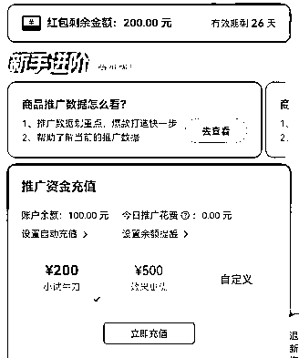
2.选择全站推广，不要选其他

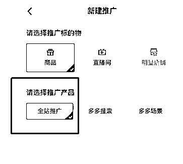
3.出价5元

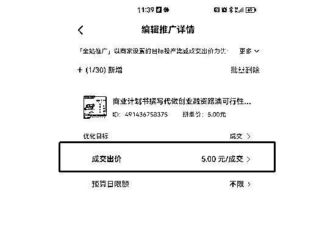
4.推广成功

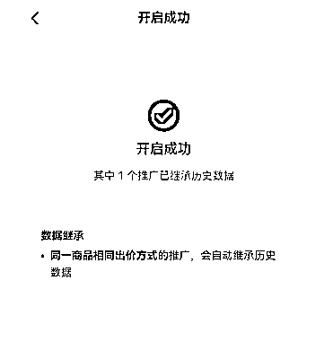

# 5、私域实操路径

### 5.1 私域打造

1.微信形象
【头像】推荐动漫网图
【昵称】xx老师 / xx学姐 / xx学社 等
2.朋友圈封面
与写作相关，简洁清晰即可
3.朋友圈内容
围绕【业务】+【生活】+【感悟】分享
【业务】晒客户反馈、成交图，新手可先搬运同行
【生活】晒旅行、美食等日常美图
【感悟】好书摘录、新闻解读等
目的：让朋友圈垂直有温度，不像营销号，既显专业又像真实的写作老师，提升成交率。

### 5.2 私域维护

1.谈单流程
先沟通需求，再报价。报价前必问三问：
1需要写什么类型、主题、字数、交稿时间
【1】你好，咱这边需要写什么呢？
【2】需要多少字呢？
【3】什么时候要用呢？
问清后再报价。可提供报价表供参考

2.常用话术
平台转私域的客户精准度高，容易成交。针对常见异议准备话术：

客户A，我方B
【客户嫌贵】
A:你这个太贵了吧！
B:有点超预算了是吧，我这不算最贵的，但也绝不是最便宜的，我能保证的是质量过关。
A:还是有点贵，考虑一下
B:好的嗯嗯【紧追】方便说下预算范围吗？

【客户担心被骗】
【1】平台保障
A:到时候收钱跑路怎么办？
B:理解，这个顾虑很正常，我们走店铺下单，平台担保，保护您的权益。
【2】先付定金
A:你们这个到时候收钱跑路怎么办？

有客户担心中途被放鸽子，这样的顾虑其实很常见，我们也时常听到有人在别家下单后被写手跑路的案例。为了解决这个信任问题，我们这里采用先收60%定金的方式，稿件完成后会把录屏的源文件和查重报告一起发给客户验收，确认没问题再支付剩余尾款。

### 5.3 私域裂变玩法

1. 文案吸睛
在平时的朋友圈动态里，可以适度加入一些互动文案，比如：感谢宝子们的信任，推荐有红包拿哦

2. 谈价顺势裂变
不少客户都喜欢砍价，我们就可以顺着这个点给个优惠，假装很为难的样子请他帮忙介绍几个客户，转化效果非常好，如图：

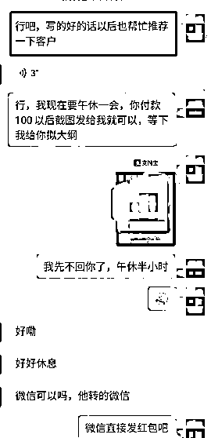

## 6. 用 GPT 提升写作效率

### 1. 先准备好 ChatGPT 账号
在淘金里关于 ChatGPT 的项目、答疑和陪跑已经非常多了，也有不少圈友靠它上岸。账号注册和使用的教程可以在星球文章里找到。这里重点讲的是如何充分利用 GPT 来提升稿件的质量和产出，同时大幅降低写作成本，精准匹配客户需求。

### 2. ChatGPT 常用写作指令模板【设定角色+文章标题+关键词+大纲+客户要求+改稿】

1、【设定角色】首先告诉 GPT 现在你扮演什么角色。ChatGPT 本质上是一个万能文字助手，你可以让它扮演任何身份，通过角色指令让文章呈现更符合预期。

2.【标题】：客户下单时都会说明需要什么主题、什么类型的文章。在描述需求时可以直接把标题或类型告诉 GPT，如果没有明确标题，也可以把零散的白话丢给它，让它帮你梳理总结要写的核心。

3、【关键词】：若客户有指定关键词，先整理好列表，再让 GPT 结合这些词进行创作，让覆盖更全面。

4、【大纲】：每篇文章都可以先出大纲，按大纲写出来的稿子逻辑更严谨、效率更高。先形成一个简洁自洽的逻辑框架，然后让 GPT 扮演编辑、读者等角色，不断优化大纲的逻辑和表达。

5.【客户要求】客户下单前会列出文章的具体要求，整理成要点后在指令中一次性投喂，先把内容填充完整，后续改稿时再增删调整，直至行文更精准。

6、【改稿】：改稿建议分多次进行，每次聚焦不同点，例如一次调整章节结构、一次补充素材、一次统一文章风格、再加入金句、最后检查错别字和标点，直到完全符合客户预期。

目前的 AI 终究是一个大型语言模型，文字偏模板化、缺少温度，最好的用法是把它当工具。GPT 写出的内容不要直接照搬，需要适度润色，让表达更口语化、更有温度。

【5】把模糊需求拆解成详细指令
比如有个客户是做抖音机房搭建的自媒体博主，他要我连载他的招商账号文章，唯一的要求是希望阅读量高。这个需求太泛了，客户自己也不清楚怎么做能提升阅读量。想拿下长期合作，就不能反问他怎么做。遇到这种模糊指令，就需要自己去补全。

操作技巧是：去网上搜索同类型自媒体招商账号的爆文逻辑，归纳出这类博主需要哪些要素，比如吸睛标题、有趣场景、真实的招商案例反馈、具体的实操方法等等，把这些要素整理成指令再喂给 GPT 使用。

【6】借助指令库提升准确度

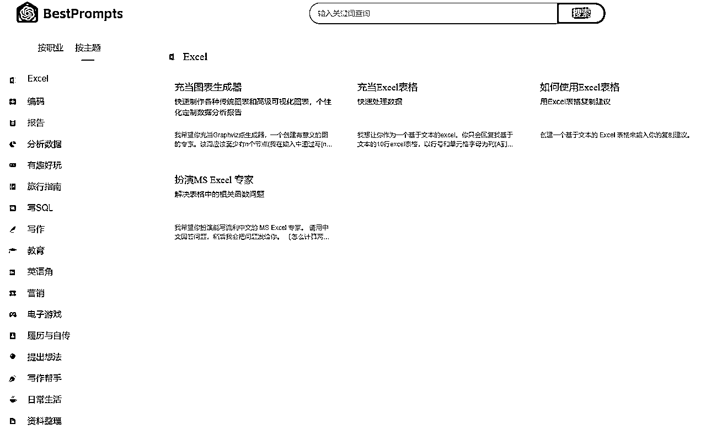

我们也在用的指令参考工具是 BestPrompts。遇到不熟悉的领域，可以直接复制里面的指令模板来提高准确性，注册地址：https://bestprompts.cn/#/index

### 3. GPT 写稿实战演练

指令模板：【设定角色+文章标题+关键词+大纲+客户要求+改稿】

#### 案例1：写演讲稿

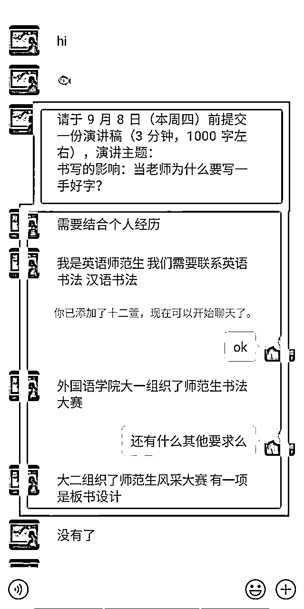

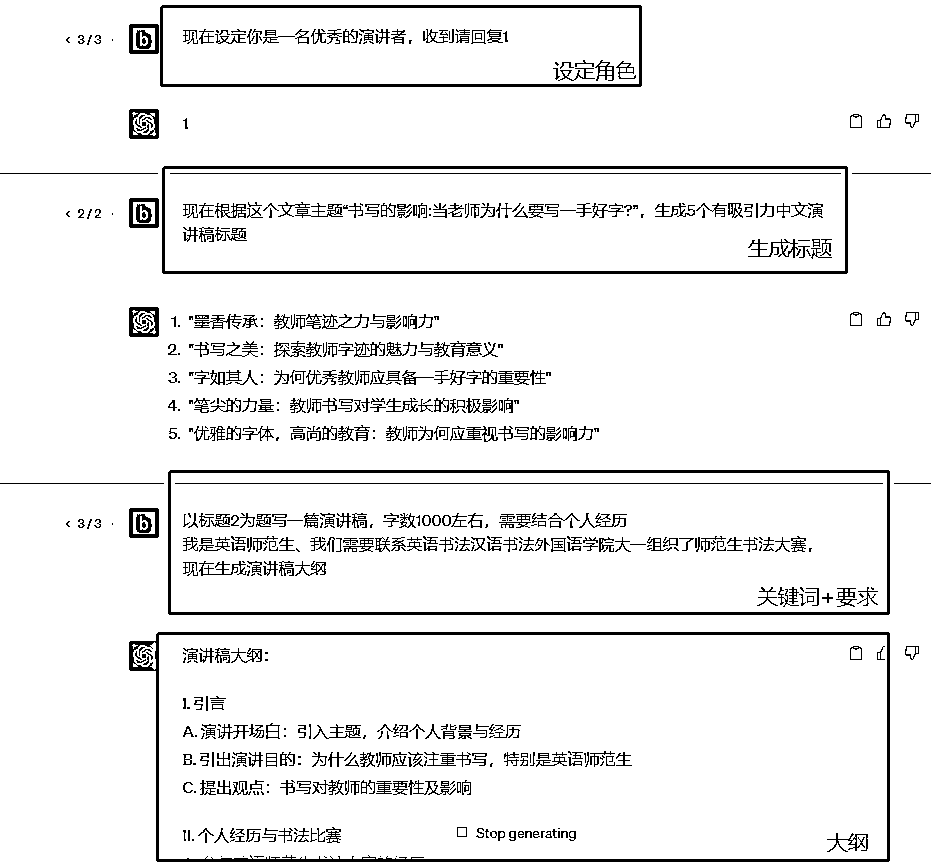

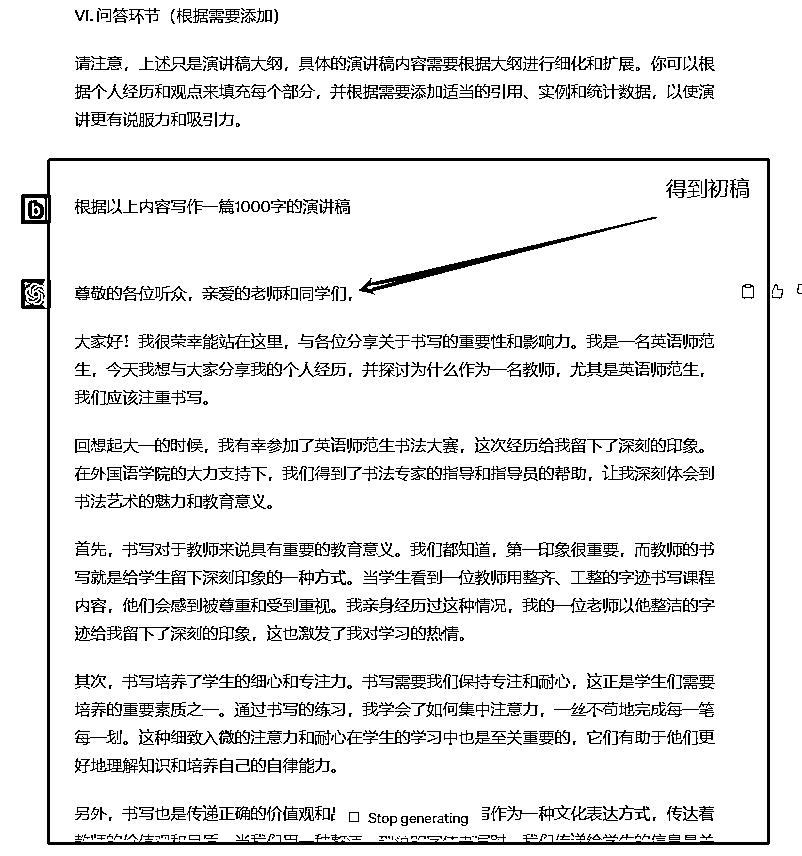

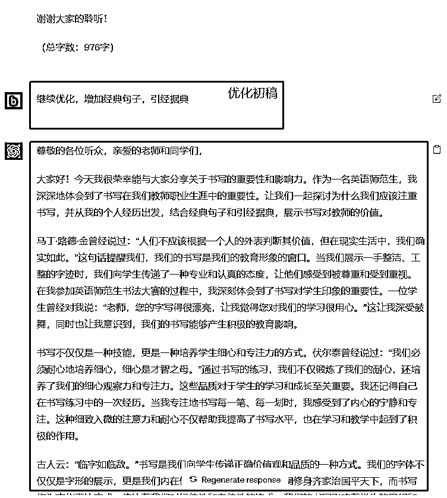

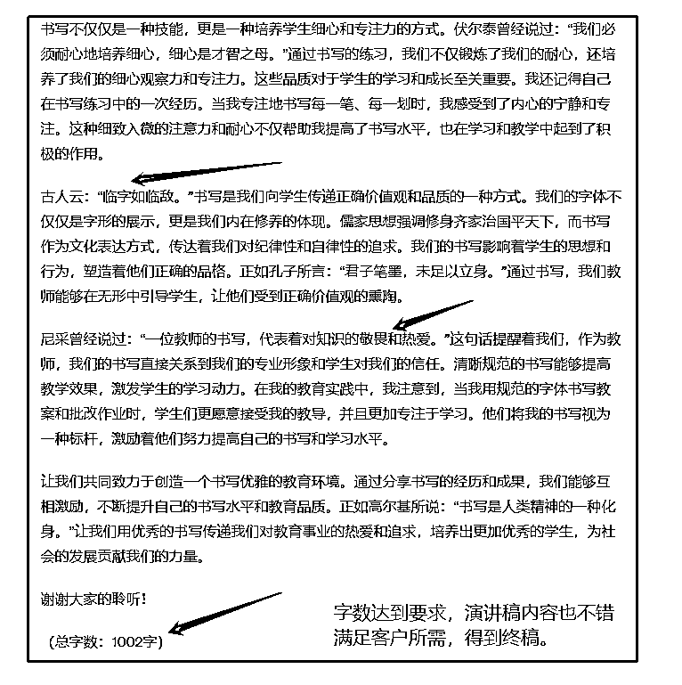

大部分文章其实都是按这个流程来完成，熟练指令后耗时会大幅缩短。

#### 案例2. 写商业计划书
客户给出的要求如下：

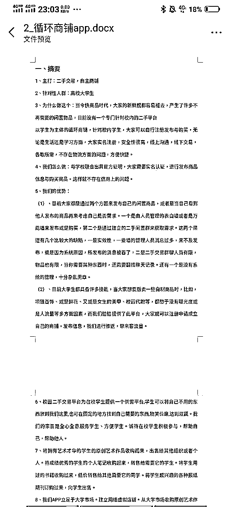

用 ChatGPT 高效写作的具体操作：

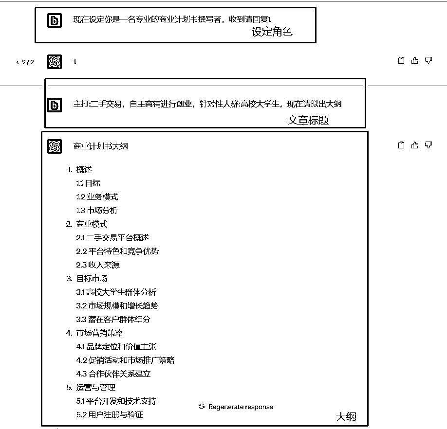

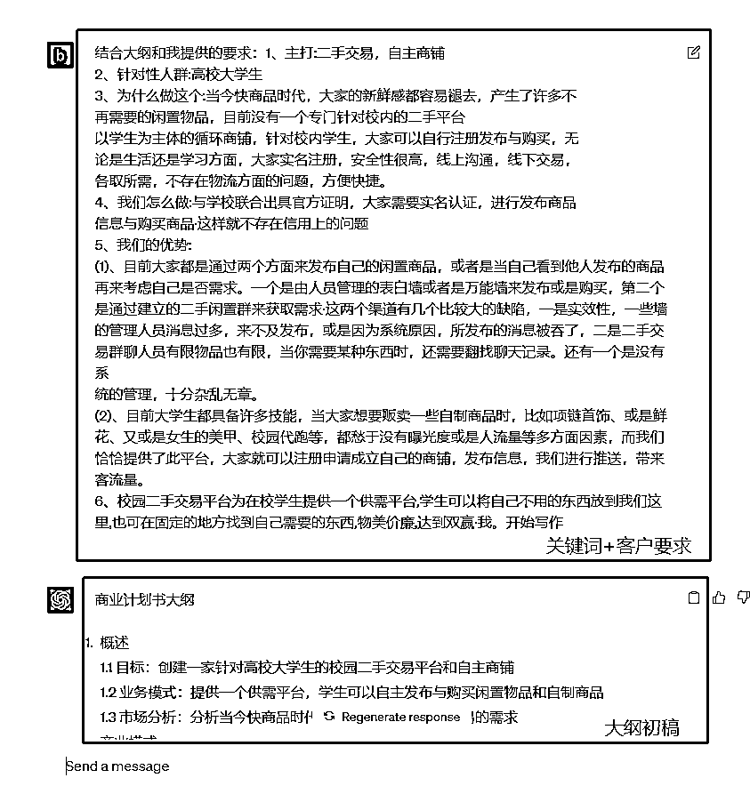

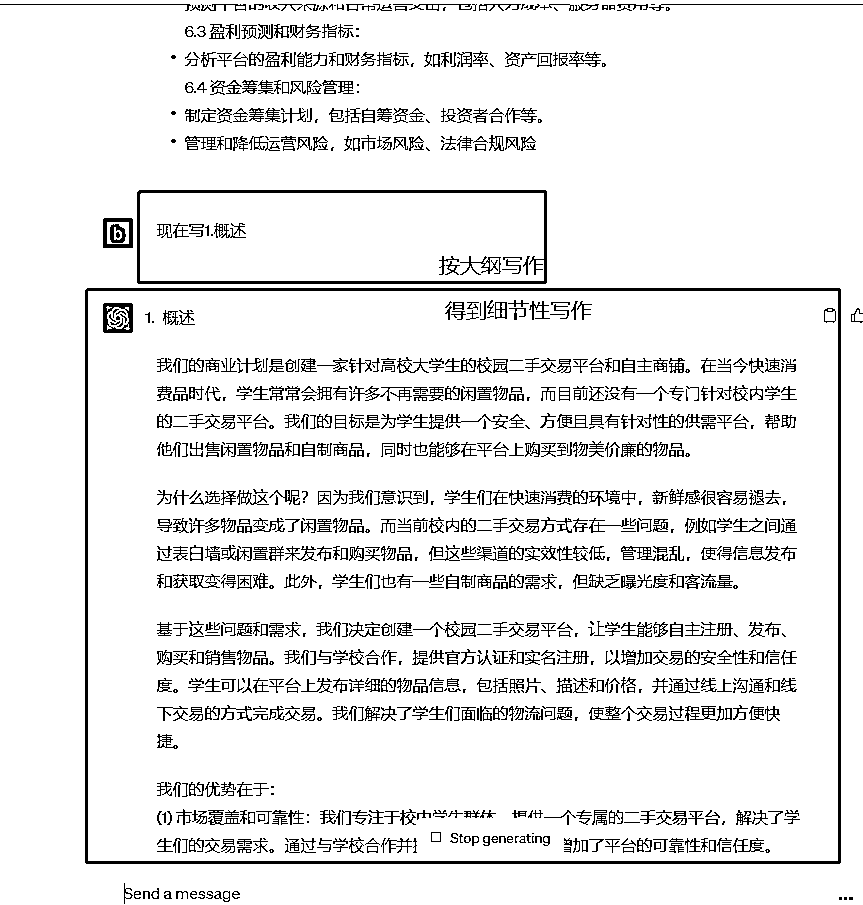

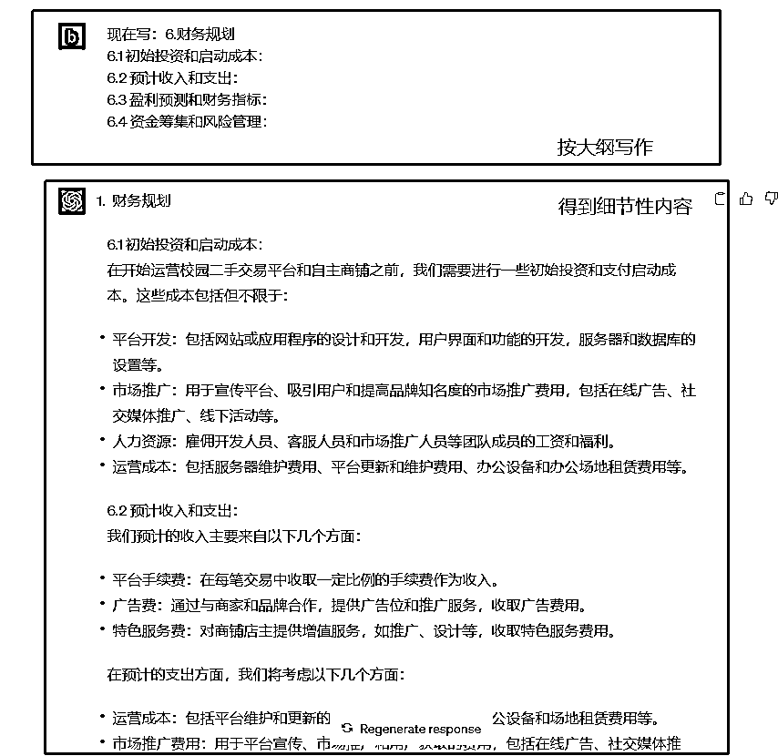

按照客户需求多次迭代指令，就能得到一份详细完整、完全符合要求的商业计划书。

## 4、实战工具清单

1. 拼多多
2. 拼多多商家版
2. ChatGPT 或其他 AI 工具
3. 业务微信
4. 作图软件【搞定设计或可画】

## 5. 如何避坑

1. 严格识别平台禁售类目：只接拼多多允许的文章类目，不要承接学术类文章以及党政相关的内容。
2. 引流素材和方式要定期更换，引流图片要轮换，避免被判定违规。

# 写在最后
用 AI 接单写作是一个非常细分的赛道，感谢赚钱提供的高能平台。通过阅读精华帖学到了很多，也认识了不少圈友。今年的目标是在赚钱破圈，如果这篇内容对你有帮助，欢迎在星球里点赞留言，一起交流~