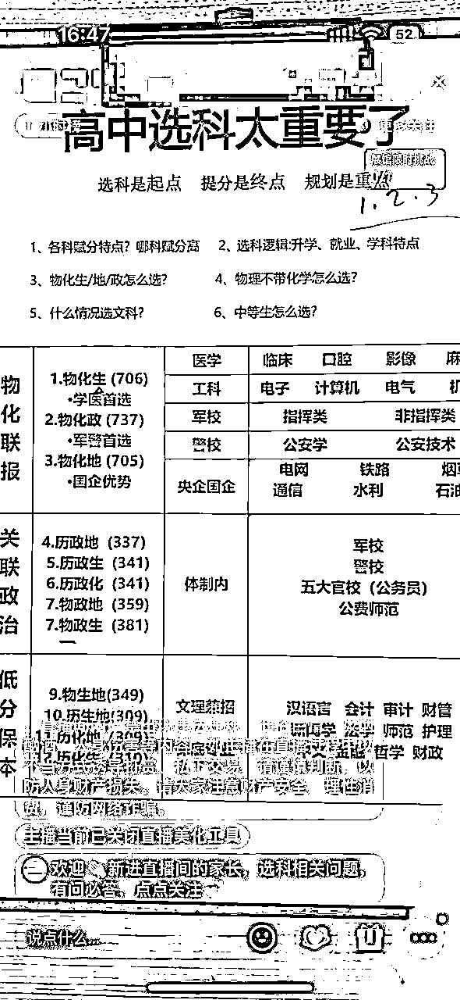
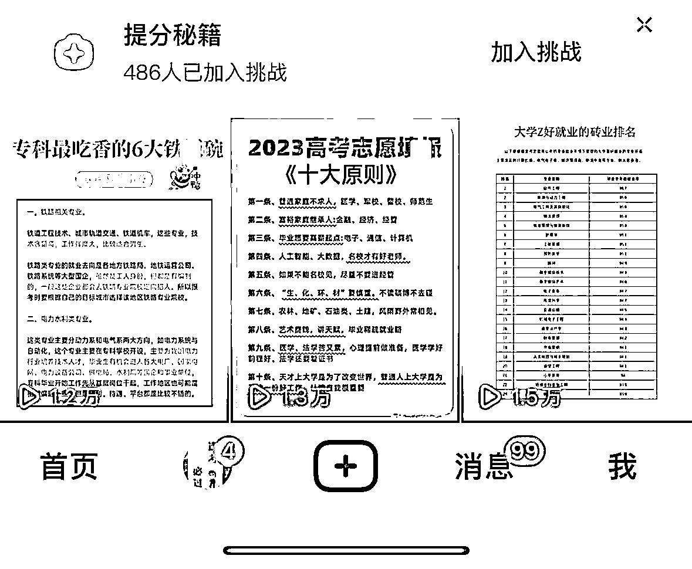
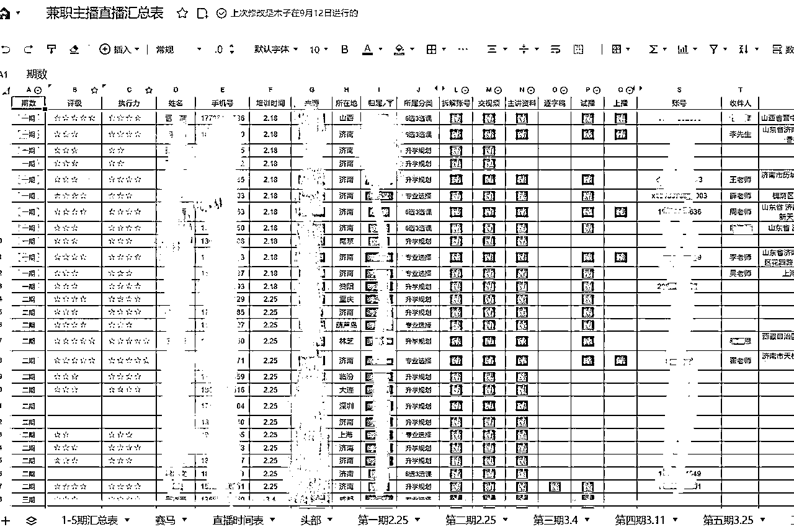
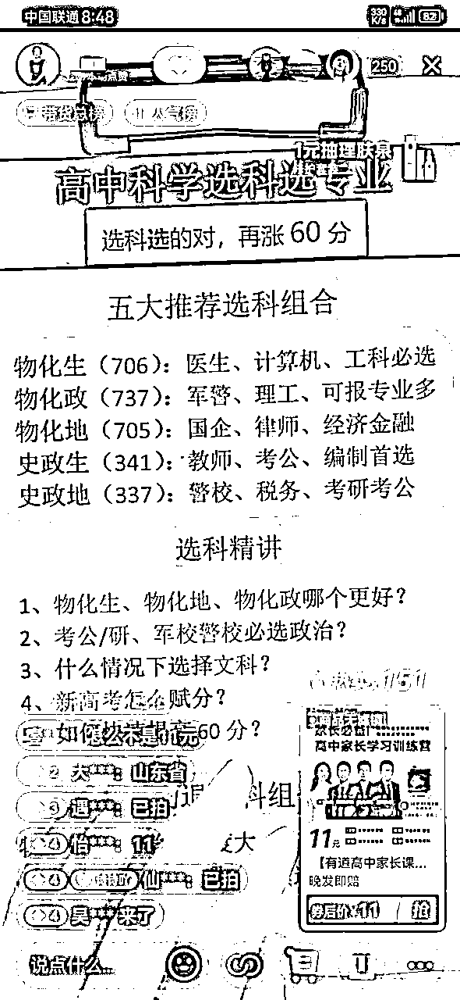
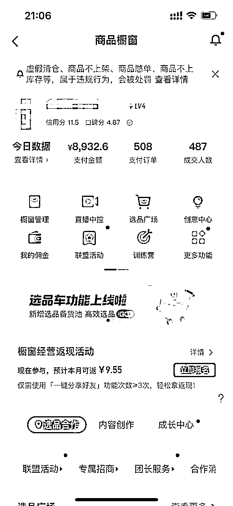
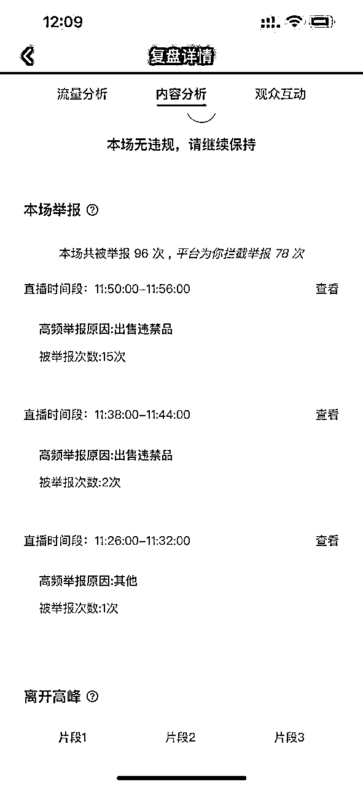
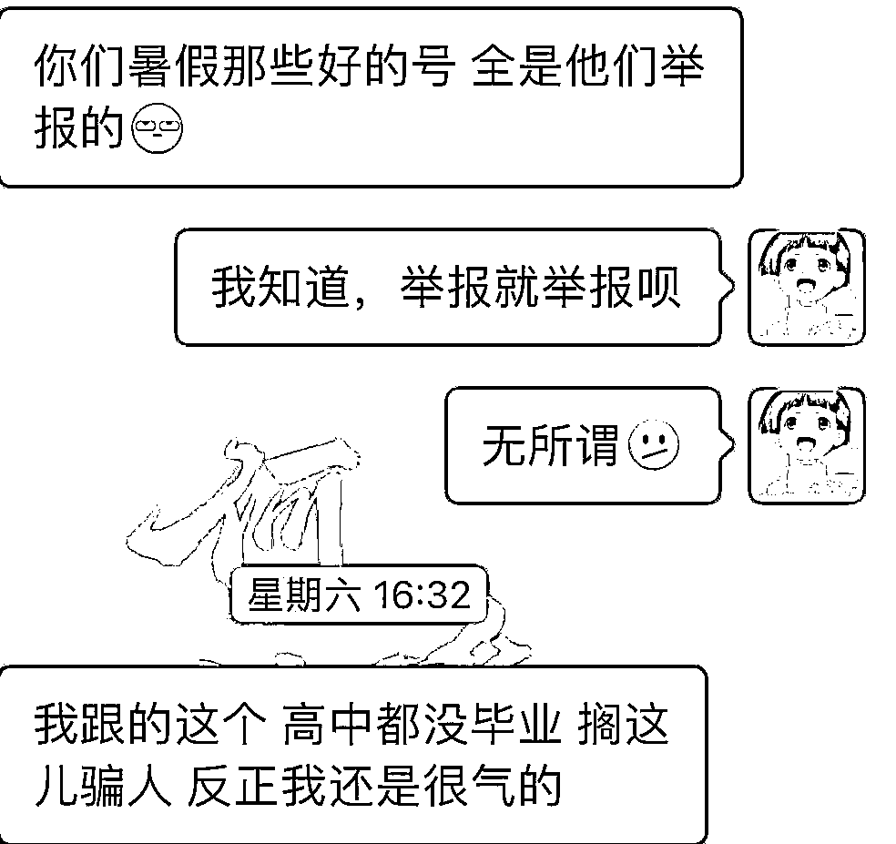

大家好，我是lemon，一个“不务正业”的老师。

2019年我开始疯狂折腾副业，2022年副业收入破了百万，2023年把副业成功转成主业，到今年十月，累计变现已经超过300万。说来惭愧，之前一直在埋头搬砖，这居然是我第一次正儿八经地做分享。

先放张图，简单普及一下什么叫手播。

再说说我的背景。2020年我认识了龙哥盟，默默在朋友圈“偷窥”了鱼丸一年，2021年才正式加入。再往前的副业路径，基本是：私域卖货→闲鱼无货源→抖音短视频，最后在教培CPA小课包手播赛道扎了下来。最近教培行业被压得沸沸扬扬，前阵子鱼丸发了我一份教培转型合集，我才后知后觉：原来我们早就进入下一个“新纪元”了。

先说结果：从2022年高中项目起步，到今年，我在高考升学规划赛道的线上线下已经累计变现300万+，业务链条也全线跑通。成绩不算大，但对我来说已经是个小小的里程碑。

想看更细的拆解，可以结合我之前分享过的两篇帖子一起读，第二篇更偏向教培CPA赛道：
https://t.zsxq.com/11b7Ocfb4
https://t.zsxq.com/0cns8tXdL

## 01 为什么从考研赛道切到高中？

一切的起点，其实是考研/公考小课包直播遇到瓶颈。2022年5月，平台开始对考研低价课限流，当月转化肉眼可见地往下掉。我很快想明白：自己在考研业务上并没有产品能力，与其死磕，不如换个方向。于是综合研究了平台上其他小课包和知识赛道，第一时间把志愿填报板块加进来。当时整个业务流程几乎没动，只是调了调方向。

2022年高考季，因为高中赛道还没有现成的小课包，我们做了一批志愿卡变现，后来又陆续接了一些B端教育公司的咨询服务。这波操作至少保住了当年的营收，但也只是“边走边看”，并没有完全确定扎根方向。这种状态一直延续到今年年初。

## 02 两个月复制近50个直播间

2023年初，各大头部教培公司陆续推出11元、19元的线上小课包，佣金最高给到100元。因为我们在这个领域有经验，顺理成章成了第一批高中小课包的乙方签约机构。有了考研时期的底子，从开播第一天起就拼命做复制，2-3月两个月内，几乎零成本复制出近50个直播间。

想放大一个项目，本质上只有两条路：扩大规模，或者做前后产业链延伸。当时谈产业链太早，于是只能死磕规模——疯狂做内容+招主播。想都是问题，做才是答案。

志愿填报方向在内容上有天然优势：题材多、覆盖面广，能拆成三个板块十几种细分内容，这也就决定了它可以被大规模复制，还能避开一部分同质化竞争。

招主播之前，我先倒推定位：这个赛道的用户是谁？他们喜欢听什么人说、讨厌什么人说？去哪里能找到这样的人？想清楚后，我把招聘思路整体更新，结合年龄、声音、阅历、学历四个维度重新梳理，放弃了之前考研业务里的大学生兼职，直接在Boss直聘上放开多个城市做社招。筛选标准很直接：大专以上学历，声音清脆，最好听起来成熟。由于2、3月求职者多，一周内我筛了几百份简历，一个个电话沟通完，直接进入培训。

当时团队配置非常精简：除我以外，只有2个全职主播、2个运营、1个行政。主播跑基础直播流程，运营配合我做内容生产、招聘初筛和主播带教，行政负责作图和对外对接。

矩阵能快速铺开，两个要点很关键。第一，内容标准化，但那一定是你先把直播间流量跑通之后，才能沉淀出最优标准。第二，业务最小单元切割，所有账号短视频统一由一位运营生产发布，不硬性考核短视频数据，但必须做到日更。我们的短视频内容很简单，就是图文、资料方向。放张图感受下。

基于标准化内容，运营再按SOP跟踪带教。到3月，我们已经组织了4期兼职主播带教，累计120多人，每个技术节点都设好交付标准和考核量。两个月下来，50多名主播顺利上岗。能起这么快，最关键的因素大概是：主播不需要参与内容，只要对着稿子读就行。当时还发过招聘图，可以感受一下画风。

## 03 初见成绩，也看到危机

50多个账号跑起来后，我们按数据挑出重点跟踪主播，只有这批人才会到我这里一对一复盘。短视频、账号管理这些杂事，全部由专人负责。效果也出来了：单个账号最高单场收益做到过15000+，单账号单日最高收益突破5万。

那段日子最让我满足的不是收益，而是团队里每个人都在往前跑，每个环节都能顺利推进。我一直信奉：极致的利他，才能利己。随着业务扩张，赛道里同行越来越多，但我从不在乎被分走蛋糕，钱不是一个人能赚完的，利他+合作才能让行业良性循环。很多同行来加我，问我踩过什么坑，只要聊过的我都照实说。这份“什么都愿意分享”的利他思维，后来也意外引出了一条新路。

业务一路猛涨，管理问题也原形毕露。运营数量有限，外地主播沟通成本极高，对接不及时、节奏拖沓成了常态。最夸张的一次，主播自己不主动，运营想起来时，已经过了一周。这种状态下，团队根本不可能继续扩张。

恰好有同行朋友来找我聊，这给了我启发：既然个体主播能跑通，是不是可以孵化工作室？这样既能缓解团队压力，也能解决外地主播沟通难题。说实话，如果没接触赚钱，这个项目大概率会停在个体孵化这一步。后来的三个工作室，全是赚钱圈友看过分享后主动找来合作的。综合评估后，我在三个城市选了试点。

过程不细说了，直接给结果：三个工作室，一个彻底失败，倒是成功培养出了两个直接竞对。这次经历让我重新审视业务，也重新审视人。想走孵化路线的同行，务必在最初做好人员筛选——不是每个人都适合当老板。而我最大的失误，就是没想清楚长期的双方责权利，没想明白怎样让合作变成1+1>2。明明做这件事的初心是为了解决业务卡点、扩大规模，最后却给他人做了嫁衣。

个人主播那边也遇冷了。一整年跑下来，内容同质化越来越严重，不只是我们自己内卷，全赛道都在卷。7月又出了“张雪峰事件”，平台对志愿规划方向收紧管控。更闹心的是，一小撮恶意同行开始盯着我们的直播间反复举报，最高的单场被举报了100多次，头部账号几乎全部被举报风控，甚至曾经帮过的人也在背后举报。何必呢……

## 04 重新梳理全盘业务

事情发生之后，我开始重新盘点整条业务链。如果要做长期主义，必须选一个我们自己能100%驾驭的产品方向。通俗点说，就算脱离后端机构，咬咬牙也能把产品做出来。我本来就是老师出身，过去在院校、专业、志愿填报上有些积累，方向是现成的。

直播的问题很清晰：可复制性太强，内容没有深度，只靠挂靠单一产品赚收益，注定陷入无休止的内卷。恶意举报这种事，说白了就是在考验人性。同时，线上线下长期脱节——不少同城用户来直播间问志愿填报，我们却没有线下承接能力，只能眼睁睁放弃。

好在赛道本身没选错。只要把产品端补上，就能跳出无下限内卷。这次风波也让我看清团队短板：多数主播只能播，称不上合格的规划师。于是两个方向被定下来：
1. 从简单粗暴的直播带货转向精细化运营，团队自己开发产品，用产品差异化对抗内卷。
2. 收费孵化独立规划师，一起承接从线上到线下的流量。

## 05 深度市场调研

想法归想法，落地前得先验证。我以独立规划师身份跑去跟几家线下填报机构聊了一圈，发现行业最大的痛点是规划师严重不足，尤其是暑期高峰期。但这反过来又是优势：一位规划师能服务的学员数量是固定的，所以这本质上是弱内卷行业。

一句话总结：落后的生产力，跟不上行业发展的速度。而且这个行业目前只有头部IP张雪峰，没有头部机构。空白市场明摆着，还特别适合个人IP生长。看一组数据：

教育部数据显示，2023年高考报名人数达到1291万人，比去年增加98万人，创历史新高。这是竞争空前激烈的一届，也是格外曲折的一届：他们经历过中考延期，高中三年大部分时间都在疫情中度过，同期毕业的大学生又撞上就业难。于是“高考志愿规划师”成了热门职业。我们调研到，今年高考志愿报考市场的人均单价基本到了5000元以上。艾媒咨询6月8日发布的报告显示，2022年中国高考志愿填报市场付费规模为8.8亿元，预计2023年达到9.5亿元。

只看数据还不够。当时正好卡在暑期填报季，我立刻给团队伙伴和几位兼职主播做专业培训：两周高强度学习，反复模拟填报、出方案实操。5个同事学完后，直接去招聘市场应聘兼职规划师。结果验证了猜想——市场需求真实存在。一个月填报期，每人挂靠在线下机构服务了20多个学员，个人提成超过5万。

## 06 个人看法

目前高中规划行业基本都集中在线下，线上业务几乎为零，独立规划师在线上活跃的更是凤毛麟角。90%的规划师都是线下作业，独立规划师通常也在暑期高峰前挂靠机构，机构负责招生和落地服务，规划师负责专业报考。

这恰恰是个人IP最好的赛道。张雪峰虽然只有一个，但他能服务的人数有限，所以注定还能跑出很多“小张雪峰”。个性化+内容深度，这两者构成了极佳的土壤，特别容易“造神”。内容有深度，意味着有门槛、可持续；个性化则意味着不同风格的规划师都能找到自己的受众。用户的个性需求，也正好给了规划师IP塑造和变现的抓手。

## 07 整装再出发

基于这些判断，我们把志愿填报项目彻底重构。放弃了过去覆盖全国流量的基础内容，改成按省深耕当地院校专业，并分省录制对应的家长规划课程。直播间也不再只卖小课包，而是注入了多元化产品。这么一来，每个直播间几乎都是本地流量，再导到私域，直接转化志愿填报和高价升学产品。

同时，我们开设独立账号，招付费规划师，提供线下专业+流量培训，一同售卖自主研发课程、共享流量。这与之前孵化工作室的差异很明显：一是不同地域、不同直播内容，从根上对抗同质化和内卷；二是产品从甲方小课包换成了自有课程，相当于我们自己变成了甲方；三是因为有了多元升学渠道和填报服务，我们和规划师之间的关系，变成了相互不可替代的深度绑定。

这两个新业务还需要更长时间跑数据，之后有机会再细说。

今年只剩最后两个月了，回头一看，整个过程还挺有意思。我对创业和项目也有了更深的理解：如果追求长期主义，一定要有属于自己的产品；当然，如果只求短期快钱，中间商确实是攒第一桶金最快的路子。可长期来看，还是那句话——先跑通0-1，之后的1-100自然会有方向。中途难免踩坑，也难免要调整节奏，但这本来就是成长的一部分。

一起加油。