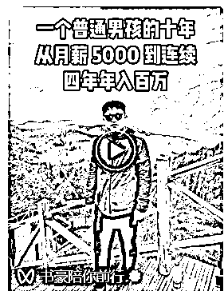
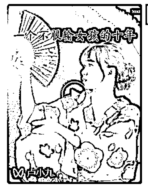
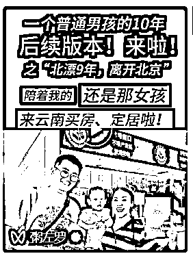

# 从零好友到四千人私域朋友圈实操笔记

> 原文：[`www.yuque.com/for_lazy/thfiu8/spn9g2tuegarkhp7`](https://www.yuque.com/for_lazy/thfiu8/spn9g2tuegarkhp7)

大家好，我是挽歌。03年985毕业，2023年入局私域做IP个人品牌，全靠私域闭环运营，从一个零好友的小白起步，到现在朋友圈沉淀4000人，付费用户接近3000，近一年营收逼近百万。

今天拆解我私域运营三大核心之一，朋友圈怎么玩才能变现。

想先了解我的整体方法论，可以先看这篇汇总：[`t.zsxq.com/15ZzRNyDn`](https://t.zsxq.com/15ZzRNyDn)

# 一、朋友圈到底为啥要发，到底发点啥

**私域是一家店，朋友圈就是店门口的招牌。**

想把生意做成，要么主动私聊拉客，要么建群集中转化，要么就靠朋友圈持续发声，让路过的熟人知道你是谁、在干嘛、能带来什么用处。

私聊转化门槛高，容易被拉黑，转化也低。社群运营门槛更高，耗精力。真正人人能上手的就是朋友圈。

判断一个人的朋友圈够不够格，核心就看广告打得清不清晰。

**广告就是广而告之。让人快速知道你、你的观点、你的产品。**

朋友圈运营做得好的账号，别人一眼就能读懂他的IP定位、性格气质、三观立场、主推产品。

所以朋友圈要发什么，方向很明确：

1.你本身：你在外界的呈现是什么样，身份、动作、面貌、日常、认知、格局
2.你的观点：你眼中的世界观、人生观、价值观、金钱观、感情观
3.你的结果物：你能给对方什么，时间、注意力、信任、金钱、影响力、技能、项目、认知

这三类看起来很多，但要赚钱就要做选择性输出：

1.你——展示更优质的侧面：清醒、独立、优秀、正能量、从容、勇敢、拼搏、热情、谦逊
2.你的观点——展示更有价值的视角：相对正确的三观、深刻的思考、理性的判断
3.你的产品——展示更有吸引力的供给：稀缺时间、稀缺关注、坚实信任、稳定收益、强影响力、硬技能、可复制项目、领先认知、商业思维与嗅觉

归根结底，个人品牌、IP、超级个体，就是**一个人在外界投射出的正向真实形象的重合处。**

举个例子：

你的全世界是集合W，在不同人眼里你是W1、W2、W3……
你在A眼里是W1，在B眼里是W2，在C眼里是W3……
所有人眼里的你 = W1+W2+W3… = 你真实世界投射的合集。

如果投射五花八门，既有好也有坏，那就是普通人。IP和品牌之所以能被记住、被追随，是因为**纯粹且高级：纯粹让人记住，高级让人追随。**

怎么做？

**让自己足够纯粹，形成强共识；让自己足够美好，形成强追随。**

这就是我对IP塑造的理解。个人IP的定义：**一个人的正向真实世界的投影的交集。**

所以别指望别人能看懂你全部，你只能做到让关键的人看到你关键的面。

# 二、发圈前先把地基打好

## 第一步，先定好朋友圈定位

做IP和做自媒体最容易卡的就是人设和内容定位反复横跳。

定位怎么做？

### 选赛道，先选对池子

一个可持续的赛道通常满足四点：

1. 你感兴趣：没反馈没钱的时候你也愿意干，不会被磨死
2. 你有能力：在这个赛道能做到前20%，有天赋或足够努力
3. 能变现：有真实的付费意愿和支付能力
4. 有持续性：用户来了能沉淀，能复购，而不是一次性交易就流失

定好赛道后，再往下细分到**能解决的具体问题**。

赛道太宽，无法起手。必须细分问题：**从问题找定位，而不是从答案找问题。**

用户买的从来不是产品，是解决方案。

比如：
朋友圈运营教练——解决朋友圈变现问题
网络社交教练——解决破圈人脉问题
化妆师——解决形象提升问题
摄影师——解决拍摄学习问题

钱来自客户需求，定位就来自客户需求。

最后提醒：**别纸上谈兵，先上手试错。**有大致方向就去实操，通过用户反馈和自身感受不断迭代。

### 第二步，搭好产品体系

光有定位没用，流量来了要能收钱。

私域要循序渐进，需要三层池子：

1. 流量池：承接并留住流量。免费池可以是个人微信、免费星球、免费群、公众号。付费池是几块到几十块的付费群/星球。
持续用朋友圈、星球、公众号把免费用户激活到付费。

2. 转化池：低价到高价的中间产品，通常是几百块的社群、课程、训练营。作用是筛选铁杆，性价比做到同行最低，交付做到最好，让用户认可质量，进而愿意付更高价。

3. 付费池：高客单的成交池。**圈人就是圈钱。**
高客单尽量不做1对1，用社群杠杆放大交付，一次交付多次收益。

### 第三步，设计好流量方案

先回答七个问题：
1. 流量在哪
2. 他们有什么特征
3. 他们有什么共性
4. 他们共同需要解决什么
5. 需求够不够强烈
6. 你的产品能否满足
7. 你有没有能力让他们买单

搞清精准人群后，再做引流：**用内容匹配共性需求吸引精准用户，留下公域转私域的钩子，导到你的流量池。**

赛道、产品体系、流量方案、转化运营，环环相扣。心中有这套闭环，知识付费才会事半功倍。没有闭环，就是瞎忙。

准备完再开始发圈。

# 三、朋友圈运营要重视附加价值

朋友圈营销的本质是建立情感连接，给到极致的用户体验。

工业时代讲功能：属性、优势、好处。够用就下单。
互联网时代讲体验。功能同质化，用户选择太多，凭什么在你这买？

朋友圈的存在就是社交场，卖货靠的是情感体验感。**用户现在买的不只是使用需求，还有强烈的情感诉求。**

产品只能触达心灵，提供超越商业本身的价值，才有机会。

以前的商业：你卖货，我买货，交易结束。
现在的商业：同款到处都有，为什么要在你这里买？你得给我额外赠品——附加价值。

附加价值可以是：
知识：让人成长
娱乐：让人快乐
情怀：让人感动敬佩
救赎：让人被治愈
震撼：让人印象深刻
进阶：让人格局打开

这也是我一直说的：私域第一步卖自己，第二步卖观念，第三步才卖产品。用户买的是解决方案，下单需要理由。

附加价值既是品牌存在的意义，也是用户下单的依据。

买豪车买的不是车，是身份、地位、面子筹码。买产品也在买附加的意义。

做个人品牌就要打造强附加价值，让人一有需求就想到你。做朋友圈营销就要从附加价值入手，给足理由让人非你不可。

这需要**俘获心灵的能力**。

# 四、怎么俘获用户心灵

### 1. 传递价值主张

最高级的营销是价值观营销。

比如：赚钱的“谈钱不伤感情”，公众号的“再小的个体也有自己的品牌”，脑白金的“今年过节不收礼”。

价值主张就是在无声处给用户植入成交密码。告诉大家你存在于他生命中的意义。

当你的价值观成为共识，你的成功就是大家希望看见的，你赚钱就是大家乐见其成的，成交、裂变、转介绍自然发生。

### 2. 讲一个让人记住的故事

非凡的故事比干巴巴的事实和观点更有说服力。

把你的成长故事讲好，让陌生人也能快速共情。

案例形式：
· 人设长文：记录创业经历与感悟
比如这篇精华帖：https://t.zsxq.com/15ZzRNyDn
· 【我的xx十年】系列视频
比如：

1. 还有很多，不一一列举。

朋友圈就是你的故事日历，要做成让人追更的剧集。

记住：做IP的人，要做自己人生的主角。

怎么讲好？三个关键词：**持续记录、与众不同、波澜起伏**

传递改变与向上生长的力量。人们需要案例：逆袭、改变、绝境逢生、逆向生长。

活成别人向往的样子，比普通人多一点：更努力、更强大、更坚强、目标更高、更浪漫、更热爱、更坚持。

多一点就是起点。个人品牌不难，难的是时间壁垒。

如果你不甘平庸，就讲好蜕变、高光、低谷，让自己成为别人的光。

### 3. 创造终极用户体验

交付本身就是最好的代言。

1. 靠谱：承诺即兑现，长期稳定高质量交付
2. 溢出价值：建立情感连接，定制、专属、仪式感、惊喜感
3. 用户视角：站在买家角度思考期待和需求，不断升级产品
4. 可沟通性：让用户感觉被重视、被用心对待
5. 亲和力：友善好沟通

### 4. 修炼表现力——文案的王炸

表现力分四层：表面力、表象力、感染力、表现力。

表面力是排版数量，表象力是情感感觉，感染力是引发共鸣。

**表面力+表象力+感染力=表现力**

真正打动人的文案，是发自内心的表达。极致绚烂来自极致用心。

动之以情，晓之以理，这是我朋友圈成交的核心心法。

分享就到这里，欢迎一起龙哥盟！

* * *

评论区：
挖哈的阿抓 : 666

今晚的交流氛围挺热闹。

烽狂创客创始人挽歌先是随口关心的发了一句，还没躺下吧，哈哈。

胡意甜立刻回了个6666，说内容全是干货，收获很大。

挽歌随后回应，自己经验还是有限，哪里说得不对的地方欢迎大家多提点。

紧接着又补了一句感谢认可，态度很谦逊。

阿叶在下面刷了个举手加火焰的表情，气氛一下子就被点起来了。

拾一则连发了四个强，认可度拉满。

♻️李拜五💥则抛出了一个很实际的问题，想了解这波流量的主要来源是哪里。

* * *