# 快手无人直播单月净利20万的操作复盘

> 原文：[`www.yuque.com/for_lazy/thfiu8/cqeo3e0hvor3ixlt`](https://www.yuque.com/for_lazy/thfiu8/cqeo3e0hvor3ixlt)

## 快手无人直播月赚20万 真实复盘

作者：书豪
日期：2023-12-15

各位好，我是杭州的书豪，目前带小红书店铺和直播航海班。上个月跟龙哥哥深聊后拿到了微天使的资金支持，很感谢龙哥盟让我正式进入电商赛道。

随之而来的压力也很大，不想辜负这份信任，最近一直在多平台多赛道做验证。

圈内朋友都知道，今年我一直在做小红书电商，操盘30家店铺。笔记带货+无人直播的组合让我实现了七位数回报。

不过从11月1日起，做小红书带货的都知道，混剪带货笔记玩法开始高危，账号稍有起色就易被判定违规，刚有苗头就被封。

我手里带的是杭州的小团队，不能就这么干等死。

我也是赚钱最早一批尝试小红书无人直播的玩家，当时抓住了窗口期，单个账号最高做到过50万GMV。

但模式极不稳定，封号风险高，属于短平快的现金流。个人练手可以，团队靠它续命就是赌博。

今天标题特意加上“真实”二字，是因为近期看到不少关于快手无人直播的分享，内容跟我实际操盘感受差距较大，不太认同。

尤其是“账号报白”这个说法，诱导性很强，好像拿到报白就能躺赚流量和GMV，报白之后就是捡钱。我会在下文讲清楚报白到底是什么。

这篇把思路和实操全盘托出，希望对做电商的伙伴有参考价值。

目录：
1. 前言
2. 兴趣电商底层逻辑
3. 快手项目底层逻辑
4. 快手无人直播实操拆解

**一、前言**

一边跑小红书自然流一边发现，这套模式波动极大。团队收入时高时低，有时一天能卖十几万，有时零单。

我在想，对小团队而言，什么样的兴趣电商打法才能满足需求：

1. 变现相对平稳，至少能保持2-3个月以上
2. 可以持续盈利

尤其是新手和新团队，成长曲线如果太陡，心态很容易崩。偶尔靠素材运气爆一次十几万GMV，过两天又回零，会让人飘，也会让人看不起每天稳定卖几千上万的项目，最后在追大单里焦虑崩盘。

风起于萍末，浪成于微澜。一砖一瓦打好地基，最后才能聚沙成塔。

在我看来，前期的稳定性压倒一切。

**二、兴趣电商的核心底层逻辑是什么？**

把主流的兴趣电商变现方式梳理下来，大致分两类：短视频带货、直播带货。每类流量路径不同，总结如下：

**短视频带货**
1. 短视频自然流挂车，不开播
2. 短视频付费流挂车，不开播

**直播带货**
1. 直播自然流带货，以广场推荐为主，不发视频不付费
2. 直播付费流带货，以直投直播间为主，不发视频纯付费
3. 直播+短视频自然流带货，以短视频导流直播间为主，发视频不付费
4. 直播+短视频付费带货，以短视频导流直播间为主，发视频纯付费

不论抖音、快手、视频号、小红书，任何能卖货的直播间，本质都能归到这几类。拆到更细，**兴趣电商的本质是内容驱动商业**。

**内容核心能力**
1. 直播内容能力，影响因素：主播、货盘、场景
2. 短视频内容能力，影响因素：脚本、拍摄、剪辑

无论哪种玩法，最后都指向团队是否具备强内容能力，有了才能做稳定、长期盈利。

直播和短视频，单拿一样也能活。两者都具备，才能活得更久更舒服。

9月底深夜，我在狭小的办公室对着黑板画到凌晨，反复问自己：我现在有什么能力？如果两样都不行，短时间内能快速补上来吗？

很坦诚，我两样都不具备。短时间把内容能力练到顶也极不现实。那一刻很沮丧，但现实不等人，要活下去，要出利润带着团队走下去。

小红书的无人直播模型跑通后，我马上意识到这套可以复制到其他平台。如果能把直播和短视频结合，再加一点微付费，是不是就能实现长期盈利？

1. 无人直播=让抖音最顶级的人货场直播间为你打工。
2. 短视频=让抖音最顶级的内容脚本混剪团队持续验证爆款，源源不断吸流量。

两者结合，才有机会做利润、做长期。

说干就干。我对比了四个平台的优劣，最终决定先从快手开始测。

视频号对无人直播和混剪素材管控很严，很容易违规。抖音的无人直播一旦被正主发现投诉很容易下播。小红书人群偏年轻，直播受众窄，付费体系也不成熟。

快手就成了首选。它的优劣势我下面会慢慢拆解。

我拿之前注册的老号，再加上借来的几个号，11月中旬开始测试。选品方向是退货率低的日用百货和服装单品。因为涉及短视频爆款混剪，我找了两个做脚本混剪的号，起号速度很快。

很快就突破单号月50万GMV，2个号30天做到140万，扣除投放、货款、退货后利润率15%，到手净利润约20万。

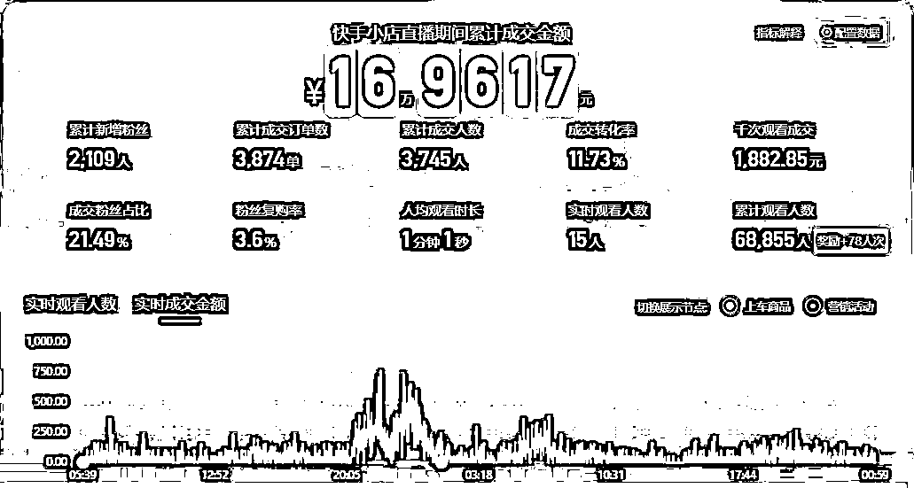

最猛的一场，2天就卖了近17万。

新号起号期是一条条素材慢慢上，权重慢慢拉起来。现在这个品每天稳定卖2-3万。

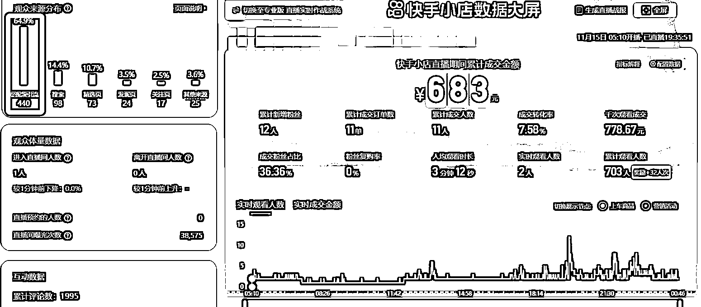

第一天

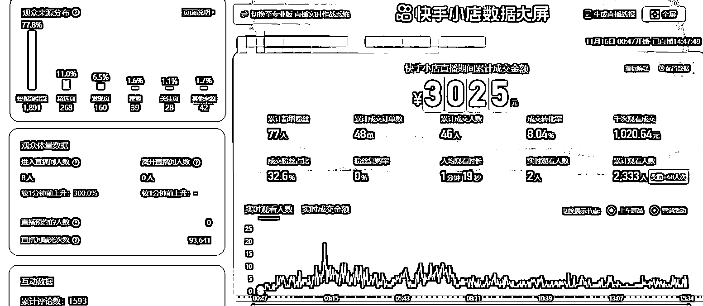

第二天

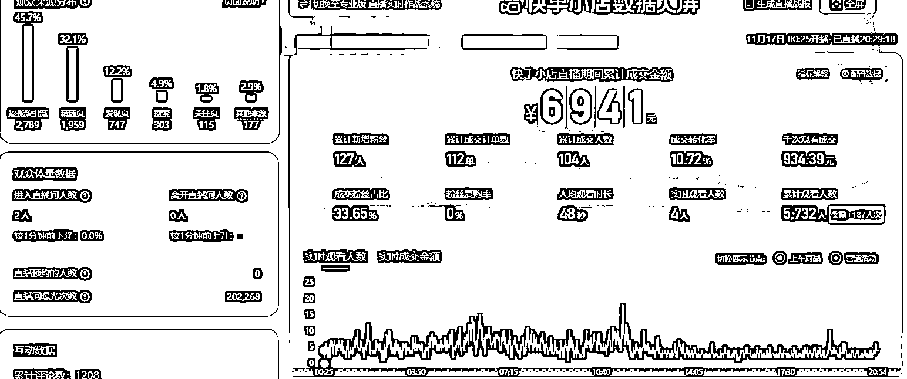

第三天

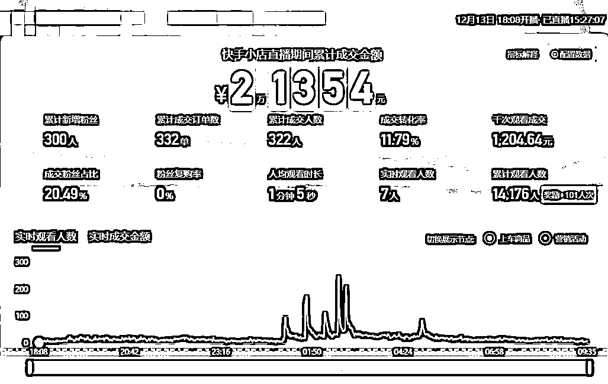

到我写文章当晚的实时销售额

**三、快手项目核心底层逻辑是什么？**

在上手快手前，我特意去请教了@木易哥他们纯付费的打法。他们是纯付费团队，一个月销售额能做到1500万左右，今年累计破一个亿了，在多个类目都是头部。

多谢木易哥介绍了快手内部的直客和小二资源，让项目测试更顺利，也特别感谢@木易哥。

没接触快手前，我的印象和很多没玩快手的人一样，觉得这是老平台，日活不如抖音，资源也不如有腾讯背书的视频号。

**快手平台基本认知**

测试后才发现认知错了。偏见对有判断力的人反而是财富。我先上几个数据：

1、2022年的数据，抖音日活7亿，快手公布日活3亿多，快要接近抖音一半，2023年冲刺4亿。视频号日活约3亿。
2022年快手年度GMV大盘9000多亿，内部小二透露今年已破万亿。视频号今年Q4据说破1000亿。

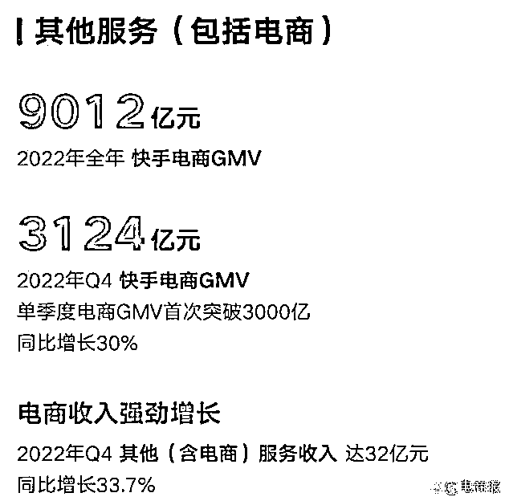

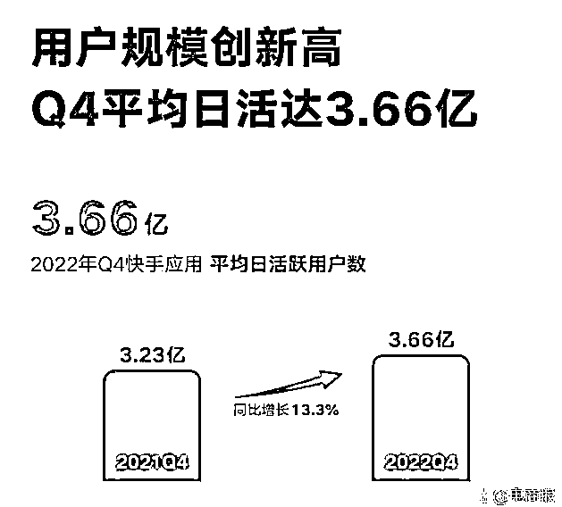

我在江西小县城长大，没怎么玩过快手。来杭州后接触了不少北方做电商的朋友，跟小二、直客交流后才知道瘦死的骆驼比马大，快手这三年依然是兴趣电商的“老二”：

1、快手是老铁经济，也就是信任经济。日活只有抖音一半，但粉丝忠诚度和信任度更高。
2、快手是粉丝经济。达人粉丝够多时，短视频和直播流量分发并不会像抖音那么极端中心化，中心化程度大概只有抖音的60%左右。所以很多达人在快手活得滋润，不去抖音内卷。同量级博主，排除顶级网红，百万粉左右的快手博主收入是抖音的2-3倍。
3、冷知识：成龙、周杰伦都没有抖音，因为被快手独家签约了。快手当年下沉市场时花大价钱签了不少老牌明星，所以很多明星线上演唱会在快手举办。
4、快手消耗返点是各平台里最高的，新号能到24%，老号开店3个月以上也有12%。按一天消耗10万算，即使前端不赚钱，后端返点也有1.2万。在现在这个卷的环境下，这就是快手还能赚钱的原因。

**快手运营层面的基本认知**

**1、小二直客体系**
小二和直客体系跟抖音类似，但快手直客权限更大。关系好的直客能拿到真实投放数据，有助于选品和投放策略。
而且快手没有蝉妈妈、考古加、有米云这种完整的第三方平台，销量排序、达人排名、投放素材都查不到，必须靠内部直客。

你跟直客的关系，基本决定你在快手能活多久、活得多舒服。对抖音这种去中心化平台是双刃剑。

劣势：对没有直客资源的新人很不友好，违规了没人处理，号可能就废了，后台申诉入口也不多。
优势：有资源和信息差的人，可以避开竞争对手，在小赛道闷声发财，内卷程度远不如抖音。

**2、账号风控解除，也就是账号报白**
最近很多帖子说有官方报白资源，报白后永远不死号，这个说法是错的。

也有很多人问我，有没有报白功能就能不劳而获拿流量、拿GMV，报白后直接捡钱。

真相是：快手确实有直客报白的操作。当账号出现违规不知道原因时，直客可以查到具体违规原因并给出解决办法，处理完后人工提报，加快后台人工审核，恢复流量和权重。

并不是报白后就可以乱来，话术违规、录播违规、素材违规照样会被处理。

举个例子：账号因为录播违规，后台磁力金牛会提示账号负向，自然流停止推荐。

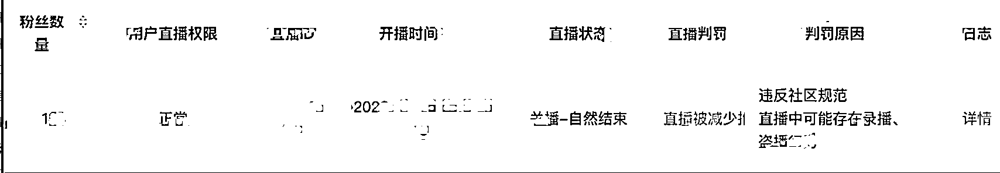

系统会判定这场直播有录播、盗播行为，减少直播推荐，自然流没有，付费流量也会受影响，默认处罚是减少7-30天的流量。

这时找直客做人工报白，可以提交非录播证明，做一套申诉材料，让人工快速加白，把机审违规去掉，账号当天恢复自然流和付费流量。

这个申诉是有方法和技巧的，就是用来度过一次风控。但下次再触发规则，该罚的还是罚，只是又可以去申诉。

外界把这个叫做账号加白、报白，其实就是人工解除风控，针对单次违规的申诉。

**3、流量分发逻辑**

**直播流量分发逻辑**
基本和抖音、视频号一致，核心看人货场。量化指标有：直播间进入率、停留、互动、商品点击、点击转化、GPM等。
在某个平台验证过的人货场，通常在其他平台也能获得一定自然流。这里主要打的是短视频导流直播间的模型。

**短视频流量分发逻辑**
和抖音、视频号不太一样。抖音素材一般发后台隐藏，用千川投放，自然流拿不到。
快手不一样，硬广素材发在主页也会有自然流量，哪怕很硬，至少有5-10%。
如果产品和脚本形式符合自然流分发模型，就可以用微付费或半付费方式不断激活自然流量，比例甚至能到50%以上。
具体什么内容在快手更容易拿自然流，我会在实操里用案例讲。

**4、短视频纯付费、半付费、微付费、纯自然的区别**
快手平台主要看三个维度：产品、内容脚本形式、付费出价。

产品维度：竞争对手少，OCPM竞价不会卷到极致，自然流就会存在。但滋补、养生、个护美妆等高毛利品，比如功效食品利润能到80%，就别指望自然流了。

内容脚本形式：快手人群相对下沉，年龄偏大，跟视频号人群类似。所以吃长脚本，引流+过渡+转化结合的形式更容易获得自然流。

付费出价：如果产品和内容具备自然流基础，就可以适当降低出价，减少付费占比，提升自然流比例。号起来后很好控制。

所以这三种打法没有绝对好坏，必须基于产品、内容、出价三者齐备。天时地利人和都齐了，自然流才极致，不是靠投放技巧或人群包就能解决的。

**四、快手无人直播保姆级实操教程**

我手上还有两个在跑的产品生命周期还长，利润不高，一个品赚8-10万，每天2000-3000块，但最怕竞争对手涌入把自己卷死。

感兴趣的可以私聊我，我可以发素材框架。

今天拆解的实操案例是一个同行打了近半年的小家电品。无人起号-真人接大流量-平稳期切回无人做利润。现在想卷他也不容易，账号粉丝已经累积80多万。

通过直客查询，从起号到现在，账号累计真实净利润保守300万左右：

1. 销量：44万单
2. 平均客单：64元，价格带59-69元
3. 后台投产：前期真人打时付费投产5，自然流占比30%，近期付费投产3，自然流占比20%

按1688价格算，除掉真人主播开销，利润非常可观。更关键的是产品能持续播到明年，每天只上传30-40条爆款脚本混剪就行。对我来说这就是最有吸引力的模式：高效、长期、成本低、利润高。

**1、怎么判断账号是不是录播？**
如果没关回放，可以直接看回放。同一场直播主播衣服、发型、话术都不变，就基本是录播。
如果关了回放，可以进直播间假装买家提问，真人主播都会回复，比如发货地、能否用、怎么用之类的问题。

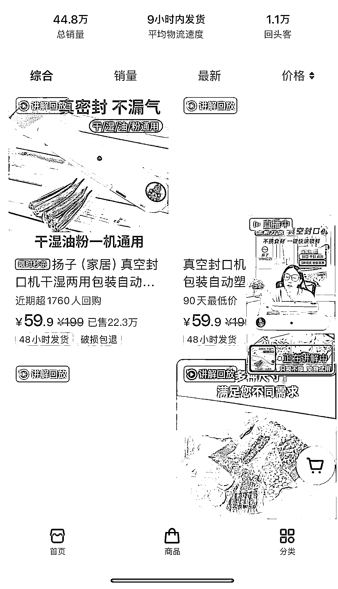

**2、选品**
工具可以用考古加、蝉妈妈，考古加相对便宜。
选品标准：
1. 直播占比70%以上
2. 后台主要流量结构是短视频引流
3. 利润率50%以上
4. 客单价29.9-150之间，太高无人直播转化差，太低决策成本低，无人和真人转化区别不大
5. 最好是7-30天的新品，自然流起得猛，或者快手没人卷的赛道

打开考古加或蝉妈妈，优先看食品、日用百货、服饰单品、小家电3C类目。

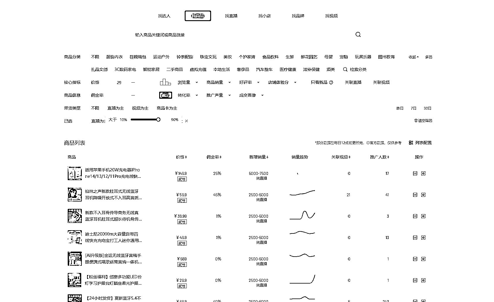

确定产品后，去1688或拼多多确定代发利润。起量后代发价格比拼多多便宜10%-20%就是最终成本价。

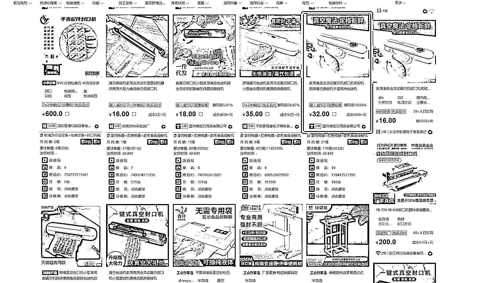

# 快手无人直播带货全流程拆解：从选品到稳定出单的实操手册

最近不少朋友在问快手无人直播到底怎么做，今天就拿我们正在跑的一个品，完整拆一遍整个链路。不敢说是什么高明玩法，但每一步都是真金白银跑出来的，希望能给想入局的朋友一些参考。

## 一、选品与定价：先算清楚账再动手

就拿真空封口机来说，这个品我们分了几个规格。快手这边目前的投放成本是19块钱，配上保鲜膜之类的赠品，代发综合成本在28块上下。抖音上同类产品定价普遍偏高，但快手的人群属性不太一样，价格可以灵活一点，根据目标人群做些调整。只要利润率达标，就可以联系直客帮忙查一下快手的投产比和自然流占比，这个数据直接决定了后续能不能干。

## 二、素材调研：用有米云挖爆款

产品和账号确定之后，第一步是去有米云看抖音上这个品类的素材量级，以及大家都在用什么样的混剪框架。

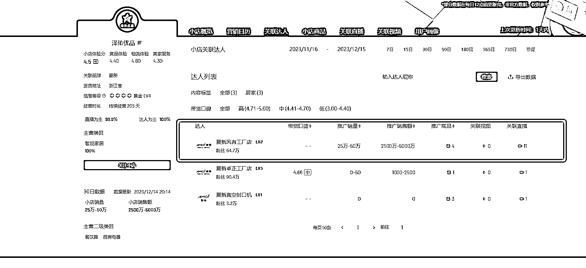

把达人账号名称输进有米云后台，就能看到他们投千川时隐藏起来的90%素材。

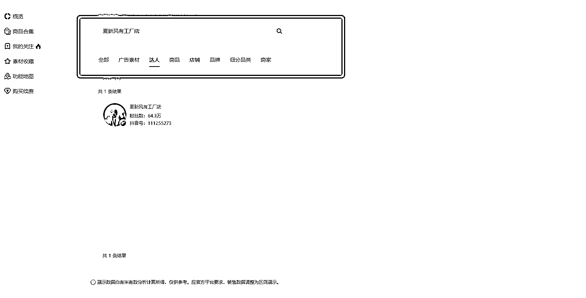

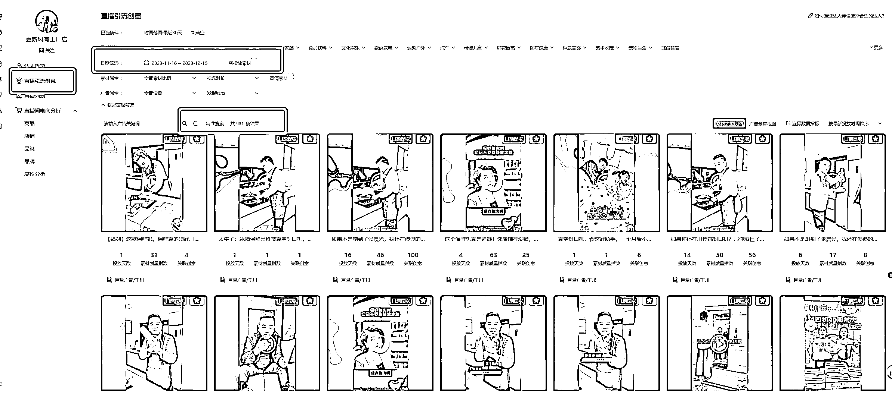

你会发现，这个账号最近一个周期里挂了900多条在投素材，右侧按投放条数排序，基本就能圈出10到20个爆款脚本。千川计划拉得越多，说明这条素材的数据越好——有量有投产，系统才会反复去跑。

下载素材用猫抓小工具就行，每次能批量抓64条，刚好一整页。

**素材拿到手，分三种情况处理：**

**第一种**：这个素材别人还没在快手发过，那就直接发，系统会认定为原创，连混剪都省了。但一定要仔细核查，确认没人发过，否则别人已经发过了，你再发基本没什么流量。

查的方法很简单：在快手搜产品关键词，比如“封口机”，分别选发布时间7天、30天，把点赞最高的都翻一遍。如果这个素材被人测过且跑出来了，点赞一定不会低。

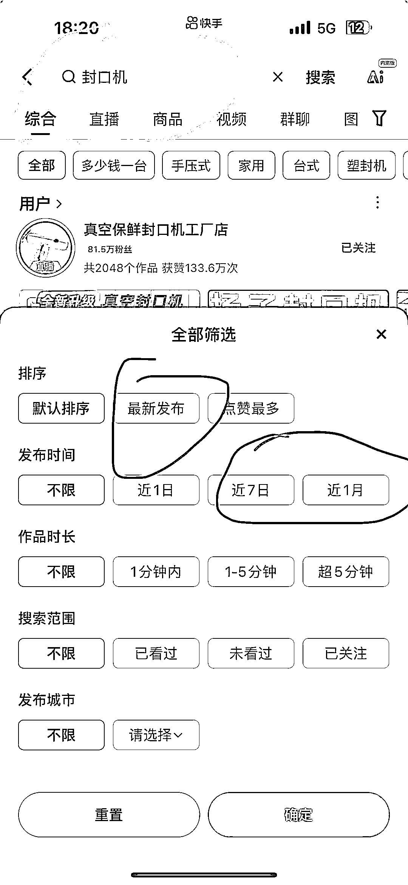

**第二种**：别人搬过了，但没跑起来。这种情况可以打，但不能直接搬运，系统会提示同质化。稍微做点混剪处理就能用。

**第三种**：别人搬过了，而且跑得很猛。这种不建议碰。你前期得砸不少付费才能跟人家掰手腕。我们做这个项目图的就是利润，没被验证过的素材自然流更多，那我们就专门挑自然流大的品去打。

混剪的具体操作这里就不展开说了，赚钱里面大佬们的保姆级笔记一抓一大把。实在不会的，去B站和抖音搜剪映基础功能就行。思路很简单：同一个脚本，大量做镜头替换去重，这对小白来说算是最容易上手的活儿了。

按我们运营的工作量算，8小时只换镜头不换脚本，一天保底能出40到50条视频。如果是一些30秒以内的简单短视频，速度只会更快。

## 三、直播录制：免费工具全自动监控

直播录制用的是下面这个免费软件。只要是抖音上正在直播的直播间，复制链接丢进工具里，它就会自动监控录制。硬盘够大，你想录多久就录多久。

（飞书链接里有安装包，文件比较大。）

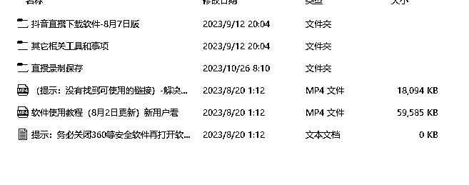

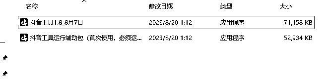

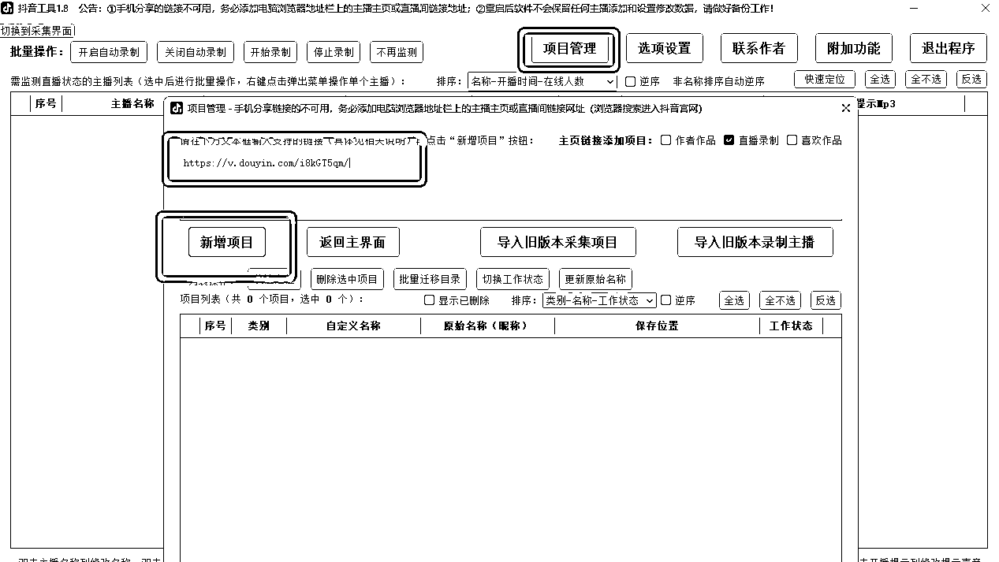

点完成，就能开始录制了。

## 四、主页定时发布：撬动海量自然流

快手创作者中心地址：[`cp.kuaishou.com/article/publish/video`](https://cp.kuaishou.com/article/publish/video)

登录后把成片通过主页按钮发出去就行，发布节奏如下：

新号起号阶段，先备好30到50条素材，同一天分批次发完，这样起号比较快。

账号稳定之后，改成定时发布，20到30分钟一条，一天发30到50条作品，稳稳地吃自然流。

帮大家算笔账。一个起号成功的快手账号，单条作品平均播放量在5000左右。你一天发30条，能拿到的自然流播放就是30乘以5000，等于15万播放。

短视频进直播间的下单率每个品类不一样，粗算按5%算。我们测出来的数据是，短视频种草后进直播间的转化率在3%到5%。这个公式拿去对比抖音、视频号也基本成立，客单价100以下的产品，转化率基本都在这个区间。

所以正常情况下，每天订单量等于视频条数乘以基础播放量乘以进直播间率乘以直播间转化率。按最低标准算：15万播放乘以0.1的进播率再乘以0.03的转化率，大概500单左右。再乘以客单价，每天账号的营收就出来了。

更关键的是，这样的号起来之后，好产品能卖3到5个月，差一点的应季品也能打半个月到一个多月。

这一点才是这个项目最让我心动的地方。没有哪个初创团队扛得住“三年不开张，开张吃三年”的玩法。现在电商整体利润都被卷到只有10%到15%的毛利了，能快速起量、快速回款才是王道。

## 五、快手录播实操：OBS+直播伴侣

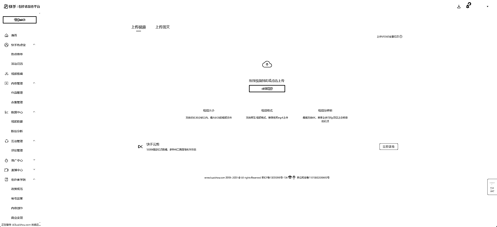

下载OBS，把录制好的录播素材拖进场景里。

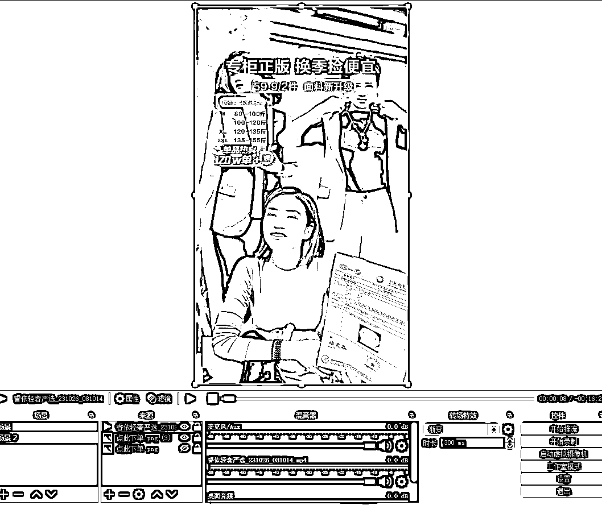

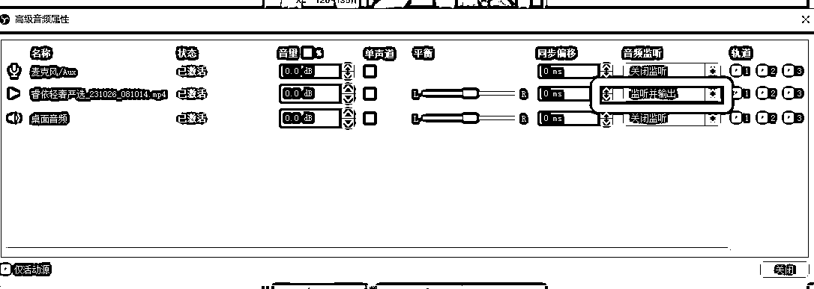

注意要选“监听并输出”，不然推流出去没声音。然后点推送虚拟摄像机。

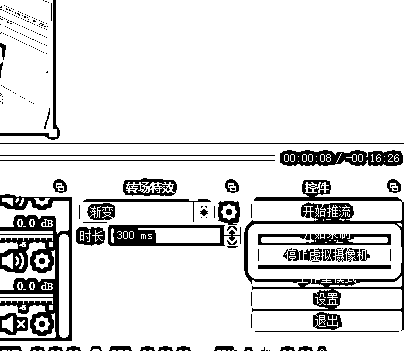

接着打开快手直播伴侣。

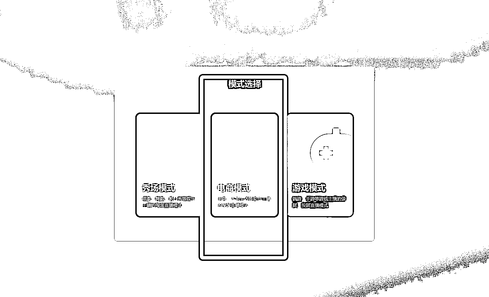

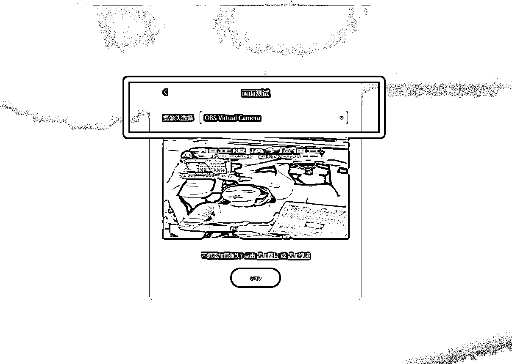

选择虚拟摄像头。

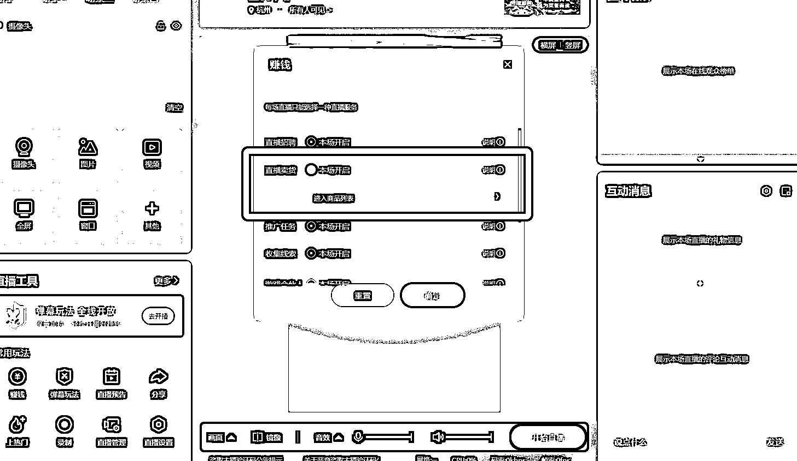

直播卖货的话，把商品挂上。

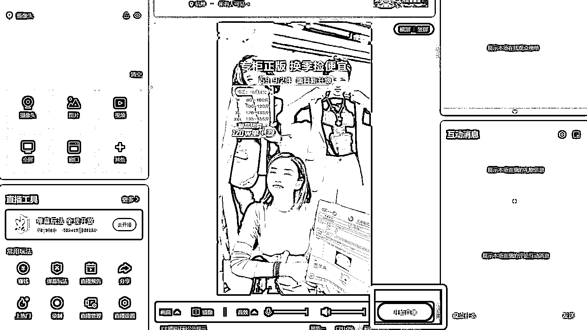

点开始直播，一个简单的无人直播就搭好了。

## 六、为什么说无人直播是新人利润最大化的方式

很多人小看这种无人直播间，但其实它可能是新人能拿到最大利润的方式，没有之一。

我们前面聊过，一个好的直播间场景核心就两个：人（主播）和场（场景）。

这两个是核心中的核心。抖音上一个人气过千的直播间主播，在一线城市底薪没有低于2万的，还不算提成。你想从零培养一个，或者在线下招一个稳定的，要花的时间和精力成本更高。

现在主流的播法是“半日不落”，一天播18到20个小时。按这个时长给主播排班，一天至少4个人，一个月加上设备办公成本，8万块打底。

再说场景。搭建一个像样的实景，装修普通一点也得过千。再加上相机、镜头、灯光这些，没有3到4万根本不好意思说自己在配人货场。

但用无人直播的方式，你一分钱不用花，就拥有了一个24小时不休息的主播，一个完整的专业直播团队，以及全套的人货场。

肯定有朋友会问：无人直播影响转化吗？

我的回答是：会有影响，但它是一个波动值。一个直播间在线人数是10人、100人、1000人还是10000人，对转化率的冲击完全不同。

毫无疑问，1万人在线的时候影响最大。真人越多，无人直播对转化的干扰就越明显。这也是为什么我们专做小而美的项目——我们会刻意控制付费比例，让直播间在线人数一直保持在100以下，这样既不容易被同行举报，也不太影响转化。

你们有时候去看我们搬运的抖音直播间，他们的在线人数和日销量，甚至还不如我们。原因有几点：

第一，抖音同个类目已经卷到极致。素材卷、主播卷，很多品类连商品卡利润都被卷没了。直播间本身没利润，全指望后端商品卡回流补血。

第二，抖音真人直播成本太高。很多直播间不是没利润，是利润全被主播分走了。我相信这是很多小团队老板最大的痛点。

举个例子，有个产品一天能卖500单，一单赚10块，一天前端毛利就是5000块。但要配4个主播、1个编导、2个剪辑、1个拍摄，你再算算账——这套配置下来，一个月固定开销超过10万，利润根本兜不住。

那我换一种思路：把这种中小直播间，用正规运营手段，短视频加付费投放的方式搬到快手来。虽然快手的整体销量比抖音小，但不妨碍我赚钱。因为我除了一个基础剪辑的人工成本，其他全是利润。

直播间直接“抄”，短视频也直接“抄”。混剪去重就行，不需要额外实拍和创意。

回归到利润的本质：我们赚的，就是省下来的人工成本钱。

## 七、磁力金牛投放：专业版和移动端的正确打开方式

磁力金牛是快手的专业投放工具，官网：[`niu.e.kuaishou.com/`](https://niu.e.kuaishou.com)

用个体户执照开户就行。磁力金牛分专业版和移动版，简单理解：

专业版对应抖音千川，移动端对应抖音随心推。

我们起号前期基本都用移动端，速度快、效率高。

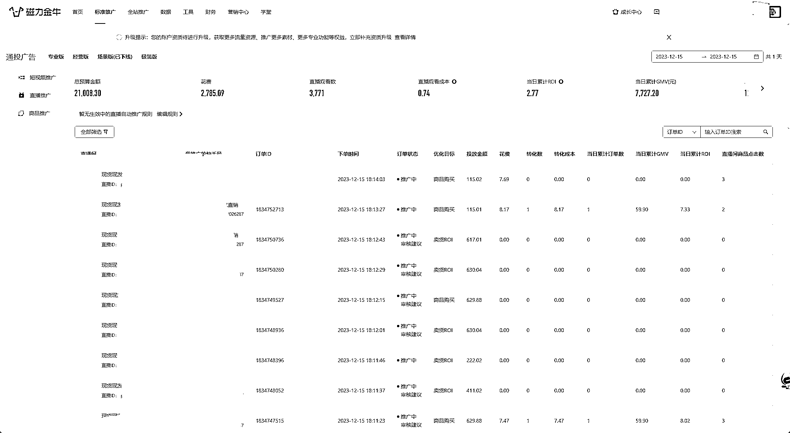

一般投放目标选“商品购买”和“支付ROI”这两个就行。投放操作如下：

预算100元。

投放目标选商品购买或支付ROI。

出价方式：前期智能消耗拉视频热度，后期转手动出价拉投产。

投放时长2到4小时即可。

专业版基本就是通投加性别、年龄。出价根据投产来定，前端保持10%左右的利润做基础出价，加上自然流和消耗返点，产品净利基本能做到15%左右。

这种投放不需要搞什么卡定向、徕卡、人群包这些花活儿。因为爆款的视频框架已经被抖音无数人验证过了——内容本身就是最好的定向，不需要任何额外操作。

新号前期30条视频，只要脚本和产品没问题，基本就能把视频和账号带起来。

## 八、稳定运营期：简单维护，持续出单

前3天，按每天25到30条视频的节奏发。一个产品3天就能测出来。没起来的话直接换品；有利润的话可以再养一段时间，反正又没主播成本，计划出价也有赔付兜底，不怕跑飞。

起来之后的维护就两个步骤：

传视频。账号热度高、日销5万以上的，每天准备30条片子，间隔不到1小时发一条。量没那么大、日销2到3万的，准备20条就够。对熟手来说，20条混剪素材3到4个小时就能做完，核心就是给抖音爆过的视频做镜头替换去重。

拉计划。移动端每6小时拉一次计划，PC端每天拉一次，特别省事。

公屏上的问题，我们用的是淦核自动回复工具，把产品卖点和常见问题全部设置好。观众在公屏问什么，系统就能自动回复什么。

以上，就是整套账号实操的全流程。

## 九、写在最后：创业这条路，问题解决不完

做这个项目的时候，我请教了很多赚钱的大哥，也翻了不少圈友过去的精华帖。从起号、脚本逻辑到投放技巧，收获特别多。中间也踩了不少坑，很多朋友帮忙对接资源，真的非常感谢。

也有不少圈友在交流新的机会在哪里，明年的电商会往什么方向走。能感觉到，大家多多少少都有点焦虑。

也有新手问我：书豪，你怎么测项目这么快，赚钱这么轻松？

我的回答是：看赚钱精华帖的时候，大家看到的是大佬们分享成功经验，那都是人前显贵的时刻。其实每个项目背后，都有层出不穷、无穷无尽的卡点，只是你们看不到而已。

你们不知道他们选品花了多少个日夜，不知道他们剪素材熬了多少个通宵，也不知道他们打磨话术和场景耗费了多少心力。中途每个人其实都经历了很多次失败，只不过大家都习惯了，也就不再提了。

上周末晚上，我刚下播从公司下楼，一个人游荡在下沙街头。十字路口有很多和我一样刚下班的人，从附近各个写字楼里涌出来，神采各异，有人稚气未脱，有人少年老成。

我和他们三三两两擦肩而过，偶尔听到他们也在聊直播数据、GMV、ROI这些词。

记得几个月前刚来杭州的时候还不太习惯。每天晚上在楼下都能看到不少直播团队，男生背着电脑音响，女生拿着手机和环形灯到处跑。在街角找个光线好的地方，女生拿着衣服就开始直播，一气呵成，行云流水。

起初我还会停下来多看两眼，他们也见怪不怪。女生在镜头前淡定自若，不管身后围了多少人，直播状态始终饱满，什么都干扰不了她。

当时挺佩服这些年轻人的：潇洒，大方，毫不扭捏。搞钱和创业的精神仿佛融进了杭州的空气里，只要你来了这座城市，就会受到滋养。这也是我喜欢杭州最核心的原因。

转眼间，今年已经是我创业的第四年了。程序员、公众号、再到电商，我做过的所有行业，几乎都没有任何经验和背景，纯粹凭着一口气咬牙就上了。但每件事，最后都做出了一点小成绩。

那天晚上为了省掉兼职主播的费用，我自己在镜头前测新品话术，一口气播了三个小时，口干舌燥，嗓子像冒烟一样。

下播的时候，运营笑着跟我说：豪哥，新号起来了，数据比全职主播做的还好，以后不用再请兼职了。

我苦笑。中间无数次我真的快坚持不下去了，想直接关播。但每到最后一刻，我就想起楼下那些年轻的脸庞，想起他们在街头人潮里大声直播的样子，咬咬牙，又撑了过来。

直播对我来说，是一个完全陌生的领域。原本觉得自己肯定做不了，但在这座不相信眼泪的城市里，硬是给磨了出来。

我一直觉得，除了极少数需要天赋的技能，其他能力都可以通过刻意练习来获得。就像杭州，凭什么能成为直播之都？难道这里的年轻人在抖音出现之前就会直播吗？

不。是因为他们敢于尝试，勇于精进。没有内容能力，就去学怎么做内容、怎么编脚本、怎么抄爆款。没有直播能力，就立刻站到镜头前播一场。唯有实践，才出真知。

创业这条路，本质上就是解决一个接一个的问题。什么时候困难没有了，机会也就没有了。

我希望自己无论未来遇到什么问题，都能像那天下沙街头直播的年轻人一样——潇洒，大方，不害怕。

也希望所有圈友，都能在赚钱里找到适合自己的方法和技巧，拿到结果。遇到问题，就解决问题，别怕。

（我目前主要做小红书和快手这两个平台，所有平台短视频内容的核心逻辑基本都是相通的，没有特别大的差异。希望这次分享能对大家有帮助，如果有疑问欢迎来交流探讨，知无不言，我的微信：wsh137552775）

