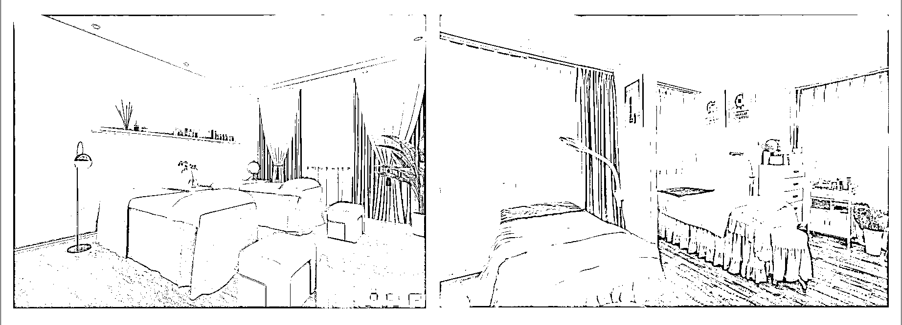
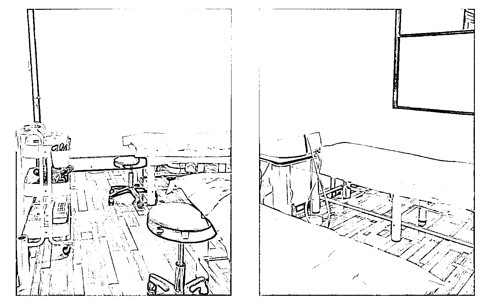
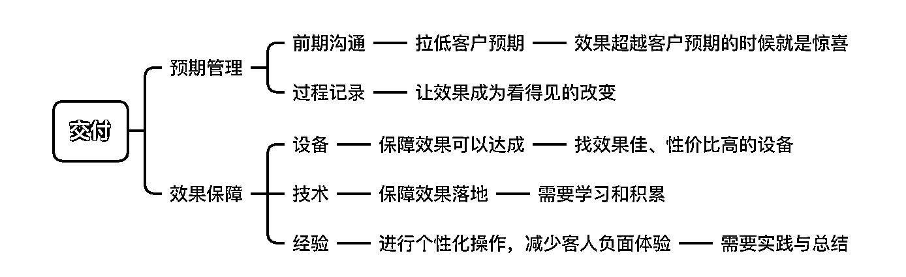
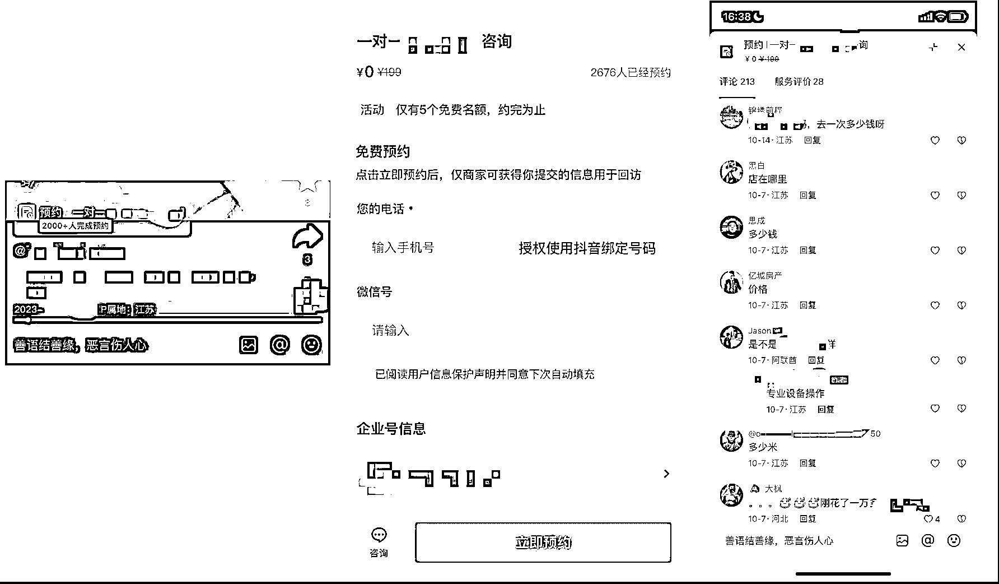
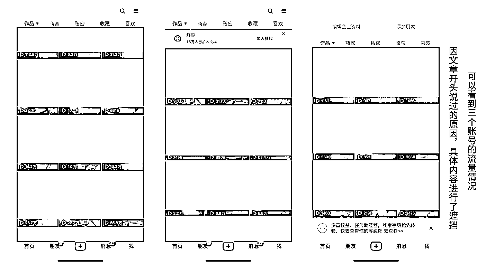
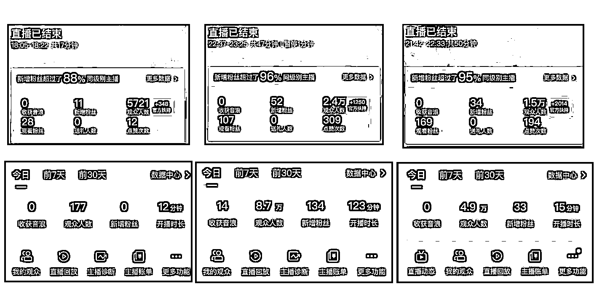
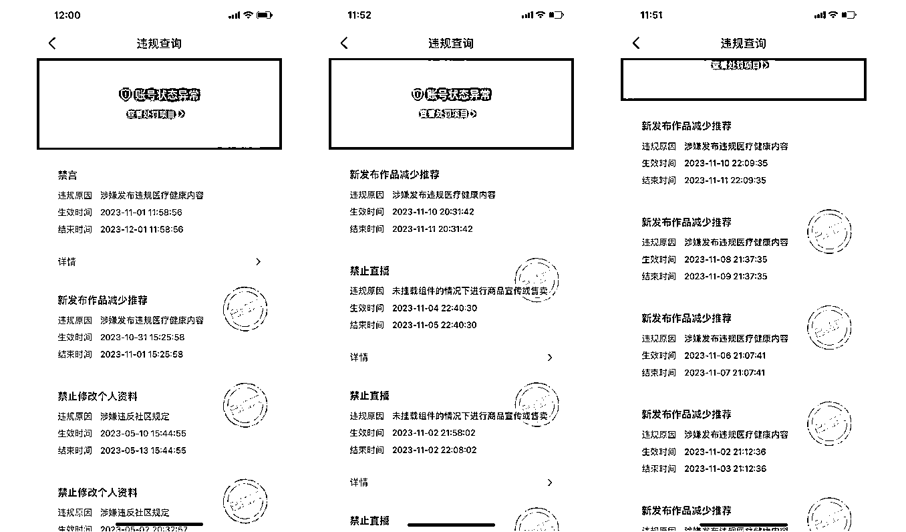
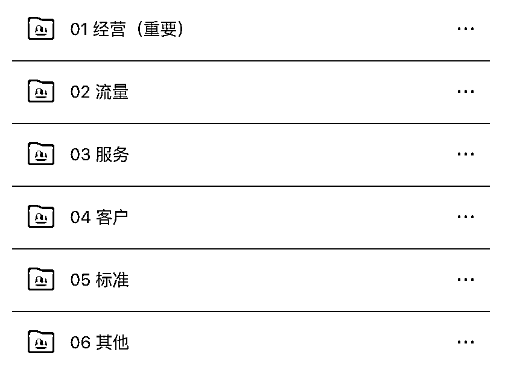
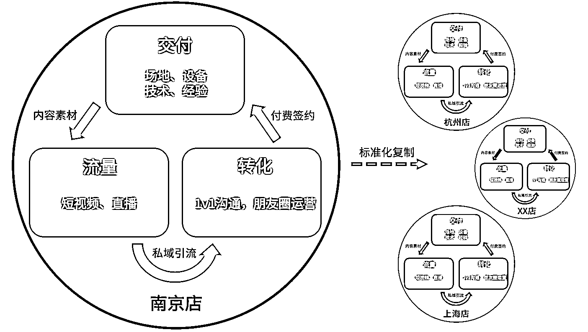
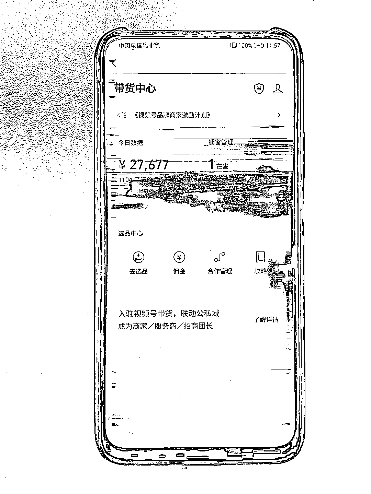

# 被忽略的男颜生意：如何在窄赛道做到月入十几万？

先说一个让我久久难忘的画面：有位男客人付了 8000 元，转身小跑着进操作间，嘴里喊着“太好了，终于不用再被这个问题折磨了”。那一刻我有点发懵：他花钱，开心程度却赛过我。也正是这个开头，让我确信这条路走得通。

去年，我和搭档在拥挤的美容市场中切出一块面向男性客群的细分生意，现在每月流水维持在 10 万到 15 万之间。这个领域受众不算广，市场培育也要慢慢来；但那些被困扰反复折磨的人，一旦被触达，付费时的果断程度相当惊人。

团队里没有销售岗，也没有高提成，预算都押在低成本获客和强履约上。做这行要有敬畏心：客人刚付的钱，在我们完成服务之前更像一笔负债，并非已经落袋的利润。后面我会讲我们为何入局、如何起盘、怎样放大，也给同样操盘线下高金额蓝海生意的人一些参考。

# 一、一个让我坚定信心的开局

第一位客人的反应，比任何市场报告都直接。他付款后当场跳起来，反复说“解脱了”。我愣了好几秒才回过神：他掏了 8000 元，却比我更开心。自那以后，我对这个项目的信心基本建立。

先交代背景。我定居南京，之前在一线软件公司和一线电商公司做过 8 年 HR，工作覆盖组织建设、招聘管理和 HRBP，也做过 2 年运营，十年里薪资涨了 14 倍。我参与的大多是公司从零开始的新业务，久了也喜欢上打开新局面的乐趣。过去还碰过出海贸易、光伏、直播带货，都只是小有收获。今天聊的是去年启动的男士护理副业，前十个月营收做到 90 多万元。

业务还在早期，增长余地也大。具体产品细节，搭档和我都认为暂不宜公开，请见谅。除此之外的运营思路和操作细节，我会尽量摊开讲。这篇内容接近一万字，谢谢耐心阅读。

# 二、这条窄路值得做的理由

这个方向不是我主动发现的，是搭档把机会带到我面前。她在面向女宾的美容项目上做了五年，客流和复购都不差，但越来越累。她的原话是：“女客人挑剔、竞争又激烈，单价也上不去。”她当时已经在考虑转型，想新增一条面向男性客群的业务线。

女宾项目中有很多可以平移到男宾身上，仪器、场地、技师都不必大改。她先试了团购平台和付费投放，价格和女宾线一样，有时为了引流甚至压得更低，结果还是赚不到钱。她相信只有竞争者更少的地方才有更大的生存余地，于是决定只服务男性客群。每一个项目，都要先看现状，再想怎么下手。

我理解的这盘生意有四个困局：第一，愿意尝试的男性总量少；第二，培育成本高；第三，痛点人群很散，难以描出清晰画像；第四，多数人觉得这是无足轻重的小事，只有极个别的人会被折磨到必须解决。机会同样明显：竞争者少；能真正把问题处理掉的机构不多；被深度困扰的人愿意付出高额代价；因为缺少对比和常识，他们对价格不敏感；男性做决策的节奏普遍更快。

基于这些判断，我们认定这事能做。随后选具体项目时，我们发现各个内容平台都已经有同类服务商，并非空白市场。有人做，说明这条路被验证过，也说明有人跑通了闭环。真正没人做的领域，更可能意味着没人做成，而非没人想到。这和实战项目里“先完成第一笔成交”的逻辑一样。

我们没有旺铺位置、豪华装修和品牌背书，客人为何信任我们？这个流量问题先按下不表。高金额订单的下单门槛很高，必须给客人一个“可以试试”的理由。于是我们为差异化做了三条假设，用来筑起壁垒。

差异化根基：一是专家感——只做一件事，专注在单一项目上，把结果和体验做到最佳；二是强履约——保证结果，做不到就退钱；三是定价权——专业性和履约质量上来后，成本自然上升，溢价也就有了支撑。

假设成立后，就要落地。

很多机构把操作间布置成这样：

我们的空间则是这样：

这样做的目的有两个：一是给客人更专业的暗示；二是避免男宾与女技师在封闭房间里离得很近，产生不必要的暧昧氛围。我们曾有一位技师被客人“拐”走结婚，这也是后话。另外，刚起步时不想投入过大，除了直接影响结果的部分，其余能省则省，装修上并没有花太多钱。事后回头看，这个选择反而成了辨识度。

每位客人来之前，都由资深技师一对一沟通。远程咨询时，我们会请对方发来照片，询问一些细节，再给出方案、原理和效果周期。若客人说以前用过别的方法没用，我们会分析不同方案的差异；若对方试过同类操作没结果，我们会解释原因，并强调所用仪器和多年经验的优势。最后用“做不到就退”把后顾之忧拿掉。

履约方面，我们对比过很多进口和国产仪器，最终选到同类里表现最佳的一款。但它的价格和购买门槛都极高，于是我们通过渠道找二手仪器，相当于用更低的成本拿到接近顶配的硬件。

结果之外，还要管理期望。很多机构在收钱前把效果说得天花乱坠，客人期待被拉高，做完自然觉得受骗。我们一开始就明确：肤质不同，见效速度和体感都会有差别；但我们保证一条最低效果线，大约是理想状态的八成，到这个线才算履约完成。操作前还会签一份书面约定，把约定与注意事项写清楚，也告诉客人后续要怎么配合。这一来能让沟通更正式，二来也让关键信息不会被忘记。

第一次做完之后的改变尤其关键。我们第一次做完后，几乎都能让客人肉眼看到差异，信任感当场拉满。

长周期服务有个隐藏问题：客人做了半年，会慢慢忘记自己最初的样子，误以为没有变化，价值感变低。我们每次做完前后都拍照，结束后马上对比，让他亲眼看到进展，不断强化“值了”的感受。

定价方面，品质和成本同步上升。虽然仪器是二手淘来的，但保养、维修、耗材全部按高端标准来。我们陆陆续续测过 500、1000、2000、4000、5000 元等价位，发现超过 2000 元以后，同等运营方式下客人数量没有明显下滑。把成本与单量放在一起权衡后，我们将最终价位落在 1500 到 15000 元，人均成交约 5000 元，并保留最多 500 元的来店优惠作为临门一脚。

定价本身也是二次筛选。定 2000 和定 10000，吸引来的用户数量和特征会很不一样。在成熟竞争行业里，涨价通常意味着客人缩水；这个细分市场竞争没那么激烈，涨价后客人量没有明显下滑，但也可能只是样本恰好站在对我们有利的位置。毕竟运营策略虽没变，直播时的熟悉水平、账号权重、内容质量等都在同时变化，不能简单归因。

# 三、运转框架：履约、流量、成交

我们把这门生意的运转拆成三件事：履约、流量、成交。

先看履约。履约质量是生意的地基，也是我对流量的核心理解：如果服务本身不行，流量越大反噬越重。高金额配大流量看起来很诱人，可一旦地基不稳，后面容易翻车。美业里的履约物，在我看来就两样：看得见的变化，以及说到做到的结果保障。关于期望和结果保障，前面已经讲了一部分。再补充一点：客人每次做完之后的日常保养也需要充分沟通。如果未来规模扩大，我们计划安排专门的人来负责保养跟进，让效果维持得更稳。

流量方面，现阶段几乎全部依赖平台的自然流量，不花钱买量，先把人引到个人号，再做成交。主要阵地是抖音。做法很直白：发视频、开直播，用线索组件和私信收联系方式，加了微信继续沟通，最后邀请来店或直接转账。门店没有选在临街，而是在办公楼里。

视频内容以正在操作的客人作为场景。拍摄前会征得对方同意，一次多拍一些素材，再切片或混剪。文案多是简单的提问：“你是不是也有这样的皮肤问题？是不是天天被它烦？现在我们来终结它。”每天每号发 1 到 2 条视频或图文。这类内容没什么高深技巧，主要靠真实场景让人好奇，停留时长、完播和互动自然更高，系统也会多给流量。高的时候单条到过 200 万播放，低的时候只有几百。目前能稳定更新的账号有三个。

图文内容更轻量：用操作场景照片做底，配一句引导语，走种草平台的风格。

直播每天都开，一天 3 到 4 场，每场 30 到 60 分钟，偶尔会延到两三小时。我们试过两种布景。前一种是用绿幕，背景放操作视频或图片，人出现在角落，大约占屏幕六分之一，顶部加主题贴纸和点击引导。后一种简单得多：电脑上打开图片或视频，人直接对着屏幕讲，右下角挂线索组件。看起来精致的前一种，数据反而一般；后一种更受平台欢迎，观看量更高。这是我们从后台看到的情况。

我们猜，对着电脑屏幕讲的形式更容易激发好奇，大家愿意停下来多看几眼。当然，这也可能只是数据恰好对我们有利，仅供参考。

渠道方面，目前主要只做抖音。并不是判断其他平台没机会，而是我们确实有点懒。种草社区、微信视频入口、海外社交平台和 Soul 都短暂试过，测试期没有明显效果就暂时没继续。这些渠道仍然可能藏着增长机会，以后值得重新捡起来。

最大的引流阻力是平台规则。账号会不时收到违规提醒，我们没有稳定的应对办法，只能持续更新，号被限制便另开新号。

# 四、成交链路

拿到线索后，我们会先加微信。第一轮筛选先确认城市、困扰程度和意愿，再告知操作方法、原理、周期，并报一次价。这样可以把离得远、意愿弱、觉得价格太高的客人先筛掉。离得远不代表不会来。我们在南京，郑州、济南、杭州、上海、徐州都有人专程赶来，周边城市来的就更多了。可见这个痛点对部分人来说真的很痛。

通过初筛的客人，会进入深度沟通。我们问年龄、职业、作息，请对方发照片，再按个人情况沟通方案。之后，我会把客人分成五类：一是纯好奇，刷到视频随便问问，没有消费意愿，或者人在外地来不了；二是需要但嫌贵，问题不算迫切，觉得花这个钱不值得；三是观望，有困扰也对方案感兴趣，但对新鲜事物将信将疑；四是重点潜客，认可价格和专业，计划抽空来现场看，没问题就当场付款；五是天使型，恨不得马上来店，先把钱打过来再约时间。

前两类客人，欢迎他们有问题随时沟通，也邀请他们以后来体验，留在好友列表里即可。第三类会针对犹豫点偶尔跟进。第四类会主动邀请，持续关注需求，推动尽早来店。第五类数量极少，拦都拦不住。

从加微信到最终付款，整体成交比例大约在 20% 到 30%。个人号动态的运营也很重要，我们不敢说多高明，但它在持续传递真实感和信任感这件事上，作用不小。

以上是我们目前的完整打法。如果你也在操盘线下高金额蓝海生意，希望这些思路能给你一点启发。我们依然在路上，远未到可以躺赢的状态，欢迎多交流。

先聊聊朋友圈怎么发。我们每天固定发三条，早、中、晚各一条。其中两条用来晒客户变化：今天谁到店做了操作，效果不错，就上效果图、操作视频或对比图；偶尔穿插项目背后的生物原理。剩下一条，必须“像个人”——抱怨加班、吐槽老板、晒美食、给客户点赞留言。本质是让屏幕对面的人觉得，这个账号背后是真实从业者，而不是冷冰冰的宣传机器。

老客户偶尔也会介绍朋友和家人来，这条渠道不能说没有，只是量一直不大。

说到项目放大，我们至今还是一家店，谈不上真正放大。但曾经有一位美容师，用自己的方式替我们验证了放大的可行性，代价有点大。她叫小A，机灵、口才好。我们当时为了人才储备，也有意让她跑一遍完整业务流。她一个人从引流、转化到实操全部能做，连设备来源都门儿清。

后来她突然提出要辞职去另一个城市单干。我们觉得这也行，多一个网点，客户可以互相引荐——离南京远、不想跑过来的客户可以推给她，她那边够不着时可以推给我们，彼此结算推荐费就行。实际操作中，她拿不准的细节，我们照样无偿帮忙。

小A确实下了功夫，专门报了个引流培训班，接着开始做短视频和直播。从她直播间来看，布景、设备、话术、转场都比我们精致，流量也大得多。客户量上去了，她价格越定越高，最高时比我们贵三成。虽然互相推荐的客户不算多，但她总在直播间说南京店是分店，我们也会配合着说是一家，毕竟抱团才好做。

可后来变味了。她的客户开始跑到我们直播间投诉，说承诺不兑现、效果不好、沟通态度差。有一次转介绍结算又出了岔子，按她给的价格做，我们铁定亏钱，还得兜底她对客户许下的承诺；客户一旦不满意，我们就得全额退款。这风险谁敢接？我们只好协商各做各的，不再对外宣称有关联。结果她在直播里话锋一转：“南京那家不做了，最优秀的师父和设备我都带走了。”还说新店很快开。

单干四五个多月后，我注意到她开始频繁促销，价格一度比我们还低30%。以她的成本和高定价，再看着日渐密集的投诉，我直觉判断：她要跑路。我马上跟合伙人同步猜测，朋友圈发声明撇清关系，换了服务品牌。又过了一个多月，她真跑了。

但她用真金白银验证了项目该怎么放大：账号矩阵、多渠道、标准化、拓展节奏。账号矩阵简单说就是不断起新号，把验证过的玩法复制上去，同时招人代播；多渠道就是在抖音之外，把其他短视频和图文平台都铺开，只是要额外花精力学平台规则、管更多账号、回更多消息；标准化则是把经验固化成文档，把操作流程变成SOP，为后面培养人、开分店或联营铺路。

但我认为，拓展节奏才是最重的一环。小A为什么翻车？她看到这项目来钱快——没什么成本，弄一两台设备，租个地方简单装修，拍视频开直播就能收到钱。一个人几千块，感觉一本万利，那就拼命做大流量呗。于是她疯狂直播、收钱、换车、消费。可这项目有真实成本，而且不低。客户交的钱从来不是落进口袋的收入，而是负债——你交付不好，钱会被要回去；就算客户满意，哪天人家不想做了、不方便来了，也得按比例退。把预付款当成已赚到的钱，是最大的隐患。重流量轻交付，流量越猛，反噬越狠。等客诉和退款潮涌来，被勾起的收钱欲望又刹不住，跑路便成了唯一选项。

所以我们的拓展节奏是：守住现有资源，先把南京店做到业务饱和，储备好人才，再考虑开新店。新人去老店，老人去新店。

那别人能不能也做？能，但先看人财物。人：需要懂行的合伙人，要有多年行业背景，光凭自己补课很难；操作技能花钱就能培训，经验可以慢慢攒，谨慎点不影响开展；运营技能反而是最容易补齐的，市面上很多实战手册和陪跑活动基本够用。财：启动资金大约30万到50万，具体看地点、设备和规模。物：资质是硬门槛，生活美容要办《公共场所卫生许可证》，医疗美容则必须持有《医疗机构执业许可证》，后者极难办；我们也算借资质运营，这在行业里并不稀奇。仪器也麻烦，全新设备上百万，状况好的二手也得20万左右，还未必知道哪里有毛病，换个零件就上万元，没有资质根本买不到。

风险也绕不开。普通客户投诉，我们尽量好好沟通，尺度只能自己拿捏。遇到过效果达标、客户认可，但还想延长操作周期的；遇到过皮肤敏感操作后微微泛红，第二天自动恢复（本身属正常），客户仍坚决要退钱的；还有找不到小A跑来要求我们退款的。有硬刚成功的，也有退了钱照样投诉到主管部门的。总之和气赚钱。一旦客户问题没处理好，闹到卫生行政部门，而你又缺少与业务和设备功能匹配的资质，那就要面临设备被拖走、责令整改的处置。这些风险都是客观存在的，我们也是踩了无数次坑，才长出预期管理、签协议这些经验。千万别觉得收到钱就属于自己，那是负债，成本都在路上。一次技术事故，赔掉半年利润并非危言耸听，甚至可能封店。时刻保持敬畏。

总结一下，我们的核心竞争力有三点：第一，切入了一个非常垂直的蓝海市场且跑通了，但没有护城河，美业大咖要进场，随时能把我们这类小玩家碾压得渣都不剩；第二，重视交付，这是商业的基本盘；第三，引流成本低，不需像很多美业那样给业务员高额提成（听说过有人拿50%的提成），也不用砸重金投广告。整个业务模型我画了张图放在下面，供参考。

项目就介绍完了。接下来聊点个人体会，未必正确，只是从我的视角给大家一些参考。

职场和做项目，我都有过切肤感受。因为职业关系，我近距离观察过财富自由的老板和职业经理人，其中一任草根出身、身家百亿的老板，让我看见创业者那股源源不断的活力。这让我一直想亲手做点什么，向自由靠近。如果你能力撑不起一个项目的闭环，怎么办？找到自己的核心竞争力，或者看清项目里哪一环缺人，看看自己能不能补上。比如一个电商项目，你什么都不会但表现力强，那就去做视频号直播，让平台和上下游帮你补齐缺环。我自己也是这么干的：对美业一无所知，但靠HR经验里那套把事情理清楚的能力，再加一点运营认知，就把缺口填上了。

裸辞，尤其是在当下裸辞创业，真不是明智选择，因为自己做项目的每一步都和预想不同。从职场跳出来自己养自己的感觉是美妙的，你可以不依赖任何公司任何人，随心所欲地奋斗和生活；同时也能真正检验，那些光环究竟是平台的，还是自己的。反过来，从项目回到职场的感受也是幸福的——哪怕今天心情不好划一天水，工资照发；那一刻你会觉得职场真香，也会明白老板真不容易。

突破困境也讲究方法。东尼·博赞那套水平思考里，对我启发最大的是“随机输入”。比如你想设计一场独一无二的婚礼，看了无数案例都没头绪，这时候随机输入一个“玫瑰花”，花瓣的形态、气味、口感都能变成灵感——餐椅能不能做成花瓣，现场要不要淡淡花香，饮品要不要带玫瑰味？我以前做校园招聘时，每场宣讲会都从色、声、香、味、触、法六个维度设计，有时随机加入应景元素，场场爆满，坐不下就站着。哪怕同行业巨头就在对面同时开宣讲会，我们到场人数照样压制。做项目和混职场同理，不能活成孤岛，要多混不同的圈子，特别是非正式小圈子，它们能带来启发和帮助。赚钱就是一个不错的圈子，信息量大、鲜活，常常能给迷茫的人脱困的灵感。

最后说说成长。翻赚钱帖子时，看到同龄人或更小的人已经拿到结果，你会不会特别焦虑？焦虑之后，有些人更努力了，有些人再也不看了。我以前是前者，看完就焦虑，焦虑完再看。现在倒习惯了，坦然接受自己笨，慢慢成长、积累、做事。眼过千遍不如手过一遍。当尝试过的项目变多、跑通闭环的次数变多，哪怕只赚过一块钱，你对很多业务的理解都会不一样。世界也慢慢变了，自己也在一点一点变好，虽然说不清具体变在哪，但总归是在变好。我这么笨，目前试过的赚钱项目，不管跟着航海实战还是照着圈友帖子操作，每个都能赚回200块，完成闭环，偶尔还能日入过万。所以我真心相信，你们也可以。

（不是故意打码，是那破手机直播）

感谢你看到这里。生活不是一天好起来，而是一天天好起来。愿大家都有个好身体，一起赚钱有术！

* * *

评论区：

暂无评论

* * *