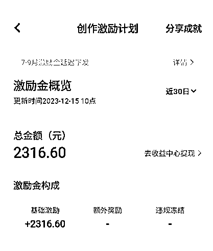
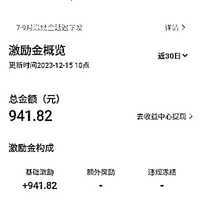
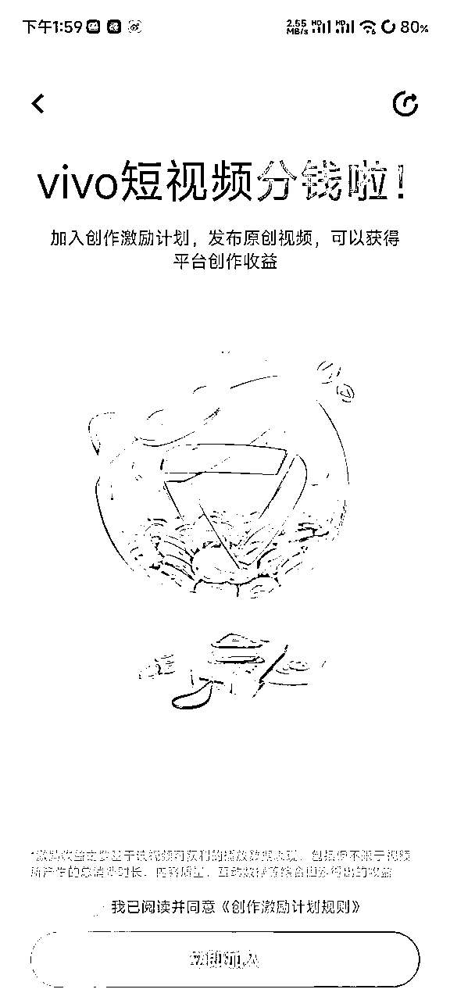
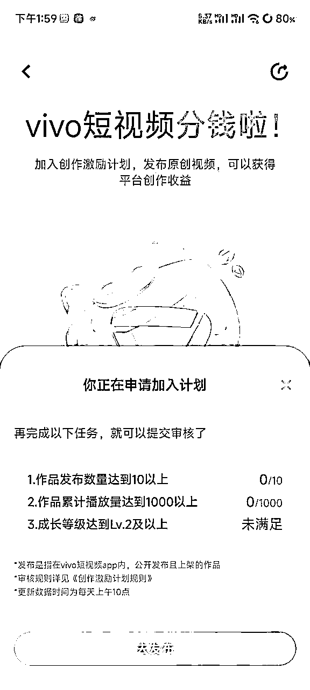
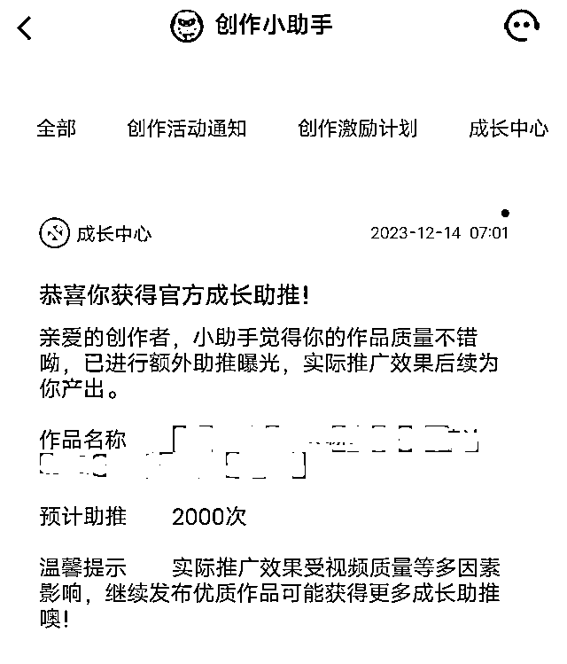
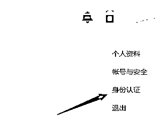
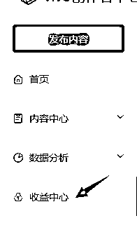
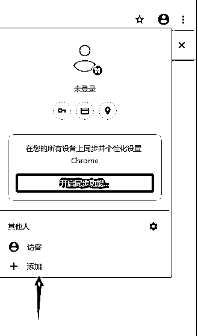
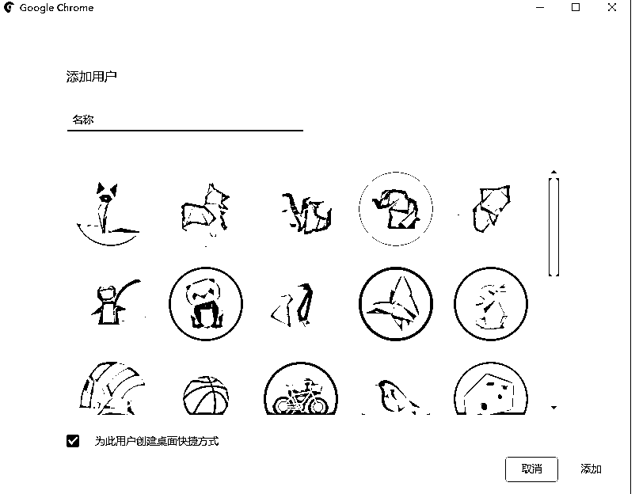

# ('vivo短视频，新手入局，教程分享', (2, 19))

最近在死磕一个藏在移动设备系统里的视频平台，属于那种“知道的人越少越好”的冷门玩法。先自我介绍一下，方便诸位判断内容出处——我的文章只会发在赚钱，希望转载的朋友注明一下来源；外面任何以我名义出现的信息，都跟我没关系。之前写过的得物项目被加精后，已经被转了好几手，这里统一说一声。

聊这个项目之前，先放两张近期的进账图，看看真实水平。

为什么它值得做？四个理由：

第一，赛道极窄，几乎没人提。
第二，平台还处在野蛮生长阶段，相关规则没收紧，批量开号约束很少，用接码平台弄来的号码就能直接通过网页登录并上传内容。
第三，加入成本低，只要手上有号码就能立刻开始。我自己一口气试了20个号，只折了1个，而且那个号本来就是为了攒互关专门用接码号开通的。
第四，不要求任何额外资源，电话号码就是唯一的入场券。

说实话，遇见它完全是意外。当时我们正在跑快手项目，进了一批vivo设备作为工作机，有个同事在系统自带应用里翻到了这个产品，发现里面挂着一个做内容的现金奖励入口。

他把这事告诉我，我把规则认真过了一遍。

门槛一共三条：
内容产出不少于10条；
累计被观看超过1000次；
成长等级来到Lv.2。

前两项不用解释，最后一项的实质就是粉丝数量凑到10个人。全网搜了一圈，相关资料几乎为零，只能靠自己去试验。

一、前期的准备和激活

我先让同事申请了20个号。先从抖音物色同类型的账号作为蓝本，把昵称、头像和简介都照着包装一遍，接着每个号传上5-7条视频，之后每天记录流量变化。等到第3天，把累计观看数冲过千的号集中起来查缺补漏——粉丝不够10的人，就随便找个号给补上关注。

有个关键细节：激励资格的评估数据滞后一天，当天产生的数据要到第二天才结算。所以当你在当天把播放冲到1000后，赶在0点之前把粉丝数凑齐10个，次日刷新后所有条件就都会满足，接着就能提交申请了。

审核的周期因人而异，短则2天长则7天，等待期间内容照更，每天1-2条就行。

二、审核通过后的玩法

审核一旦下来，就可以放心加大力度。优先关注搞笑、影视或生活方向的内容。过审时提交的对标作品还能继续接着用，但要是对方的库存有限，最好把昵称和头像整个换掉，另开一个号重新做。之前的包装只是为了让后台觉得你有辨识度，更容易通过。新号更适合拿二次剪辑的搞笑合集或生活资讯类素材号做蓝本，因为量大管饱，东拼西凑着发也不会露馅。每天每个号至少20条，抽帧、加片头这类的去重操作，圈内讲得很多，不展开。

实测的结果：20个号里1个被冻结、4个没过审、2个流量差到只有几分钱而且换素材也没救，其余13个都跑出了可观的收益。

三、后台活动

作者后台不定期会推出达人相关的激励招募，值得多刷几眼。眼下有一个活动要实名认证，我就没有碰，想赚这份钱的可以自己去看看。该平台的现金补贴上线才几个月，显然还在红利窗口内，但单个号的上限不高，最好的策略就是多号并进。

PC作者后台入口：https://kaixinkan.vivo.com.cn/#/

四、避雷指南

申请号码的时候，最稳的办法是每个设备只开一个号、只走一条IP。条件不允许就打开PC浏览器的隐身模式，从网页端入口来开通，千万避免拿同一部vivo机器反复试。我自己遇到过系统提示号码有风险、拒绝开通的情况，全部换到网页端后都成功了。

在网页端开通的号，后续打理完全可以脱离机器：开号、编辑个人资料、上传内容、提现，全部可在线完成。收益资格的开通按钮也在后台首页的广告位上。

对了，同一IP下挂多个号，目前检测得不算严格，甚至还能钻些空子，这里不细说。项目上限不高，只适合当副业小赚一笔。

这个圈子里的不少项目都要资源和人脉，入场费不低。这个不一样，只要手里有几个电话号码，花时间就能跑起来。另外，尽量传竖屏视频，我测过的横屏内容在播放量上差竖屏很远。

五、日常维护

发布的视频记得把相关关键词尽量铺满标题，平台隔段时间会有免费推流，能吃到就是赚到。

还有一点，别看这个应用声量小，机审的严厉程度和大厂有得一比，敏感词尽量绕开。虽然可以申诉，但处理速度极慢，最好一开始就不要踩雷。我之前有一个标题加了“地球”“侵入”的视频，第二天流量明显下滑，那是唯一一次吃到教训。

六、电脑端结算

在PC后台，先在右上角完成身份核验，通过后左侧导航栏的结算页面就能用了。

注意，新号不要一上来就绑卡取现，因为实名身份会被占用。我目前还在运营的号都没有绑定实名。首月产生的补贴，次月15号左右发放到钱包，之后再取。

七、多号布置

用于批量开号的卡商卡照样能通过这个平台开通，遇上风控就用我前面说的方法，大概率能顺利解决。卡商卡怎么找，圈子里有大批人在卖，自己看着办。

网页端并不需要频繁切号，Chrome自带多开功能。点击浏览器右上角的设置按钮，选择添加，给它随意起个名字，桌面上就会出现对应的快捷方式，以后要登录哪个号，就双击哪个快捷方式。

我自己这边是用自动化软件来处理登录和发布的。本想免费送出，但以前的经验告诉我，录好教程没人看，加微信就是上来问，干脆不外传了。见谅，软件不卖也不需要联系我。十来二十个号手动操作，每天花的时间也很有限。

App安装包：https://pan.baidu.com/s/1vBZtlf0mGIOzAhA5Fn4dGw?pwd=1hrs
访问口令：1hrs

PS：按今年的实际需求，我做了一个综合管理工具，可以适配多个内容平台，比如抖音、快手、小红书、知乎、得物等。它基于Chrome运行，能快速在不同平台间切换号，支持对账号做备注、加标签，一键导出表格。还能集中提取某一组号的特定维度数据，例如粉丝总量或账户余额（需要懂一点F12面板的基础知识）。