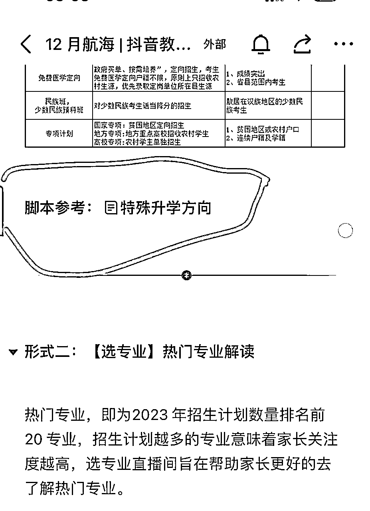
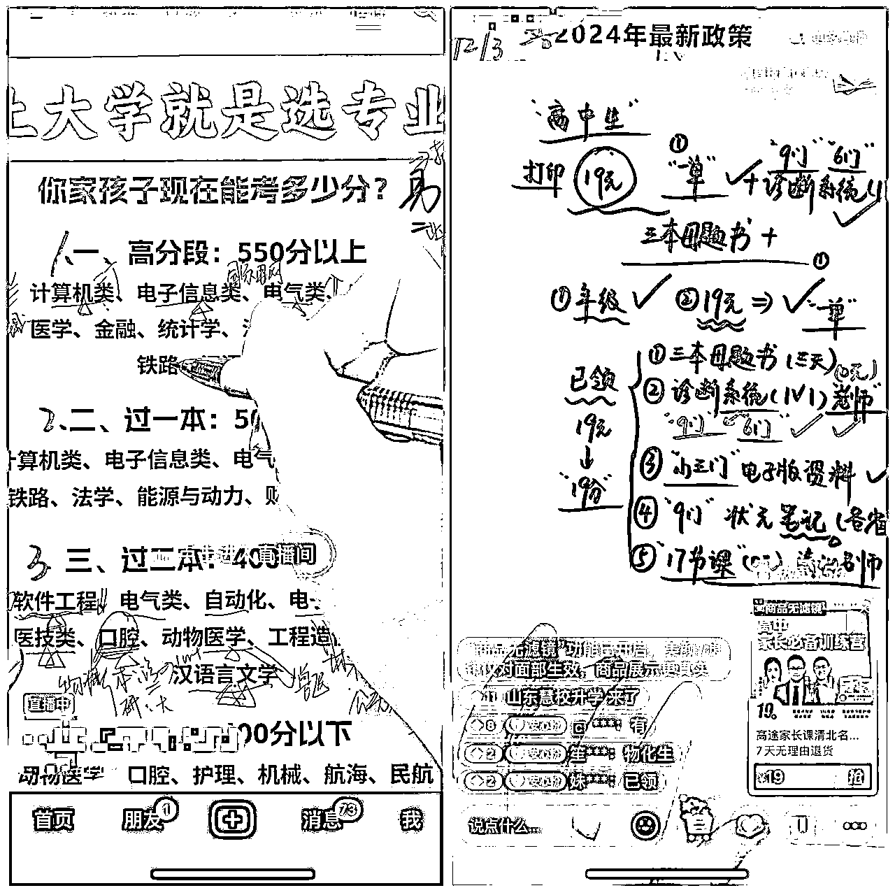
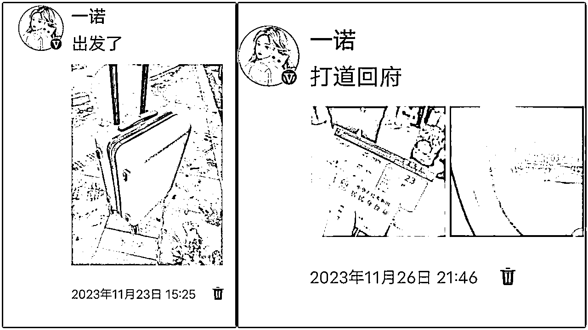
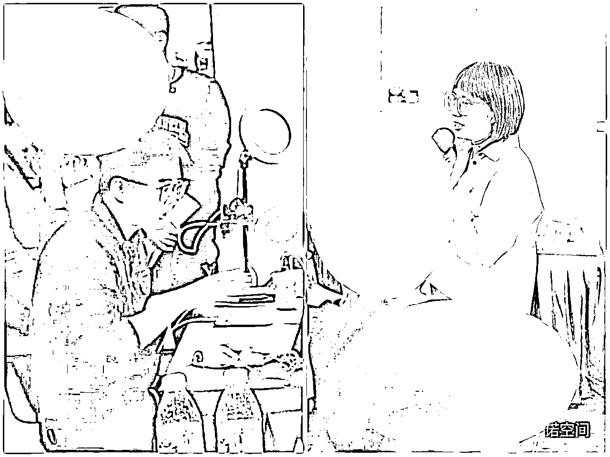
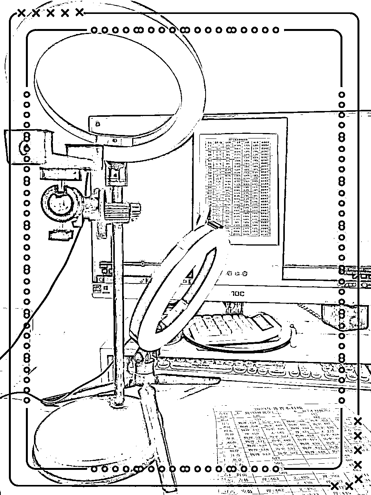
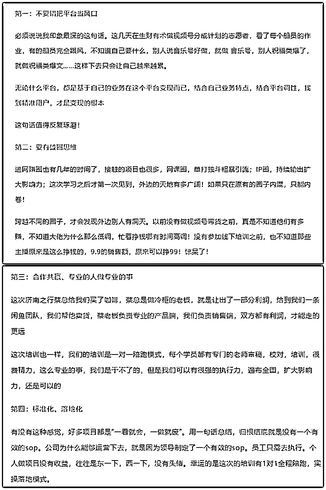

最近龙哥盟2024年头一回航海定在1月5日开船，报名通道昨天已经打开了，你选了哪条船？

我这次选了抖音直播（教育）这条线，不光当船员，还把领队、志愿者的名额也报了。要是能被选上，就多出一份力；选不上也没关系，安安静静当个船员，好好享受整段旅程。

估计有人会好奇，我为啥对这条船这么上心？那咱就好好聊聊这个项目。

# 这个项目到底做什么？

先说结论：抖音教育直播，其实是一条升学规划垂直赛道的直播项目。核心玩法是“手播”，真人不用出镜，照着脚本念话术，输出专业内容，然后通过挂车卖小课包、书籍、志愿卡这类产品来变现。这条赛道没有淡季，只有旺季和更旺季——平时靠小课包走量，高考前还能靠志愿填报再冲一波。

我第一次看到这条船的时候，也跟没做过线下培训的你一样：一脸懵，满脑子抗拒。我不懂专业知识、没当过K12老师、不敢露脸直播、还社恐……总之就是觉得“我不行”。

但如果你也这么想，那咱俩真是一模一样。我起初也觉得自己没基础干不了，学完之后才彻底反应过来：零基础完全能上手，而且老师说，越是零基础越好做——因为没有旧知识束缚，不会自己乱发挥，反而更容易照着要求来，顺着抖音的规则跑，成功概率更高。

偷偷告诉你，教练连脚本都直接塞进航海手册里了，基本属于“不带脑子也能参加”的程度。

一句话概括：这是一条升学规划垂直赛道的教育直播，用手播形式（不用露脸），按脚本讲专业知识，最终靠带货小课包、书籍、志愿卡等产品实现变现。没有淡旺季分别，只有旺季和更旺季——平时卖小课包，高考前还能切入报考场景。

再说个信息差：卖19.9的小课包，一单利润能做到60到100块。别太惊讶，也别觉得我手滑打错了，真的是19.9的课，能赚出60到100的利润。

直播场景大概是这样的：

聊完项目，再说说我这趟济南之行，以及为啥我铁了心推这条船。

# 济南，我来了

## 初识高考规划师

其实去济南之前，我已经听说过高考规划师这个行当。因为亲戚家孩子去年高考，找人报志愿花了5000块——我当时就暗想，要是我自己会报考，这5000是不是就落我兜里了？这事让我意识到，高考规划师绝对是个利润空间巨大的行业。只是当时觉得非得专业人士才能碰，就一直没敢涉足，直到遇见了Lemon。

认识Lemon是在一条闲鱼团队里，我们都是高级代理。她最开始做闲鱼，后来转型干高考规划师。我们团队平时氛围特别好，大家会互相分享引流方法、运营技巧，有好项目也从不藏着。一次交流中，Lemon聊起了线上做高考规划师的前景，还晒了晒自己的收入情况。

当时真把我惊得下巴快掉了。那一刻我才彻底明白了什么叫“隔行如隔山”——原来网上卖19.9的课，一单利润竟然能有60到100！全家震惊。所以等她组织线下培训时，我想都没想就报名了。

## 线上规划师的前景

现在市场上有这么个局面：线下机构会报志愿，但不懂线上运营；线上机构会玩流量，却对专业知识了解不深。

正因为有这种线上线下的认知落差，普通人也能借机切入线上规划师赛道——关键拼的是直播能力。

线上直播间：卖小课包、教辅书、志愿卡、课程等；线下引流后：做志愿填报、多元升学规划，这些都是高客单业务。

所以这很可能是一次线上、线下相互整合的机会。哪怕你完全不会做线下，光是等到高考旺季，也能靠直播赚笔像样的收入。

## 学习过程

三天两夜下来，脑CPU几乎烧干。全程印象最深的一句话就是：“不要错把平台当风口”——光是这一句，就足够让我觉得跑这一趟济南值了。

第一天上午，讲行业现状和发展趋势，也看到了柠檬姐是怎么从闲鱼无货源电商一步步转型成规划师的。

第一天下午，拆解抖音底层逻辑和直播算法。以前我在视频号直播，只觉得视频爆了就有流量接住，至于自己在说啥无所谓，不冷场就行。听完课才恍然大悟：原来一切背后都有清晰的底层逻辑。

第一天晚上，现场看了侯老师直播。最大的感触是：搭建直播间真没那么难——没亲眼见的时候觉得超复杂，到现场才发现完全是自己吓自己。

第二天上午，拆脚本。这真是让人昏昏欲睡的一个上午，像极了文化课：明明很重要，却枯燥到不行，还偏偏必须学。

第二天下午，自己上手练拆解。那会儿才体会到“书到用时方恨少”——我唯一能拆出来的就是拉互动，剩下的只能日后多练。

第三天上午，学怎么科学复盘，又是一个茅塞顿开的时刻：原来如此！

第三天下午，聊未来规划，讲怎么一步步搭好变现路径、实现多元化发展。

# 我推荐这条船的理由

## 1. 客单价低、利润高、容易成交

这点我已经强调好几遍了，说到底就是信息差。以前我以为19.9的小课包顶多赚10块，谁知道居然能赚60到100。19.9不过一杯奶茶、一包烟的价格，家长根本不会犹豫，出单自然容易。

## 2. Lemon老师带队，值得信赖

我是真真切切在线下学了三天两夜，亲眼见识了老师的专业水平，以及在抖音做高考规划师的实战能力。而且老师一点架子都没有。想走这个赛道的朋友，真的值得去链接一下，说不定能碰撞出更多灵感。

## 3. 投入少、产出高

不少项目操作起来要砸时间或者砸钱。比如做实拍视频，起号之前厂家根本不会寄样品，得自己掏钱买；闲鱼无货源电商，客户随时咨询，你得随时在线。相比之下，这个项目每天花的时间是固定的，一场直播大概1到1.5小时，想一天播几场全看你想赚多少。

基础投入100块以内，不用投流，只需要手机、补光灯、手机支架这类简单设备，直播时长也固定。下面是我的装备，总花费：57.96元。

## 4. 有认知差，也有一定壁垒

现在线下经济一直往下走，大量人挤到线上，带货和直播卷得不行。但知识赛道反而是另一番景象：抖音知识直播看播时长增长了165%，超过55%的抖音教育兴趣用户有相关购买行为，其中小课包占比最高。

再加上很多人误以为非得是专业高考规划师才能做这行，于是不敢轻易入场——对比其他赛道，这里真的没那么卷。

## 5. 这不止是一个项目，更是一份事业

济南线下学习时最戳我的一句话还是：不要错把平台当风口。

在赚钱圈子里，项目从来不缺，缺的可能是变现能力。项目多有多的好处，也有多的劣势——乱花渐欲迷人眼。大家可能更习惯做短平快的项目，却没意识到，我们真正想要的其实是一份长期事业。

如果天天跟着平台到处换项目，只会越做越累。下面是我学完后的真实感悟，可以参考一下：

## 6. 趁旺季之前，提前卡位

高考规划师的变现路径，不止是卖小课包、志愿卡、书籍，还能线下接报考、做学习规划。平时我们卖小课包是给机构带货、赚佣金，但客户完全可以引流到私域。

过了年就是旺季，很多家长已经开始着手准备了；到了六月，线下报考基本供不应求。线上线下一起做，前景相当可观。就算自己没有报考经验，把粉丝介绍给当地机构，或者跟线下机构合作，也是一笔不小的收入。

## 7. 还能帮自家孩子报考

都说一技在手，吃穿不愁。咱不用学那么多，至少能给自己家孩子做个报考规划，省下5000块。退一万步讲，哪怕真派不上大用场，至少以后给孩子选报考规划师时，你也能露出专业功底，让对方更重视你的孩子。

## 8. 来体验一下A+志愿者的服务

这次我报了志愿者和领队，如果有幸被选上志愿者，就能和大家一起冲了。你也可以来感受下A+志愿者的服务水准！想了解我的服务细节，可以看看这篇精华帖：

https://t.zsxq.com/154JoIeL0