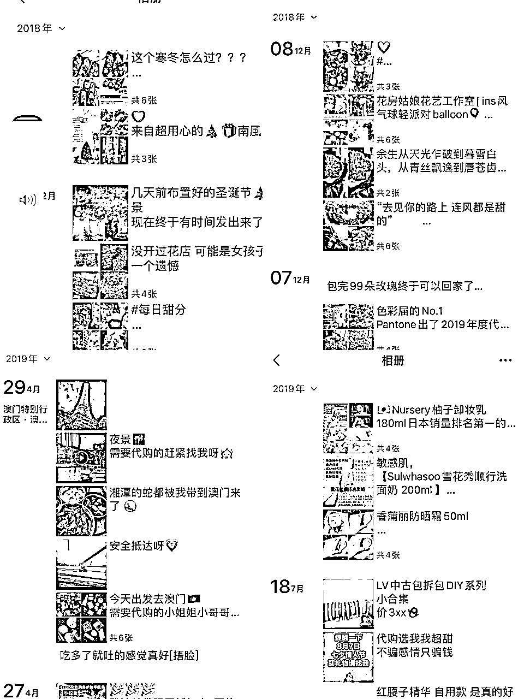
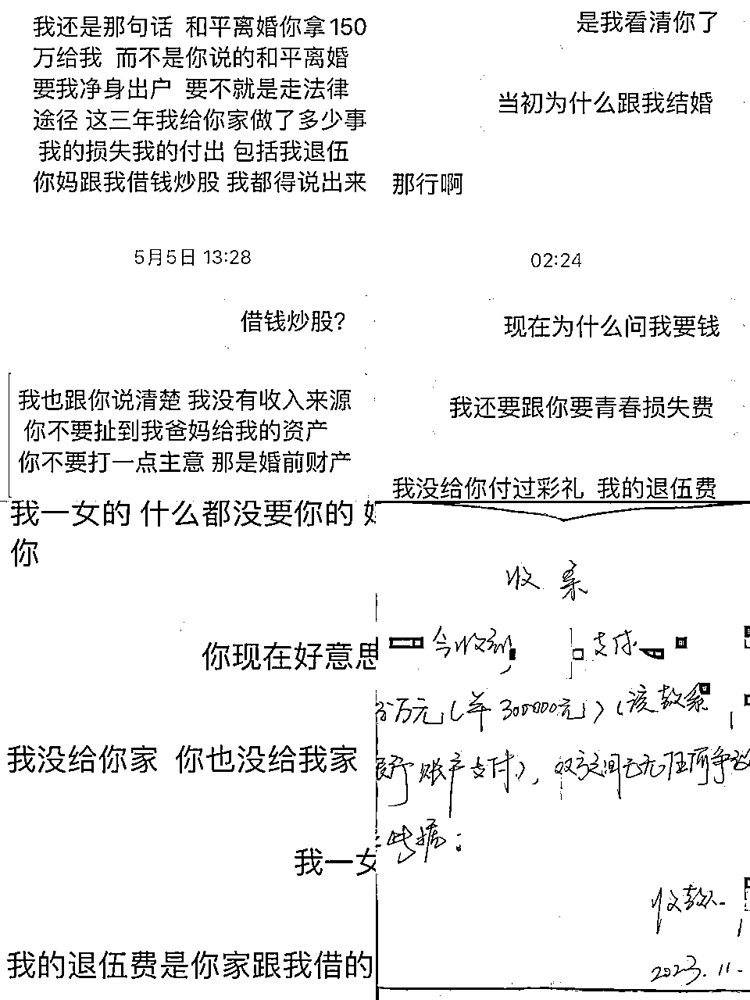
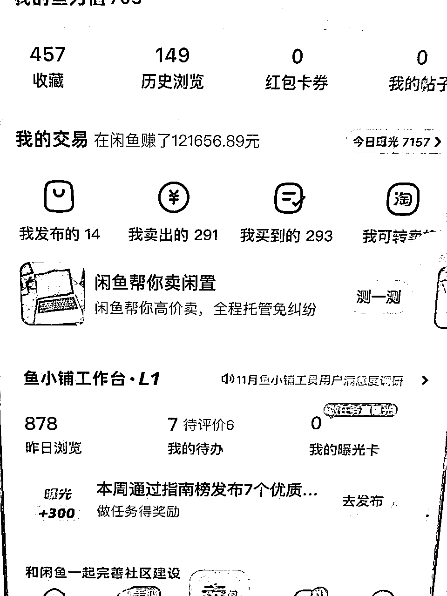
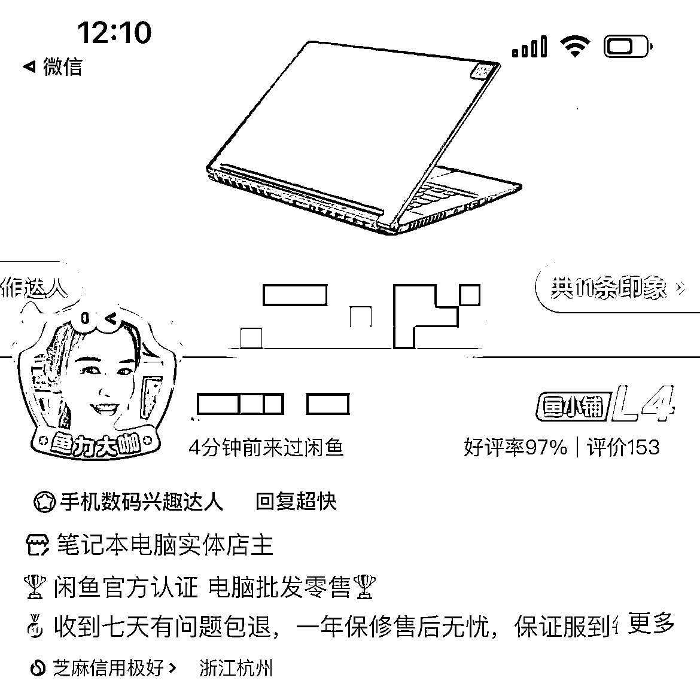
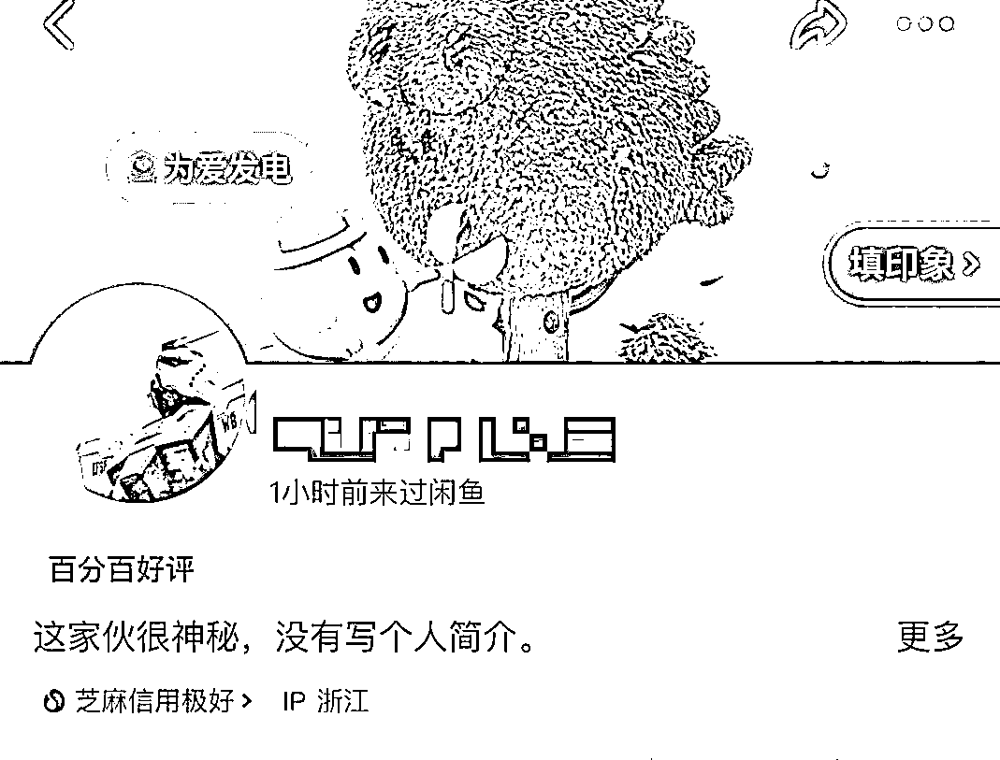
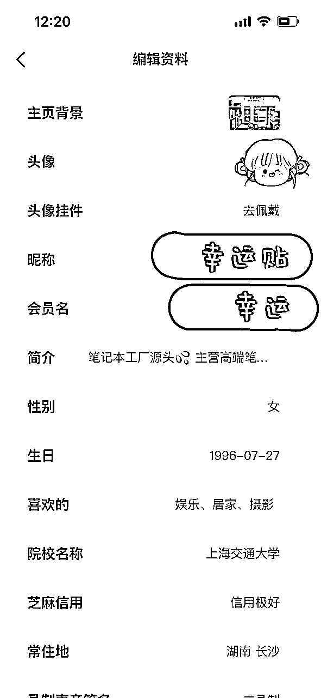
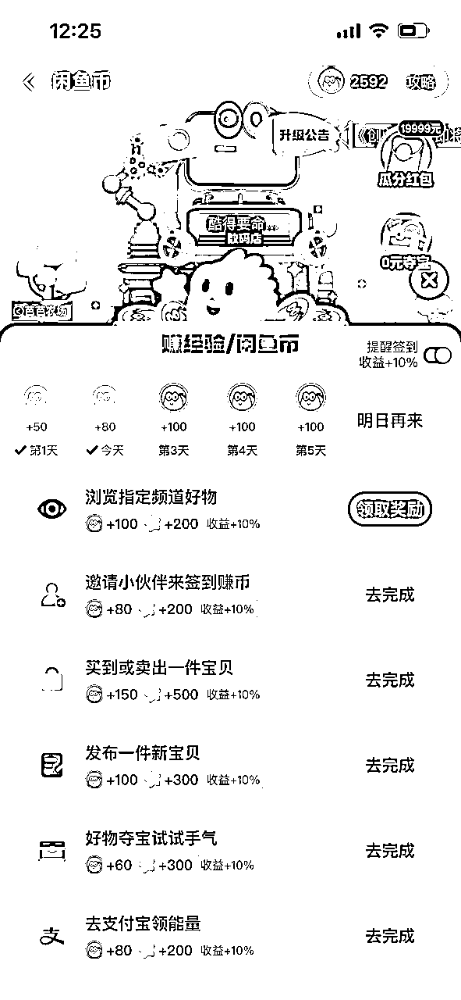
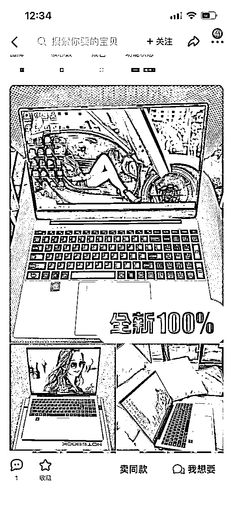

婚姻让我耗尽两百万，闲鱼却重新给了我底气

嗨，我是酷得，老家在南方一座小县城。父亲在体制内工作，母亲早年碰上企业改制，后来自己做买卖，多年下来攒了些家底。我从小被保护得太好，没吃过苦头，总觉得世上全是好人，想干什么都能成功。家里条件不错，我就向往精神满足，尤其想要一份美好的爱情，也总想着靠自己做出点名堂。哪里想到，这份执念让我为婚姻损失了二百多万。

先讲搞钱这条线。头几年微商刚刚兴起，淘宝也有红利，我抓住了机会，赚到人生首笔50万。后来太过相信合伙人，投了商业演出项目，赔进去十多万，整个人差点崩掉，也终于看明白生意场上的险恶。期间尝试考研，没有考上。后来拿剩余的钱开花店、做代购生意，收入只够温饱，疫情一来，又全黄了。这些年我试过无数项目，花掉的学费远比赚回来的多，身心俱疲。

感情线上，我更是栽了跟头。从小到大，父母越是拦着，我越要拧着来。他们早就看出那人追我是另有所图，可我偏偏不听，一心要嫁给爱情。2020年我不小心怀孕，家里没了办法。转过年来，我嫁给了一位家庭背景复杂的男士。原以为事业不顺，婚姻总能给点温暖，谁知婚后所有压力都落在我头上。才出月子，就要扛起养孩子、养丈夫、养家用的重担。三年里，我们吵了不知多少回，我也受够了精神控制。那人始终在想法子掏空我，不断索取，处处算计。我忍无可忍，决定结束婚姻。可离婚时他用各种借口，骗我办手续，把父母出资100万开的辅导学校转到了自己名下，临走还逼我拿30万，才肯放过我们。钱给了，我也只能独自抚养孩子。短短几年功夫，父母老得很快，家底也被那场婚姻消耗殆尽，再也帮不上我。前前后后给前夫花了两百多万。

到了今年，我可以说两手空空，爱情没有，事业也没有，心里最对不起的就是父母。可是宝宝的口粮、家里的日常开支，都在提醒我不能倒下。回头盘点，自己还算有电商方面的底子。电商启动成本低，风险也可控，因此我决定回到互联网上，重新折腾闲鱼，期间也砸了不少学费。最初怕赔钱，只敢碰那些能代发、成本极低的商品。做了一阵子，发现利润太薄，时间成本太高，精力也白费。后来又在电商培训上交了不少智商税，我甚至想，命运故意跟我作对：起初的牌并不差，怎么就落到这步天地。机缘巧合，我在赚钱圈刷到瑜大老师的文章，直觉告诉我可以信任，就立刻去找她，跟着拿利润更厚的货盘。她的指点加上我原本的电商经验，很快有了回报。11月30天算下来，净赚3万多，我实实在在被震住了：选择确实比埋头苦干更重要。下面就把闲鱼运营的要点全部分享给你。

先说新手入局的几个理由：

第一，全国网民规模约11亿，闲鱼目前只有5亿用户，还处在增长期，上升通道很明显。第二，闲鱼不设付费推广入口，系统不会给花钱的人额外倾斜，每位卖家的曝光机会大体均等，新人也能冒头。第三，平台用户年纪轻，加上本身是做二手交易起家，大家更在意东西实不实用、划不划算，而不是大牌。我卖数码产品能走量，很大程度得益于这一点。第四，操作很轻量，开户就能卖，不受地域约束，随时能在手机上回复。我要带孩子，这一点特别友好。第五，对比其他线上渠道，闲鱼的正反馈来得最快，能帮人快速建立信心。

我特别喜欢一句提醒：自信不是靠洗脑，也不是靠别人夸奖，而是靠实实在在办成几件具体的事，从外界得到肯定。完成有难度的目标，或者拿下某个阶段的小胜利，自信就会慢慢长出来。赚钱的圈子里大神太多，越看越容易焦虑。但我不甘心认命，静下来把事情做深，结局大不相同。

# 二、先把账户准备到位

(1) 优先起新号。新注册的ID，系统会优先给机会，也没有乱七八糟的历史记录，从全新状态起步，最容易见效。

(2) 旧号也不一定没用。关键看它有没有卖过货。如果超过90天没有卖家记录，系统会把原有评分清零，同样会给机会。很多旧号之前随便挂过商品，把早期机会挥霍掉了，所以要么换新ID，要么让旧号闲置满90天再启用。

(3) 多开账户会不会分流？同一人名下的几个ID如果有卖货行为，流量可能会分散。但新手阶段不用太担心。闲鱼说到底还是二手交易市场，规则没有别的平台那么细，影响不大。等业务跑顺了，再借用家人的身份多开也不迟。

(4) 记得做好设备隔离。每台手机、每张SIM卡、每个ID都要一一对应。别把不同ID放在同一无线网或热点下登录，也别在一台设备上反复切换，否则容易被限流。新手期坚持用新ID就好。

# 三、把这六件事做扎实，出单就不难

1. 人设包装要到位。先看图： 假设你是买家，两个卖家卖同样的货，价格差不多，你更愿意点谁？肯定是资料完整、看起来像真人的那边。路径在闲鱼App的“我的—设置—个人档案”。

关于性别：我做的类目是数码，买家大多是男同胞和电脑小白姑娘。ID性别我填女，女生做售前沟通、催单、售后时更有天然好处。封面图放了电脑实物图，看起来垂直专业；放豪车图也行，能显示实力。头像我用的真实女孩照片，千万别用明星脸。简介要交代两层：一是你是谁（年龄、城市、做这行多久），二是货品情况（发货地、到货时间、渠道、售后、活动）。我直接写了“电脑工厂一手货源”，让人更信服。其他信息，年龄填20-30之间，院校、喜好、居住地能填就填。

2. 每日任务不要断。每天进闲鱼App后记得签到： 连续签到能拿平台积分和经验，既能养号，也能提高权重；积分还能用来推广商品。我早上起床头件事就是签到，不花几分钟，贵在坚持。平时多刷30个商品，装得像普通用户，别让人当成专职广告号；有条件就买点小东西，积累真实成交；零点一过再擦亮一下商品。

3. 参考优秀卖家非常关键。他们爆款的标题、价格、文案、图片都是现成教材。标题公式：核心词+长尾关键词+卖点+痛点+实际用途+品牌+转让原因+优势+数字。不用全用，挑几个组合就很好。我习惯这样：选3-5个想模仿的卖家，把他们的标题存下来，修改成自己的。日常刷到好标题、好文案，随手记进收藏夹，慢慢搭起自己的语料库。还可以再养个辅助ID，去和这些卖家聊天，学他们的说法。

4. 美商必须在线。首图决定点不点进来。我习惯把商品摆在画面中央，背景收拾干净，让买家一眼看清商品。再用修图软件在图片上加“全新”“余量不多”这类字眼，更抓眼球。

5. 前期要会自己造数据。有货、会养号以后，就要靠运营来拉曝光、浏览和成交。我以前做淘宝，补单是店里绕不开的动作，闲鱼也类似。起步阶段，可适当用辅助ID帮主ID把数据做起来。

6. 真诚最能打动客户。首先，回复要快。不少卖家是业余在做，没法秒回，你反应够快就赢了。其次，把回答口径准备好。做数码类目时，我把配置、用途、内存、价格、售后都理成模板，放进手机输入法的快捷栏。像‘货从什么地方发出’‘几天能到’‘用哪家物流’‘是不是全新’‘能便宜吗’这些高频问题，一下就能答。聊天时多讲‘咱们’‘我们’，少用‘你、我、他’；男生可以端学长一点，女生可以更亲昵些，再配上表情，亲切感就出来了。能用语音沟通的话，尽量发语音，语气放温柔，下单机会能提高两成。

最后说一下选品。我怎么会锁定电脑整机？因为闲鱼对单ID能上架的类目有限，我之前做代发模式，碰了壁。来算笔账：卖打印机那会儿，一天累死累活出10单，一单只赚20，单月顶多6000，不如去工厂拧螺丝。后来换了赛道，一单赚500左右，每日成交三单，单月能到4-5万。当然，要先让主ID跑出正反馈，再逐步加开，每人最多同时运营3个ID。就算不能天天开单，保底每月也有1万。所以我总说：七成选品，三成操作。品挑对了，收入就赢了大半。把精力放在最值的地方，跟对人，做对事，回报才能拉满。

说实话，我在闲鱼这条路上也才刚起步。咱们互相鼓劲，共同把利润做大。有不懂的地方随时找我聊，我一定知无不言。特别感谢瑜大老师，也感谢赚钱提供的机会，让我遇见对的引路人。本月我的目标是做到5万利润，过个踏实年。咱们共勉。