# ('干货分享-教你用影刀 RPA 批量抓取抖音爆款视频数据', (2, 29))

你有没有发现，做抖音最痛苦的事之一，就是天天盯着对标账号，手动翻视频、记数据？点赞、评论、发布时间一个个复制粘贴，眼睛酸不说，效率还低得离谱。其实这种重复、有逻辑、规则固定的活儿，天生就该交给RPA来干。今天我们就来聊聊，怎么用影刀RPA给抖音项目“加杠杆”，自动批量抓取爆款视频数据，把人力彻底解放出来。

先交代一下背景：我是马小威，影刀官方认证中级工程师，也是个专注用RPA降本增效的95后奶爸。这次我做了个机器人，能自动跑完整套抓取流程，而且文末依旧无保留分享源码，交个朋友。

先看效果视频，感受下这个机器人到底能做什么。

在动手做之前，得先搞懂两个核心指令：一个是【循环Excel】，一个是【双循环】。

【循环Excel】说白了就是把Excel里的内容挨个取出来用，从第一行到最后一行的顺序，比如表格里有1、2、3、4、5，循环就会依次拿出1、2、3、4、5，直到全部处理完。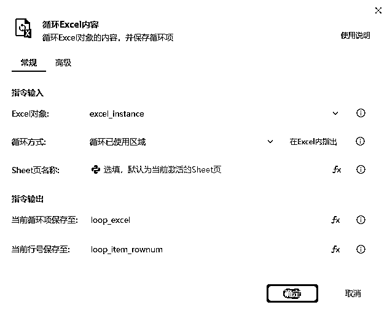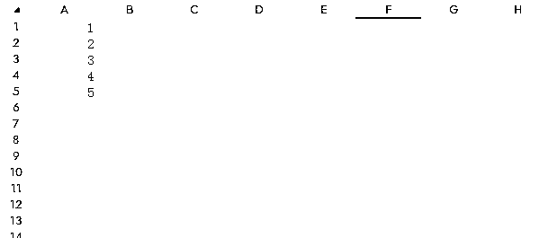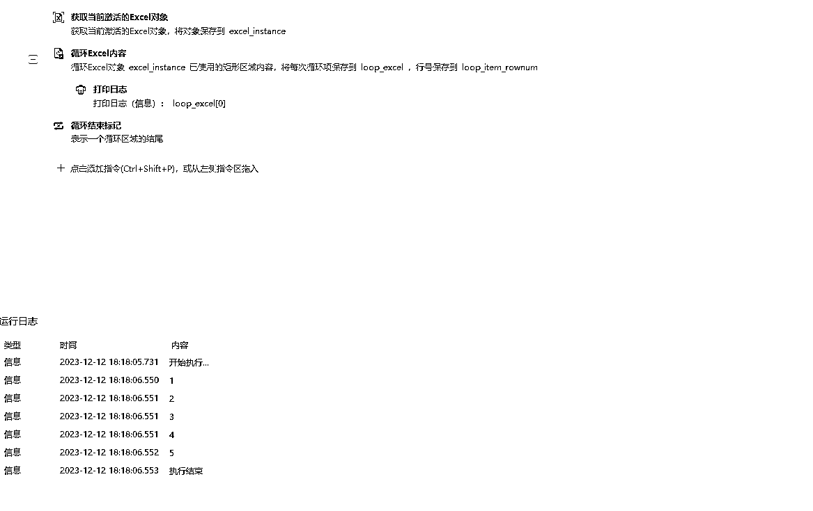想深入了解的话，可以去看影刀官方文档“循环Excel内容”。

【双循环】则是在外层循环的每一项里，再嵌套一层内层循环。比如外层是1、2、3，内层是4、5、6，流程会先跑外层第一项1，再完整跑内层的4、5、6，接着再跑外层第二项2，再跑一遍内层4、5、6……直到外层结束。 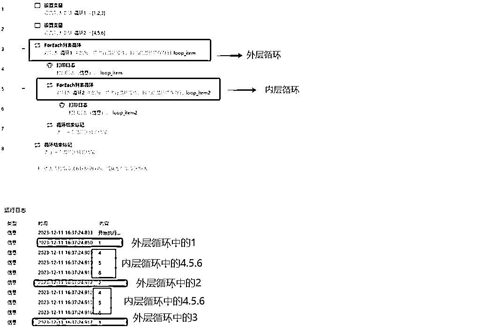简单说，就是“循环中的循环”。

接下来看机器人怎么落地。第一步是准备工作：把要抓取的对标账号信息提前填进Excel表格，然后用【循环Excel】指令，让机器人挨个去这些账号的主页抓爆款数据。RPA会访问每个账号首页，按昵称新建sheet页，并在“抓取状态”栏里更新进度。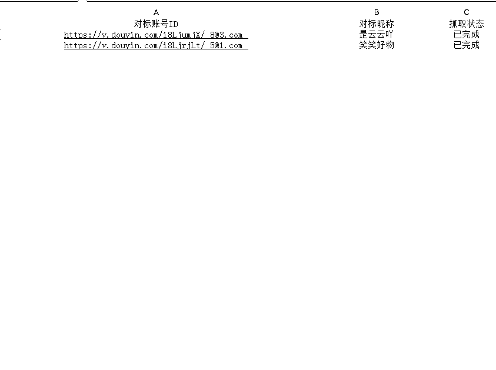

收集素材的时候，咱们通常有筛选条件，比如点赞超过多少、评论超过多少、发布时间在几号到几号之间。有人会问，RPA能做筛选吗？当然能。你可以在启动前定好爆款标准：点赞超1万、评论超2000，也可以按某几天内最高赞、最高评论来选。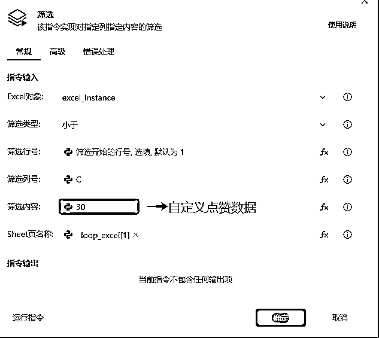

要提醒的是，爆款有时效性。所以这个机器人默认抓近3天内的优质视频，这样参考价值才高。当然，时间范围完全可以自己改。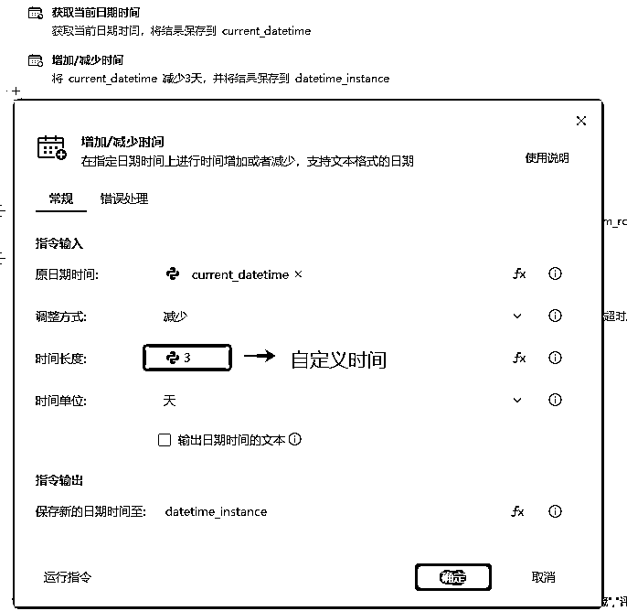

具体抓取流程分几步。循环第一步是打开Excel里填好的对标账号链接，然后通过【批量数据抓取】指令，把正文内容、发布时间、链接、点赞、评论等原始数据抓下来。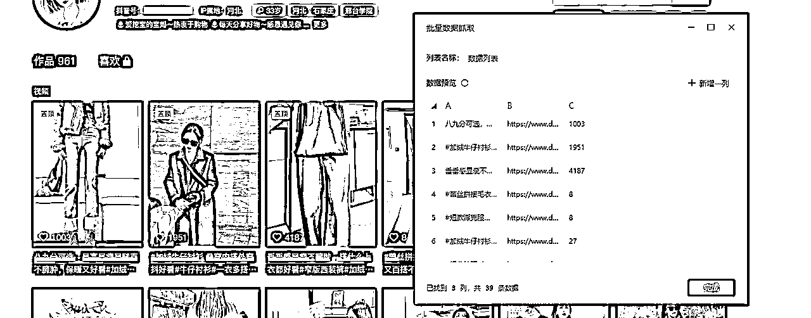但要注意，这一步在账号主页能抓到的只有文案、链接和点赞数，跟我们最终想要的完整数据还有差距。所以接着要用影刀市场里的【筛选】指令，按自己的标准把有效数据筛出来。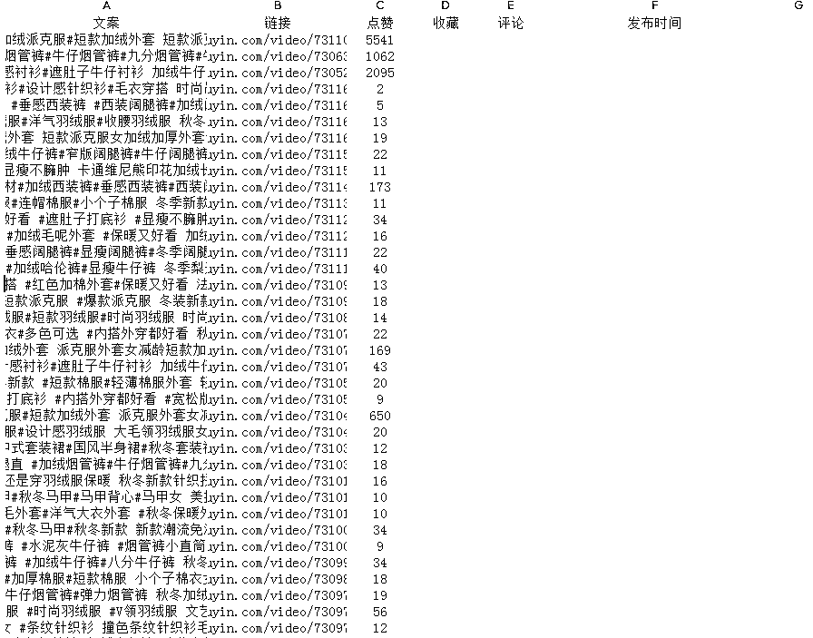筛选标准可以灵活改，比如按点赞数过滤。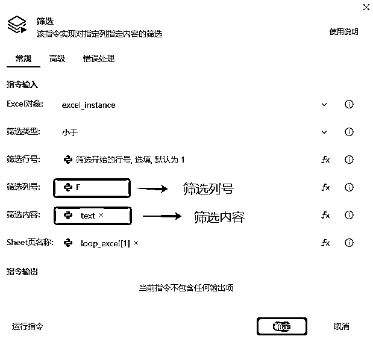

这部分的完整操作就是：在Excel里新建sheet页，写入批量抓取结果，再完成初步筛选。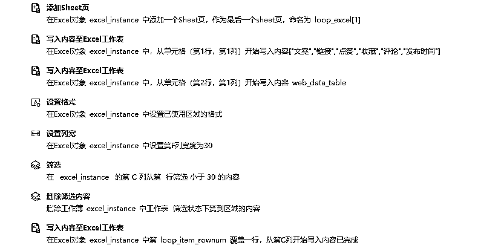细心的朋友会发现，这里拿到的数据并不全——主页上只能看到文案、链接、点赞，所以也只抓到了这三样。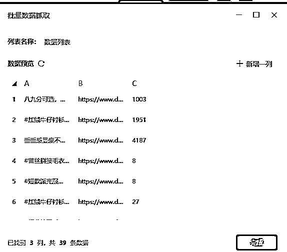

那评论数、发布时间、收藏数怎么拿？办法其实很“笨”：像人工一样，逐条点进视频详情页去抓。这就要在原来的【循环Excel】里再套一层循环，也就是前面说的“双循环”。

为了提效，可以直接在步骤3.2初筛过的数据基础上，再抓评论和收藏。大致流程是：循环抓到的数据→打开抖音链接→抓取评论、点赞、发布时间→写回Excel。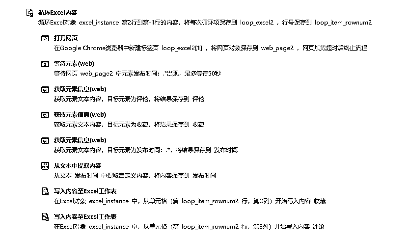这样一套下来，不管你想收点赞过万、评论过2000的，还是近3天最高数据的视频，都能实现。

但有个细节要注意：点赞、评论的标准得结合对标账号本身来调整。如果账号粉丝量不高，那点赞1万、评论2000没问题；如果对标的是几十万上百万粉的大号，爆款的定义就得重新掂量。毕竟大家心里都清楚，低粉爆款才是更有对标价值的。

经过两轮筛选，最终数据就会清晰呈现在Excel里：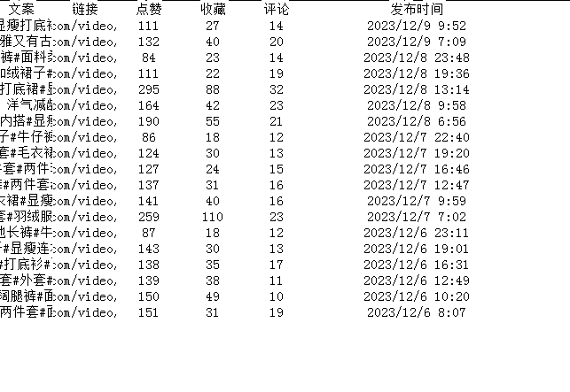视频文案、链接、点赞数、收藏数、评论数、发布时间全都有了。拿到这些，就可以模仿、跟款了。

机器人跑完还有个贴心功能：同步信息到微信。为什么要加这一步？因为等机器人全跑完，把关键结果直接推到微信，你就能随时随地被提醒，快速看到对标账号动态，及时安排后续跟款操作。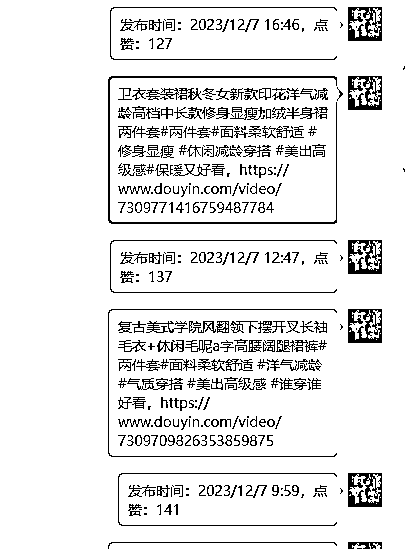

这部分也是循环Excel表格，遍历抓到的视频数据。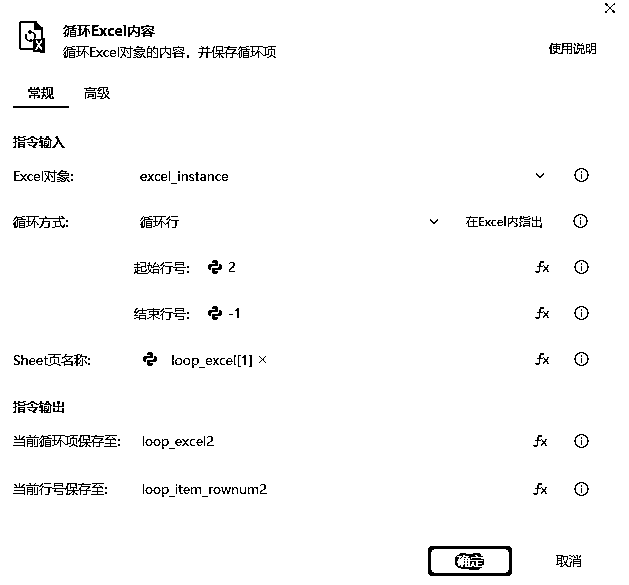流程大致是：唤起微信窗口→点击搜索框输入要发送的微信昵称→点击输入框输入点赞数据和发布时间→把文案和视频链接发出去。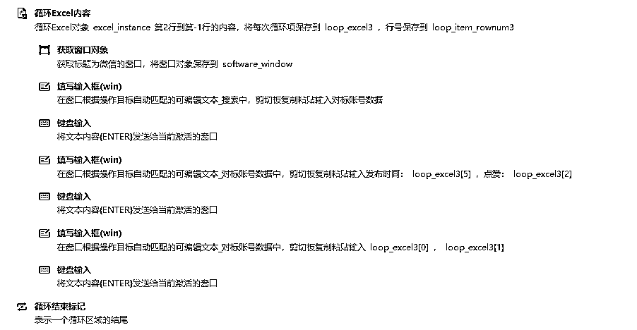走完这一步，整套流程就大功告成了。当然，你也可以把Excel里每一行的信息打包发送，这里只是挑了部分字段做示范。

最后多说一句：我觉得“学习”不是一个词，而是“学”和“习”两个动作。掌握影刀基础只是开始，更关键的是不断拿真实项目去练级、打怪，RPA才能真正给工作生活加上杠杆。

这次机器人链接在此：自动抓取抖音爆款视频数据-马小威（密码：mxw4260），下载影刀后点击获取应用就能用。用的时候有问题欢迎交流。顺便推荐几个之前做的机器人：马小威-如何利用影刀RPA为微头条10倍赋能；马小威-如何利用影刀RPA给公众号爆文赋能；马小威-免费自动加微信好友的RPA机器人，保姆级使用教程。

我是马小威，专注影刀RPA降本增效，祝大家一起赚钱有术。想提升工作效率的话，欢迎来聊，V：mxw4260。