我的“最简发售模型”复盘：600人小范围发售，12.5万入账，转化率41.8%

各位龙哥盟的圈友，大家好，我是宋老师——那个“宋老师帮你做课”的账号主理人。

先简单交代一下背景：目前我在知识付费领域主攻做课和卖课，已经做到全网的头部位置；一年变现800W+，带过的5000多名学员里，有200多位的变现成绩已经突破100W。

上星期我做了一次小范围的发售测试，没有大张旗鼓，只开放给600个用户，卖的是499元的文案营，结果还是相当提气的：

600人里成交251人，营收125,249元，转化率41.8%。再看商品点击到支付这一层，转化率做到了50%——也就是说，每两个点过链接的人，就有一个直接付了款。

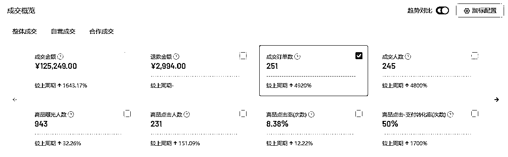

这场仗打完，团队当晚就拉着我做了深度复盘，整套打法被我提炼成了一个特别精简的模型，我叫它“最简发售模型”。

今天写出来，就是想给还没摸到发售门路的朋友一些启发。

在进入正题前，先聊聊我的几个标签，方便你知道这些经验是从哪儿来的：

1. 目前自媒体圈里，做课&卖课方向的头部博主——这是我的流量能力；
2. 前新东方总监，最高管理过80万学生社群——这是我的教学能力；
3. 刚用600人小范围发售换来12W+变现，验证了最简发售模型——这是我的发售能力；
4. 8000多位知识博主背后的老师——这是成绩；
5. 很多百万博主做课卖课背后的男人——这算是江湖地位吧。

整套最简发售模型，我只把它拆成三步：筹备——造势——发售。

下面我一个个讲。

## 一、筹备

我做事有个习惯：不打没把握的仗。一件事情在启动前，我会先把底层逻辑想明白，至少保证七成胜算，否则就是在浪费时间。筹备这一步，就是整场发售的地基。

这一阶段我其实只干了两件事：第一，敲定发售排期；第二，物料准备+责任到人。

听起来简单，但里面坑很多。

### 1. 敲定发售排期

不管大事小事，排期就是后续所有动作的指挥棒。光是排期这件事，我和团队就开了5个小时的会，用沙盘推演把整个发售路径模拟了一遍，确认每个环节没有漏洞，才真正动手。

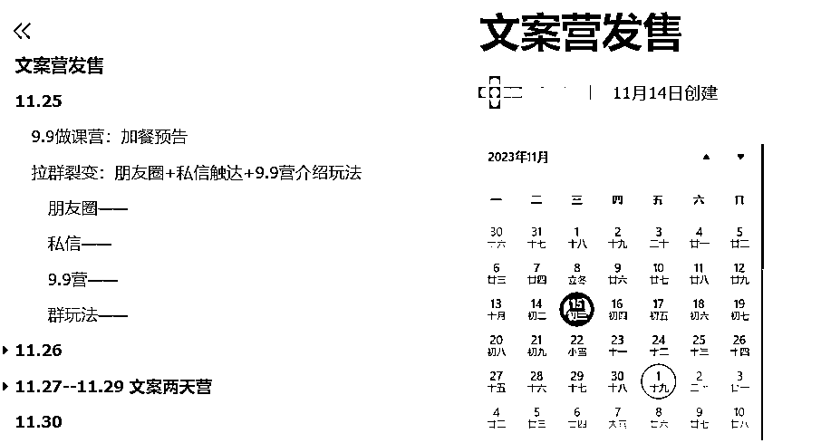

写排期时，有几件事一定要想清楚：

**第一，发售对象要选准，不是每次都得打全部私域。** 这次只是小规模试水，所以我只针对新进入私域的600人发售，完全没有打扰老用户。团队大概统计了一下，这批新用户对文案的需求更旺盛，卖给他们的精准度更高，转化自然更容易。

**第二，社群是隐藏的弹药库。** 你过去和现在建的每一个免费或付费社群，到发售时都能变成关键子弹，帮你把势能顶上去。这句话我这次体会特别深，后面细说。

**第三，厉害的人一次只做一件事。** 上周我们整个团队就围着文案营发售转，其他事全部往后排。我从新东方出来，到自己做IP，再到成为做课卖课赛道的头部，带过的付费学员超过5000，越来越确信：能把一件事做好的人，才最容易成事。反过来，什么都想抓的人，往往什么都抓不住。

这一点真的很重要，如果你记住了，一个月后大概会回来感谢我，到时候记得告诉我。

### 2. 物料准备和责任到人

排期定了，就按排期做准备。准备分两块：物料和人员。

每个环节需要什么物料，都在事前配齐，免得到执行时手忙脚乱，或者临时去补。比如私信触达需要话术和海报，那就提前写好、设计好，每项物料都指定具体负责人，并且定好提交截止时间。只要在deadline之前全部到位，后面就能按部就班地跑。

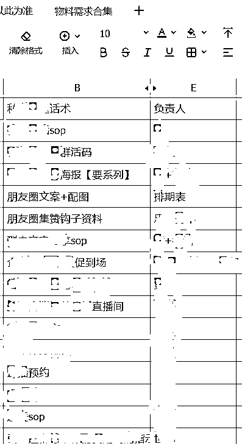

## 二、造势

做知识付费，IP的势能太重要了。每一件事，不论大小，都在为你的势能添砖加瓦。

在这个环节，我主要做了几个动作，等于把微信生态的闭环整体打通了一遍：

### 1. 朋友圈

朋友圈是IP的移动名片，也是造势的主阵地。这次我主要玩了三个动作：

**集赞造势。** 发售前发集赞朋友圈，目的有两个：一是判断用户意向。我送的资料都是那种价值感很强的干货，点赞的人多，就说明这批用户对内容感兴趣，后面报名概率大。二是储备二次激活用户。到了关键节点，我可以在那条集赞朋友圈下面发一条评论，做一个强提醒。

**倒计时海报。** 这次我打出的噱头是“年终公开课”，团队设计的海报做成了一系列。放几张给大家感受一下，朋友圈一发，气势直接拉满。

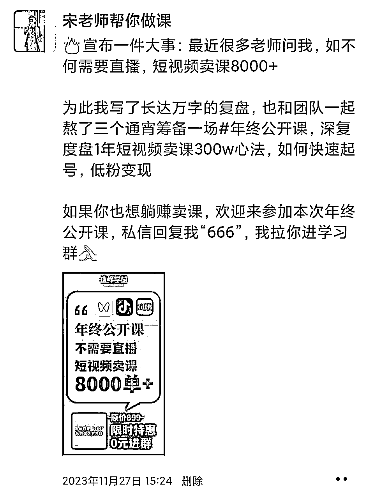
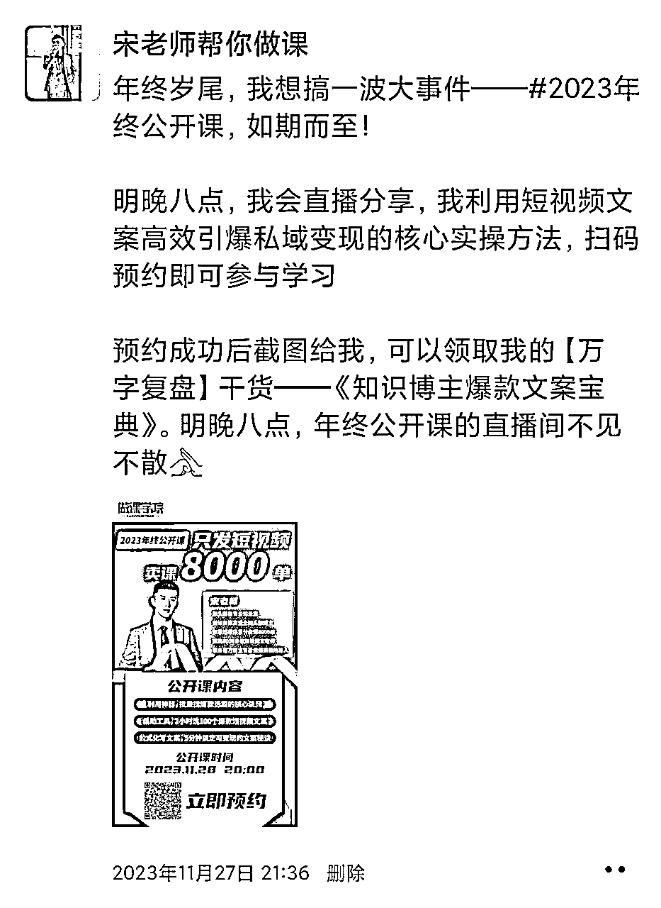
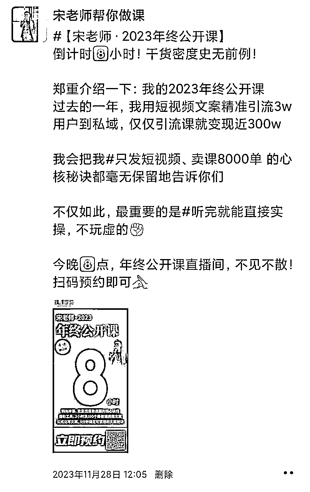
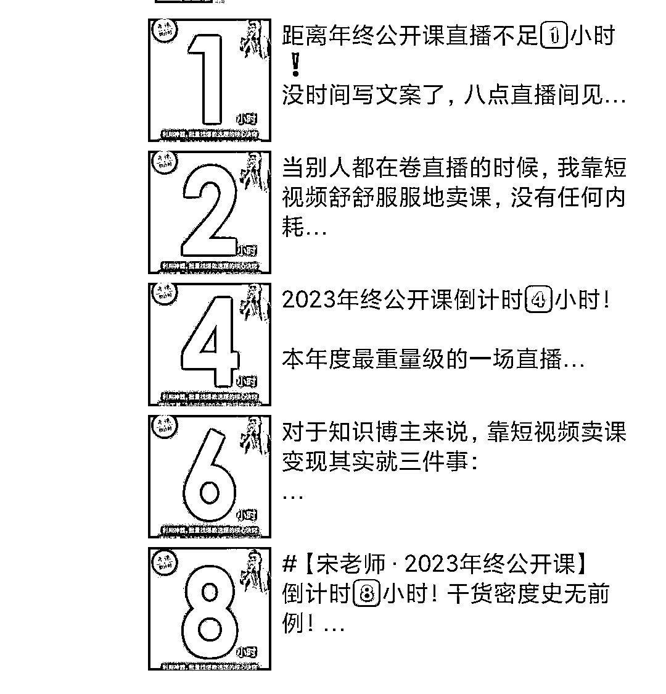

**转发直播间。** 直播发售时，讲到不同的话题就马上转发到朋友圈。尤其我选的开播时间是20:00-21:00，正好是大家刷朋友圈的高峰期，朋友圈该刷屏就刷屏。

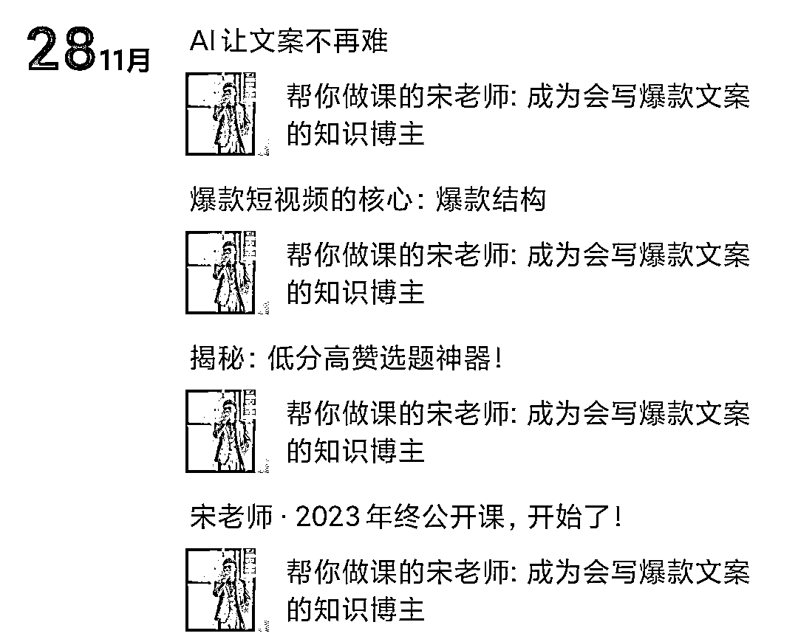

### 2. 私信触达

这次我一共私信触达了600个新进私域的用户。目的很简单：邀他们进我的年终公开课群，也就是发售群。

私信这个环节，我用工具全自动发送话术+图片，一天触达200人，3天就搞定了600人。全程只安排了两位小伙伴，非常轻松。

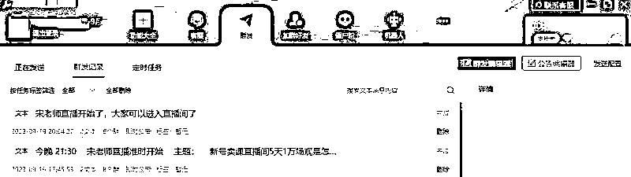

五个发售群也顺利建好了。这里有个小技巧：群名要跟着节奏变。从“备课中”“预约中”“8点直播”“免单中”到“结营”，不断换名字，是在变相增加用户点进群的频率和粘性。

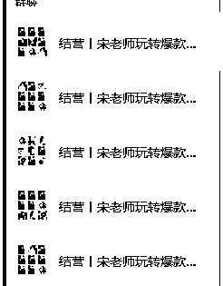

### 3. 社群

社群造势很关键。群里有KOL和KOC帮你带节奏，事件热度一下就能起来。这次我刚建群，就有位付费学员在群里好一顿夸我，像极了水军，哈哈。

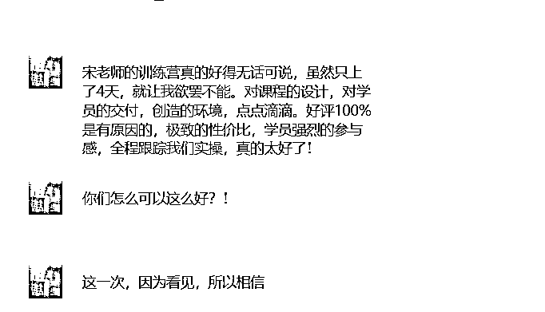

群建好之后，直播前一天我在群里做了一次文字分享，强调公开课的重要性，以及它能解决什么痛点。最关键的步骤是拉直播预约——我当时用了一个动作：预约直播送资料。这个福利一出来，直播预约量瞬间被拉起来，发售600人，当天晚上预约就破了300。

### 4. 企微必不可少

企微这次帮了大忙，有两个核心价值：

一是自动发资料。提前在企微设置好加好友话术，用户加上好友后，就能自动收到资料，省下了大量人工。不清楚的老师可以私下问我。

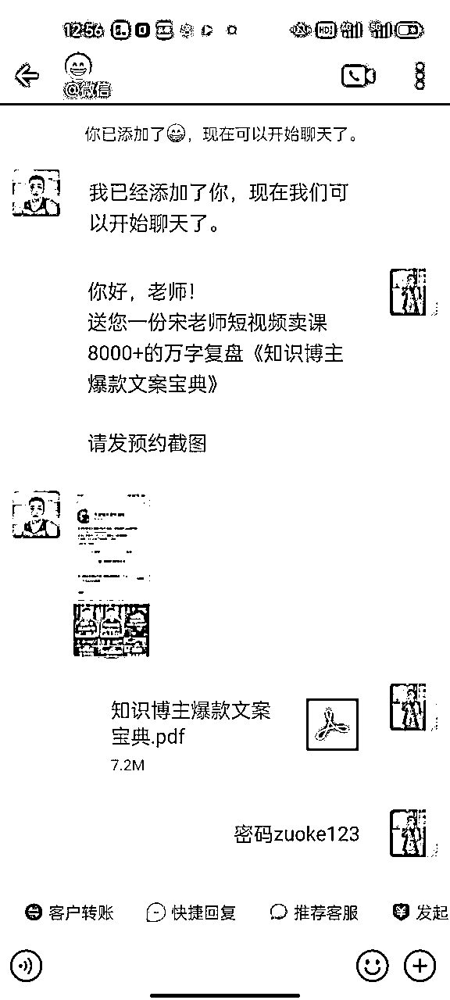

二是直播促到场。直播前用企微提醒用户到场，才能保住直播在线人数。

### 5. 视频号直播

用视频号直播发售，是我这次做过最明智的决定，没有之一。具体好处我在发售板块展开讲。

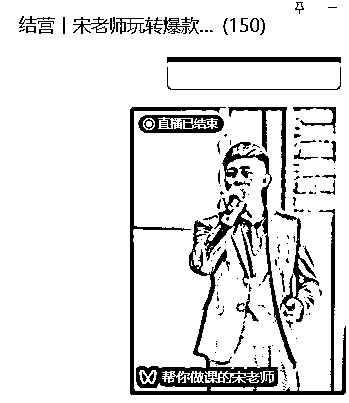

### 6. 直播卖课成交心法

这里直接上干货：

**第一，私域卖课和公域卖课逻辑不一样。** 私域要拉群快速成交，1小时内结束最好。我的转化直播一般是40分钟干货+20分钟推课，大家可以参考。

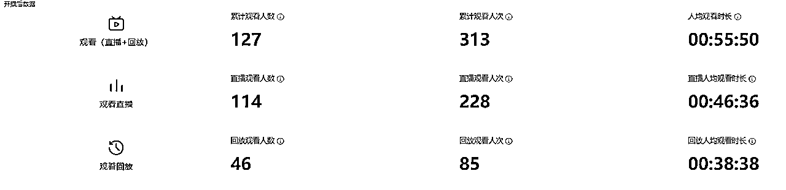

**第二，讲干货的时候也要拉停留。** 可以加钩子、送资料、抽奖互动。观众平均观看时长能有50分钟，才算一个好的讲师，也意味着转化大概率不会差。一定别抠门，该送就送：电子版、纸质版、高级礼盒，都可以安排。

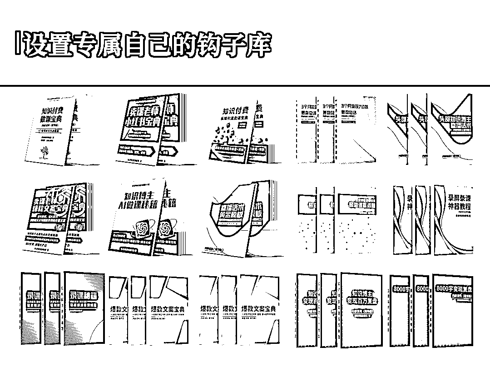

**第三，推课部分一定要憋单。** 层层叠加权益，但就是不上链接，把势能攒住。大概过了5页PPT之后，突然放出价格，配合直播操盘手后台改价、放优惠，1分钟成交几十单都是正常的。更详细的推课节奏，可以直接看我的直播回放。

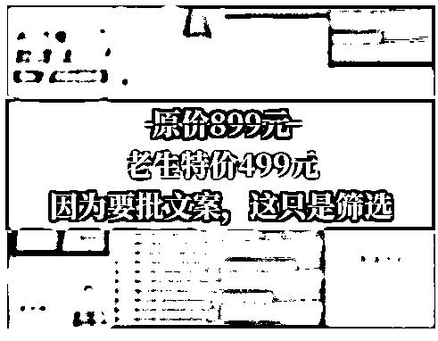

**第四，群内动作可以用接龙模型。** 不断触达还没买课的粉丝。我们一般用“3级火箭模型”：10位接龙报名送xx福利，25位送xx福利，终极福利是40人报名抽奖免单——是真抽奖。这样既能营造积极的学习氛围，又能让围观的人有参与感。

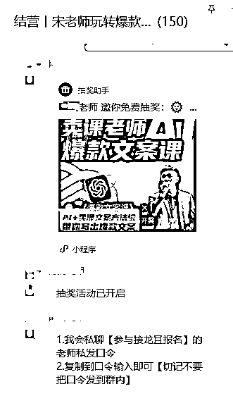

## 三、发售

正式发售是两天。第一天是简单的开营，在群内做文字分享，前面已经提过。第二天是年终公开课直播，也就是发售板块的核心。

虽然只发售600人，但开播前直播预约已经拉到440人以上。预约转化率77%，这个数字真的很能打。

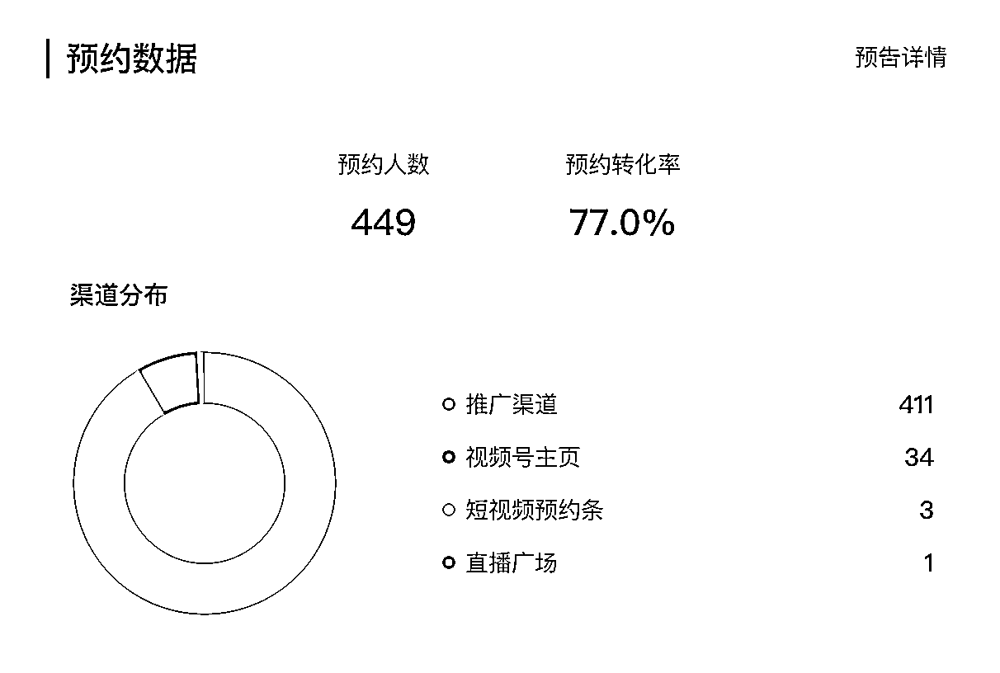

视频号直播最大的杀手锏是公私域联动：私域用户进直播间，会带动公域流量涌进来。

大家看上次的发售直播数据：

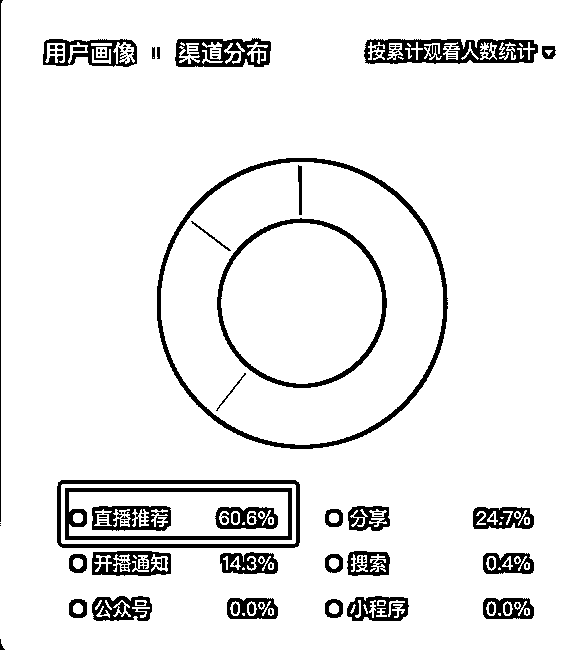

累计观看人数里，直播推荐占比高达60.6%，这就是公域流量带来的想象力。再看成交数据：

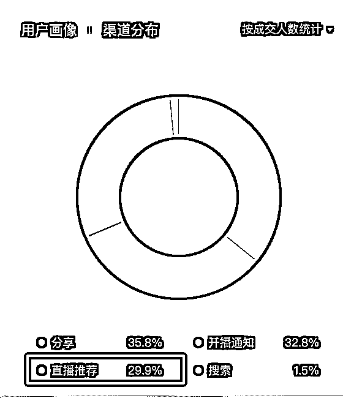

直播推荐带来的成交用户占比29.9%。这些人第一次进我直播间就付费，说明我的内容够硬，能迅速建立信任。关于怎么在直播间快速建立信任，背后也有一套方法论，篇幅关系我改天单独开帖聊，感兴趣的朋友欢迎来交流。

看完数据你应该能理解：在所有短视频平台里，视频号是整个微信生态闭环里的重要一环，对新手特别友好，公私域联动带起来的直播节奏，真的牛。

我自己私域有3W+好友，这次只撬动了600个。所以我现在有一个更大的念头——12月我会发售新产品，在“最简发售模型”基础上把玩法放大数倍。欢迎来围观我年终的大动作。

## 写在最后

发售这件事，乍看是个系统工程，但其实能简化。像这次小规模发售，我就管它叫“最简发售模型”。

如果你没试过发售，如果你是新晋知识博主，如果你怕大规模发售玩砸了，那我建议你：先照着我这次的路子，做一次小型发售探探路，再慢慢完善自己的模型。

能复制有结果的模型，对知识博主来说，是快速打通认知体系的关键一步。希望今天的分享，能帮你在发售这条路上走得更顺。

祝大家都能靠发售攒起自己的势能。有任何做课卖课的问题，随时来找我聊。

我是宋老师，23年帮500位老师卖课50w，欢迎和我一起卖课赚钱。