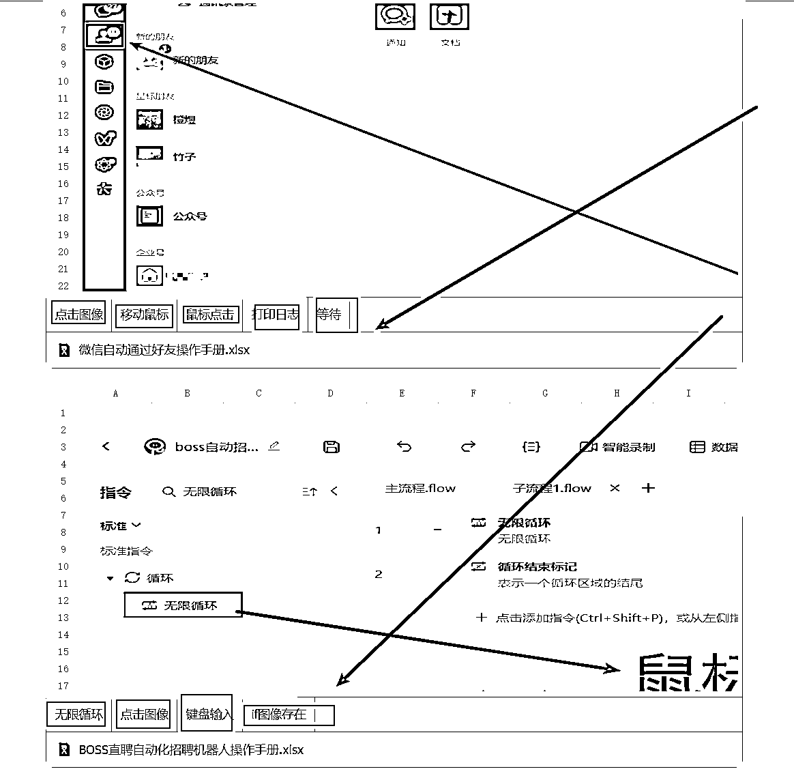
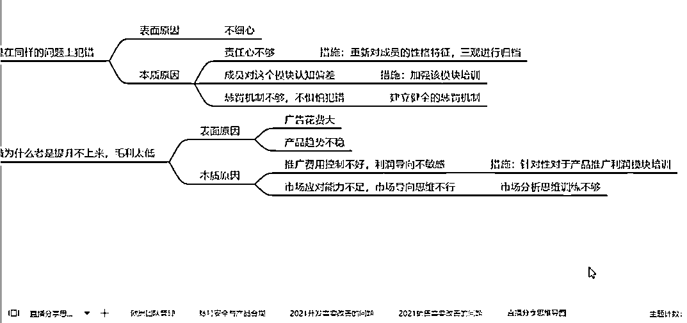

# 别再用“专家视角”做教程了，先用用户的眼睛、普通人的脚去设计

> 来源：[https://vgcf8zrqd4.feishu.cn/docx/KYjkdyHS4oYSkwxEA6UcZEvhnbh](https://vgcf8zrqd4.feishu.cn/docx/KYjkdyHS4oYSkwxEA6UcZEvhnbh)

教程好不好，不是看你塞了多少干货，而是看学的人能不能上手。

## 一、换位到用户，教程才会被用

### 1. 现在市面上常见的教程长什么样

1. 视频课，时长拉得很长，铺垫和转场话术特别多
2. 飞书文档，一路往下刷，信息是竖着堆的
3. 训练营群里的聊天记录，也是纵向信息流
4. PPT，也是从上到下堆内容

刚接触知识付费时，看到这么多资料，我也兴奋得像打了鸡血。赚钱的内容尤其扎实。

道理上讲，这些东西足够值钱。安静下来反反复复学个几遍、十几遍、几十遍，然后照做，结果大概率是有的。

但现实是28定律在作祟，最终能落地的永远是那20%左右的人。

### 2. 新手真正吃得下的是什么形式

内容越多越全越丰富，看起来越值钱，却越不适合刚入门的人。

拿之前写的 BOSS直聘机器人这个案例说事：RPA+明星切片+BOSS直聘自动化招聘全流程解析
https://wx.zsxq.com/dweb2/index/topic_detail/188128254185542

【如果有用辛苦知识星球留个赞】

十年前我在电信干活，用过一套 CRM 受理系统。那系统体验极差，一步错了就要整体重来。而当时一线营业厅的同事，很多只读到高中。

为了让他们能用，支撑团队直接用 Excel 做操作手册。界面一屏能看完，纵深感很强。再复杂的流程，也就拆成十几个 Sheet。

飞书文档、思维导图那种一眼望不到头的结构，对他们就是灾难。

知识点太多，自己都分不清会了哪些、缺哪些。

在我做的手册里，每个 Sheet 就对应一个具体知识点。整体并不会很多，3 到 5 个知识点就能拼出一个机器人。

学会一个机器人，就等于掌握了几块基础点。下一个机器人，大部分点是重复的，只需要补上新的那一小块。

新内容的增量很少，不会让人觉得难到做不了，也不会一上来就懵。

在解决具体问题的过程中，RPA 能力就自然长出来了，而不是先放下项目，去花大块时间啃技能。

### 3. 演示要快，越短越好用

有人爱看图文，有人爱看视频。但用户本质上不想爱上流程和按钮，他只想快速跑通，薅到流量、招到人。

把 8 分钟能讲清的东西拖成半小时，甚至把每个点讲透，让用户陪你耗几个小时，本质上是在消耗他的耐心。

很多时候根本不需要先懂原理，照着做、跑通再说。为什么这么配、区别在哪，用上之后自然就明白了。

### 4. 学习路径要像上学一样一页一页来

前几天带 5 岁的儿子去上积木课，突然想起他学拼音写字。每回就一小页，一点一点推进，几乎是哄着他完成的。

上学也是这样，一节课一个知识点，课后作业巩固，再考试。知识点是被反复刷很多次后，才去考场的。

如果一个人连幼儿园都没毕业，就直接把语数外理化生全堆给他，还让他去上大学选修课，随时有问题问老师。这种事听起来就荒唐。

做项目、做电商也一样。很多人连“幼儿园阶段”都没跑完，就被要求一起冲刺，本来起跑线就不一样。

### 5. 给指令，别只给选项

两年前我写过一篇关于付费社群的复盘。那些社群到现在看依然很有价值，当初的选择也没错。

但社群好、内容好，不等于我能出结果。有社群在续费时问我原因，我的反馈是：希望必做题多一点，选择题少一点。

内容太多，不知道先从哪下手。很多人其实想要的是指令式引导：做这个项目、按这步走，而不是自己从海量内容里挑选。

这种交付对输出方压力很大，也容易被骂。替别人选了没结果，锅最后还是输出方背。所以很少人敢这么做。

## 二、用普通人的立场去设计流程

### 1. 普通人到底是什么样

评论区有人质疑某个项目门槛高，不适合普通人。这就引出一个问题，普通人到底指谁？

我的理解很简单：啥都不会、执行力一般、有一点懒、但想赚钱。

我自己就是这样，我相信成千上万的人也一样。

### 2. 他们买知识付费，真正要解决的是什么

执行力是项目成败的关键，这点已经被说烂了。

但换个角度想：用户以为自己是来学赚钱方法的，实际上他可能更需要的是有人帮他把执行力这个问题给扛住。

如果一个人本身就极有执行力、肯学、舍得花钱去链接资源，他凭什么跑不出来，还要来付费？

用罗翔老师的话说，这逻辑不自洽。

### 3. 执行差和懒的背后是什么

借用顾小北社群一位嘉宾的分享：

原分享讲的是职场场景：一个自律高效的管理者，如何带一群拖沓执行差的员工？

她没有停留在“你们执行力不行”的表面判断，而是往下挖原因，并给出具体解法。

她愿意去思考问题背后的问题，并真的去解决。

筛选永远比培养容易，但她选择了更难的培养路径。

面对执行力不足时，她去找方法，而不是只扔一句评价。否则这和品茶时随口说一句“好喝”有什么区别。