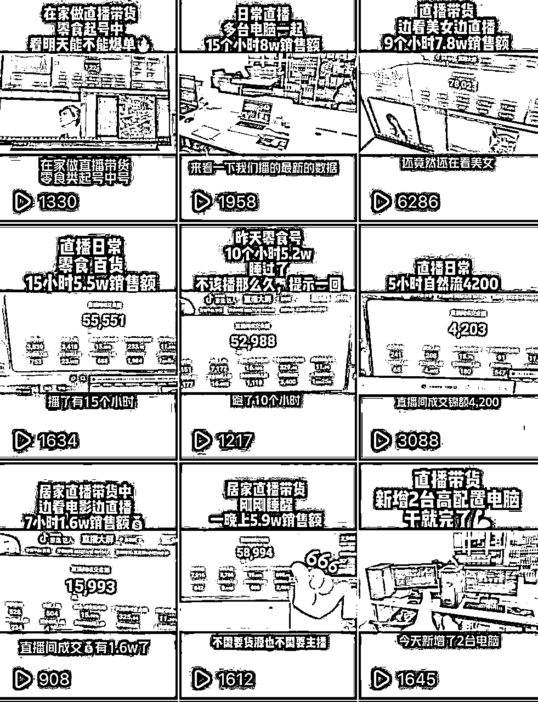
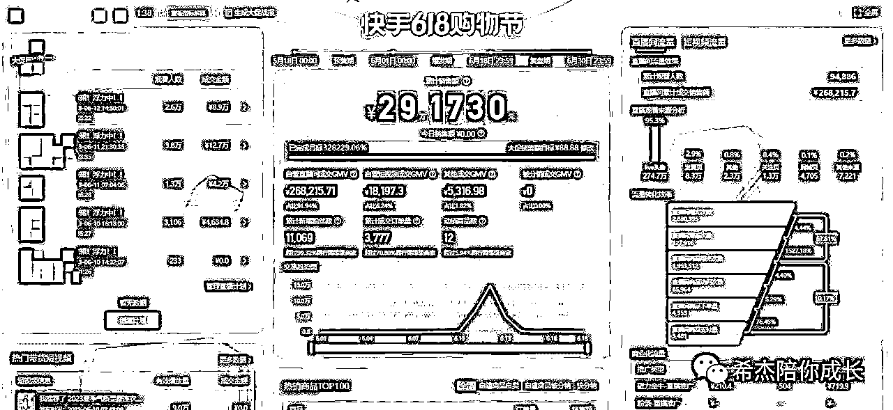
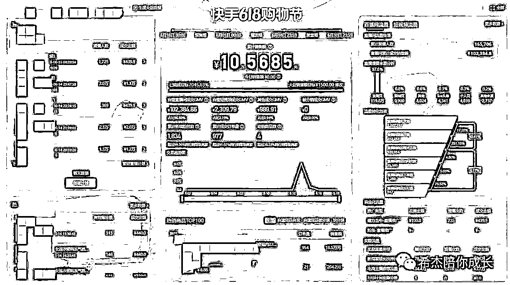
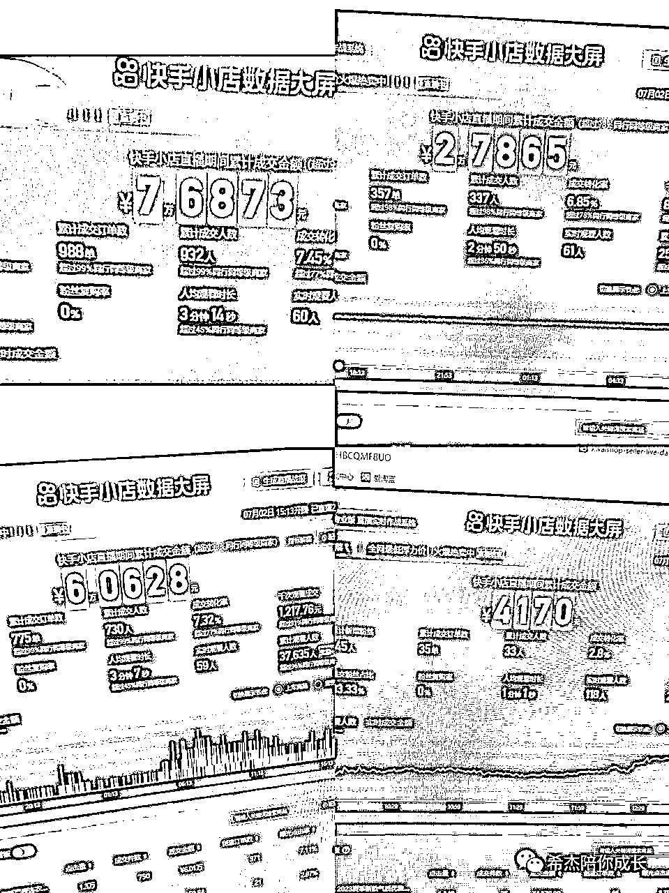
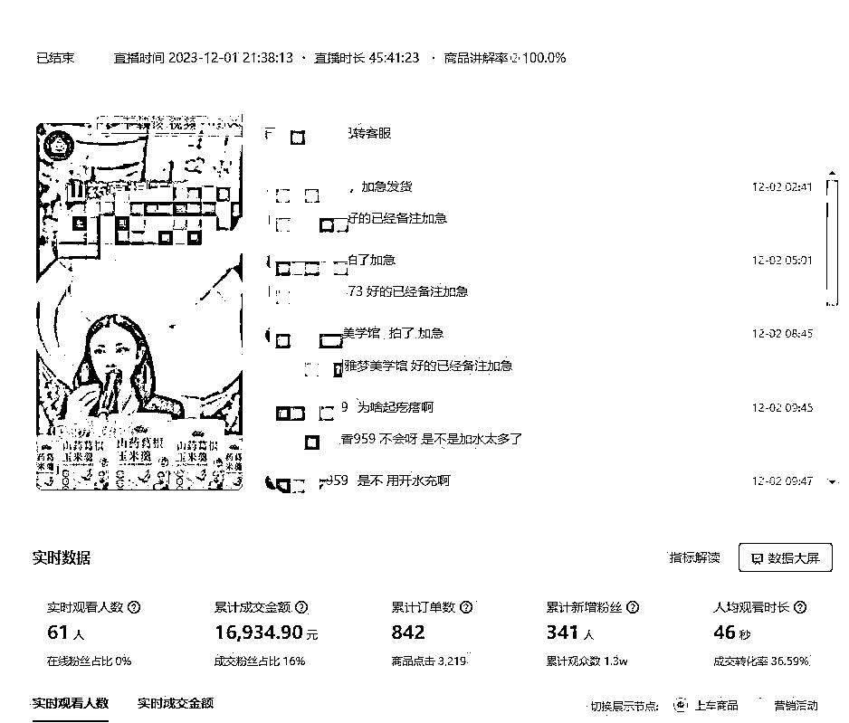
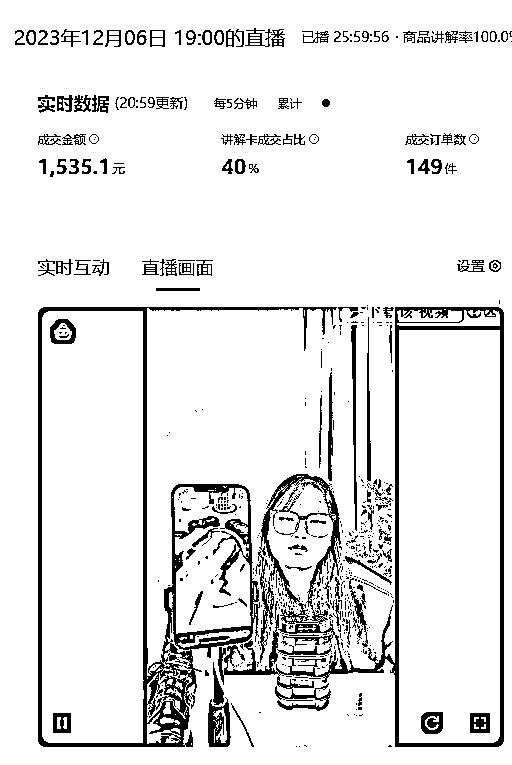
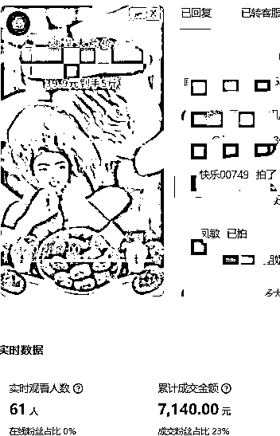
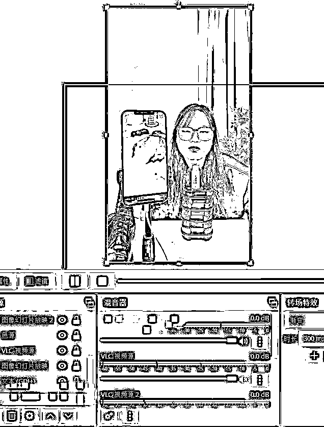
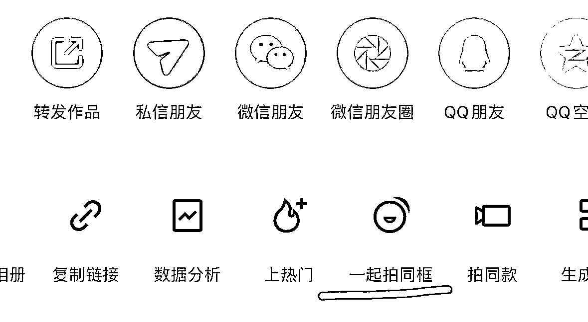

# 快手无人直播带货，单人年佣金破两百万，依然值得做

> 赚钱有术圈友 @韩希杰 的实战复盘

你能想象吗？靠快手无人直播带货，一年佣金做到了两百多万，如今还搭上了快手官方的内部合作通道。这个人不是段子，是赚钱有术圈友韩希杰的亲身经历。

2022年9月，他第一次接触电商，起初在抖音做无人直播试水，后来把重心挪到快手，并扎根下来。到今年十月，团队已与快手官方内部达成协作机制。从入场算起，他与团队在快手这条赛道上的累计兑现已超两百万。

看着光鲜，背后全是血泪。2013到2023这十年，他与抑郁症对抗，家里为他治病花了近百万。最险的时候在ICU住了七天才抢回来，出院后又在医院待了整整一个月。2020年才慢慢清醒。这十年的苦，他很少对人说，父母更从不在他面前提，弟弟知道的比他还多。父母从没要他大富大贵，只求他平平安安。他却不愿认命——既然被给了第二次生命，就要拼一次，把想要的东西用命去争。

天无绝路。2022年9月刷抖音时，他认识了现在的合伙人辉少。辉少比他小三岁，却已在抖音无人直播拿下成绩。他当时想着跟上去做，心里其实打鼓——全新领域，没结果怎么办？现在回看，那可能是他三年里最对的一次选择。

当年十月，团队从抖音切到快手。2022年10至12月，是爆发期。那时正处疫情，平台治理松，商品比较好推。他们主推生鲜牛肉、牛碎骨等，两台电脑单日最高做到百万元GMV，佣金占比三成，且生鲜保质期仅七天基本零退货。单日净赚三十万，当时激动到发疯。接下来半个月，日利润一直维持在十万到二十万区间。单日收入顶过去一年。电商彻底打开他的认知，当场决定死磕下去。

随后一路狂飙：从河南焦作到郑州，2023年迁到广州番禺，从小作坊式做到规模化运营。一年内拿下以下成果：

1. 在番禺区租下八百平直播基地，成立新带货公司，他由运营晋升为合伙人。
2. 彻底帮家里还清债务，自己也走出抑郁，还减重三十斤。
3. 团队成为快手无人直播头部玩家，与官方建立内部协作。
4. 团队直营月均GMV稳定在两千万以上。
5. 线上陪跑学员超千人，线下学员超百人。

他始终坚信厚积薄发，选对赛道再付出超常投入，结果自然来。那一年他基本每日到凌晨零点后才休息，清晨四五点就起床管账号。他也清楚，眼下成绩只是起点。做事靠的不仅是运气，还有信息、资源、资金、人脉。翻盘要靠执行力，执行力才是拉开差距的关键。

他说：“人生必须有一段自己硬走过来的路，有痛有孤独，那叫成长。”命运掌握在自己手里。加入赚钱有术五个月，他学到很多，认识很多大佬，所以想把创业历程分享出来，共勉。

下面分享他近期与快手官方合作的内部打法，供大家参考。

---

从2022年9月转到快手无人直播后，他们换了无数套打法。去年10到12月，做无人直播极其简单，直接把抖音直播间转播到快手就能成交，压根不用管去重、降违、防封，平台管理非常宽松。今年七八月，他们主打搜索流加短视频流量，卖女装连衣裙、冰丝裤，客单约一百元，仅广州自营加学员GMV就破千万。部分学员成绩截图：

### 为何要和快手官方合作，启动内部4.0报白打法？

因为规则在收紧。他们持续调整，顺应规则。今年九月，快手开始大面积封禁无人直播间，很多团队直接停摆，他们的号也被封一批，线上结算变难。于是动用在快手沉淀的资源，联合内部高管推出内部4.0打法。核心逻辑是账号开播前先走内部预审，通过率约七成。例如准备十个已实名的号，大约七个能通过，进入内部白名单。进白名单的号基本能稳健盈利，单号GMV可做到约一万元，保底收益两千左右。若每月通过三十个号，用三台电脑操盘，月入五到六万是常态。而且通过的号不需注销，次月仍可循环使用，持续开播。

这套4.0打法比之前的3.0单场二三十万的爆款模式更稳。主推百货、滋补、养生、美妆等品类，退货率低，线下结算快。以下为自营跑出来的数据：

GMV不算高，但求稳。

### 操作流程

**首日：搭建直播间。**
利用OBS把抖音已录制的素材投放到快手，配合快手直播伴侣开播。教学视频完整，有需求可私聊。

**次日：找对标账号。**
对标要求：
1. 从抖音找，且该账号在快手从未发布过内容。
2. 粉丝量不超过十万。
3. 视频大多超过两分钟，四五分钟剧情最佳。
4. 选不露脸的美食、烘焙类账号，收集十五个，整理文档后发给他们。
5. 对标视频数量充足，一分半以上视频要超过二十个。

**第三日：发内容养号。**
拿到提供素材后发布两条作品，间隔至少一小时。发布后进入快手主页点开作品，点击右下角分享查看是否出现“一起拍同框”功能，有则保留，无则删除换视频重试。直至两条可触发同框的作品发布成功。目的在于养号提升权重。

**第四日：电脑端开播细节。**
一、检查间内情况：开播后立刻进入自家间，确认音频、场景、背景音乐是否正常，音乐过大则调低，提升购物体验。
二、商品卖点设置：上架后点开商品描述，把优势写进描述，有助转化，例如“库存有限，仅剩三单”“两百余位用户评价好看实惠”，可按品类自拟。
三、公屏刷屏：无人说话很冷清，需刷屏营造氛围、催单、告知活动。话术按品类区分，后续会提供。
四、公屏互动：客户提问要即时回复，转化率会明显提升。
五、防违操作细节，开播结束后调整OBS参数。
六、掌握手机小店、网页快手小店的选品与调品方法。

**第五日：录制同行直播。**
主素材录制时长至少四小时。若同行关播，等其再次开播继续录。

**第六日：内部预审、定品、找爆款、找对标。**
预审通过后账号基本可稳定盈利。但无人直播七成靠选品，素材同样关键。
定品：品类波动大，具体播什么需结合开播时间决定，由他们定。
发布短视频：收集三十到四十条爆款短视频，电脑和手机各备份一份，先用快影在手机端过审发布五条左右，再开播同步大批量发布。电脑端投放一百条，手机端过快影一百条，具体节奏与他们对齐。

**第七日：手机快影发布实操演练。**
以上为快手4.0的准备阶段。准备完毕即可开播，平均一到三天即可拿到两千元保底收益。

---

### 写在最后

日拱一卒，坚持到底
再好的赛道，也不是随便开一场就能爆。一场直播连开四十八小时轻松过万，那不叫项目，那叫天上掉馅饼。很多新手看到别人日入过万，急着入场，满怀期待，结果一周过去，两个号都上了却没起色，便开始怀疑自己、怀疑模式，进而内耗。

任何项目都有新手适应期，从菜鸟到高手需要时间。熬夜开播没成交在所难免。即便是现在近乎躺赚的内部报白4.0模式，预审仍有约三成的淘汰率。有人会心态失衡：“好不容易凑三个号，结果不能用，现在实名多难？”直播带货像指数曲线，心态极其重要。有时会莫名开一场卖十万二十万，佣金三五万到手；有时辛苦整月，账号不爆，每天一两千、三千地卖，看着别人一场顶自己一月。越是此时越要沉住气，把细节做好，耐心等待爆发。

感谢读到这里。这是他在赚钱有术的首次分享，文笔有限请多包涵。后续会持续输出干货。对快手无人直播或互联网创业感兴趣的朋友，欢迎交流。祝大家都能赚钱有术，事业更进一步。