# 用影刀 RPA + ChatGPT 把公众号爆文做成流水线，我 4 个月流量主做到 6w+ 的自动化打法

> 来源：[https://ev0ft8k60w2.feishu.cn/docx/LoGUdYnnmov6SFx1xescAZGGnkh](https://ev0ft8k60w2.feishu.cn/docx/LoGUdYnnmov6SFx1xescAZGGnkh)

我是伟豪，目前自由职业。8 月从零跟着航海学习 AI 写作，12 月前靠公众号流量主累计收益就突破了 6 万。这期不聊变现心法，单聊我是怎么把写作这件事自动化起来，让影刀 RPA 和 ChatGPT 帮我批量生产爆文的。

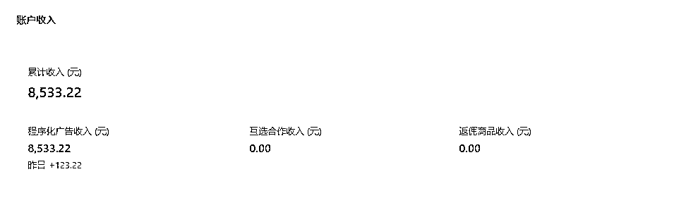

上篇在赚钱分享的是 AI 自媒体 0 到 1 的变现路径：https://t.zsxq.com/15bv056qB

这次聚焦实操：零基础如何用影刀 RPA 搭建一套可重复的自动化写作流水线，实现影刀 RPA + ChatGPT 批量出稿提效，基础篇干货全放这里。

# 一、先搞懂 RPA 到底在干嘛

RPA 全称 Robotic Process Automation，机器人流程自动化。说人话就是：让虚拟机器人代替人做重复操作。

它能模拟人去点、填、读、存，还能把不同工具串起来，形成一条自动化作业线。

它最擅长处理那种重复、可预测、规则明确的任务。

结合公众号流量主的写作特征就很匹配：

*   选题垂直集中，比如情感、热点、鸡汤类
*   写作逻辑高度同质化，成熟后基本靠一套提示词打底，只换主题或大纲
*   一个人要操盘多个号，重复提问、复制粘贴、整理导出这些事做多了会很烦

所以思路就很清晰：先用 RPA 把选题批量喂给 ChatGPT，再把答案统一收拢到表格里。写作这件事就从手工作坊升级成生产线。

# 二、为什么我选影刀 RPA

想把 AI 写作自动化，大概有三条路：

1.  用现成的分发平台。这类工具偏编辑和多平台推送，部分带 AI 扩写润色，但调用的大模型多是国产接口，和 ChatGPT 的效果有差距。
2.  直接调 OpenAI API 写程序。性价比最高，但要会编程，而且 GPT-4 的 token 费用不便宜，全程用 4.0 写稿成本扛不住。
3.  用 RPA 工具。影刀是我的首选：个人版免费、教程案例多、功能够用，完全能满足起步需求。

# 三、影刀 RPA + ChatGPT 实战搭建

下面这套流程是给影刀小白准备的，手把手教你搭一个从提问到导出答案的自动化闭环。

## 一）影刀的基础使用

先去官网注册并安装。

核心概念就两个：

指令：就是 RPA 能执行的原子动作，比如点击、输入、读取。每个指令都要配参数。

流程：把多个指令按顺序和逻辑串起来，就是一条自动化流程。

我们要做的就是用指令拼出一套“自动提问-自动收答案”的流程。

## 二）从零搭一个 ChatGPT 批量提问流程

以情感文为例，演示如何批量提问并导出结果。

### 先把人脑流程理清楚

做自动化前一定要先把手工步骤写下来，我的顺序是：

整理一批对标文章提炼主题或大纲，丢进 Excel ->

打开浏览器登录 chat.openai.com ->

循环读取 Excel 里的每一条主题 ->

固定提示词 + 当前主题合成完整提问 ->

点开 ChatGPT 新对话 ->

把合成后的提问粘进去并发送 ->

等待模型返回 ->

把问答内容抓下来存到 Excel/Word ->

循环下一条，直到全部跑完

### 把选题做成 Excel 任务表

把主题整理好，保存成 CSV 格式方便后续导入。

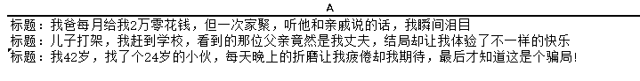

### 新建一个影刀应用

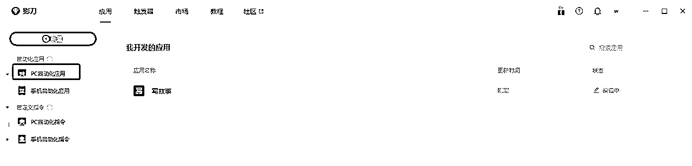

### 打开 ChatGPT 网页

这里用的是【获取已打开的网页对象】指令。提前用 Chrome 打开并登录好 ChatGPT，再让影刀去抓取当前页面对象。Chrome 配合影刀插件调试最顺手。

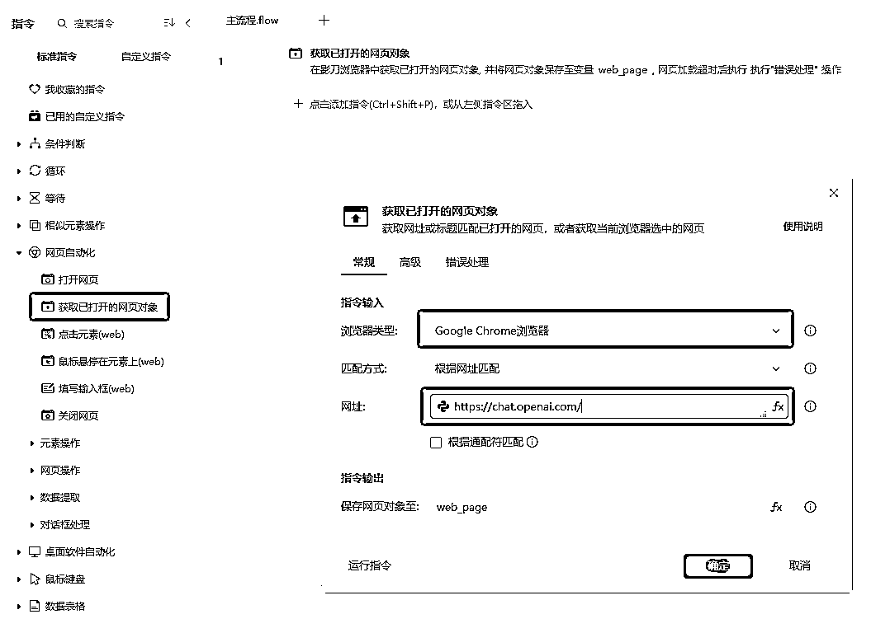

怎么判断指令配对没问题？开两个标签页，把非 ChatGPT 的页切到前台，再点影刀的运行或调试，如果能自动切回 ChatGPT 页面就算成功。后面所有调试都用这招。

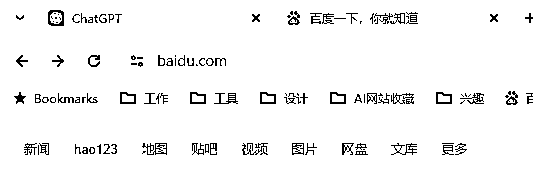

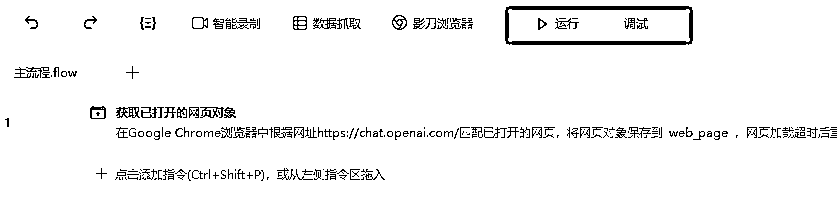

### 导入选题列表

用【读取CSV数据】指令把 CSV 读进来，建议命名为 store_list，方便后面调用。

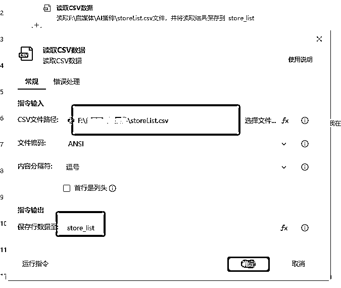

### 设置循环

批量任务必须循环。用【循环】指令，起始 1，结束等于表格总行数。用 store_list 做数据源，打印日志看循环是否正常。

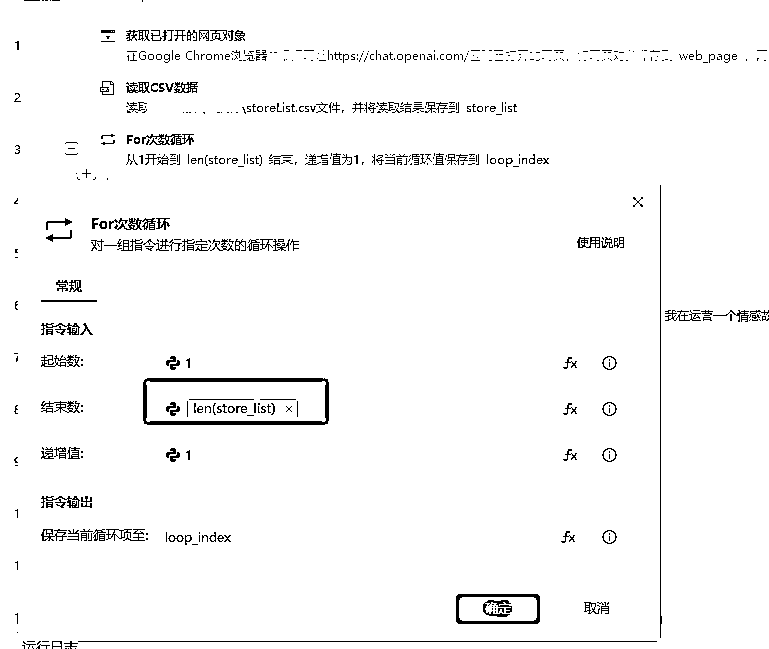

读取当前轮次对应的主题内容。loop_index 就是当前循环序号。

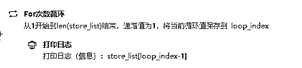

调试打印效果如下：

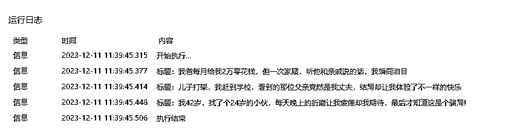

### 组装提示词并输入

先用【点击元素】点一下“新建对话”按钮。

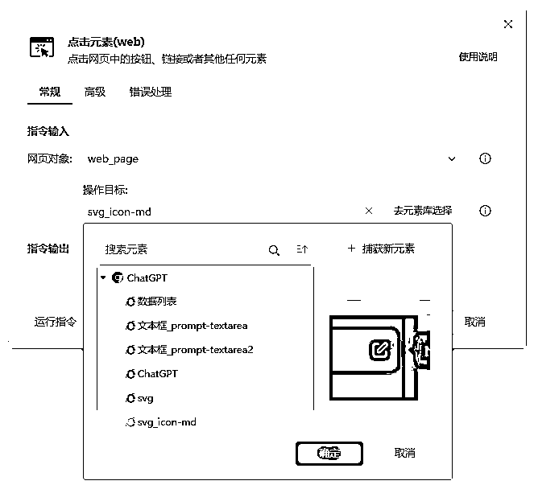

然后用【填入输入框】把通用提示词填进去，操作目标手动框选网页输入框即可。

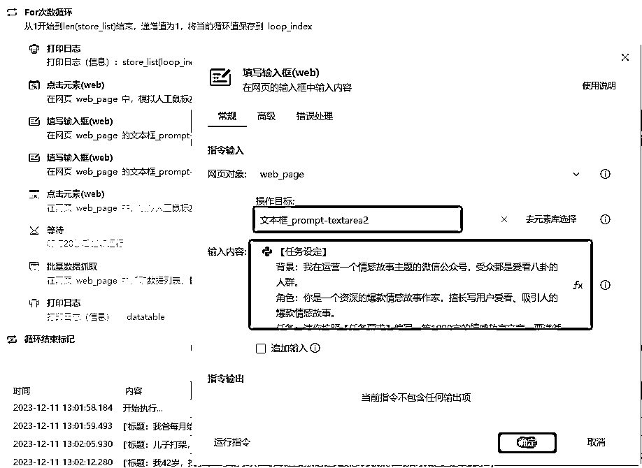

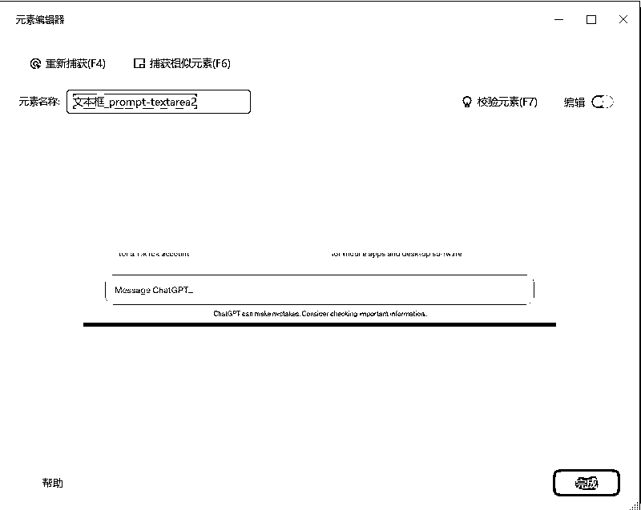

提示词较长时建议用剪切板输入，成功率更高。

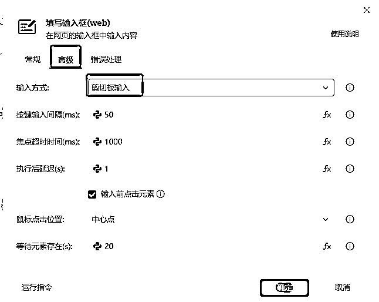

再加一条【填入输入框】，把当前循环的主题追加到同一输入框。输入内容用读取到的单元格数据。

因为 CSV 读进来是逗号分隔的字符串，实际是数组。要取到当前条目的第一个字段，可以用：store_list[loop_index-1][0]

store_list[loop_index-1] 代表本次循环的整行，[0] 取第一列的主题值。不会编程也没关系，直接复制用就行。

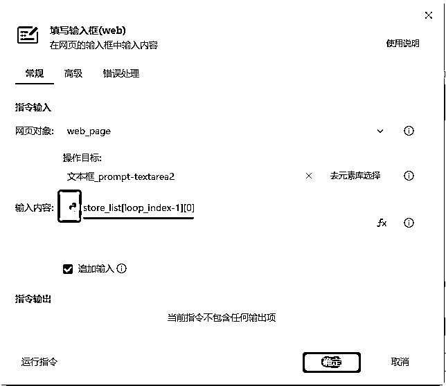

### 发送提问

添加【点击元素】指令，框选发送按钮。

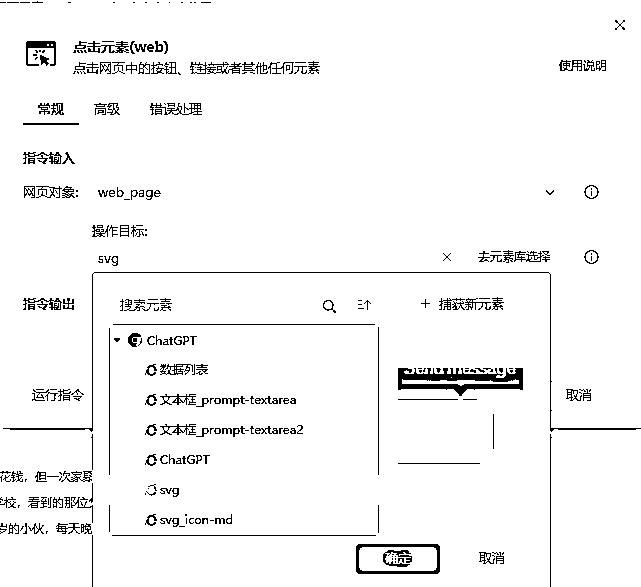

### 等待模型回复

GPT-3.5 10-20 秒基本够用，GPT-4 建议等 1 分钟左右。

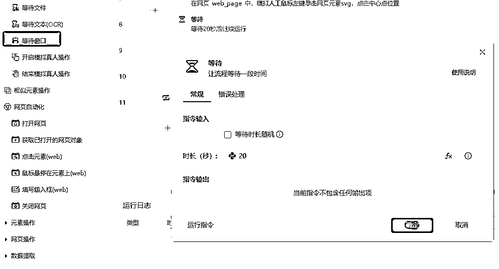

### 抓取问答内容

用【批量数据抓取】指令把问题和答案一起抓下来，后续再统一导出。

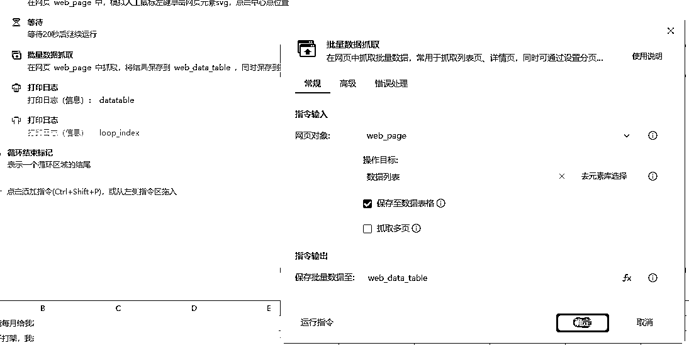

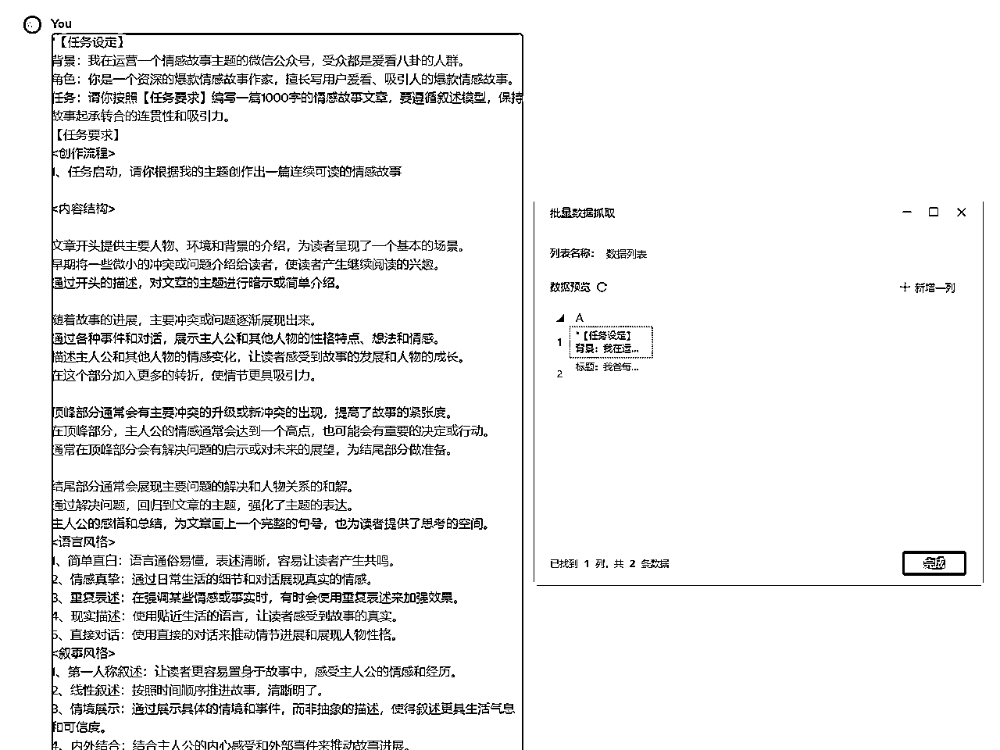

### 导出结果

任务执行完最后一步是用【数据表格导出】把结果导出到指定文件夹。

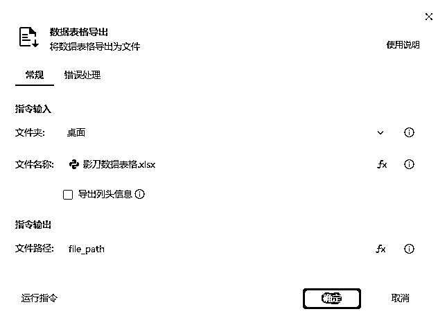

导出效果示例：

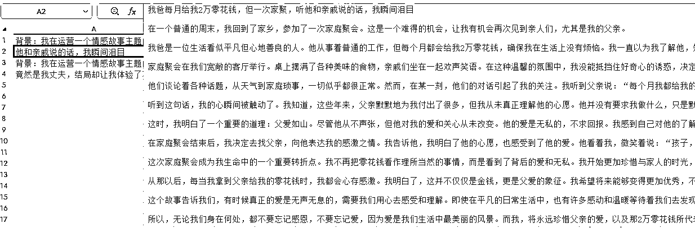

整体流程图如下：

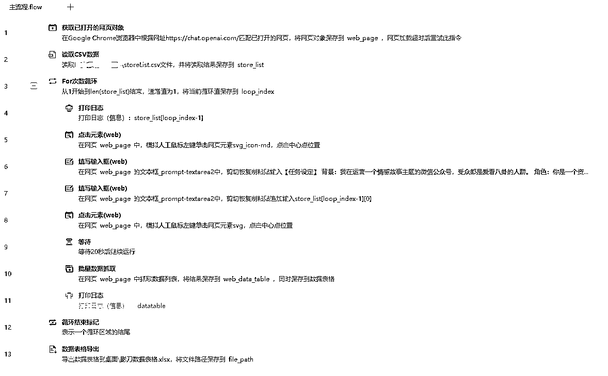

# 四、收尾与延伸

## 一）影刀还能干什么

这次只演示了“用机器人自动提问生成初稿”这一个环节。影刀的玩法远不止：全平台自动分发、批量扩写润色、爆文内容批量抓取、结合 Python 做内容库管理等等，都可以往上套。

## 二）感谢

感谢赚钱这个平台，让我结识到很多优秀的人。提效说到底就是把好工具用起来。

文章有疏漏或不明白的地方欢迎指正，问题也可以直接问我。