# 用不到高成本，抖音教育直播一年做到300万利润的轻量玩法拆解

> 来源：[https://wq43syvo98.feishu.cn/docx/MviudsEpSodwmLxG3xXcPqoanTh](https://wq43syvo98.feishu.cn/docx/MviudsEpSodwmLxG3xXcPqoanTh)

航海即将启程，本次航线里新加了【抖音教育直播】赛道。与伙伴们聊下来，发现对这个赛道的认知存在不少偏差，所以在开船前连夜把思路整理成这篇拆解。

全文拆成四部分：

1、升学规划赛道全景
2、直播变现路径拆解
3、精简型教育直播团队怎么搭
4、复盘总结

正式进入前，先用几个真实场景感受下可复制的升学规划直播是什么样。

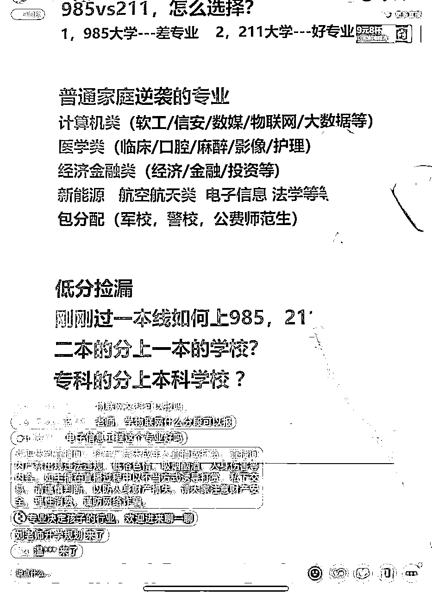

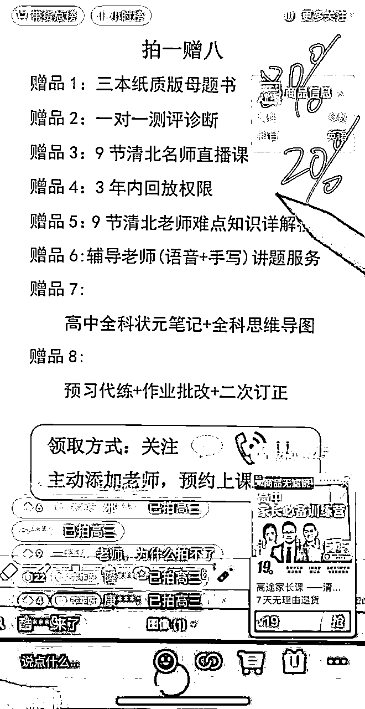

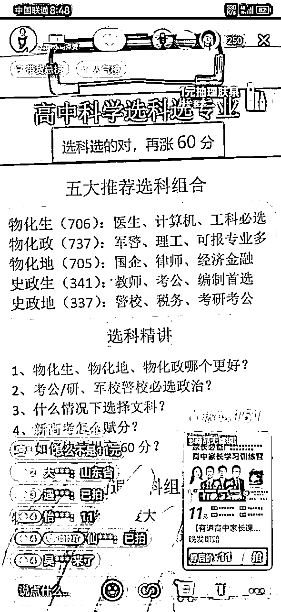

看到这些场景，是不是觉得要很强的专业背景才行？如果把直播间背后的真实操作摊开来看，又会是怎样？

其实直播间听起来的专业感，大多是稿子被打磨到足够顺畅的结果。把预期先降下来，我们正式开始。

# 第一章：升学规划赛道全景

先聊为什么要做升学赛道，这个赛道是否有足够空间值得长期深耕。

看一组官方数据：

教育部公布，2023年高考报名人数达1291万，较上一年增加98万，再创新高。竞争空前激烈的一届，也是求学之路更为坎坷的一届：中考推迟、高中三年大部分时光在疫情中度过、同期毕业的大学生就业压力加大。

在这些背景下，“高考志愿规划师”迅速成为风口职业。据我们调研，今年志愿报考服务的人均客单价普遍在5000元以上。艾媒咨询2024年6月8日发布的报告显示，2022年中国高考志愿填报市场付费规模为8.8亿元，预计2023年将达到9.5亿元。

从宏观数据看，升学赛道是持续扩大的蓝海。但数据不等于实况。我本人长期在教育行业，在切入前就以兼职规划师身份去线下机构面试。

只要有岗位，就意味着有真实需求。目前行业最突出的问题是规划师严重短缺，尤其是暑期旺季。反过来这也是优势：一个规划师服务的人数有限，赛道天然抗内卷。交付重服务轻标准化，对新人友好，头部品牌效应不强。

确认赛道有空间后，再看线上能否做、是否有头部IP、发力点在哪。

整体升学规划行业长期集中在线下，从2012年起逐步扩张，新高考改革成为爆发节点。

线上现状是：头部IP只有张雪峰，没有头部机构。张雪峰也是从考研切入升学。这留下了一个巨大的空白，也是一个非常适合做个人IP的赛道。

正如前文所说，该行业交付属性是重服务轻产品，知识面极广。张雪峰流量再大，其公司能服务的容量也是有限的。强个性化需求让头部IP和机构的压制力很小。对教育行业而言，这是一个可实现高价续费与裂变转介绍的长线生意。

目前行业基本在线下，线上几乎空白。结合内容特性，线上具备很强的可为空间。

个性化+内容深度，决定了线上可规模化复制且能长期深耕。足够深的内容自带门槛与生命力；个性化使得不同风格的规划师各有受众，为IP塑造和商业化提供了抓手。

# 第二章：直播升学规划变现拆解

全程自然流，不投放。

项目可行后，关键是怎么做。先看赚钱方式：

*   初级变现：直播获客，售卖订单粉小课包
*   中级变现：直播带课/带货
*   终极变现：直播带货+导流高客单规划服务

## 初级变现：直播获客卖订单粉小课包

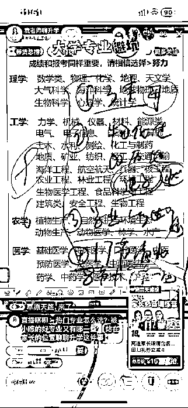

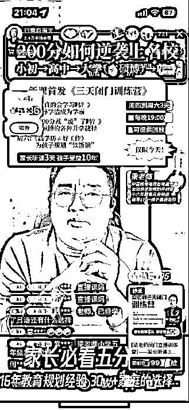

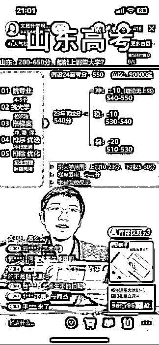

以上三个都是升学赛道的直播间，小黄车挂的就是引流小课包。通俗讲就是我们代卖的引流课，并非19元卖出赚19元。实际结算的是流量费，通常能结算到60元以上，相当于完成第一单。19元的小课包，实际到手60+。卖出50单，就能拿到3000元左右。

我们这边主播在非高峰期的平均成交为一场三四十单，高峰期一场超百单。常规是每天4场左右，每场90分钟。日单量可达100-500单。

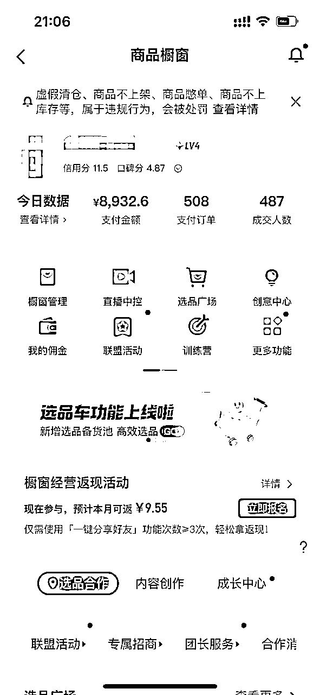

这个阶段收益已经很可观。非常适合没有实战案例、或者想一人做副业的朋友，见效快。

## 中级变现：直播带课/带货

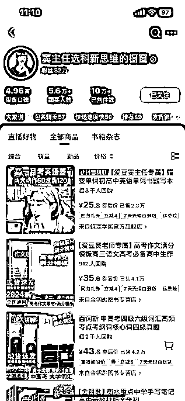

除小课包外，用户群体是高中家长，可以顺势拓品带教辅图书、教材、以及助脑类健康品。

教辅图书佣金在30%-60%，核心是该赛道产品属于刚需。升学压力下家长付费阻力小。

教育行业规律是家长认人，不认机构。很多主播的自然流带货，销量远超官方直播间。以老师身份推荐，在IP与内容加持下，带货效果极强。

这个阶段可理解为一个不那么内卷的电商赛道。只要匹配直播间定位的用户需求，教辅之外面向高中生的用品都可尝试。

该账号从7月首播起号，至今单场稳定销售额2.5-5万元

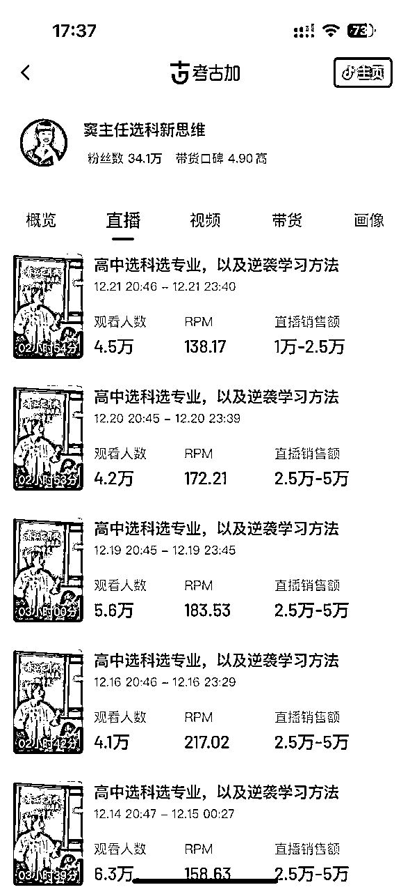

## 终极变现：直播带货+引流高客单规划

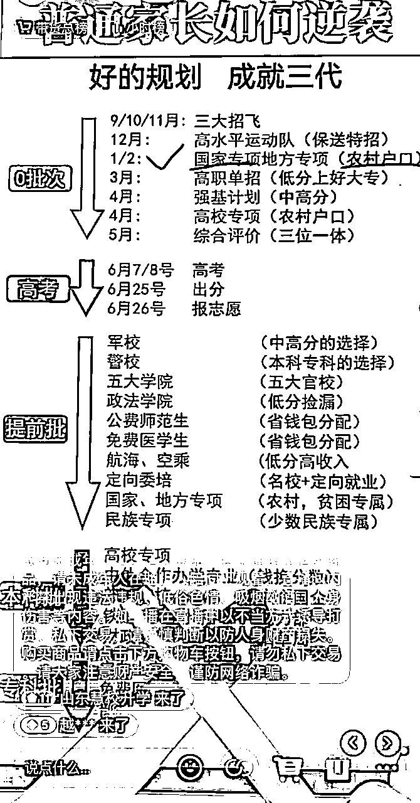

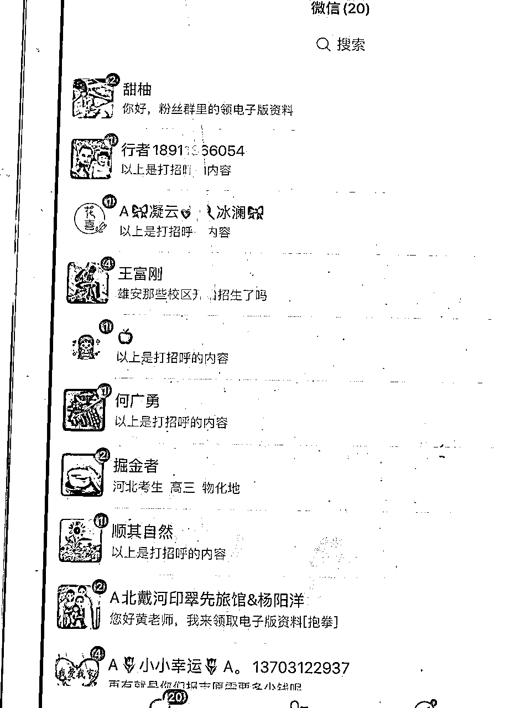

这一阶段需要团队配合。升学赛道除了志愿填报，还有提前批报考、海外升学、港澳升学、强基计划、高职单招等。

产品覆盖各个分数段，单门课程普遍在2万元以上，海外港澳方向更高，且解决的是刚需，家长付费认知成熟。

直播间日常要做关注引导和粉丝群沉淀。在直接卖小课包和带货之外，可在私域做高客单承接。

有团队可嫁接甲方产品，沉淀私域后做高价转化；个人可对接到合适的后端卖流量。该板块增长弹性很大，适合团队化运作。

# 第三章：小而美的教育直播公司团队搭建

下面是我过去一年实操的路径，以及踩过的坑。

在此特别感谢lemon姐的指导，有lemon没难题

能做一个项目，第一步一定要自己先跑通流程，跑通后再谈放大。

第二步是人。先有人再有事，想办法用人力放大。

第三步是拓展后端，扩宽变现线。

## 初期：0到1，跑通初级变现

项目确定后，在lemon姐指导下做了两版直播话术。我和一位朋友开始无脑执行。

直播看似难实则不难，付出多少精力就能得到多少结果。

后面的航海会讲具体操作，先分享几个踩过的坑。

### 1.先做学生：内容深度不足，学习方向偏

教育的第一步永远是先当学生。

项目初期我连话术怎么拆解都不懂，仅靠之前在教育行业的经验和浅层升学知识支撑。

在破风控、打标签阶段勉强可行。但第二周起流量始终难突破，有测试流量接不住。起初以为是话术结构和互动节奏问题，反复优化了两周毫无进展。

发现不了问题，最直接的是对标学习。当时没有明确对标，只能拿张雪峰做参照，跟播三天后发现核心问题是专业度不够。

懂直播的人都知道，基础数据是停留。内容讲不透留不住人，没有停留，互动和加团自然上不来。

以学生心态切入，学生准备好，老师自然会出现。

这是教育直播最大的坑之一，也决定你能不能做下去。教育直播的门槛本质是持续学习。

### 2.先是老师后是主播，利他分享再变现

在我看来，这是教育直播和纯电商的本质区别。请务必摆正心态，先做分享者，先以老师身份解决用户问题，再去当主播。

这个阶段踩的坑是急于求成，想快速变现。

知识储备够了数据才突破，就开始考虑转化。最初照搬电商节奏，每15分钟一轮带货。结果停留数据很差，整体数据下滑，转化也不理想。后来改为一场带两次，每次约10分钟，转化仍不理想。

在lemon姐指导后才明白节奏怎么控。教育直播的核心转化群体是停留用户，本质是先利他。问题解决了，价值给了，用户自然会成交。先当老师，再当主播。

## 中期：招募主播，放大规模

直播跑通后，就要考虑放大。志愿填报内容可批量复制，且知识面广可拆成三大板块十几种细分方向，内容上可避免内卷。下一步是招人跑测试。

招人前先明确：人怎么带？

基于业务我把流程拆成：面试-试播-上播-起量-带货；全程持续优化。为低成本跑通，需要大量人做覆盖。做法是标准化流程，每个环节设明确考核指标，用漏斗化方式推进。

#### 面试阶段与试播：

面试快速筛选，考察声音条件、直播时间及场次、职业背景等是否匹配。

通过后发放初稿试播，从拿稿到开播的时间判断学习能力与态度，结合试播表现综合评估

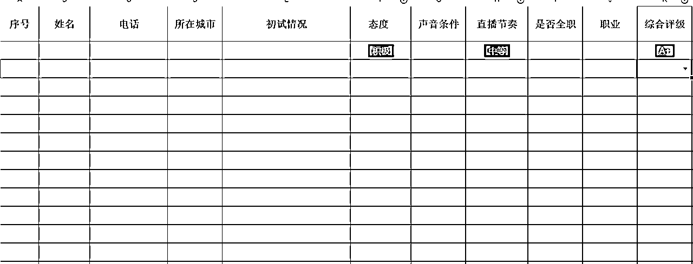

#### 上播、起量、带货

上播后的整体运营以运营为主。运营比主播更重要。内容运营负责持续输出保证迭代；数据运营负责复盘；主播负责执行。

按主播水平分级，重点培养优质主播，次级主播复盘优化，初级主播统一跟踪。一定要有标杆，榜样力量最强。在标准化内容基础上，由运营按SOP全程带教。

一句话：把复杂的事简单化，把简单的事重复做。

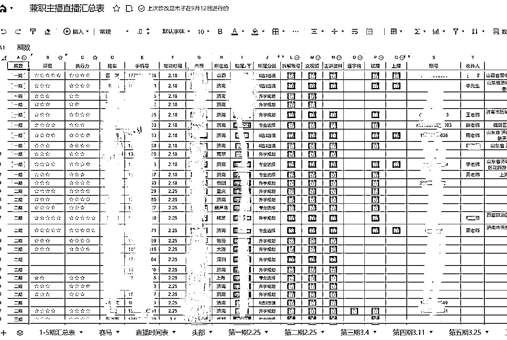

## 后期：开发后端产品

放大的第二个方式是前后链路拓展。目前讲产业链有点大，其实就是外部合作。有流量后找合适的产品对接。

志愿填报前置产品是提分课程，利润高且好卖，但目前线上不可售、线下严查。所以重心放在后置产品。

升学赛道的后置产品非常丰富：志愿填报、提前批报考、海外升学、港澳升学、强基计划、高职单招等。前期不建议自建产品研发，成本高难度大，以外部合作为主。可自建私域团队转化，也可做流量合作增量。

该块业务仍在开拓中，有阶段性成果再分享。

# 第四章：总结

以上就是我的实操复盘，有不足之处欢迎指正。抛砖引玉，期待更多交流。

报航海时发现直播类航海报名人数最少，从侧面说明大家担心门槛高。我认为这反而是壁垒。

做教育直播，我一直没把它当成一次性项目，而是值得长期深耕的事业。教育本身就不该是项目。做好教育很简单：初心与底线、空杯心态持续学习。

如果想入行教育或做教育主播，建议放平心态。最差的结果你也掌握了知识，未来也能传给下一代，没有损失。不要怕犯错。

再次感谢lemon姐的指导，祝各位圈友龙哥盟，23年过个肥年，24年继续发财！