最近刷抖音的时候，我意外发现了一个超冷门的截流玩法——啥技术都不用，光靠评论区写9个字，愣是让我吸了2500多个创业粉，顺带变现小一万。今天不藏私，全部分享给你。

先自我介绍下：我是可乐，也叫蛇哥，98年，人在南宁。老电商人了，目前在一家医药集团带运营团队，私下搞了个“蛇界淘金”的小圈子。平时就爱琢磨各种冷门、热门的引流路子，踩过几波风口，累计也赚了小七位数。今年给自己定了个调：左手AI、右手IP，做一个真正的超级个体。这次分享的方法，哪怕到今天都还在给我带人，主页访问量基本两三天就破99+。

# 为啥突然想通了这条路？

说来也是机缘巧合。我是今年9月1号进的龙哥盟，当时就感觉自己到了个转折点，心里憋着股劲想创业。5月到7月那会儿，说实话挺焦虑的，转型太急，思维又有点僵，虽然靠运气赚了点小钱，但合伙搞的几个业务基本都黄了。

后来无意间在知识星球看到赚钱，第一直觉就觉得这里边有杠杆，能撬动资源，果断进了。进来以后真是开了眼界，每天都泡在信息海洋里找突破口，试了不少项目，慢慢把原来的脑子给洗过来了。特别感谢圈友@七小 给我的启发，我复盘了自己最擅长的东西，发现是信息挖掘——就是比别人更快更准地拿到一些消息。想明白这点以后，我搭了一套围绕自己核心的搞钱体系，也整了不少引流手段。我不喜欢把鸡蛋放一个平台，哪个方法简单有效就死磕哪个，顺手还会布局点SEO。

一直折腾到12月，大部分事情都能出结果了。今天你们看到的我，背后是半年来每天十五六个小时连轴转换来的认知迭代。当初要是没咬牙挺住，估计也不会有现在这些分享的机会。

# 试了一圈，还是抖音评论区最香

其实这个玩法9月我就玩过，后来停了一段时间去研究别的引流技术，绕了一圈发现还是评论区来人最快，而且对我这种懒人来说够简单。10月中旬又捡起来重新深挖，中间被封了几个号，也踩出了不少坑。最后就靠着这套操作，拉了2500多号人，最高一天逼近200。刚好10月底我把自己的产品——搞钱社群和引流陪跑服务打磨完，一推出来就有人买单，陆续收了5个298合伙人和7个980股东，还有一些零碎的虚拟资料钱，顺带帮家里人带的草药洗发水也出了点单。不多说，反正赚钱的门票早翻倍赚回来了。

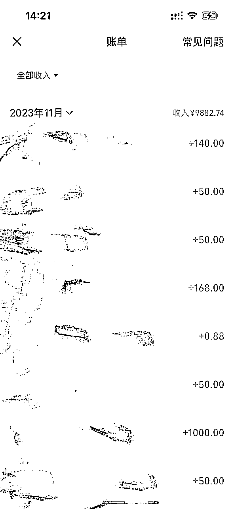

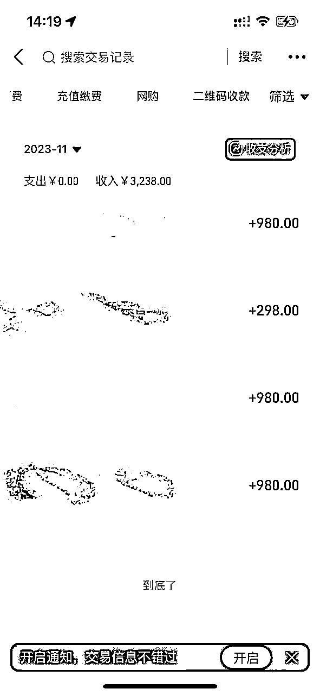

# 上干货：评论区的“神评论”截流法

你们刷短视频的时候，一定在热门作品下面看过那种“截流”评论吧？操作是真简单，效果也是真好。

具体就是在评论区写些特别容易引发共鸣的话，比如：

1、想拉个圈子，共同努力

2、想拉个圈子，聊聊生活

3、加油年轻人（配收款记录或成绩图）

4、祝在座的各位得偿所愿（配收款记录或成绩图）

举一反三，你们可以自由发挥想象力。

# 为啥不直接写“拉个创业交流群”？

很多新手喜欢写“来人”“拉群”“每天只能搞个两三张”，对不起，这种词太敏感了，平台系统一抓一个准，再被同行举报一下，号就没了。我那几个阵亡的号就是这么废的。

反过来，20-30岁这个年龄段的人，普遍压力大、迷茫，你写点“聊聊生活”“共同努力”这种话，人家最容易放下戒心主动来链接你。你想想，一个人正刷到一条特别戳心窝子的视频，突然看到评论区有人号召大家聚一聚，是不是下意识就想找联系方式？所以这种评论的本质是顺应人性。把人性琢磨透了，引流就变得很简单——他们想要啥，你就给啥，真诚就是最大的杀手锏。我大部分好友，都是靠这种“看不见营销痕迹”的方式加上的，一直有流量进来，但平台完全发现不了。

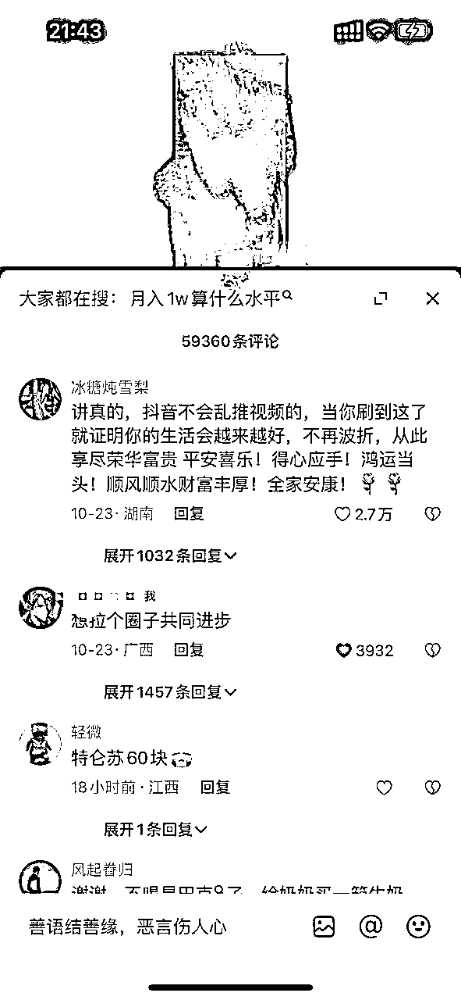

举个例子：有个讲穷人怎么翻身的视频，评论区有人呼吁“拉个圈子”，互动量直接好几千条。这种时候，只要人群精准了，哪怕一开始只是闲聊，后面也能根据标签属性切入后端产品。比如创业+知识付费，或者项目培训，这些都是刚需，稍微引导一下，转化并不难。我自己也通过这个操作涨了一波粉丝，新增粉丝的画像也正好是拥抱互联网的年龄段，很多业务都能顺势展开。你们可以对照下自己的业务看看。

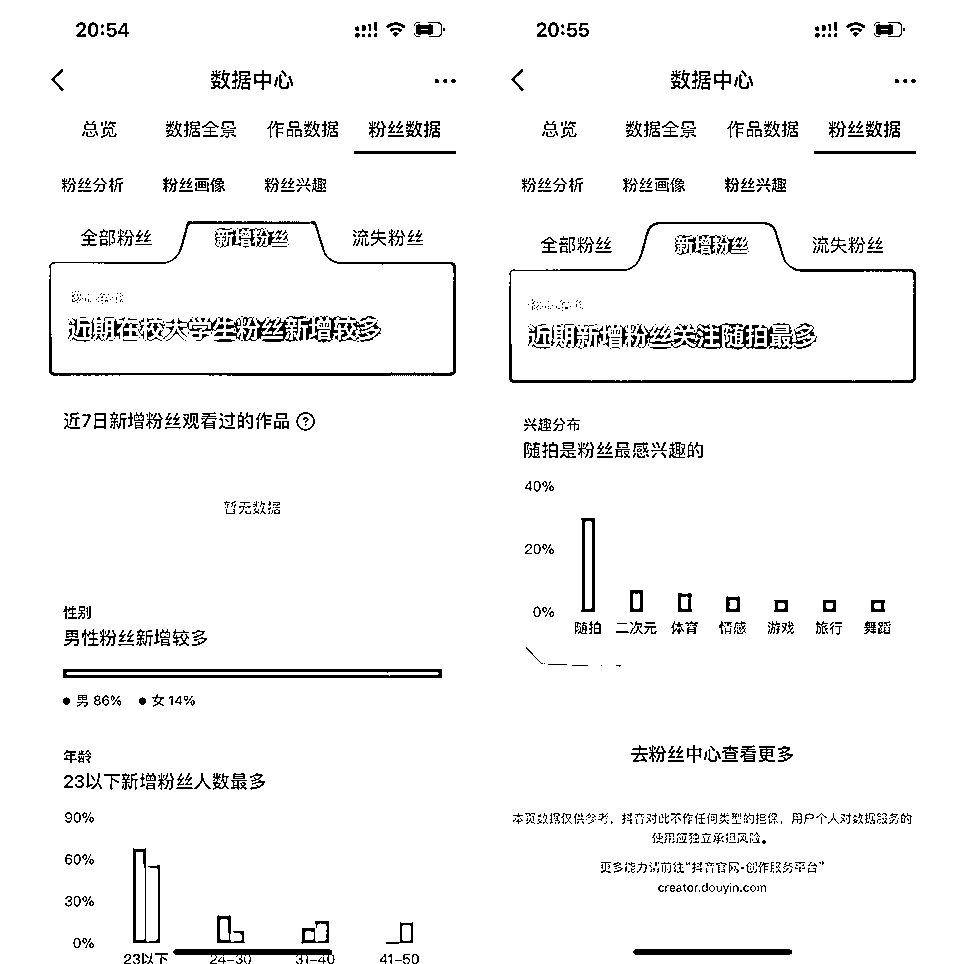

# 重点来了：账号怎么选？

记住一句话：一定要用老号！人设要接地气，让所有人都觉得你是个普通用户。千万别拿企业号去搞，营销味太重了。我这个号基本每条评论都能带人，发出去没多久就有人点赞。新号呢？容易被举报传销，本身也没啥流量。老号权重高，容易火。平时多刷点鸡汤类视频，让账号属性偏向这个方向，对你的评论上热门很有帮助。我之前测试的几个号复盘下来，死就死在没有活跃度、账号属性又不贴近这两点上。

# 个人资料怎么设置？

可以照我这样配：私信里用谐音引导，再挂个小号，小号上直接放个人微信，再建个粉丝群备用。这样人家搜你账号进来以后，就能顺着路径摸到微信。我现在每天都有10-30个流量是通过搜索账号进来的。

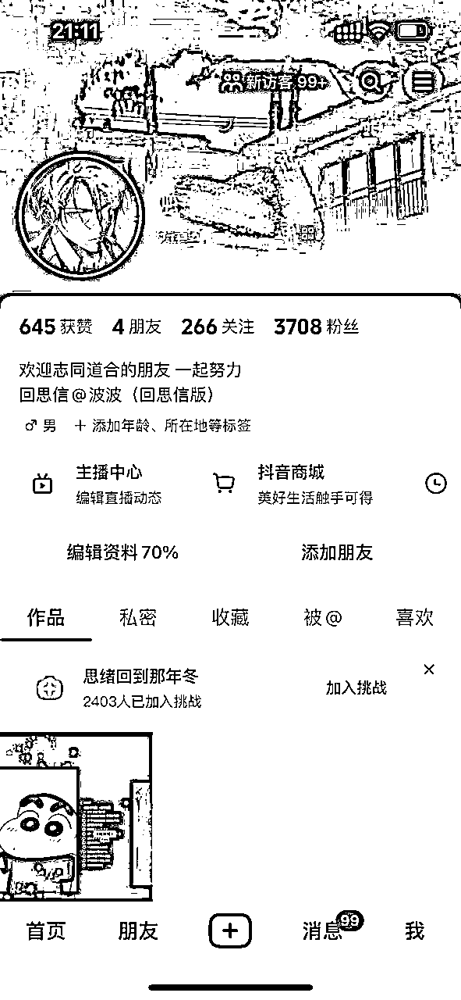

# 上哪找这些视频？

直接搜“创业、搞钱、赚钱、翻身、人性、认知”这些关键词就行。或者直接关注相关博主，比如男天门、张华这种鸡汤博主，刷多了系统就会自动给你推荐同类型视频。看到这种类型的博主就顺手关注，方便后续操作。可能有圈友要问：为啥不用抖音热点宝？讲真，我也试过，选“商业”“商学院”“商业技能”这几类，评论区的人对赚钱的欲望根本不如鸡汤博主强。而且热点宝搜出来的结果不太准，不如系统自动推的质量高，所以果断弃了。

# 评论到底怎么发？

找那种点赞高、发布时间越近越好的视频，说明正在上热门，评论火的概率更大。发完顺手给自己点个赞。注意别太频繁，隔10分钟评论一次，每天不要发太多，避免被系统盯上。给自己点赞是个小心机，目的是引导别人也点赞。这种评论一发，很多人想联系你，就会在评论区回复，这时候目的就达到了。

平台评论区的规则基本都是看点赞和评论数，抖音流量又是全网最大的，你只要突破基础机制，系统就会不断把你推到前面。这种视频本来就容易扎心，互动数据特别好，大家看评论区就是想知道别人的状态。你们还可以用矩阵号去点赞评论，只要比别人数据好一点（可以参考评论区点赞最高的几条），刚发布的视频有个5-10个点赞或评论，流量就滚起来了。博主一般也不会删你的评论——因为你的神评能带动视频播放数据，对人家是好事，只要不过分，基本没人管。

# 私信怎么回？

有人私信你，就可以用卡片引流了。稳妥做法是先回个系统表情包，每个人换一个表情，每10分钟回复2-3个人，回复间隔至少10秒。这么做是为了躲开系统的营销号检测。千万别一下子狂发，系统会吞信息，而且不会提示，对方根本看不到你发了啥，一般24小时解封。不确定有没有被吞的话，可以拿小号测试下能不能收到。

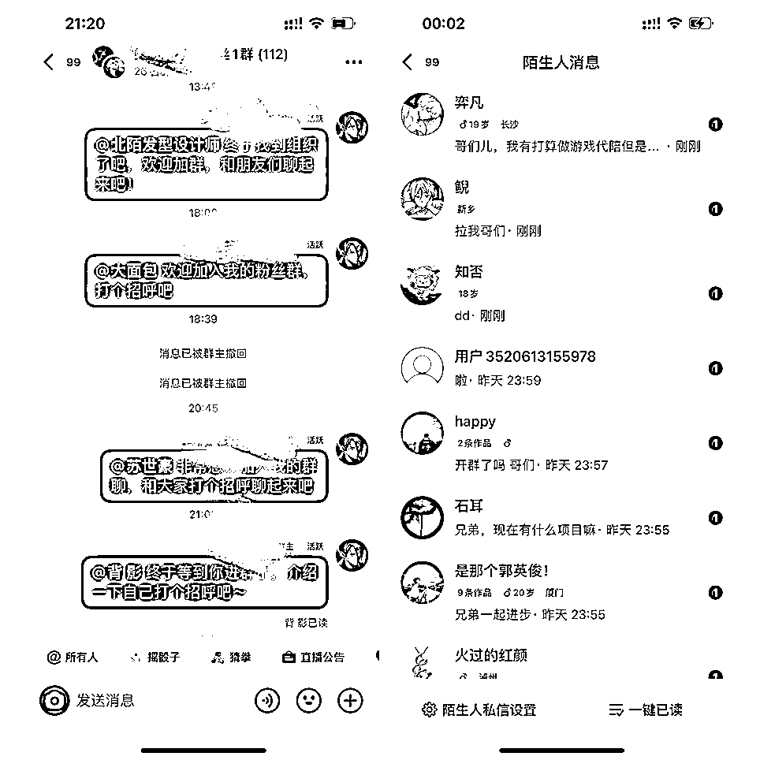

回完表情才能转卡片，然后正常操作。我一般每10秒以上转发一次卡片给对方。

如果碰上小爆，可以手动回复一下评论，但注意频率，免得被博主发现举报。我一般会写“后台踢下我”“踢一下我”，懂的人自然来私信你，看不懂的进来了也没啥用。加上好友以后，该干嘛干嘛，最好附带一个交流群，人家要啥就给啥，顺着人性来。只要把一个号养好了，真的可以为所欲为，而且不需要啥时间成本——最大的成本就是回私信哈哈哈。

# 卡片咋做？

市面上工具挺多的，像天天外链、微客外链这些。我一般用微客，因为它没有明显短板，能用就行。关键是它是官方小程序，系统检测不到。万一跳第三方外链被系统更新了链接，直接复制新链接出来就行。

微客外链地址：https://weikelink.com/

新用户免费送24小时内100次跳转权限，号多的圈友可以使劲薅。

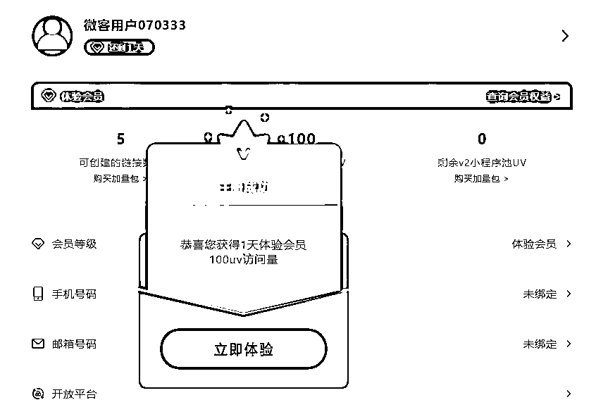

操作路径：功能 → 跳入微信 → 个人微信号 → 立即创建。

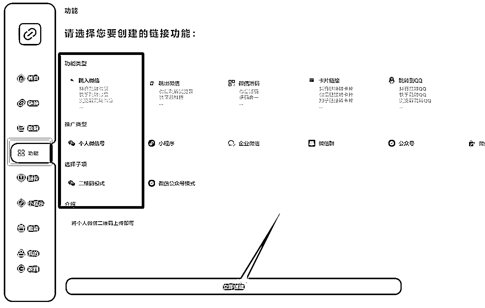

名称和介绍按自己需求填，上传二维码。

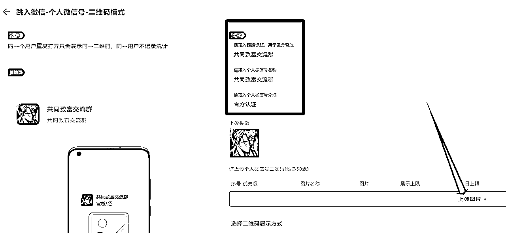

开启链接卡片配置，然后立刻生成。

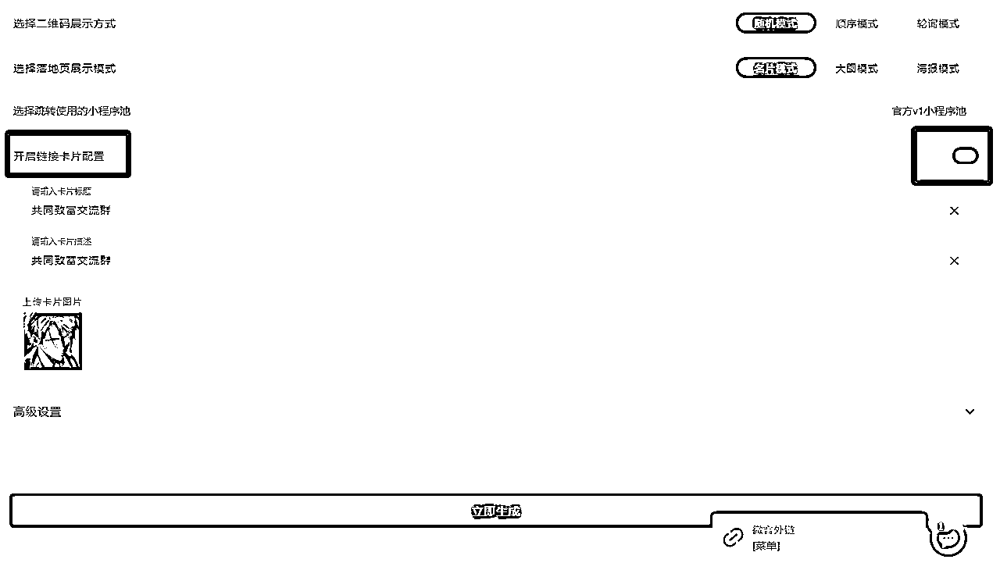

复制链接到抖音发给自己小号。

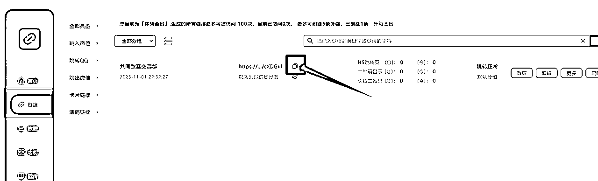

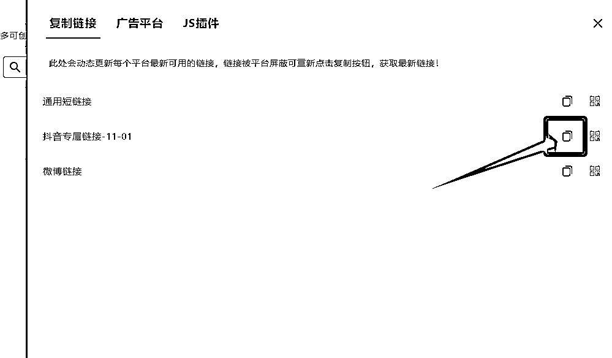

点进链接，确认能不能正常跳转微信。然后返回抖音，点右上角再次分享给小号，这时候就变成一个正常的卡片了。

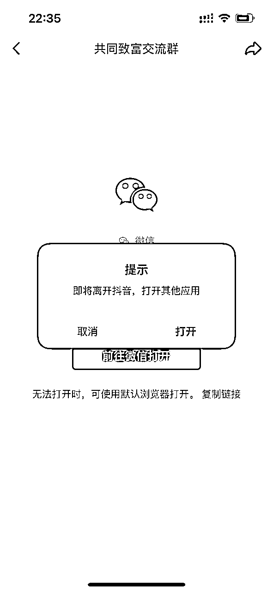

我的分享就到这儿。希望能给正在这条路上摸索的朋友一点启发，如果这些内容对你有实在帮助，那是我的荣幸。分享本来就是互相学习的过程，大家一起交流、一起成长。越分享越幸运。我是可乐，欢迎多多链接我，祝各位在搞钱这条路上，越走越稳，做大做强。