# 小红书无人直播新打法实战复盘：7天单号GMV破2万的完整路径

> 来源：[https://e102r8ejz5v.feishu.cn/docx/OYpUds3R1oOxIXxri1McOX5gnIb](https://e102r8ejz5v.feishu.cn/docx/OYpUds3R1oOxIXxri1McOX5gnIb)

非常感谢书豪对无人直播思路的拆解。在小红书11月严打搬运混剪、无货源笔记几乎拿不到流量的环境下，这个玩法给了新方向。照着操作一周，单账号单款GMV就过了2万。虽然距离书豪的25万差距明显，但模式跑通后，只靠扩机器和扩号就能放大。目前我已经加了第二台设备、第二账号在测试。

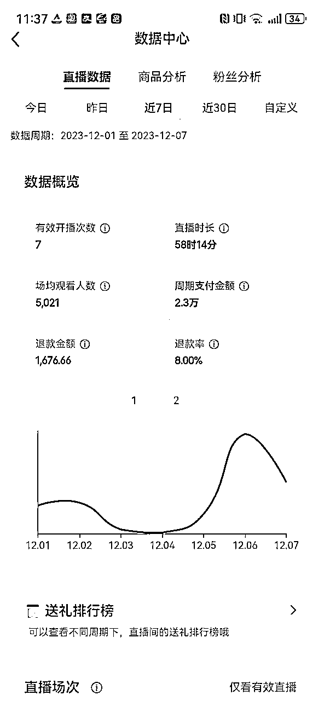

下面结合我这7天起号的真实经历，把踩过的坑、解决办法和操作要点一次性说清楚。

# 启动前准备

## 先把小红书店铺搭好

初期建议从一个号起步，可以用个人店，也可以是关联的个体店。核心是有店铺、有商品上架，直播间才能挂链。不会开店上品的可以去看航海手册，里面有标准流程。

## 电脑配置要够用

电脑不用顶配，但别卡顿。无需外接耳麦、音响、摄像头。MAC目前不推荐，找不到兼容的录制软件和OBS，虚拟机或双系统推流会卡。

## 三件核心工具

### 1. 抓取直播素材

抓取工具很多，我用的是江湖工具箱

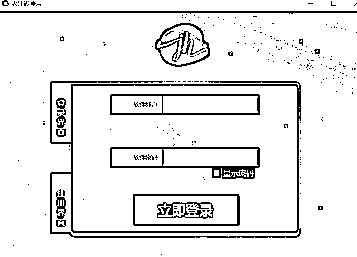

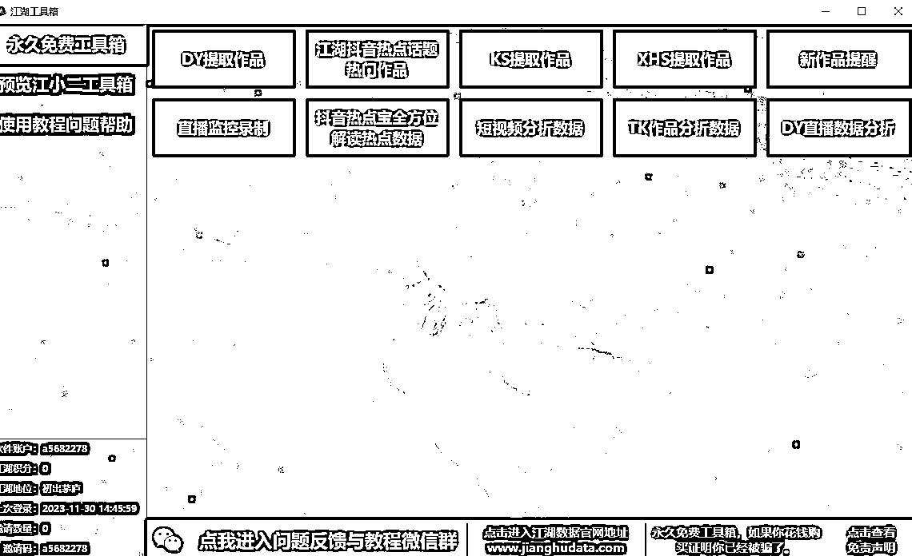

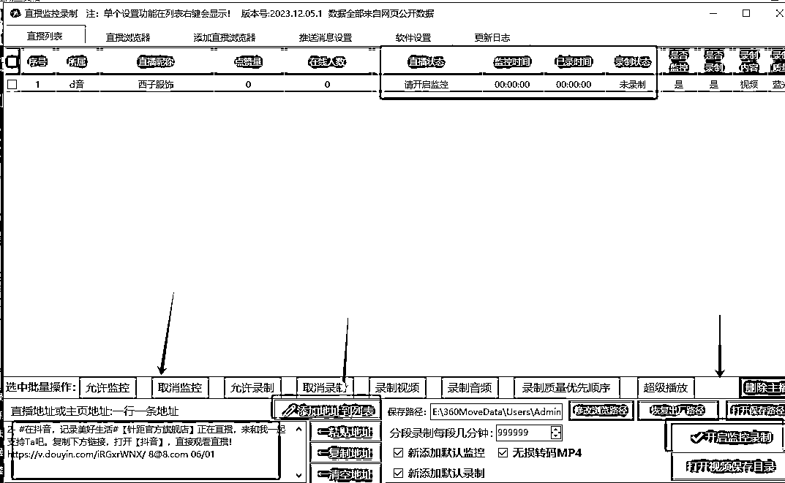

使用方式：注册登录后，把要录的直播间链接粘贴到左下角，加到列表开启监控录制。提前设定好保存路径，录完视频会自动落到文件夹里。

使用注意：
1、建议每次录3小时左右的片段，不必从头到尾，中间截取即可。3小时循环播放不容易被认出，时长太短容易被举报录播。
2、录制是后台进行的，不占电脑性能。直播时可以同时录多个房间的素材。

### 2. OBS推流

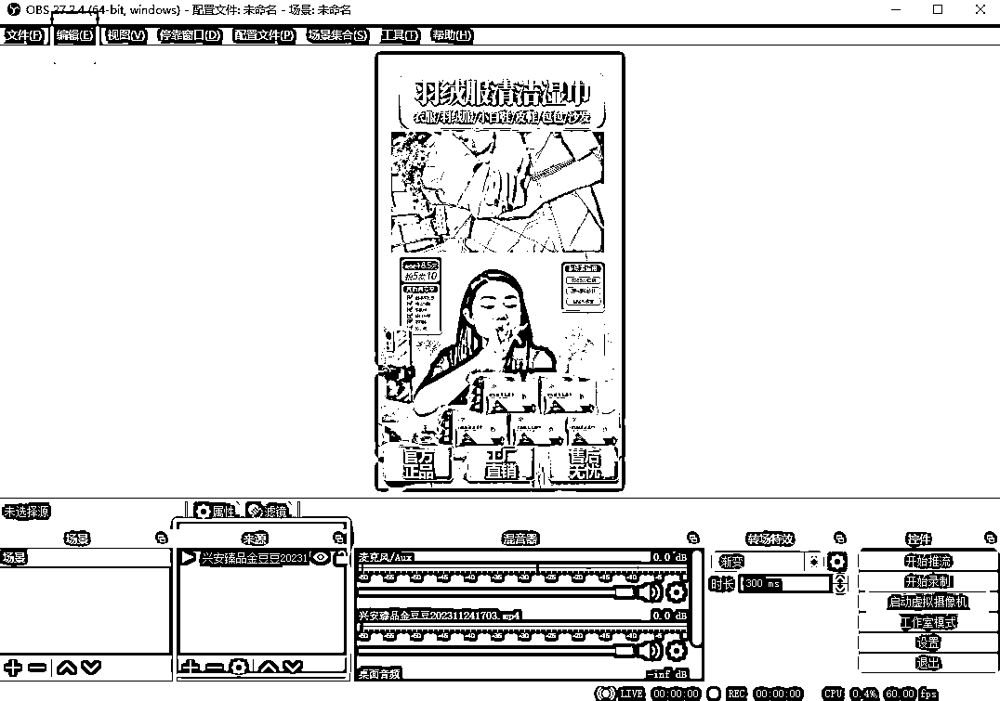

把录好的视频拖进OBS，启动虚拟摄像头，就能把画面推给直播平台。

注意事项：
1、把视频源加进OBS后，进编辑-高级音频属性，给媒体源开启监听并输出，否则没声音。
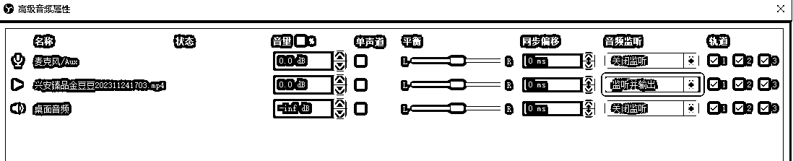
2、在设置-视频里把分辨率手动填成1080*1920，竖屏比例是9:16，不是16:9，不然输出会是横屏。
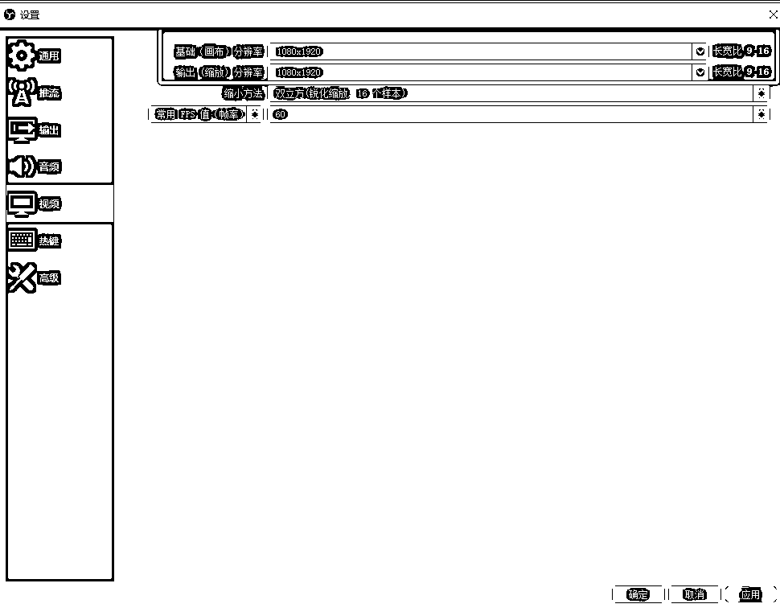

### 3. 小红书直播助手

官方PC直播工具，相当于抖音的直播伴侣。

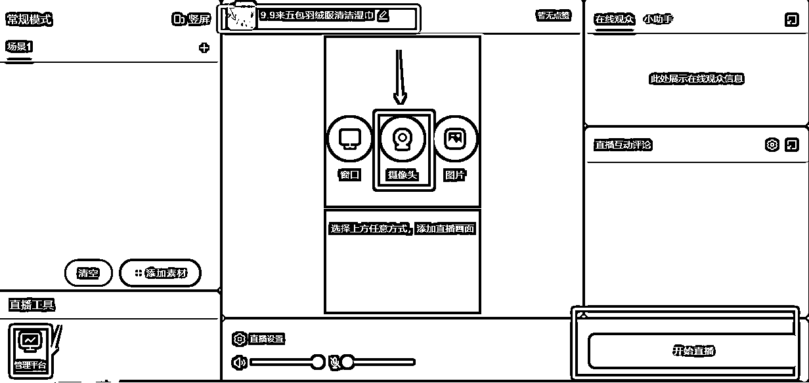

操作：点击摄像头添加OBS虚拟摄像头，就能同步画面。上方可改封面和标题，左下角是直播后台。

注意事项：
1、加好OBS摄像头后若没有1080*1920选项，先在OBS启动虚拟摄像机，再在直播助手刷新一次，分辨率就会出现。
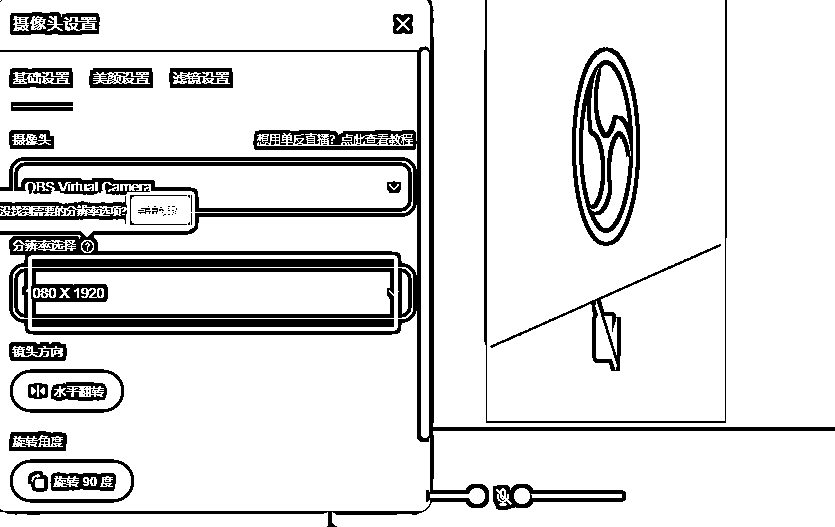
2、开播前先定好封面和标题，可参考同行。
3、开播后要去左下角管理平台上架商品。
4、上架完用小号进间检测：画面、声音、商品点击购买是否正常。

总结一下就是：录素材、播素材、官方直播。

# 选品思路

## 类目选择

直播广场目前跑得好的有女装、零食、百货。结合平台调性，女装最容易起量、起号。

## 选品方法

### 站内抄同行爆款 做参考别硬抄
看直播广场场观过万的间做参考。

优点：是已被验证能起量的品。
缺点：好素材容易撞车，多号用同个源会被判定多账号直播和录播，风险高。
解法：选爆款的平替款，或挑爆款冷门素材，主播粉丝少、销量低的间。

### 跨平台实时爆款迁移
工具：巨量百应、禅妈妈、考古加等。

优点：抖音快手已验证的实时爆款，放到小红书主播稀缺的环境是降维打击。
缺点：品类可能不匹配小红书人群。
解法：测品。每款播6小时，测3天，场观起来但转化不行就换。女装转化概率高，我第一单跑通就是用这套方法。

# 选素材

素材决定销量和账号寿命。

我的筛选标准：

## 基础门槛
画面干净，无花里胡哨贴片；非官方旗舰店、非品牌直播、非几十万粉大V；画面无平台水印；主播话术不频繁提及平台、点赞关注、小黄车、粉丝牌等。

## 我的偏好
1、不选多链接多品的间。无人直播不可控，弹幕要讲解其他链接没人回；也要避免找货源麻烦。
2、价格不能太低，要能找到利润率30%以上的货源。
3、偏暖色调直播间，主播颜值高，曝光、点击、停留都会更好。

# 开播执行

选好品、录好素材、备好货源、上架后即可开播。打开直播助手，设置标题封面后上线。

注意事项：
1、开播同时挂车，去直播管理平台实时跟播添加商品。
2、封面被提示违规要立刻换。
3、别频繁开播下播，会影响推流。

必须做：
1、开播后用小号自检，画面声画、商品链接是否正常。
2、设置直播间屏蔽词：录播、录像、直播、假等，降低负面节奏。

# 起号加速度

## 拉时长+优化封面

新号前两天没流量很正常，账号无标签。需要用时长换官方冷启动扶持。

官方扶持的两个隐形标准：
1、连续播3天，单场30分钟以上
2、封面点击率>4%

时长和优质封面能让账号更快破冰。

## 完成官方任务拿曝光翻倍

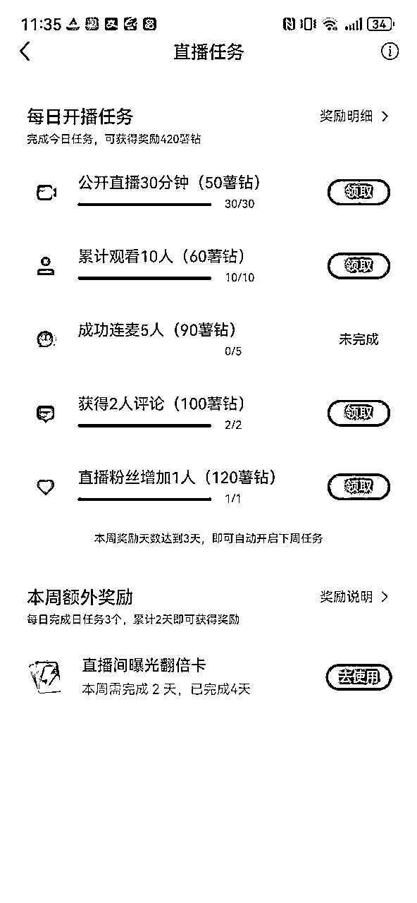
小红书对直播扶持力度大，完成官方任务可领曝光翻倍卡，起号更快。

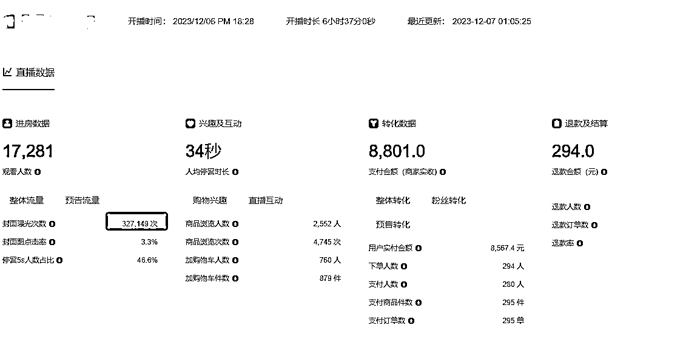
6号拿到翻倍卡那场数据：单场播6小时，曝光32万，场观1.7万。

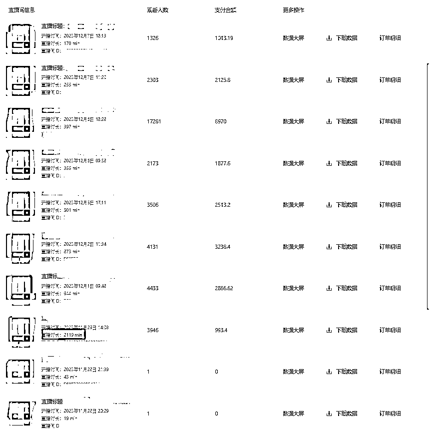
我从开播到7号的场次走势，29号累计开播35小时，场观拉到4000，开始出单，后面人流和转化就稳定了。所以前两场零流量也要坚持播第三场。

# 流量逻辑

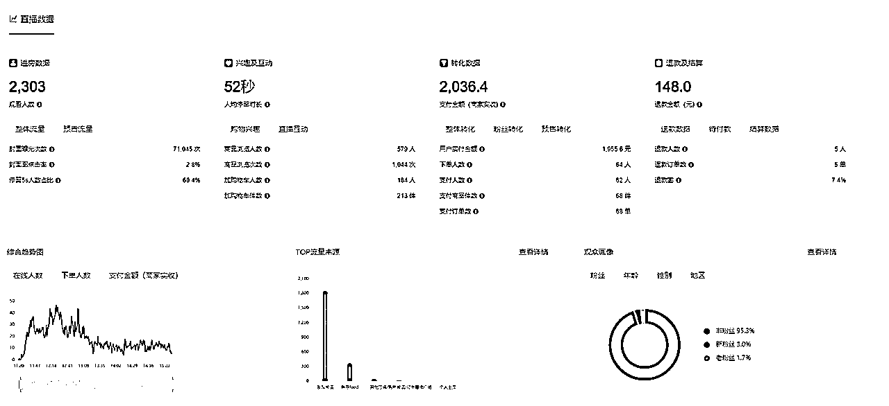
小红书直播后台很简洁，比抖音、视频号简单很多，没有复杂的漏斗、CPM、GPM，核心就是告诉你看封面。

## 封面即流量入口
抖音靠短视频和直播画面推流，小红书靠笔记入口和直播封面。在不发笔记的情况下，流量几乎全靠封面。发现页就是看封面，封面点击率过4%，平台会持续推人。

## 标签养成
新号无标签。可通过发垂类笔记或付费投流打标签，但太慢，不适合无人打法。

更实际的做法是：在封面OK的前提下，用时长换泛流量。初期流量不精准，但随着时长增加，平台会根据下单人群画像继续推相似人群，人群就会越来越准。

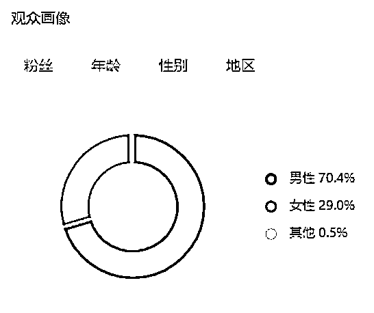

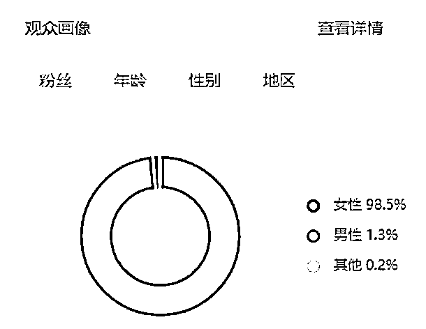
同一个账号女装的前后对比。刚开始70%观众是男性，明显不准；随着时长和销量提升，人群回到女性为主，转化率同步提升。

总结：前期靠封面拿泛流量，再靠购买人群画像把流量收敛，时长越长、销量越高、标签越准。

# 最后复盘

以上就是整个操盘框架、坑点和优化细节。再次感谢书豪放出的红利思路。

书豪也提到过，这套打法不一定长做，但短期回报很快，还能复制放大。能赚长期的钱不代表不能赚短期的。即便模式后期难做，也能练出直播体感和经验。

我做过一年抖音直播运营，一个真人间基础配置就得5万+，绿幕灯光相机电脑加主播运营场控投手。无人直播用最低成本把全流程走一遍，自己就能承担运营、场控、主播、客服。以后转真人直播，直接把录播换成真人就行。

引用Eric老师一句话：能赚钱的时候，就要用力赚。

我是来自苏州的赚钱圈友小艾，有私域运营和抖音直播运营经验，目前自由职业，主要做视频号和小红书，欢迎交流！